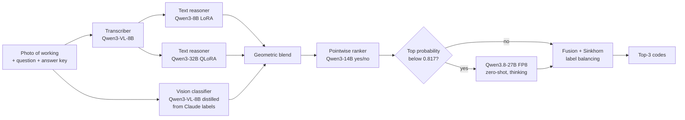

# Misconception detection in K-12 handwritten maths

A research and engineering project for the Kaggle competition *Misconception Detection in K-12 Student Math
Workings*. Given a photo of a student's handwritten working, the question (in Indonesian) and the answer key, the
system ranks three diagnoses from a taxonomy of 75 misconception codes plus `NONE`. The metric is MAP@3.

| | |
|---|---|
| **Best public score** | **0.76383 MAP@3**, about rank 65 of 481 teams (16 Nov 2026) |
| **Kaggle notebook** | [Method, runnable fusion code and negative results](https://www.kaggle.com/code/shivateja005/k12-misconceptions-method-code-negative-results) |
| **Licence** | [Apache 2.0](LICENSE) |
| **Starting point** | 0.48533 (CPU baseline on question and topic priors), first submission 0.58216 |
| **Experiments recorded** | more than 120, each with a pass mark written down before the run |
| **Final inference** | fully offline, open-weight models only (a competition rule) |
| **Compute** | Kaggle free GPUs, RunPod and Hugging Face Jobs, all under hard spending caps enforced in code |

Competition data, student photos, model weights and predictions are **not** in this repository (see
[Data and privacy](#data-and-privacy)).

---

## Public score over time

| Date (2026) | Public MAP@3 | What changed |
|---|---|---|
| 8 Nov | 0.58216 | Qwen3-VL-4B LoRA image classifier |
| 8 Nov | 0.59800 | Temperature-softened classifier mixed with a question/topic prior |
| 11 Nov | 0.62383 | Qwen3-VL-8B trained with teacher-transcription supervision, blended with the 4B model |
| 11 Nov | 0.66183 | **Read, then diagnose**: a vision transcriber feeds a fine-tuned Qwen3-8B text reasoner |
| 11 Nov | 0.68283 | Vision model distilled from Claude Opus labels on unlabelled photos (labels only; never test photos) |
| 11 Nov | 0.70850 | Three-model geometric ensemble with a Qwen3-32B QLoRA reasoner |
| 12 Nov | 0.71716 | Label-free Sinkhorn balancing of the predicted label mix |
| 13 Nov | 0.73183 | Fused with a Qwen3-14B pointwise yes/no ranker |
| 14 Nov | 0.76266 | Qwen3.8-27B with thinking, run only on the least-confident test photos |
| 15 Nov | **0.76383** | Same, with all 1,593 least-confident photos answered |

Full submission history with file checksums: [`reports/status.json`](reports/status.json).

---

## The system behind the best score



1. **Read, then diagnose.** A vision-language model transcribes the working; text models trained on those machine
   transcripts (not the teachers' typed ones, which do not exist at test time) diagnose the error. Splitting the job
   gave the largest single jump (+0.038 public).
2. **Distillation from a frontier model, within the rules.** Claude Opus labelled 26,202 photos from the
   unlabelled pool (training and unlabelled photos only, never test). Those labels trained an offline vision student.
3. **Ensemble and rerank.** Three classifiers are blended geometrically, then a Qwen3-14B model scores each
   (photo, candidate code) pair with a yes/no question.
4. **Spend compute where it matters.** A 27B reasoning model runs only on the 46% of test photos where the ensemble is
   unsure (top probability below a fixed threshold), so the costly model runs on under half the rows.
5. **Calibrate the label mix.** Sinkhorn iterations nudge the test predictions toward the training label distribution
   without using any test labels.

Detailed walk-through with diagrams: [`docs/study/K12_STUDY_GUIDE.md`](docs/study/K12_STUDY_GUIDE.md)
([PDF](docs/study/K12_STUDY_GUIDE.pdf)).

---

## How the work was run

**Evaluation discipline.** One fixed 301-row development fold, scored per row type (no error, seen
question-code pair, unseen pair). Fusion weights are cross-fitted by question, and every gain is reported with a
paired bootstrap interval over questions. Each paid run has a pass mark written before launch; a run that misses it is
not used, however close. Development has run 0.01–0.03 above the leaderboard, and the record shows why gains under
about +0.02 were not trusted.

**Budget guards in code.** [`scripts/launch_kaggle.py`](scripts/launch_kaggle.py) reads the live Kaggle GPU quota,
reserves the worst-case remaining time of every active job plus a margin, and refuses a launch that could break the
cap. [`scripts/runpod_pod.py`](scripts/runpod_pod.py) creates, watches and terminates cloud GPU pods against a spending
ledger. Ledgers: [`reports/gpu_budget.json`](reports/gpu_budget.json),
[`reports/runpod_budget.json`](reports/runpod_budget.json), [`reports/hf_budget.json`](reports/hf_budget.json),
[`reports/claude_budget.json`](reports/claude_budget.json).

**Three compute back-ends.** Kaggle notebooks (2x T4, offline, private), RunPod pods (RTX 6000 Ada, vLLM with FP8) and
Hugging Face Jobs (A100 80 GB, data in private buckets), each driven by scripts in this repository.

**Negative results are kept.** Some of what did not work, with the measured reason:

| Idea | Result on development | Why it failed |
|---|---|---|
| Fine-tuning Qwen3.8-27B with a classification layer | 0.658 vs 0.748 untrained | The layer reads the state before any reasoning happens |
| Same model fine-tuned, then asked to think | 0.599 | Training without thinking traces collapsed its reasoning (as arXiv 2605.21127 warns) |
| Qwen3.5-9B fine-tune on Kaggle T4s | 0.562 alone, −0.013 fused | Weak on unseen question–code pairs (0.26) |
| A 14B judge over the first model's candidates | 0.777 alone, −0.002 fused | Anchored on the first model's top code 87% of the time |
| Nearest-neighbour look-up of similar workings | −0.006 to −0.016 fused | Near-zero on unseen pairs (0.06) |

The complete table of experiments: [`docs/experiment_review_2026-11-14.md`](docs/experiment_review_2026-11-14.md).

---

## Repository map

```
src/k12/            Core library: data, folds, metric, models, training and inference
  core.py             data loading, question-grouped folds, MAP@3
  baseline.py         CPU baseline (question and topic priors)
  vision.py           Qwen3-VL LoRA classifier with an auxiliary correctness head
  transcriber.py      photo -> transcript
  pod_train.py        text reasoner training (LoRA / QLoRA)
  pointwise_ranker.py yes/no ranker over (photo, candidate code) pairs
  q38_finetune.py     Qwen3.8-27B fine-tune with a classification head
  blend.py, router.py, slices.py, exemplars.py, prompts.py   fusion, routing, row types, prompts
scripts/            Command-line tools: dataset builders, fusion, evaluation, launchers, budget guards
kaggle/             Offline Kaggle notebook bundles; `public-writeup/` is the public notebook
runs/               Job scripts for pods and HF Jobs, plus analysis code (outputs are not committed)
tests/              96 unit tests (folds, metric, prompts, routing, a submission reproduction check)
reports/            Measured results as JSON, spending ledgers, submission history
docs/               Plans, experiment review, study guide, research notes on eight papers
```

**Key documents**

| Document | What it holds |
|---|---|
| [`HANDOFF.md`](HANDOFF.md) | Current state and a dated log of every run, spend and submission |
| [`docs/experiment_review_2026-11-14.md`](docs/experiment_review_2026-11-14.md) | Every experiment in one table: what worked, what failed, why |
| [`docs/plan_to_085_2026-11-15.md`](docs/plan_to_085_2026-11-15.md) | The live plan, with stages, costs and pass marks |
| [`RESEARCH_SYNTHESIS_K12.md`](RESEARCH_SYNTHESIS_K12.md) | Eight research papers mapped to the measured bottlenecks |
| [`ARCHITECTURE_REFORM_2026.md`](ARCHITECTURE_REFORM_2026.md) | A redesign proposal reviewed by six independent critics |
| [`docs/study/`](docs/study/) | Study guide and research report with diagrams |
| [`docs/research_notes/`](docs/research_notes/) | Per-paper notes |
| [`AGENTS.md`](AGENTS.md) | The project's operating rules (spending, submissions, data handling) |
| [`docs/history/`](docs/history/) | Earlier README from the CPU and first vision phase |

---

## Getting started

```bash
git clone https://github.com/ShivaTeja05/kaggle-k-12.git
cd kaggle-k-12
python3.12 -m venv .venv && source .venv/bin/activate
pip install -r requirements-cpu-lock.txt
PYTHONPATH=src python -m unittest discover -s tests
```

The competition files come from Kaggle under your own account; see
[`docs/workspace_setup.md`](docs/workspace_setup.md). GPU dependencies are in `requirements-gpu.txt`.

Reproduce the CPU baseline once the data is in `data/raw`:

```bash
PYTHONPATH=src python -m k12.baseline
```

---

## Data and privacy

- Competition data, student photos and their transcriptions are never committed (`.gitignore` covers `data/`,
  `artifacts/`, `runs/` outputs and all table, array and weight formats).
- No credentials are stored in the repository. API keys and tokens live in each tool's own credential store.
- Test photos were only processed by open models on our own machines and private jobs, never by an outside API.
- Third-party research PDFs are not redistributed; the notes in `docs/research_notes/` summarise them.

## Licence

The code and documents in this repository are released under the [Apache License 2.0](LICENSE). The competition data is
not part of the repository and stays under the competition's own terms (competition use only).

## Tech stack

Python, PyTorch, Hugging Face Transformers and PEFT (LoRA, QLoRA), vLLM, scikit-learn, NumPy and pandas;
Qwen3-VL, Qwen3, Qwen3.5 and Qwen3.8 open-weight models; Kaggle, RunPod and Hugging Face Jobs for GPUs.
