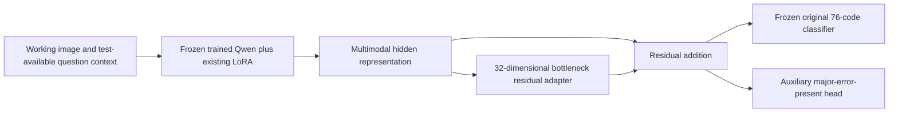

# Qwen adaptation experiment, 8 November 2026

The submitted Qwen3-VL-4B model is already fine-tuned with rank-16 LoRA in its language attention and MLP projections. Its image encoder and visual merger remain frozen. It achieved 0.59524 MAP@3 on 301 development examples and initially 0.58216 on the public leaderboard. A CPU-calibrated blend subsequently scored 0.59800 publicly. These results remain below the 0.82 target.

## What the evidence suggests

The trained classifier has 17.82% false alarms on NONE and misses 11.5% of error rows as NONE. Its singleton-code MAP@3 is zero on five development rows; classes with 2–5 total examples score 0.16667 on six rows. Grade 10 scores 0.41429 on 35 rows. These are small slices. They motivate testing rare-class training and adaptation, not an assumption that adding depth will solve the task.

The 9B code-only model scored 0.45515 on the complete development fold and predicted NONE first on 53.5% of actual error examples. Its 48-row evidence pilot scored 0.55903, but that sample is too small and the output format differs. Neither is a reliable pseudo-label teacher at this point.

Oracle diagnostic bounds make the target's scale clearer: fixing every row from classes with at most five total examples, while leaving other predictions unchanged, would yield only 0.62846. Perfectly fixing all classes with at most 20 examples would yield 0.73643. These are hypothetical bounds, not model results. Reaching 0.82 requires improving common-class reading and reasoning as well.

## Experiment implemented

The new adapter is between Qwen's final multimodal representation and its classifier. It is an output adaptation layer; it is **not** AdaLoRA or a new transformer block. The up-projection starts at zero, so the original predictions are preserved before training. The original Qwen, its trained LoRA, and root classifier are frozen in this arm. An auxiliary loss predicts whether the gold root is NONE, which differs from final-answer correctness. No hard rule forces a correct final answer to NONE.

A control refits the original linear classifier on exactly the same frozen representations. Both arms use the same fitting labels, fixed training schedule, mild effective-number class weighting and a fixed seed. Class weighting is tempered and capped because MAP@3 is an empirical-frequency metric, not macro accuracy. Neither arm receives validation labels during training. CPU training follows a single GPU pass to cache fitting and validation representations.

The feature job verifies checkpoint/data/class fingerprints, exact fitting/held-out IDs, batched versus single-image predictions and reproduction of the existing frozen baseline. Tests check that initialization preserves predictions, learning changes the adapter while preserving frozen root weights, saved weights reload correctly, and rare-class weights are bounded. All 14 project tests passed before launch.

The predeclared screening rule is a development improvement of at least 0.01 over the same cached baseline before considering test inference. An adapter-specific benefit also requires beating the linear control. This development fold has already been used for epoch and prompt selection; it is not an untouched audit, and any small gain requires further confirmation.

## Other internal changes worth considering

| Change | Rationale | Current decision |
|---|---|---|
| Train visual-merger adapters or late vision layers | Could improve handwriting/sign recognition when the correct evidence never reaches the language representation. | Requires image-reading error evidence and a separate controlled training run. Not launched. |
| Transcription and root-rationale supervision | Train on the supplied teacher transcriptions/explanations as targets, with only image/question context as inputs. Could teach reading and root-versus-consequence distinctions. | Stronger next training objective; no claim of measured gain. Do not use gold transcripts at test time. |
| AdaLoRA or DoRA | Established alternatives for allocating low-rank capacity or adapting weight magnitude/direction. | Not interchangeable switches for the already trained adapter. Need compatible training and a matched control. Not launched. |
| QLoRA on a larger backbone | Reduces weight memory, allowing gradients into low-rank adapters on a larger model. | Memory savings do not remove training time, activation memory or the 10-hour limit. Not launched. |
| Organizer's unlabelled examples with pseudo-labels | Adds data from the actual handwriting domain. | Use only after a teacher demonstrates sufficient held-out quality. Preserve teacher confidence and prevent validation/test leakage. Do not amplify the failed 9B teacher's biases. |

An output adapter cannot recover a sign or digit that the frozen representation did not encode. It also cannot learn the meaning of a completely unseen label from zero examples merely by increasing its rank. Those problems call for reading supervision, taxonomy-aware supervision, or verified additional training data.

## Budget

Only free Kaggle GPUs are used. The feature extraction job launched at 12:03 UTC with an 18-minute maximum. Admission counted 6.17 hours already used, the entire remaining maximum of the active 27B job, overhead and safety margin: 9.92 hours projected total. Every subsequent GPU launch must pass `scripts/launch_kaggle.py`. Training small heads locally uses no Kaggle quota.

The initial feature pass reached that timeout after saving the complete validation cache and processing 1,120 fitting rows. Its in-memory fitting array was not yet complete, so it was not used for training. A fitting-only retry launched at 12:25 UTC with a 25-minute maximum and periodic partial-cache saves. Its budget admission projected 7.3767 hours total. The saved validation cache is reused, after checking checkpoint/head identity.

The original 27B run loaded successfully but failed to compile its bounded evidence regex. It was stopped through Kaggle's active-events controls and the API confirmed cancellation. A CPU-only job then compiled the replacement compact EBNF with the actual 248,320-token tokenizer in 0.0449 seconds. A separate, gated 27B retry launched at 12:28 UTC with a 140-minute maximum, conditional test inference and a worst-case task budget of 9.85 hours including the fitting-cache job. These are execution fixes, not evidence of better predictions.

## Open training data

The first adaptation test uses only organizer-provided labelled records. The provided 50,000 unlabelled workings are a closer domain match than general expression-recognition datasets, but reliable pseudo-labels and teacher/fold separation are prerequisites. For example, [MathWriting's official README](https://github.com/google-research/google-research/blob/master/mathwriting/README.md) specifies CC BY-NC-SA 4.0 for its data; it was not added to training. External datasets need task relevance and their own licence/access checks rather than an assumption that public download means unrestricted competition use.

## Primary references

- [LoRA paper](https://arxiv.org/abs/2106.09685) and [official PEFT documentation](https://huggingface.co/docs/peft/en/package_reference/lora).
- [Parameter-Efficient Transfer Learning for NLP](https://arxiv.org/abs/1902.00751), the bottleneck adapter precedent. The present output adapter is an engineering experiment, not a reproduction of that paper's transformer-layer architecture.
- [AdaLoRA paper](https://arxiv.org/abs/2303.10512) and [authors' implementation](https://github.com/QingruZhang/AdaLoRA).
- [DoRA paper](https://arxiv.org/abs/2402.09353).
- [QLoRA paper](https://arxiv.org/abs/2305.14314).
- [Class-balanced loss paper](https://arxiv.org/abs/1901.05555). The implementation uses tempered, capped weights rather than claiming to reproduce the full experimental recipe.
- [Official Qwen3-VL repository and training code](https://github.com/QwenLM/Qwen3-VL) and [Transformers model documentation](https://huggingface.co/docs/transformers/model_doc/qwen3_vl).

Current execution and measured results are recorded in `reports/status.json`; an unmeasured candidate is never reported as an improvement.

## Measured outcome

All 1,199 fitting representations and 301 validation representations were retrieved and checked. The original and fitting-only jobs used identical encoder/split source, identical checkpoint/data hashes and exactly equal frozen classifier weights. The cached baseline is 0.59801; its small difference from the submitted classifier's 0.59524 is due to the batched numerical path. Every adaptation is compared against the same cached baseline.

| Model | Fitting MAP@3 | Development MAP@3 | Delta to cached baseline |
|---|---:|---:|---:|
| Frozen original classifier | 0.86350 | 0.59801 | — |
| Refit linear classifier | 0.93300 | 0.59025 | −0.00775 |
| Rank-32 residual adapter | 0.95969 | 0.57032 | −0.02769 |
| Conservative rank-8 adapter | 0.86920 | 0.59911 | +0.00111 |

The first adapter increased the fitting/development gap: it learned the fitting examples more closely while predicting held-out examples worse. That is evidence of overfitting, not evidence that more layers solve the task. The linear control also failed to improve.

After observing that failure, a second exploratory CPU recipe reduced rank to eight, trained for only 40 steps, removed class reweighting, increased residual anchoring and dropout, penalized drift from the original classifier with KL divergence, and bounded each logit change to ±0.5. This approximately restored baseline performance. Its question-bootstrap 95% interval for the change is **[−0.00748, +0.01045]**, excluding model-selection uncertainty. It is not a reliable gain and misses the predeclared +0.01 screening margin. **No output adapter is promoted or submitted.**

The conservative head has 43,521 trainable parameters. The rank-32 head has 166,401; the linear control has 197,197. All small-head fitting ran locally on CPU after the feature passes. Seventeen tests passed, including saved-model replay, fitting/validation separation and bounded-logit behavior. Detailed outcomes are in `reports/adaptation_comparison.json`.

The next internal fine-tuning experiment changes the supervision: jointly supervise the existing internal LoRA with image reading and supplied root-cause explanations. Teacher transcriptions/explanations are targets only; the classifier reads the causal context representation before any teacher response. Inputs at validation/test remain the image and test-available question context. Visual-merger adaptation is a separate controlled option if reading errors persist.

## Reading-supervision execution

Single-device and two-device smoke runs completed. The two-device run trained 16 examples for two global optimizer updates, saved a checkpoint, and predicted four validation and four test examples. Peak memory was 10.12 GB per reported training log. The actual-model prefix isolation check found a maximum class-probability change of 0.000773 when teacher tokens were appended; the classifier always reads the preceding causal prefix. The four-row smoke score is not quality evidence. Twenty contract tests passed.

The full two-T4 run launched at 16:19 UTC, then was cancelled while queued at approximately 16:26 UTC. An unrelated "Gemma 4 K3 Timing" GPU job was consuming account quota outside the project registry. The user chose to leave it running and continue K-12 on CPU. The full reading recipe has no measured development result. Its prepared configuration resumes the same 1,199 fitting rows for one additional epoch, with classification loss plus 0.15 times the response-token loss. Response targets alternate teacher transcription and annotated root explanation. LoRA learning rate is 2e-5; head learning rate is 1e-4; the global effective batch is eight. No new train examples, public/test labels or paid APIs are used. Validation is the same previously reused 301 rows, so selection uncertainty remains.

The prepared quality gate compares raw validation with the previously selected fixed calibration (temperature 2, prior weight 0.25). The better development variant must reach 0.615 before test inference. A separate runtime forecast must fit the 3,500-second internal budget; the outer Kaggle timeout was 3,900 seconds. Initial admission read 8.55 quota hours used and projected 9.98333 total including overhead and safety margin, but missed the unrelated active job. The launcher now discovers recent account-wide active jobs and refuses unregistered concurrency. A read-only preflight verified rejection of the Gemma job; 21 tests passed. Further GPU launches are disabled under the user's latest CPU-only instruction.

The completed 27B model scored 0.58970 on the same validation fold and was rejected by its 0.65 gate. It needed 2,171 seconds for 301 images. Even a hypothetical gold-informed choice of the better existing 4B or 27B ranking for every validation row would score only 0.74363. That is a diagnostic bound for a two-model selector, not an ensemble result or a general upper bound. Forty-four rows were outside both models' top three. New reading/reasoning capability is needed to close the gap.
