# K-12 Misconception Detection: Architecture & Code Study Guide

_Generated 12 Nov 2026 from the repository code and reports. Every section was fact-checked against the code._

## Contents

1. [The problem, the data and the metric](#01-problem-data)
2. [Stage 1: the transcriber (photo to text)](#02-transcriber)
3. [Stage 2a: the text reasoners (Qwen3-8B and Qwen3-32B)](#03-text-reasoner)
4. [Stage 2b: the image classifier (Qwen3-VL-8B distilled from Claude)](#04-vision-classifier)
5. [The teacher: Claude Opus labels and distillation data](#05-teacher)
6. [Stage 3: combining the models (blend, balancing, evaluation)](#06-ensemble)
7. [Stage 4 (new): the candidate-aware student](#07-candidate-student)
8. [Infrastructure: pods, budgets, safety and submissions](#08-infrastructure)
9. [Experiment history and lessons learned](#09-history-lessons)

## How to use this guide

This guide covers the whole K-12 misconception project: the data, every model, the glue code, the money and safety rails, and what we learned. Each chapter has the same layout:

1. **In one paragraph**: the idea in plain words.
2. **Concepts first**: every new technique, explained before it is used.
3. **How our code does it**: `file:line` references and short excerpts.
4. **Real numbers**: taken from `reports/`, `runs/arch/PLAN.md`, `runs/research/*.md` and `docs/handoff.md`. "Not measured" means exactly that.
5. **Key files**, **Things to try yourself** (CPU-only exercises), and **Common confusions**.

Each chapter has one detailed diagram plus one to three zoom-in diagrams. The two diagrams in this opening show the whole system. Look at them first, then come back to them after each chapter.

### Suggested reading order

| Order | Chapter | Why at this point | Time (reading / with exercises) |
|---|---|---|---|
| 0 | This opening: whole system, glossary, repo map | Gives you the map; you will return to it | 20 min / 30 min |
| 1 | **The problem, the data and the metric** (`01-problem-data`) | Everything else is scored with MAP@3 on the 301-row dev fold, so learn those first | 45 min / 1.5 h |
| 2 | **Stage 1: the transcriber** (`02-transcriber`) | Introduces VLMs, LoRA and next-token loss on the simplest model | 1 h / 2 h |
| 3 | **Stage 2a: the text reasoners** (`03-text-reasoner`) | The same LoRA ideas plus QLoRA, a classification head and soft labels | 1 h / 2 h |
| 4 | **Stage 2b: the image classifier** (`04-vision-classifier`) | Combines the two previous chapters: an image model with a head and a reading loss | 1 h / 2 h |
| 5 | **The teacher: Claude labels and distillation data** (`05-teacher`) | Explains where the soft rows used in chapters 3 and 4 come from | 45 min / 1.5 h |
| 6 | **Stage 3: combining the models** (`06-ensemble`) | Geometric blend, Sinkhorn, cross-fitting and bootstrap CIs: the "honest evaluation" toolkit | 1 h / 2 h |
| 7 | **Stage 4: the candidate-aware student** (`07-candidate-student`) | The newest design, built to close the gap the earlier chapters measure | 1 h / 2 h |
| 8 | **Infrastructure: pods, budgets, safety, submissions** (`08-infrastructure`) | How the GPU work is run safely and how a CSV reaches Kaggle | 45 min / 1 h |
| 9 | **Experiment history and lessons learned** (`09-history-lessons`) | Ties everything together. Read it last, or read it first as a story and again at the end | 45 min / 1 h |

The full guide takes about **8 hours to read** and **about 15 hours with all the exercises**. These are rough estimates.

**Shortcuts:**
- **Only one evening?** Read this opening, chapter 1 sections 7–8 (metric and bundles), chapter 6 sections 3–4 (blend and Sinkhorn), and chapter 9 sections 4 and 6 (gap analysis and lessons).
- **Want to modify a model?** Read chapters 2–4 in order. They share `src/k12/vision.py` and the same LoRA/loss patterns, so each chapter makes the next one faster to read.
- **About to spend money or submit?** Read chapter 8 first, then `AGENTS.md`.

**How to run the exercises:** run everything from the repo root, usually as `PYTHONPATH=src .venv/bin/python`. All exercises read local files only. None touches a pod, an API or Kaggle. Some print aggregates computed from private competition data, so keep that output on your machine.

---

## The whole system on one page

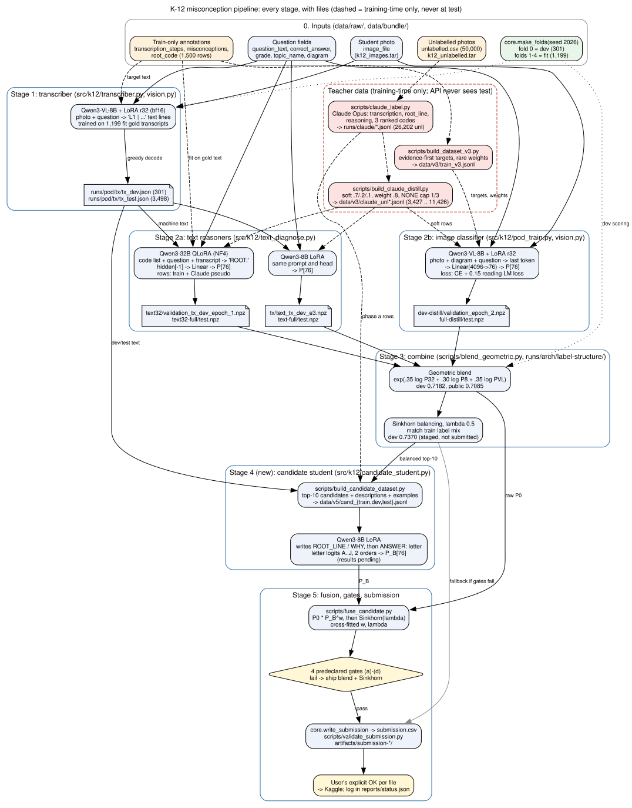

**The task.** Each row is a photo of a student's handwritten maths working plus the question fields: text, optional diagram, answer key, grade and topic. We must rank the 3 most likely *root misconception* codes out of 76 classes (75 taxonomy codes plus `NONE`). We have 1,500 labelled training rows, 3,498 test rows and 50,000 unlabelled photos. The score is **MAP@3**: 1 point for a correct first guess, 1/2 for second, 1/3 for third. All development numbers come from one held-out split: **fold 0, 301 rows** of `core.make_folds(seed 2026)`.

**The pipeline, left to right:**

1. **Stage 1, the transcriber** (`src/k12/transcriber.py`). A Qwen3-VL-8B with LoRA reads the photo and writes the working as numbered text lines (`L1 | ...`). It learned this from the human transcriptions in `train.csv`. Its outputs are `runs/pod/tx/tx_dev.json` and `tx_test.json`. Reading quality: median normalised character error 0.095, number recall 0.88. A *perfect* reader would add only about +0.015 to +0.022 to the ensemble.
2. **Stage 2a, the text reasoners** (`src/k12/text_diagnose.py`). Qwen3-8B (LoRA) and Qwen3-32B (QLoRA) each read a prompt: the code list, the question, the answer key and the machine transcript, ending in `ROOT:`. A linear head on the last token's hidden state gives a 76-way probability vector. Dev MAP@3 on machine text: **0.6667** (8B) and **0.6523** (32B).
3. **Stage 2b, the image classifier** (`src/k12/pod_train.py`). A Qwen3-VL-8B looks at the photo directly. It has the same kind of head plus an extra "reading" language-model loss during training. It was trained on real rows plus 3,427 Claude-labelled unlabelled photos. Dev MAP@3 **0.6528**.
4. **Teacher data, training time only** (dashed in the diagram). Claude Opus labelled *training and unlabelled* photos, never test photos (`scripts/claude_label.py`). It scores 0.8189 on dev, so it is a strong teacher. Its answers become soft-labelled training rows (`scripts/build_claude_distill.py`: shares .7/.2/.1, weight 0.8, NONE capped at one third). The project spent $186.61 on the main key and $25.33 on a second key.
5. **Stage 3, combining** (`scripts/blend_geometric.py`). A **geometric blend** (.35 / .30 / .35) of the three models scores dev **0.7182** (0.706 when the weights are cross-fitted) and public **0.7085**. This is the best score submitted so far. **Sinkhorn balancing** at λ = 0.5 then nudges the predicted label mix toward the training mix. It reaches dev **0.7370** (+0.019, CI [+0.006, +0.033]). The balanced CSV is staged, not submitted.
6. **Stage 4 (new), the candidate-aware student** (`src/k12/candidate_student.py`). A Qwen3-8B LoRA sees only the balanced blend's top 10 codes, each with a description and same-question examples. It writes a short diagnosis first, then answers with a letter, and the letter probabilities become a 76-way bundle. Its purpose is to fix the main weakness found in `runs/arch/PLAN.md`: 84 dev rows where the student made an error *new for that question*. On those rows the blend scores 0.431 and Claude 0.712, and they hold about 78% of the gap. **Results are pending.**
7. **Stage 5, fusion, gates and submission** (`scripts/fuse_candidate.py`). The fused model is `P0 · P_B^w`, followed by Sinkhorn, with w and λ cross-fitted. It must pass four gates that were declared before the run. If any gate fails, we ship blend + Sinkhorn instead. `core.write_submission` writes the CSV and `scripts/validate_submission.py` checks it. Then **the user must explicitly approve that specific file** before it goes to Kaggle. The result is logged with its SHA-256 in `reports/status.json`.

**Everything is passed around as "bundles"**: `.npz` files with `ids`, `classes`, `p` (N × 76) and `meta`, written by `core.save_bundle` and read by `core.aligned_bundle`. `aligned_bundle` refuses any file whose ids or classes do not match. That one convention is what lets models trained by different scripts be blended safely.

**Where the time and money run.** GPU training runs on rented RunPod pods ($80 cap). The pods receive data from the Mac over SSH and never receive credentials. Three kill switches protect the budget: a spend watchdog, a 3-hour dead-man heartbeat and per-pod cap timers. Kaggle is used only for CPU notebooks that bundle the photos, and for approved submissions.

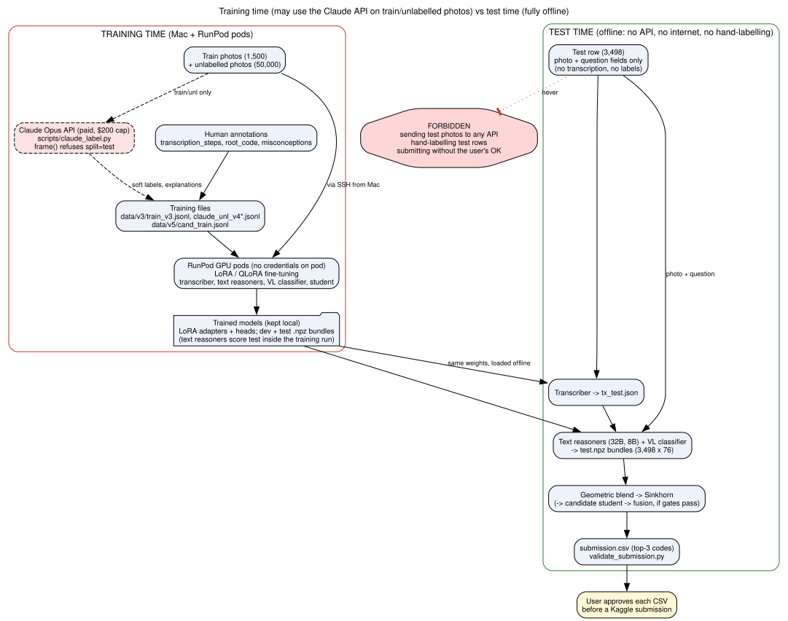

**What may touch an API, and what must not.**
- **Training time:** the Claude API may label train and unlabelled photos (`frame()` in `claude_label.py` raises an error for `split == 'test'`). Its labels, explanations and transcriptions become training targets.
- **Test time:** test rows go only through our own Qwen models, loaded offline: transcriber, reasoners, classifier, student. No API call, no internet, and no human looks at or labels test rows.
- **Submission:** never automatic. Every CSV needs the user's explicit OK.

**One honest sentence on where we stand.** The best public score is 0.7085. The plan's expected range by 17 November is about 0.72–0.74 public. Nothing measured so far supports 0.80 or more (chapter 9, section 7).

---

## Glossary

Terms are grouped by topic and listed alphabetically within each group. The first chapter that uses each term is given in brackets.

### Competition and data

- **Annotation / finding** [01]: one entry in a training row's `misconceptions` JSON, with `step`, `span`, `category`, `severity` (major or minor), `root` (true or false) and `text`. Test rows have none.
- **Clean** [01]: a train-only flag, true when annotators found no issue at all (449 rows). It is not the same as `NONE`: 57 NONE rows contain minor slips.
- **Dev fold / fit rows** [01]: fold 0 of `make_folds` (301 rows) is the development set that every model is scored on. Folds 1–4 (1,199 rows) are the "fit" rows the dev models are trained on.
- **Family** [01]: the prefix of a code before the dash (`EXP`, `FRA`, `CAL`, …), 35 in all including `NONE`. Different from **section**, the taxonomy column that groups families into 12 areas.
- **Label space** [01]: the 76 output classes, the 75 taxonomy ids plus `NONE` in alphabetical order (`core.label_space`). Every probability matrix uses this column order.
- **NONE** [01]: the label for "no major root error". It is the largest class (506 of 1,500 train rows).
- **Public / private leaderboard** [01]: Kaggle scores 1,000 test rows publicly and keeps 2,498 private for the final ranking.
- **Root code** [01]: the label. It is the category of the one finding marked `root: true`, the pedagogically central error, which need not be the first error.
- **Seen / new pair ("unseen pair")** [06, 07, 09]: a dev error row whose (question, code) pair did or did not occur in the fit rows. "New pair" rows (84) are where most of the gap to Claude sits.
- **Singleton** [01]: a code with exactly one training row (13 codes). If that row lands in dev, the dev model has never seen the class.
- **Taxonomy** [01]: `taxonomy_v1.csv`, the 75 misconception codes with name, description, nature, default severity, grade band and section.
- **Transcription (gold / machine)** [02]: a line-numbered text copy of the student's working (`L1 | ...`). "Gold" means written by a human (train only). "Machine" means produced by our transcriber (available for dev and test).
- **Unlabelled pool** [01]: 50,000 extra photos without labels, used for Claude labels and pseudo-labels.

### Metric and evaluation

- **AUC** [06]: the area under the ROC curve. It is the chance that a random positive is scored above a random negative (0.5 = coin flip, 1 = perfect). Here it measures NONE-vs-error separation (0.947).
- **Bootstrap** [01]: estimating uncertainty by resampling the evaluation rows with replacement many times (2,000–10,000) and recomputing the score each time. The middle 95% of the results is the confidence interval.
- **Confidence interval (CI)** [01]: a range that probably contains the true value. In this guide, if a gain's 95% CI excludes 0, the gain is probably real.
- **Cross-fitting** [01, 06]: choosing a setting (blend weight, λ) on some dev folds and scoring it on the held-out fold, then stitching the held-out pieces together. The score never comes from rows that chose the setting.
- **Cross-validation / folds** [01]: splitting data into K parts, training on K−1 and evaluating on the held-out one.
- **In-sample / optimism** [06, 09]: a score computed on the same rows used to choose settings. It is higher than the honest score; for the blend, 0.718 in-sample vs 0.706 cross-fitted.
- **MAP@3** [01]: mean average precision at 3. With one true code per row: 1, 1/2 or 1/3 if the truth is your 1st, 2nd or 3rd guess, else 0, averaged over rows (`core.map3`).
- **OOF (out-of-fold)** [01]: predictions for a row made by a model that did not train on that row.
- **Oracle** [05, 07]: a measurement that uses information unavailable at test time, such as Claude's dev answers. It is useful for diagnosis but can never be submitted.
- **Paired bootstrap** [01]: bootstrapping the per-row *difference* between two models scored on the same rows. Shared row difficulty cancels, so the CI for "A beats B" is tighter.
- **Predeclared gate** [07, 08]: a pass/fail threshold written down *before* seeing a result, so a weak result cannot be talked into a success.
- **Question-grouped bootstrap** [01]: resampling whole questions instead of rows, because rows of the same question are correlated. It gives more honest (usually wider) intervals.
- **Recall@k** [01]: the share of rows whose true code is anywhere in the top k. It sets the ceiling for any re-ranker of the top k.
- **Spearman correlation** [02]: a correlation between the ranks of two quantities. 1 means perfectly monotone, 0 means no relation.
- **Standard error** [01]: the typical size of random noise in an estimate. For a MAP@3 difference on 301 rows it is about 0.013.
- **Top-1 accuracy** [01]: the share of rows whose first guess is correct.

### Models and architecture

- **235B-A22B / mixture of experts** [09]: Qwen3-235B-A22B has 235B parameters, but only about 22B are active per token, because a router picks a few "expert" sub-networks per token.
- **Backbone / decoder** [02, 03]: the stack of transformer layers that turns tokens into hidden states, without the final vocabulary projection (`lm_head`).
- **bf16** [02]: a 16-bit float with the range of float32 but less precision. It halves memory and is used for frozen weights and fast matmuls.
- **Causal attention** [03]: each token can attend only to earlier tokens. So the hidden state at `ROOT:` cannot see text appended after it.
- **Classification head** [03, 04]: a single `nn.Linear(hidden_size → 76)` on one hidden vector. A softmax turns its outputs into probabilities. No text is generated.
- **Hidden state** [03]: the vector (4,096 numbers for 8B models, 5,120 for 32B) that the model computes at each token position, summarising everything up to that point.
- **Image tokens / patches** [02, 04]: a vision tower cuts the image into 16×16-pixel patches and merges 2×2 neighbours. In Qwen3-VL one visual token therefore covers 32×32 pixels.
- **LoRA (Low-Rank Adaptation)** [02]: freeze a big weight matrix W and train a small correction B·A of rank r (32 here) beside it. The layer computes `Wx + (alpha/r)·BAx`. Only about 1% of the parameters train.
- **lm_head** [02]: the final matrix that maps a hidden state to a score for every vocabulary token (about 152k) for next-token prediction.
- **NF4 / 4-bit quantisation** [03]: storing frozen weights in a 4-bit "NormalFloat" format, which suits normally distributed weights. "Double quantisation" also compresses the scale factors.
- **QLoRA** [03]: LoRA on top of a base model stored in 4-bit NF4. This is how the 32B model trains on one 48–80 GB GPU.
- **Qwen3 / Qwen3-VL** [02]: the open model families used here. Qwen3 is text-only (8B, 32B, 235B); Qwen3-VL also takes images (4B, 8B).
- **RoPE (rotary position encoding)** [03]: a position scheme in which attention depends on the distance between tokens. Left-padding a sequence therefore does not change how its real tokens attend to each other.
- **SDPA** [02]: PyTorch's fused scaled-dot-product attention kernel, which is faster and uses less memory.
- **Token / tokenizer** [03]: models read text as tokens (word pieces). The tokenizer converts text to token ids and back. `" A"` (space + A) is a single token, which the candidate student relies on.
- **Transcriber** [02]: our Stage-1 model that turns a photo into text lines.
- **Vision-language model (VLM)** [02]: a language model with an image encoder attached, so images become tokens in the prompt.
- **vLLM** [09]: a fast open-source inference server, used for the 235B probe.

### Training

- **AdamW** [02]: the standard optimiser for fine-tuning (Adam with decoupled weight decay).
- **Auxiliary loss / multi-task heads** [04]: extra training objectives (e.g. "which error family?") meant to shape better shared features. They are thrown away at test time.
- **Completion-only loss** [02]: the next-token loss is computed only on the target text, never on the prompt.
- **Cosine schedule with warmup** [02]: the learning rate ramps up linearly over the first 5% of updates, then decays along a half cosine toward 0.
- **Cross-entropy (CE)** [03]: the classification loss, −log(probability of the right answer). With a soft target it becomes −Σ target_c · log p_c.
- **EOS** [02]: the end-of-sequence token that teaches a model where to stop writing.
- **Epoch** [02]: one pass over all training rows.
- **Explanation loss / reading loss** [03, 04]: an extra language-model loss for writing a teacher text (WHERE/WHY or a transcription) after the prompt. It shapes features during training and is not used at test time.
- **Gradient accumulation** [02]: summing gradients over several small batches before one optimiser step, which simulates a bigger batch.
- **Gradient checkpointing** [02]: not storing intermediate activations and recomputing them in the backward pass. This saves memory at the cost of compute.
- **Gradient clipping** [02]: capping the total gradient norm (at 1.0 here) to prevent rare huge updates.
- **Hard negatives** [07]: plausible wrong answers deliberately shown during training, e.g. codes common on the same question.
- **Label smoothing** [03]: mixing a little uniform probability (3% here) into the target so that the model is never pushed to 100% on one class.
- **Learning rate** [02]: the step size of each optimiser update. The heads use a larger one because they start from random.
- **Oversampling / rare copies** [04]: repeating rows of rare codes so the model sees them more often.
- **Row weight** [03, 05]: a multiplier on one row's loss, e.g. 0.8 for a Claude row and 1.0 for a human row.
- **Shortcut learning** [07, 09]: the model learns a cheap cue that predicts the label in training ("this question → its usual codes") instead of the real skill.
- **Smoke test** [07, 08]: a tiny run that only checks the pipeline runs end to end. Its score is never a result.
- **Teacher forcing** [02]: feeding the true previous tokens while training a model to predict the next one.

### Teacher, distillation and labels

- **Batch API** [05]: sending many API requests at once and collecting the results later, at half price.
- **Distillation (teacher / student)** [03, 05]: a strong, expensive teacher (Claude) labels data, and a smaller offline student (Qwen) is trained to copy it. Only the student runs at test time.
- **Effort** [05]: an API setting for how much Claude thinks before answering (`medium` here).
- **Exemplar** [07]: a short real example of a code on the same question, shown next to a candidate.
- **Few-shot / zero-shot** [05, 09]: giving a model a few solved examples in the prompt, or none.
- **Label shift** [06]: the label mix in training differs from the test label mix, so the model over- or under-predicts some codes.
- **Prompt caching** [05]: the API stores a long shared prompt prefix, so later requests read it at about 1/20 of the normal input price.
- **Pseudo-label** [01, 05]: a label produced by a model rather than a human, usually filtered for confidence.
- **Rank shares** [05]: fixed probabilities given to Claude's ranked codes: .7/.2/.1 as training targets, .6/.25/.15 for scoring and blending.
- **Soft label** [03, 05]: a probability vector as the target (e.g. A 0.7, B 0.2, C 0.1) instead of a single correct class.
- **Structured output (JSON schema)** [05]: the API forces the reply to match a schema. Enum fields restrict codes to the 76 allowed classes.

### Combining and post-processing

- **Arithmetic blend** [06]: a weighted average of probabilities. One confident model can drag a class up.
- **Calibration / temperature** [01, 09]: adjusting how sharp probabilities are. Temperature T > 1 softens them (`p^(1/T)`, renormalised). It matters for MAP@3 only when models are combined.
- **Geometric blend (log-linear pooling)** [06]: a weighted sum of log-probabilities, exponentiated and renormalised. A class must be plausible under every model to rank high.
- **Gradient boosting** [06]: an ensemble of small decision trees, each fitted to the previous trees' errors. Used here as a stacker, where it overfit.
- **Hierarchical prior** [01]: a photo-free model, "codes this question usually gets", smoothed toward the topic's and then the global code mix (`baseline.py`). It scores 0.485 on its own.
- **kNN** [09]: k-nearest neighbours, predicting from the labels of the most similar stored examples.
- **Letter-logit scoring** [07]: reading the model's next-token scores for the letters A–J at `ANSWER:` and using them as a 10-way classifier.
- **Logistic regression** [06]: a linear model that outputs a probability. Used here as the stacker.
- **Position bias** [07]: models favour early list positions or letters. Scoring each list in two orders and averaging cancels much of it.
- **Re-ranker** [07]: a model that reorders a short candidate list produced by another model.
- **Sinkhorn balancing (λ)** [06]: alternately rescale a probability matrix so that rows sum to 1 and column means match a target label mix. Apply a fraction λ of the learned per-class log-bias. It is label-free and transductive.
- **Smoothing / Dirichlet prior / pseudo-counts** [01]: adding small counts (e.g. +0.5 per class) so rare or unseen classes never get probability 0.
- **Stacking** [06]: training a second-level model on the base models' outputs to decide how much to trust each one.
- **Transductive** [06]: a method that looks at all test rows together (without labels), so one row's result can depend slightly on the others.

### Infrastructure and safety

- **Cap timer** [08]: a background timer that terminates one pod when its time budget runs out.
- **Dead-man switch / heartbeat** [08]: if the file `runs/heartbeat` has not been touched for 3 hours, all pods are terminated, because nobody is watching them.
- **GraphQL** [08]: the HTTPS API style RunPod uses. You POST a query (a read) or a mutation (an action).
- **Kaggle GPU quota** [08]: weekly free GPU hours on Kaggle. K-12 Kaggle GPU launches are currently disabled.
- **`nohup` / `setsid`** [08]: shell tools that keep a pod job running after the SSH connection closes.
- **RunPod pod / Secure Cloud** [08]: a rented GPU machine, billed per hour while it exists, until it is terminated.
- **SHA-256** [08]: a fingerprint of a file. The same hash means the same bytes, which proves which CSV was scored.
- **SSH / scp** [08]: encrypted remote login and file copy, used to move data and results between the Mac and the pods.
- **`SUPPLY_CONSTRAINT`** [08]: RunPod's "this GPU type is sold out" error. The launcher falls back to the next approved GPU.
- **Terminate (vs stop)** [08]: terminating a pod deletes it and its disk. Copy the results back first.
- **Watchdog** [08]: a loop that terminates all pods when estimated spend reaches the cap minus a $1 margin ($79).

---

## Map of the repository

Only the important parts are shown. `data/`, `runs/` and `artifacts/` are gitignored and hold private data and results. Several key files are untracked or have uncommitted edits (see chapter 8, section 10).

```
kaggle-K-12/
├── AGENTS.md                      Dated user rules: budgets, API scope, no submit without OK (read first)
├── README.md                      Early project summary (stale: still quotes 0.598 as the best score)
├── pyproject.toml, requirements*.txt   Python package and dependency pins
├── src/k12/                       The library: every model and the shared core
│   ├── core.py                    read_csv, label_space, map3, topk, make_folds, save/aligned_bundle, write_submission
│   ├── baseline.py                HierarchicalPrior (photo-free question/topic prior, 0.485)
│   ├── analyze.py, evaluate_holdout.py   Slices and question-grouped bootstrap CIs
│   ├── holdout_calibration.py     calibrated(): temperature + prior mix
│   ├── vision.py                  VisionSystem (Qwen3-VL + LoRA + heads), image(), messages(), old Kaggle trainer
│   ├── transcriber.py             Stage 1: train/transcribe photo -> 'L1 | ...' text
│   ├── reading_finetune.py        append_teacher(), teacher_response() for reading losses
│   ├── text_diagnose.py           Stage 2a: Qwen3-8B/32B text reasoner (prompt, head, explain loss)
│   ├── pod_train.py               Stage 2b: RunPod VL-8B classifier trainer (reading loss, Claude rows)
│   ├── pod_predict.py             Rescore a saved VL checkpoint
│   ├── candidate_student.py       Stage 4: reason-then-choose student (train / predict)
│   ├── scale_probe.py             235B few-shot probe with deadline handling
│   └── (adaptive, taxonomy_ranker, vllm_ranker, text_prior, prior_correction, oracle_text, blend, output_format)
│                                  Earlier experiments, mostly superseded
├── scripts/                       Command-line tools around the library
│   ├── claude_label.py            Teacher: Claude API labeller (refuses test split, budget guard)
│   ├── evaluate_claude.py         Score Claude runs on dev; rank shares -> probabilities
│   ├── build_claude_distill.py    Claude answers -> soft-labelled rows (data/v3/claude_unl*.jsonl)
│   ├── build_dataset_v3.py        Gold rows with evidence-first targets (data/v3/train_v3.jsonl)
│   ├── build_claude_train_why.py  Swap in Claude's label-conditioned WHY lines
│   ├── select_unlabelled.py       Pick error-rich unlabelled photos for labelling
│   ├── build_pseudo_labels.py     Self-training pseudo-labels from our own model (pseudo_v3.jsonl)
│   ├── evaluate_transcripts.py    CER / number recall of transcripts
│   ├── blend_geometric.py         Stage 3: weighted geometric blend -> submission.csv, test.npz, metrics.json
│   ├── stack_models.py            Candidate-level logistic-regression stacker (did not beat the blend)
│   ├── build_candidate_dataset.py Stage 4 data: candidates, exemplars, prompts (data/v5/*)
│   ├── fuse_candidate.py          Stage 5: fusion, cross-fit, four gates, staging
│   ├── validate_submission.py     CSV format check (3,498 ids, 1-3 valid distinct codes)
│   ├── runpod_pod.py              Pods: create / status / terminate / watchdog
│   ├── launch_kaggle.py           Kaggle GPU admission control (currently always refuses)
│   └── run_test235.sh, run_probe_h200.sh, probe_*setup.sh   H200 235B probe launchers with cap timers
├── kaggle/
│   ├── image-bundle/, unlabelled-bundle/   CPU-only notebooks that tar the photos
│   └── (train, smoke, qwen35-*, reading-*, ...)  Earlier Kaggle notebooks
├── docs/
│   ├── competition_research.md    Rules, deadline, data description
│   ├── handoff.md                 State on 11 Nov: runs table, pod layout (partly stale)
│   └── path_to_082.md, adaptation_strategy.md, ...   Older planning notes
├── reports/                       Small JSON results and budget ledgers (the numbers in this guide)
│   ├── status.json                Submission log with SHA-256 and public scores
│   ├── runpod_budget.json, claude_budget*.json, gpu_budget.json   Money and quota ledgers
│   ├── data_audit.json, baseline_metrics.json, dataset_v3.json    Data facts and baseline
│   ├── claude_dev_*.json, claude_distill*.json, claude_scaling.json   Teacher quality and distillation
│   └── pod_8b_*_dev.json, cand_dataset.json, ...   Run results and dataset statistics
├── data/                          (gitignored, private)
│   ├── raw/                       train.csv, test.csv, taxonomy_v1.csv
│   ├── semisupervised/competition_data/unlabelled.csv   50,000 unlabelled rows
│   ├── bundle/                    k12_images.tar, unl/k12_unlabelled.tar
│   ├── images/                    Unpacked photos
│   ├── v3/                        train_v3*.jsonl, claude_unl*.jsonl, pseudo_v3.jsonl, scale_*.jsonl, dev_ids.json
│   ├── v5/                        cand_train/dev/test.jsonl (candidate student)
│   └── claude_dataset/            All Claude-labelled photos collected in one place
├── runs/                          (gitignored) logs, bundles and analyses
│   ├── claude/                    Raw Claude answers: dev_*.jsonl, unl*_opus.jsonl, unl_all_v4.jsonl
│   ├── pod/                       Pod outputs: tx/ (transcripts), text32/, text32-full/, text-full/,
│   │                              dev-distill/, full-distill/, scaling/, probe235/, dev-cls/, dev-read/, ...
│   ├── arch/                      Architecture study
│   │   ├── PLAN.md                Gap analysis, recommended pipeline, gates, honest outlook
│   │   ├── label-structure/       Sinkhorn experiments and the staged balanced CSV
│   │   ├── combiner-headroom/     Failed combiners (grids, stackers, routers)
│   │   ├── reading-impact/        Gold-vs-machine reading study
│   │   ├── ensemble-anatomy/, recipe-audit/, test-*/   Supporting analyses
│   │   └── student/               SPEC.md, pod_run.sh, smoke tests, data checks
│   ├── research/                  REPORT.md, ARCHITECTURE_FROM_PAPERS.md, probes
│   └── heartbeat                  Dead-man switch file (only its modification time matters)
├── artifacts/                     (gitignored) Staged submissions and analyses
│   ├── submission-3way-blend/     The 0.7085 public CSV + test.npz + metrics.json
│   └── submission-3way-sinkhorn/  Balanced CSV, staged, not submitted
├── tests/                         test_core.py, test_reading.py, test_adaptive.py
└── references/                    Public reference notebooks and model notes
```

**Where to look first:**
- **To understand the data and the metric:** `src/k12/core.py`.
- **For the current models:** `text_diagnose.py`, `pod_train.py` + `vision.py`, and `transcriber.py`.
- **For the decisions and the reasons behind them:** `runs/arch/PLAN.md`.
- **For the money and the rules:** `AGENTS.md` and `reports/*budget*.json`.


---

<a id="01-problem-data"></a>

# The problem, the data and the metric

## The problem, the data and the metric

### In one paragraph

Each row in this competition is a photo of a student's handwritten maths working, together with the question it answers (text, optional diagram, answer key, grade, topic). We must name the root misconception, meaning the single error that best explains what went wrong, as one of 75 taxonomy codes, or `NONE` if the work has no major root error. We get 1,500 labelled training rows that carry a lot of extra annotation (a human transcription of the photo and step-level error findings), 3,498 test rows that carry none of it, and 50,000 unlabelled photos. Every model in this repo turns a row into a 76-way probability vector. The shared code in `src/k12/core.py` ranks that vector, keeps the top 3 codes, and scores them with MAP@3, which gives 1 point for a correct first guess, 1/2 for second and 1/3 for third. All development numbers in the project come from one held-out split: fold 0 of `make_folds`, 301 rows.

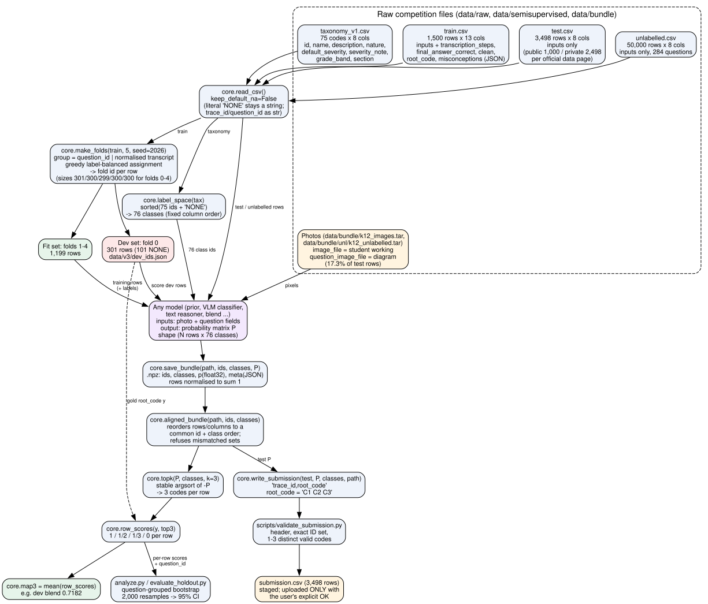

---

### 1. The task, as the competition defines it

From `docs/competition_research.md` and `docs/handoff.md`:

- **Goal:** for each test `trace_id`, predict up to **3 distinct, space-separated codes in confidence order**. The truth is one `root_code`.
- **What "root" means:** the host's clarification (linked in `competition_research.md`) says the root is *the pedagogically central cause, not mechanically the first error*. A student can make a small slip on line 2 and a big conceptual error on line 5, and the root can be the line-5 error.
- **Inputs available at test time:** the student photo, the question text, an optional question diagram, the answer key, the grade and the topic.
- **Deadline:** 17 November 2026. `docs/handoff.md` records it as 00:00 UTC; `docs/competition_research.md` notes that the overview text says 23:59 UTC while the page header shows 00:00 UTC, and takes the earlier time to be safe. The project treats 16 November as the last working day.
- **Leaderboard context:** on 8 November the public top 3 were 0.8445 / 0.842 / 0.83916 (`reports/status.json`). Our best public score so far is **0.7085** (submission 58240192, `reports/status.json`).

### 2. What one row looks like

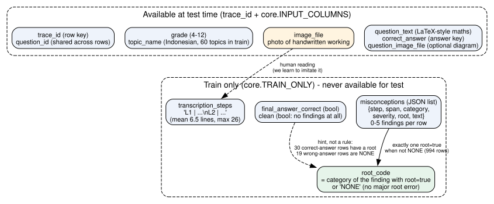

`core.py` splits the columns into two groups (`src/k12/core.py:8-10`). `trace_id` is the row key and sits outside both lists, so test has 8 columns: `trace_id` plus the 7 `INPUT_COLUMNS`.

```python
INPUT_COLUMNS = ['question_id', 'grade', 'topic_name', 'question_text',
                 'question_image_file', 'correct_answer', 'image_file']
TRAIN_ONLY = {'root_code', 'transcription_steps', 'final_answer_correct', 'clean', 'misconceptions'}
```

**Input columns (in train, test and unlabelled):**

| Column | What it is | Notes from our data |
|---|---|---|
| `trace_id` | Row key (12 hex chars), also the photo name | Never shared between train, test and unlabelled (checked: 0 overlaps). |
| `question_id` | UUID of the question | Many students answer the same question: 462 questions in train (3.25 rows each on average), 492 in test (7.11 rows each). |
| `grade` | 4 to 12 | Train counts by grade: 4:97, 5:211, 6:174, 7:246, 8:250, 9:127, 10:184, 11:132, 12:79. |
| `topic_name` | Topic in **Indonesian**, e.g. `Bilangan Berpangkat` (powers) | 60 topics in train. The most common is `Operasi Bilangan Bulat` (integer operations, 104 rows). |
| `question_text` | Question in Indonesian, with LaTeX-style maths (`$3^x = \dfrac{1}{27}$`) | |
| `question_image_file` | Optional diagram for the question | Present on 18.2% of train rows and 17.32% of test rows. |
| `correct_answer` | Answer key, sometimes LaTeX (`$4a^2 - 4$`) | |
| `image_file` | Photo of the student's handwritten working | The main evidence. |

**Train-only columns (never available for test):**

| Column | What it is |
|---|---|
| `transcription_steps` | A human transcription of the photo, one line per step: `L1 \| 3^x = 1/27, 27 :3 = −9\nL2 \| x = −9 ...`. On average 6.5 lines (median 6, max 26). |
| `final_answer_correct` | Whether the student's final answer matches the key (517 True, 983 False). |
| `clean` | True when the annotators found **no** issue at all (449 rows). |
| `misconceptions` | JSON list of step-level findings: `{"step": "L1", "span": "27 :3 = −9", "category": "EXP-01", "severity": "major", "root": true, "text": "..."}`. |
| `root_code` | The label: the `category` of the finding marked `root: true`, or `NONE`. |

What the annotations tell us (computed from `data/raw/train.csv`):

- **Number of findings per row:** 0 findings on 449 rows, 1 on 744, 2 on 224, 3 on 70, 4 on 12 and 5 on 1.
- **One root per error row:** every non-NONE row has exactly one finding with `root: true`, and its category always equals `root_code` (0 mismatches over 994 rows).
- **NONE does not mean "clean":** 506 rows are `NONE`, but only 449 are `clean`. The other 57 NONE rows contain only `minor` findings (66 minor findings, 0 major). So `NONE` means "no major root error", not "no mistakes at all".
- **Every root finding is `major`** (994/994).
- **The answer key is a hint, not a rule** (`reports/data_audit.json`): 30 rows with a correct final answer still have a root error, and 19 rows with a wrong final answer are `NONE`.

The extra train-only columns are why the project can train a **transcriber** (photo to text, imitating `transcription_steps`) and use findings as auxiliary signals. None of them may be used as an input at test time.

### 3. The label space: 75 taxonomy codes plus NONE

`data/raw/taxonomy_v1.csv` has 75 rows and the columns `id, name, description, nature, default_severity, severity_note, grade_band, section`. The id prefix (the part before the dash) defines a **family**, and families group into 12 **sections**:

| Section | Codes | Families (id prefixes) |
|---|---|---|
| ADVANCED TOPICS | 12 | FUN, INV, LIN, SIM, QUA, LOG, EXP, SEQ, SET |
| CROSS-STRAND | 12 | ANS, CAL, VIS, WOP, FRM, NOT, CHK, UNT, REL |
| NUMBER — Place Value & Operations | 9 | PV, OPS, OOO, KPF |
| DATA & PROBABILITY | 8 | STA, PRO |
| NUMBER — Fractions | 6 | FRA |
| NUMBER — Operation Properties, Powers, Ratios | 6 | EXP, RAT |
| ALGEBRA | 6 | ALG |
| MEASUREMENT | 5 | MEA |
| NUMBER — Integers | 4 | INT |
| GEOMETRY | 4 | GEO, ANG, COR |
| NUMBER — Decimals | 2 | Dec |
| CATCH-ALL | 1 | OTH (`OTH-00` "Other / uncategorized") |

Things to notice:

- **The EXP prefix appears in two sections.** You cannot always recover the section from the prefix alone; use the `section` column.
- **CROSS-STRAND codes are generic**, e.g. `CAL-01` "Simple arithmetic/copy slip", `WOP-01` "Wrong operation inferred from word-problem misreading", `FRM-01` "Wrong formula chosen / recalled incompletely" and `ANS-01` "Stopped at an intermediate quantity / wrong answer form". They can apply to any topic. In its "wrong part of the taxonomy" analysis, `runs/arch/PLAN.md` names confusion between the generic codes (CAL, WOP, FRM, ANS, OTH) and topic-specific codes as the main confusion.
- **`nature`** is procedural (37), conceptual (33), careless (3) or meta (1), and blank for OTH-00. **`default_severity`** is major (65) or minor (9), and blank for OTH-00.

The code builds the class list in one place (`src/k12/core.py:18-19`):

```python
def label_space(taxonomy):
    return sorted(set(taxonomy['id'].astype(str)) | {'NONE'})
```

This gives **76 classes in alphabetical order**. Every probability matrix in the project has its columns in this order (bundles also store the order explicitly; see section 8).

A subtle but important detail is in `read_csv` (`src/k12/core.py:13-15`):

```python
def read_csv(path):
    # Literal NONE is a class. Never allow pandas to interpret labels as nulls.
    return pd.read_csv(path, keep_default_na=False, dtype={'trace_id': str, 'question_id': str})
```

By default pandas turns the string `"NONE"` into a missing value (NaN). That would silently delete our largest class, so every CSV in the repo is read through this function. Empty `question_image_file` cells become `''` rather than NaN for the same reason.

### 4. Class balance: a long tail with one giant class

Counts of `root_code` in train (1,500 rows):

| Group | Codes | Rows |
|---|---|---|
| `NONE` | 1 | 506 (33.7%) |
| Exactly 57 rows: OTH-00, ANS-01, FRM-01, WOP-01, CAL-01 | 5 | 285 |
| 21 to 56 rows (e.g. EXP-04 47, VIS-01 41, INT-04 39, OOO-01 30) | 11 | 329 |
| 6 to 20 rows | 32 | 334 |
| 2 to 5 rows | 12 | 33 |
| Exactly 1 row ("singletons") | 13 | 13 |
| In taxonomy but **never** in train: NOT-02, PRO-03 | 2 | 0 |

The error-row totals add up to 994 (= 1,500 − 506). By section, the error rows are dominated by CROSS-STRAND (336 rows), then Place Value & Operations (129) and Advanced Topics (113).

Why this matters:

- **The cap at 57.** Five codes sit at exactly 57 rows, which suggests the organisers capped common classes (PLAN.md: "train looks capped near 57 rows per code ... but nobody verified it"). `runs/arch/PLAN.md` builds the one CPU-only gain that survived testing, **Sinkhorn balancing**, on this observation. Sinkhorn balancing is an iterative rescaling that nudges a probability matrix so that the predicted label counts over the test set match a target mix (here the train label mix). The plan measures +0.019 on dev with λ = 0.5 (0.7370, CI [+0.006, +0.033]), but warns that the sign depends on the target: using Claude's label mix as the target gave −0.066, and a uniform mix gave −0.019. So if test labels do not follow the train mix, the step can hurt. The method has its own chapter; here it is enough to know that the class counts above are its target.
- **Singletons.** A singleton's single row lands in exactly one fold, so a model evaluated on that fold has never seen the class. `make_folds` says this is deliberate (see section 6).
- **Never-seen codes.** NOT-02 and PRO-03 must stay in the 76-way output, because test may contain them. We must not invent examples for them.
- **The simplest baseline.** The hierarchical prior in `src/k12/baseline.py:13-36` ignores the photo entirely. It predicts "codes this question usually gets", smoothed toward the topic's codes and then the global label mix. It scores **0.48533 out-of-fold MAP@3** (CI 0.4577 to 0.5128; top-3 recall 0.6727; `reports/baseline_metrics.json`). Everything else has to beat this.

```python
pt = (t + self.b * self.global_p) / (t.sum() + self.b)        # topic counts smoothed to global
result.append((q + self.a * pt) / (q.sum() + self.a))         # question counts smoothed to topic
```

(`src/k12/baseline.py:33` and `:35`.) This is **Bayesian smoothing** (a Dirichlet prior): a question with few rows borrows strength from its topic, and a topic with few rows borrows from the global distribution. `question_strength = 2` and `topic_strength = 8` act as pseudo-counts. The global distribution itself adds 0.5 to every class count (`baseline.py:21`), so codes never seen in train still get a small probability.

### 5. Test set and unlabelled pool

**test.csv:** 3,498 rows, the 8 input columns only. According to the official data description (recorded in `docs/competition_research.md`) they split into 1,000 public and 2,498 private rows, and the splits are student-disjoint, share questions, and are stratified by root code and grade. (`runs/arch/PLAN.md` section 6, question 7, lists the public split size and the daily submission limit as unknown, so recheck both on the competition page.)

**"95.7% of test questions seen in train":** precisely, **95.71% of test rows** belong to a `question_id` that also appears in train (`reports/data_audit.json`, key `test_questions_seen_in_train`). Counted per unique question, 92.5% of the 492 test questions appear in train (computed here). This is the single most important structural fact:

- A model can memorise "which codes this question usually gets". That is why a photo-free question prior already reaches 0.485 on its own. (Added on top of the current blend, extra question priors measured −0.004 to −0.005 in PLAN.md, because the fine-tuned models have already absorbed this signal.)
- `runs/arch/PLAN.md` shows the price of that shortcut. Our blend scores 0.830 on the 94 dev error rows whose code was already seen for that question (better than Claude's 0.812), but only **0.431** on the 84 error rows from a seen question whose true code never appeared for that question in the fit rows, i.e. the student made an error **new for that question**. Those rows hold about 78% of the gap to Claude Opus zero-shot (0.8189).

**Unlabelled pool** (`data/semisupervised/competition_data/unlabelled.csv`): 50,000 rows with the same 8 columns as test. Photos are in `data/bundle/unl/k12_unlabelled.tar` (train and test photos are in `data/bundle/k12_images.tar`).

- They cover only **284 questions**; 97.6% of rows are on questions that also appear in train.
- They skew toward lower grades: 4:6,924, 5:9,026, 6:9,203, 7:6,818, 8:6,208, 9:6,546, 10:2,515, 11:2,123, 12:637.
- Only 2.4% of rows have a question diagram.
- Uses in the project: pseudo-labels (`data/v3/pseudo_v3.jsonl`, 1,565 confidence-filtered soft pseudo-labels built by `scripts/build_pseudo_labels.py`, which keeps each row's top codes with renormalised probabilities, drops rows below a confidence threshold and caps NONE) and Claude labels, which `AGENTS.md` allows on training and unlabelled photos only, **never on test photos**. **Pseudo-labelling** means letting a model (or an external teacher) label unlabelled rows and training on those guesses, usually only the confident ones.

### 6. Folds and the dev split: `make_folds`

**Cross-validation** splits the training rows into K parts ("folds"). You train on K−1 of them and evaluate on the one held out, so the score reflects rows the model never saw. Most of this project does not train 5 models. It uses one split: **fold 0 is the development (dev) set (301 rows); folds 1 to 4 are the fit set (1,199 rows)**. `competition_research.md` intended fold 4 as an untouched audit fold.

`src/k12/core.py:71-94` (abridged to the key lines):

```python
for i, r in enumerate(train.itertuples(index=False)):
    text = ' '.join(str(r.transcription_steps).lower().split())
    key = str(r.question_id) + '|' + text
    groups.setdefault(key, []).append(i)
...
rng.shuffle(items)
items.sort(key=lambda g: -len(g))
for ix in items:
    labels = train.iloc[ix].root_code.tolist()
    costs = sum((counts[c] for c in labels), np.zeros(n_splits))
    candidates = np.flatnonzero(costs == costs.min())
    small = sizes[candidates]
    candidates = candidates[small == small.min()]
    f = int(rng.choice(candidates))
```

In plain words:

1. **Group duplicates.** Rows with the same question and the same lower-cased, whitespace-normalised transcription form one group, so a duplicate can never sit on both sides of the split. In this data every one of the 1,500 rows forms its own group (checked: 1,500 distinct keys; `reports/data_audit.json` also reports 0 exact duplicate context transcripts), so the grouping is only a safeguard.
2. **Shuffle (seed 2026), then process large groups first.** Python's sort is stable, so groups of equal size keep their shuffled order.
3. **Balance the labels greedily.** For each group, the "cost" of each fold is how many rows with the same label(s) it already holds. The group goes to the cheapest fold; ties go to the smallest fold, then to a random choice. The result is round-robin stratification: each label is spread as evenly as possible.

Result: fold sizes 301 / 300 / 299 / 300 / 300 (folds 0 to 4). Dev has **101 NONE rows**, and the capped codes ANS-01 (12), WOP-01, FRM-01, CAL-01 and OTH-00 (11 each) have 11 to 12 rows each. `data/v3/dev_ids.json` stores the same 301 IDs (verified equal).

What the split does **not** do:

- **It is not grouped by question.** The same question appears in fit and dev, which mimics test (questions are shared). Even so, 39 dev rows (13%) come from questions absent from fit, against 4.3% of test rows absent from train, so dev is somewhat harder on unseen questions.
- **It is not grouped by student,** because student IDs are not provided (the docstring, `core.py:65-70`, says so).
- **It exposes rare classes on purpose.** 5 singleton rows sit in dev, so 5 dev codes never appear in fit.
- **It cannot show public/private variance.** On 301 rows the paired standard error of a MAP@3 difference is about 0.013 (`runs/research/REPORT.md`), so changes smaller than about +0.02 cannot be confirmed from one run.

`make_folds` takes a `seed` argument, and several modules (for example `transcriber.py`, `vision.py`, `vllm_ranker.py`, `evaluate_holdout.py`) expose a `--split-seed` option. Always use the default 2026 when you compare against project numbers.

### 7. The metric: MAP@3, and how our code computes it

**MAP@3** ("mean average precision at 3") with a single true label per row reduces to this: look at your top 3 guesses, find the position of the true code, and score 1 for position 1, 1/2 for position 2, 1/3 for position 3, and 0 if it is absent. The final score is the mean over rows.

The code has three steps.

**`normalize`** (`src/k12/core.py:22-28`) rejects non-finite or negative values and empty rows, then scales each row to sum to 1.

**`topk`** (`src/k12/core.py:31-35`):

```python
def topk(p, classes, k=3):
    p = normalize(p)
    if p.shape[1] != len(classes) or len(set(classes)) != len(classes):
        raise ValueError('Class order does not match scores')
    return np.asarray(classes)[np.argsort(-p, axis=1, kind='stable')[:, :k]]
```

`kind='stable'` matters for ties: equal probabilities keep their column order, which is alphabetical.

**`row_scores` and `map3`** (`src/k12/core.py:38-51`):

```python
hits = [1.0 / (i + 1) for i, c in enumerate(list(codes)[:3]) if c == target]
scores.append(hits[0] if hits else 0.0)
...
def map3(y, p, classes):
    return float(row_scores(y, topk(p, classes)).mean())
```

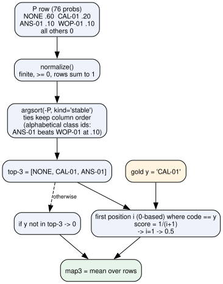

**Worked example** (run with the real functions on a toy 4-class space `['ANS-01','CAL-01','NONE','WOP-01']`):

| Row | Probabilities (ANS, CAL, NONE, WOP) | Top 3 | Truth | Score |
|---|---|---|---|---|
| 1 | .10 .20 .60 .10 | NONE, CAL-01, ANS-01 | NONE | 1 |
| 2 | .50 .30 .10 .10 | ANS-01, CAL-01, NONE | CAL-01 | 1/2 |
| 3 | .40 .30 .20 .10 | ANS-01, CAL-01, NONE | NONE | 1/3 |
| 4 | .25 .25 .25 .25 | ANS-01, CAL-01, NONE | WOP-01 | 0 |

MAP@3 = (1 + 0.5 + 0.333 + 0) / 4 = **0.4583**. Row 4 shows the tie rule: with all values equal, the stable sort returns the alphabetical first three, and WOP-01 is dropped. (Row 1 also has a tie, ANS-01 and WOP-01 at .10; ANS-01 wins because it comes first alphabetically.)

Consequences for strategy:

- **Always submit 3 codes.** A 2nd or 3rd guess can only add points, never remove them.
- **Only the order of the top 3 matters.** Calibration (whether the probabilities are "honest") does not change the score directly. It matters only when you **combine** models, because the blend multiplies or averages probabilities. That is why the project spends effort on geometric blending and balancing.
- **MAP@3 sits between accuracy and recall@3.** For the prior baseline: top-1 accuracy 0.339, MAP@3 0.485, recall@3 0.673 (`reports/baseline_metrics.json`).

**Confidence intervals:** the project reports **question-grouped bootstrap** 95% intervals. A bootstrap estimates uncertainty by resampling the evaluation set with replacement many times (here 2,000) and recomputing the score each time; the middle 95% of those scores is the interval. Our code resamples whole **questions**, not rows, because rows of the same question are correlated. From `src/k12/analyze.py:57-61`:

```python
# Resample whole question groups: less optimistic than treating similar rows as independent.
agg = out.groupby('question_id').score.agg(['sum','size']).to_numpy()
rng = np.random.default_rng(2026)
sample = rng.integers(0, len(agg), (2000, len(agg)))
boot = agg[sample, 0].sum(axis=1) / agg[sample, 1].sum(axis=1)
```

A **paired** bootstrap applies the same resampling to the per-row score **difference** between two models scored on the same rows, which removes the shared row difficulty and gives a tighter interval for "is A better than B?". `src/k12/evaluate_holdout.py:24-27` does exactly this for a model against the hierarchical prior (`delta = scores - reference`, grouped by question, 2,000 resamples). PLAN.md's "+0.019, CI [+0.006, +0.033]" style numbers are question-grouped bootstrap intervals of the same kind (PLAN.md line 4), computed by the diagnosis scripts rather than by this exact function.

### 8. Prediction bundles: the project's common currency

Every model writes its probabilities as a **bundle**: a `.npz` file with `ids`, `classes`, `p` (float32, rows sum to 1) and `meta` (JSON). See `save_bundle`, `src/k12/core.py:97-103`. `aligned_bundle` (`src/k12/core.py:106-114`) loads one and reorders its rows and columns to the caller's ID and class order. It **refuses** a bundle whose ID set or class set differs, which prevents silent misalignment when you blend models trained by different scripts.

Real dev bundles (each 301 x 76), scored here with `map3`:

| Bundle | `meta.kind` | Dev MAP@3 |
|---|---|---|
| `runs/pod/text32/validation_tx_dev_epoch_1.npz` (Qwen3-32B text, machine transcripts) | text_diagnosis_development | 0.6523 |
| `runs/pod/tx/text_tx_dev_e3.npz` (Qwen3-8B text, machine transcripts) | text_diagnosis_development | 0.6667 |
| `runs/pod/dev-distill/validation_epoch_2.npz` (Qwen3-VL-8B distilled from Claude) | pod_image_predictions | 0.6528 |
| Geometric blend .35 / .30 / .35 of the three | | **0.7182** (reproduces PLAN.md) |

A **geometric blend** is a weighted average of log-probabilities (equivalently, a weighted product of probabilities) followed by re-normalisation. A code that one model strongly rejects stays low. PLAN.md notes that 0.7182 includes about 0.012 of optimism from choosing weights on the same dev rows: cross-fitted weights give 0.706, close to the public 0.7085. **Cross-fitting** means choosing a setting on some dev folds and scoring it on the others, so the reported score never comes from rows that chose it.

### 9. Submission format and validation

`write_submission` (`src/k12/core.py:54-61`) writes `trace_id,root_code`, where `root_code` is the top-3 joined by spaces:

```
trace_id,root_code
dc6fc95e7f65,MEA-04 FRM-01 CAL-01
5b18569f3365,NONE FRA-04 CAL-01
```

(First lines of `artifacts/submission-3way-blend/submission.csv`, the 0.7085 public file.)

`scripts/validate_submission.py:8-17` checks:

- the header is exactly `trace_id,root_code`;
- the ID set is exactly the 3,498 test IDs, with no duplicates;
- each row has 1 to 3 **distinct** codes, all from the 76-class label space.

Under the project rule from 11 November (`AGENTS.md`), a validated CSV is **staged** and only uploaded after the user explicitly approves that specific file.

### 10. Rules that shape the design

Summarised from `docs/competition_research.md` and `AGENTS.md`. The binding text is the official rules page.

- **Submissions:** 5 per day; select at most 2 final entries (`competition_research.md`, `handoff.md`; PLAN.md asks to recheck the daily limit).
- **Offline final inference.** External APIs are not allowed in the final solution. The organisers allow commercial-API pseudo-labels on train and unlabelled data. The project used Claude for training and unlabelled photos only, under a budget tracked in `reports/claude_budget.json`, and never on test photos. (`competition_research.md` was written on 8 November and still says "We use no paid APIs"; the user authorised the Claude API on 11 November.)
- **No hand-labelling** of validation or test records, and no human prediction.
- **Data privacy:** use the data only for this competition, do not identify students, do not redistribute images.
- **Model size:** models up to the Nemotron 550B reference size are allowed, with no compute restriction from the sponsor. Our own limits are budgets: Kaggle GPU caps, a RunPod cap of $80, and the Claude API cap of $200.
- **Reproducibility:** winners must supply training and inference code under Apache 2.0.

### Key files

- `/Users/gaddamshivateja/Documents/ChatGPT/kaggle-K-12/src/k12/core.py`: `read_csv`, `label_space`, `normalize`, `topk`, `row_scores`, `map3`, `write_submission`, `make_folds`, `save_bundle`, `aligned_bundle`
- `/Users/gaddamshivateja/Documents/ChatGPT/kaggle-K-12/data/raw/train.csv`, `test.csv`, `taxonomy_v1.csv`
- `/Users/gaddamshivateja/Documents/ChatGPT/kaggle-K-12/data/semisupervised/competition_data/unlabelled.csv`
- `/Users/gaddamshivateja/Documents/ChatGPT/kaggle-K-12/data/v3/dev_ids.json` (the 301 fold-0 IDs)
- `/Users/gaddamshivateja/Documents/ChatGPT/kaggle-K-12/src/k12/baseline.py` (hierarchical prior)
- `/Users/gaddamshivateja/Documents/ChatGPT/kaggle-K-12/src/k12/analyze.py` and `src/k12/evaluate_holdout.py` (slices, bootstrap CIs)
- `/Users/gaddamshivateja/Documents/ChatGPT/kaggle-K-12/scripts/validate_submission.py`
- `/Users/gaddamshivateja/Documents/ChatGPT/kaggle-K-12/scripts/build_pseudo_labels.py` (how `pseudo_v3.jsonl` is filtered)
- `/Users/gaddamshivateja/Documents/ChatGPT/kaggle-K-12/reports/data_audit.json`, `reports/baseline_metrics.json`, `reports/status.json`
- `/Users/gaddamshivateja/Documents/ChatGPT/kaggle-K-12/docs/competition_research.md`, `docs/handoff.md`, `runs/arch/PLAN.md`

### Things to try yourself (CPU only, a few seconds each)

Run these from the repo root with `python3`. They read local files only.

**1. Load a bundle and compute MAP@3 on dev.**
```python
import sys; sys.path.insert(0, 'src')
from k12.core import read_csv, label_space, make_folds, aligned_bundle, map3, topk, row_scores
tr = read_csv('data/raw/train.csv'); classes = label_space(read_csv('data/raw/taxonomy_v1.csv'))
dev = tr[make_folds(tr) == 0]
P = aligned_bundle('runs/pod/tx/text_tx_dev_e3.npz', dev.trace_id.tolist(), classes)
print(map3(dev.root_code.tolist(), P, classes))           # expect 0.6667
s = row_scores(dev.root_code, topk(P, classes))
print('NONE rows', s[dev.root_code.values == 'NONE'].mean(), 'error rows', s[dev.root_code.values != 'NONE'].mean())
```
Question to answer: is the model weaker on NONE rows or on error rows?

**2. Reproduce the 0.7182 geometric blend, then change the weights.** Load the three bundles from the table in section 8, compute `L = sum(w_i * log(clip(P_i, 1e-12)))`, exponentiate, and score. Try `w = [1/3, 1/3, 1/3]` and `[0.5, 0, 0.5]`. Notice how small the differences are compared with the ±0.013 standard error.

**3. Break the tie rule.** Build a matrix whose rows are all equal (e.g. `np.ones((1, 76))`) and confirm that `topk` returns `ALG-01 ALG-02 ALG-03` (the first three ids in alphabetical order). Then explain why a model that outputs near-uniform probabilities is biased toward codes early in the alphabet.

**4. Measure the question shortcut.** For each dev error row, check whether its `root_code` appears among the fit rows of the same `question_id`. Then compare the mean `row_scores` of the two groups for any bundle. You should see the "seen pair vs new pair" gap that PLAN.md calls the main lever (blend: 0.830 vs 0.431).

### Common confusions

- **"NONE means the student made no mistakes."** No. 57 NONE rows contain minor findings. NONE means no *major root* error.
- **"A correct final answer means NONE."** No: 30 rows contradict it, and 19 wrong-answer rows are NONE.
- **"The root is the first error."** No. It is the pedagogically central error, per the host's clarification.
- **"75 classes."** The output is **76**-way (75 codes plus NONE), and NOT-02 and PRO-03 must stay in it even though train has no examples.
- **"I can use `transcription_steps` as a feature."** Only for training (as a target or as supervision). Test has no transcription, so at inference it must come from our own transcriber.
- **"`pd.read_csv` is fine."** It turns `NONE` into NaN. Always use `core.read_csv`.
- **"95.7% of test questions are seen."** It is 95.71% of test **rows**. Per unique question the share is 92.5%.
- **"Dev 0.718 means public 0.718."** Weights tuned on dev are optimistic by about 0.012; cross-fitted 0.706 matched public 0.7085. Never quote in-sample or smoke-test numbers as scores.
- **"Fold 0 is grouped by question or student."** Neither. Questions are shared across folds on purpose, and student IDs do not exist.
- **"Probabilities must be calibrated for MAP@3."** The metric only uses the order of the top 3. Calibration matters only when combining models.
- **"Topic names are English."** They are Indonesian (e.g. `Operasi pecahan` = fraction operations), and so are the questions.


---

<a id="02-transcriber"></a>

# Stage 1: the transcriber (photo to text)

## Stage 1: the transcriber (photo to text)

### In one paragraph

The transcriber is a Qwen3-VL-8B vision-language model with small LoRA adapters. We trained it to look at a photo of a student's handwritten working and write that working out as numbered text lines (`L1 | ...`, `L2 | ...`), copying the teacher transcriptions in `train.csv`. It was trained on the 1,199 "fit" rows. It then transcribed the 301 dev photos into `runs/pod/tx/tx_dev.json` and the 3,498 test photos into `runs/pod/tx/tx_test.json`. That lets the Stage 2 text reasoners (Qwen3-8B and Qwen3-32B) work on text instead of pixels.

Its reading is good but not perfect: number recall is 0.88 and the median normalised character error rate is 0.095. Even so, giving the downstream models perfect (gold) text would add only about **+0.035 MAP@3** to one model, and **+0.0155 to +0.022** to the full ensemble. That is why the project treats diagnosis, not reading, as the bottleneck.

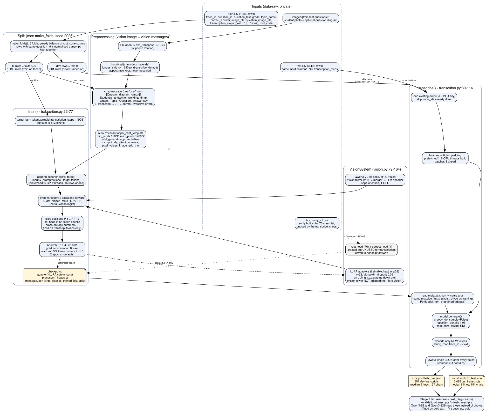

---

### 1. Why a separate "reader" stage at all?

The task: given a photo of a student's working, name the root misconception (one of 75 taxonomy codes or `NONE`), ranked top 3. There are two ways to attack this:

- **End to end:** one vision model looks at the photo and outputs a code directly. This is `vision.py`'s classifier path (`VisionSystem.predict`, `vision.py:145-157`).
- **Read, then diagnose:** first turn the photo into text (this stage). Then a strong *text* model reasons over the question, the answer key and the transcript (Stage 2, `src/k12/text_diagnose.py`).

The second route lets us use larger text-only models such as the Qwen3-32B reasoner. It also lets us measure two questions separately: "did we read it right?" and "did we diagnose it right?". The handoff records when this direction paid off. The text reasoner scored 0.570 with teacher transcripts and 0.542 with machine transcripts. Its conclusion: "Reading costs only ~0.03; diagnosis is now the bottleneck" (`docs/handoff.md:35-36`).

The current reference blend is described in `runs/arch/PLAN.md` (section 1, lines 18-24). Two of its three models read the transcriber's output: the 32B text reasoner (weight .35) and the 8B text reasoner (weight .30). The third is the VL-8B image classifier distilled from Claude (weight .35).

---

### 2. Concepts you need first

**Vision-language model (VLM).** A language model with an image encoder attached. Qwen3-VL has three parts:
- a vision tower (a ViT), which cuts the image into small patches and turns each patch into a vector;
- a merger, which compresses neighbouring patch vectors into "image tokens";
- the language-model decoder, which reads image tokens and text tokens in one sequence.

To the decoder, an image is just a long run of special tokens in the prompt. Bigger images produce more image tokens, which costs more memory and time.

**LoRA (Low-Rank Adaptation).** Fine-tuning all 8B weights is expensive. LoRA freezes each original weight matrix `W` (shape `d_out × d_in`) and learns a small correction `B·A`:
- `A` is `r × d_in` and `B` is `d_out × r`, with a small rank `r` (here 32).
- The layer computes `W x + (alpha/r)·B A x`.
- Only `A` and `B` are trained. For an 8B decoder at rank 32 on all seven projections, that is roughly 1% of the parameters. The exact count was not logged.
- The adapter is saved separately from the base model and is small next to it (exact size not recorded locally). It can be attached to the frozen base model later.

**QLoRA.** The same idea, but the frozen base weights are stored in 4-bit (NF4) to save memory. `vision.py:89-93` supports this through `--load_4bit`, but **the transcriber does not use it**. Its parser has no 4-bit flag, so the base model loads in bf16. The 4-bit path is there for the 32B QLoRA classifier experiment (the code comment says "so a 32B model fits a 48 GB card"; see `docs/handoff.md:30`).

**bf16 / autocast.** bf16 is a 16-bit float format with the same range as float32 but less precision.
- The transcriber loads the base weights directly in bf16 (`vision.py:94-96`).
- The trainable LoRA weights are cast up to float32 (`vision.py:132-133`).
- `torch.autocast('cuda', dtype=bf16)` makes the matrix multiplications, including the fp32 LoRA ones, run in bf16. The optimiser still updates fp32 master copies of the LoRA weights.

**Teacher forcing / next-token loss.** To teach a model to *write* a text, we feed it `[prompt | target]`. At each target position, it must predict the next target token. The loss is cross-entropy: the average negative log-probability of the correct next token. We compute loss **only on the target tokens**, never on the prompt. This is called "completion-only" loss.

**Gradient checkpointing.** This saves GPU memory by not storing every intermediate activation. The activations are recomputed during the backward pass instead. That is slower, but it lets long image+text sequences fit.

**Gradient accumulation.** We process one row at a time but update the weights only every 8 rows, summing gradients in between. That simulates a batch size of 8.

**Greedy decoding.** At inference, always pick the single most likely next token (`do_sample=False`). It is deterministic, which is what you want for transcription.

**Repetition penalty.** At generation time, Hugging Face penalises every token id that already appears in the sequence. That includes the prompt, so digits from the question or answer key are penalised too. A positive score is divided by 1.05 and a negative score is multiplied by 1.05. This mildly discourages the model from looping on the same line.

**CER (character error rate).** CER = (Levenshtein edit distance between machine and gold text) / (length of gold text). The edit distance counts the minimum number of single-character inserts, deletes and substitutions. 0 is perfect. CER can exceed 1 when the machine writes far too much, for example by looping.

**MAP@3.** For each row you get 1 point if the true code is your 1st guess, 1/2 if 2nd, 1/3 if 3rd, otherwise 0. MAP@3 is the mean over rows (`core.py:38-51`). A "+0.03" gain means about 9 extra points on the 301-row dev set.

**Bootstrap confidence interval (CI).** Resample the 301 dev rows with replacement 10,000 times, recompute the metric difference each time, and take the 2.5th and 97.5th percentiles. If the interval excludes 0, the effect is probably real.
- `runs/arch/reading-impact/common.py:32-37` implements this as `boot()`, a **row-level** paired bootstrap with seed 0.
- Most other CIs in `PLAN.md` are question-grouped instead (`PLAN.md:4`): they resample whole questions, so rows of the same question move together.

---

### 3. Data in: what the transcriber learns from

`train.csv` has 1,500 rows. Each row has:
- a student photo (`image_file`);
- an optional question diagram (`question_image_file`, present on 18.2% of train rows and 17.3% of test rows);
- question context (`grade`, `topic_name`, `question_text`, `correct_answer`);
- the **gold transcription** `transcription_steps`.

The gold transcription is a teacher-written, line-numbered copy of the working in the format `L1 | ...` / `L2 | ...`. It sometimes includes markup such as crossed-out markers. A reading audit found markup-like cross-out annotations in 158 gold rows (`runs/research/q1-formula-paper/reading_audit2.json`).

`test.csv` has the same input columns **but no `transcription_steps`**. That is the whole reason this stage exists: at test time we must produce the text ourselves, offline.

**The split** (`core.py:64-94`, `make_folds`) has 5 folds with seed 2026. Rows are first grouped by `question_id` plus the lower-cased, whitespace-collapsed transcript, so duplicates never straddle folds. Each group then goes to the fold where its `root_code`s are currently rarest (ties go to the smaller fold, then a random choice). The docstring calls this "round-robin stratification". Fold 0 (301 rows) is the dev set and the other 1,199 rows are the fit set. The transcriber trains on the fit set only (`transcriber.py:28-29`):

```python
# src/k12/transcriber.py:26-31
frame = read_csv(data / 'train.csv')
classes = label_space(read_csv(data / 'taxonomy_v1.csv'))
folds = make_folds(frame, seed=args.split_seed)
fit = frame if args.full_train else frame.loc[folds != args.fold].reset_index(drop=True)
if args.smoke:
    fit, args.epochs = fit.head(8), 1
```

So `tx_dev.json` is an honest **out-of-fold** reading: the transcriber never saw those 301 photos. The handoff confirms that the test transcripts also come "from a transcriber trained on 1,199 rows" and calls retraining on all 1,500 "a cheap upgrade" (`docs/handoff.md:74`). No full-data transcriber output exists in the local `runs/`, and `PLAN.md:212` now lists transcriber retrains as "do not do".

`read_csv` uses `keep_default_na=False` (`core.py:13-15`). This keeps an empty `question_image_file` as an empty string instead of NaN, and stops the literal label `NONE` being read as a missing value.

---

### 4. Image preprocessing (`vision.py:50-57`)

```python
# src/k12/vision.py:50-57
def image(data, split, filename, maxside=1024):
    candidates = [data/'images'/split/str(filename), data/str(filename)]
    path = next((p for p in candidates if p.is_file()), None)
    if path is None: raise FileNotFoundError(f'Missing {split} image: {filename}')
    with Image.open(path) as im:
        out=ImageOps.exif_transpose(im).convert('RGB')
    out.thumbnail((maxside,maxside));return out
```

Step by step:
1. **Find the file.** It looks under `images/<split>/` first, then directly under the data folder. There is deliberately no fallback image, so a missing photo crashes the run instead of silently scoring a blank.
2. **`exif_transpose`.** Phone photos often store "rotate 90°" as metadata instead of rotating the pixels. This applies the rotation so the handwriting is upright.
3. **`.convert('RGB')`.** Drops alpha channels and grayscale modes, so every image has 3 channels.
4. **`thumbnail((maxside, maxside))`.** Shrinks the image in place so its *longest* side is at most `maxside`, keeping the aspect ratio. It never enlarges small images. The transcriber's default is **`--maxside 1280`** (`transcriber.py:128`), larger than the classifier's default of 1024, because small digits and minus signs need resolution.
5. **Processor pixel budget.** `AutoProcessor.from_pretrained(..., min_pixels=128*128, max_pixels=args.max_pixels)` (`vision.py:83-84`) sets the budget. The transcriber's default is `max_pixels = 1280*1280`. The Qwen processor resizes each image to a patch-friendly size within that budget and outputs `pixel_values` plus `image_grid_thw`, which records the number of patches in each direction. The exact number of image tokens per photo was **not measured** in this repo.

**Same preprocessing at train and test.** In `transcribe()`, the model is rebuilt from the training run's own saved arguments (`metadata['args']`, `transcriber.py:82-86`). So `maxside`, `max_pixels` and `dtype` at inference are guaranteed to match training. The generation length (`--max-tokens`) is the one exception: it comes from the `transcribe` command line.

---

### 5. The prompt (`vision.py:60-76`)

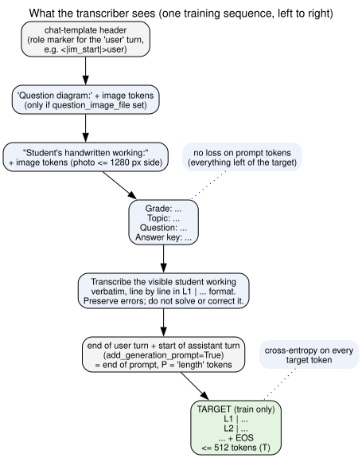

`messages()` builds a single "user" chat turn, in this order:
1. the question diagram (if any);
2. the student photo;
3. a text block with grade, topic, question and answer key;
4. the task instruction.

For `task='transcribe'` the instruction is:

```python
# src/k12/vision.py:71-75
if task == 'transcribe':
    instruction = "Transcribe the visible student working verbatim, line by line in L1 | ... format. Preserve errors; do not solve or correct it."
...
content.append({'type':'text','text':f"Grade: {row.grade}\nTopic: {row.topic_name}\nQuestion: {row.question_text}\nAnswer key: {row.correct_answer}\n{instruction}"})
```

Why give a *reader* the question and answer key? The context helps it decode ambiguous handwriting. If the question involves `2a − 1`, a smudged `2a-1` is likely that.

The risk is **error erasure**: the model "corrects" a student's mistake toward the answer key, which destroys the evidence of the misconception. The instruction "Preserve errors; do not solve or correct it" exists for this reason, and training on gold text that keeps the errors reinforces it. Section 10 shows how often reading differences flip a diagnosis (`error_erasure` in `results.json`).

`VisionSystem.encode()` (`vision.py:136-138`) calls `processor.apply_chat_template(..., add_generation_prompt=True)`, which appends the "assistant turn starts here" marker. Everything up to and including that marker is the **prompt**. The code calls its length `length`; the diagrams call it P.

---

### 6. The model and its LoRA (`vision.py:79-134`)

`VisionSystem.__init__` does the following:
- **Processor.** Loads the processor and sets `padding_side='left'` (`vision.py:85`). For batched generation, padding must sit on the left, so every sequence's last real token lines up at the end, where generation continues.
- **Base model.** Loads `Qwen3-VL-8B` with `AutoModelForImageTextToText` in the chosen dtype (`vision.py:94-96`). The transcriber's default is `--dtype bfloat16` (`transcriber.py:129`); `vision.py` falls back to fp16 for Kaggle T4s. It uses `attn_implementation='sdpa'` on one GPU.
- **Compatibility patch** (`vision.py:97-108`). Disables PEFT's optional torchao dispatch when it would crash on non-quantised weights. This is a library-version workaround, not modelling.
- **LoRA targets** (`vision.py:114-125`):

```python
# src/k12/vision.py:114-125 (abridged)
targets=[n for n,m in self.base.named_modules() if isinstance(m,nn.Linear)
         and 'language_model' in n and n.rsplit('.',1)[-1] in
         {'q_proj','k_proj','v_proj','o_proj','gate_proj','up_proj','down_proj'}]
if getattr(args,'lora_vision',False):
    vision=[... '.visual.' ... {'qkv','proj','linear_fc1','linear_fc2'}]
    targets+=vision
self.model=get_peft_model(self.base,LoraConfig(r=args.rank,lora_alpha=args.rank*2,
             lora_dropout=.05,target_modules=targets))
```

What this means:
- LoRA goes into every attention projection (q, k, v, o) and every MLP projection (gate, up, down) of the **language decoder**.
- The rank is 32 by default (`transcriber.py:126`), with alpha = 2 × rank = 64 and dropout 0.05.
- The transcriber's argument parser has **no `--lora-vision` flag**, so `getattr(args,'lora_vision',False)` is `False`. `get_peft_model` freezes everything that is not a LoRA weight, so the vision tower and merger stay frozen.
- In effect, the decoder learns *how to write down* what the frozen vision features already encode.

**Unused heads.** `VisionSystem` always builds two classifier heads: `self.head` with 76 outputs (75 codes + `NONE`) and `self.correct_head` with 1 output (`vision.py:127-128`). This is because the class is shared with the image classifier. The transcriber never uses the heads, but `system.save()` still writes them to `heads.pt`. This is harmless shared plumbing.

---

### 7. Training loop (`transcriber.py:22-77`)

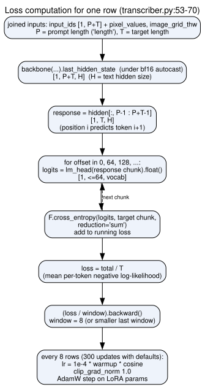

**Setup** (`transcriber.py:32-38`):
- enables gradient checkpointing;
- calls `enable_input_require_grads()`, which checkpointing needs when the input embeddings are frozen;
- turns off the KV cache;
- builds AdamW with lr `1e-4` and weight decay 0.01 over the trainable (LoRA) parameters only.

**Building one example** (`transcriber.py:41-47`):

```python
# src/k12/transcriber.py:41-47
def encode(i):
    row = fit.iloc[i]
    prefix = system.encode(row, data, 'train', task='transcribe')
    target = system.processor.tokenizer(str(row.transcription_steps) + system.processor.tokenizer.eos_token,
                                        add_special_tokens=False, truncation=True, max_length=args.max_tokens,
                                        return_tensors='pt')['input_ids']
    return append_teacher(prefix, target) + (target,)
```

`append_teacher` (`reading_finetune.py:36-44`) does the joining:
- concatenates the prompt ids and the target ids;
- extends `attention_mask` with ones, and any `token_type_ids` / `mm_token_type_ids` with zeros;
- returns `(joined, length)`.

`prefetched()` (`pod_train.py:28-39`) runs `encode` on 6 background CPU threads, 16 rows ahead, so image decoding never leaves the GPU waiting.

**Forward and loss** (`transcriber.py:54-63`):

```python
# src/k12/transcriber.py:54-63
with torch.autocast('cuda', dtype=system.dtype):
    hidden = system.hidden(joined)
response = hidden[:, length - 1:length + target.shape[1] - 1]
target = target.cuda()
loss = hidden.new_zeros((), dtype=torch.float32)
for offset in range(0, target.shape[1], 64):
    logits = lm_head(response[:, offset:offset + 64]).float()
    loss = loss + F.cross_entropy(logits.reshape(-1, logits.shape[-1]),
                                  target[:, offset:offset + 64].reshape(-1), reduction='sum')
loss = loss / target.shape[1]
```

What each part does:
- **Backbone only.** `system.hidden()` (`vision.py:140-143`) calls the multimodal **backbone** (`get_base_model().model`), not the full causal-LM wrapper. It returns hidden states `[1, P+T, H]` *without* multiplying every position by the huge vocabulary matrix. The image and prompt positions never need logits, so this saves a lot of memory.
- **The shift.** The hidden state at position `i` predicts token `i+1`. The first target token sits at position `length`, so position `length-1` predicts it. The slice `[length-1 : length+T-1]` therefore lines up exactly with `target[0 : T]`.
- **Chunked lm_head.** The vocabulary projection is applied 64 positions at a time, and the logits are cast to float32 for a stable softmax. Without chunking, a long transcript (up to 512 tokens) would create a `[512, vocab]` float32 tensor all at once.
- **Mean loss.** The chunk losses are summed, then divided by `T`, giving the mean per-token cross-entropy.

**Optimiser step** (`transcriber.py:64-70`):
- **Backward.** `(loss / window).backward()`, where `window` is 8. The final partial group uses its true size so the average stays correct. With 1,199 fit rows, the last window of each epoch has 7 rows.
- **Schedule.** With the defaults there are `2 × ceil(1199/8) = 300` optimiser updates. At each update the learning rate is `1e-4 × warmup × cosine`:
  - `warmup = min(1, (step+1)/(0.05·updates))` ramps linearly over the first 5% of updates (15 updates).
  - `cosine = 0.5·(1 + cos(π·step/updates))` then decays smoothly toward 0.
- **Clipping.** Gradients are clipped to norm 1.0 before the AdamW step.

**Defaults** (`transcriber.py:124-130`): 2 epochs, rank 32, lr 1e-4, accumulation 8, max target 512 tokens, maxside 1280, max_pixels 1280², bf16, seed and split seed 2026, fold 0.

The exact arguments of the run that produced `tx_dev.json` / `tx_test.json` are stored in the pod's `checkpoint/metadata.json`, which is **not in the local repo**. Treat the defaults as the recipe. The actual run's values, wall-clock time and GPU memory are **not recorded locally**.

**Output** (`transcriber.py:75-76`), all under `checkpoint/`:
- `adapter/`: the LoRA weights, as safetensors;
- `processor/`;
- `heads.pt`;
- `metadata.json`, with `args`, `classes`, `trained_ids` (proof of which rows were trained on) and `task: 'transcribe'`.

---

### 8. Inference: `transcribe()` and the resumable JSON (`transcriber.py:80-116`)

```python
# src/k12/transcriber.py:94-97, 106-113 (abridged)
out = Path(args.output)
done = json.loads(out.read_text()) if out.exists() else {}
rows = [r for r in frame.itertuples(index=False) if r.trace_id not in done]
groups = [rows[i:i + args.batch_size] for i in range(0, len(rows), args.batch_size)]
...
generated = system.model.generate(**inputs, max_new_tokens=args.max_tokens, do_sample=False,
                                  repetition_penalty=1.05, pad_token_id=tokenizer.pad_token_id)
texts = tokenizer.batch_decode(generated[:, inputs['input_ids'].shape[1]:], skip_special_tokens=True)
done.update({r.trace_id: t.strip() for r, t in zip(group, texts)})
out.write_text(json.dumps(done, ensure_ascii=False))
```

The key ideas:
- **Resumable.** The output file is a single JSON dict `{trace_id: transcript}`. On start, already-done ids are skipped, and the whole dict is rewritten after *every* batch. If a paid pod dies halfway through the 3,498 test photos, rerunning the same command continues where it stopped. The handoff shows this in use: the L40S pod was "Transcribing 3,498 test photos (resumable)" (`docs/handoff.md:47`).
- **Batching.** Batches of 8 (`--batch-size`) with left padding. `prefetched(batch, groups, ahead=3)` prepares the next 3 batches on 6 CPU threads.
- **Decoding only the new tokens.** `generated[:, prompt_len:]` drops the echoed prompt. Because of left padding, `prompt_len` (the padded length) is the same for every row in the batch.
- **Filters.**
  - `--ids` (a JSON list of trace_ids) restricts the `--csv` file. Pointed at `train.csv`, this selects the dev rows.
  - `--limit` gives a quick smoke run.
  - `--split` picks the student-photo folder: `train` for dev photos, `test` for test. Question diagrams always come from `images/questions/`.

**What the files look like, measured on the local copies (aggregates only):**

| File | Rows | Median lines | Median chars | Every non-blank line in `Lk \|` format | Empty |
|---|---|---|---|---|---|
| `runs/pod/tx/tx_dev.json` | 301 | 5 | 137 | 300 / 301 | 0 |
| `runs/pod/tx/tx_test.json` | 3,498 | 6 | 151 | 3,481 / 3,498 | 0 |

The plan notes **20 looping and 26 overlong test transcripts**, which need to be capped before Stage B prompts are built (`runs/arch/PLAN.md:157`).

**How Stage 2 consumes them.** `transcripts(frame, source)` (`text_diagnose.py:100-104`) returns the gold `transcription_steps` when `source == 'gold'`. Otherwise it reads the JSON and looks up each `trace_id`.
- The reasoners are **fitted on gold text**: `--fit-transcripts` defaults to `gold` (`text_diagnose.py:237`).
- They are **validated and tested on machine text** (`--validation-transcripts`, `--test-transcripts`, lines 238-239).

This train-on-clean / test-on-noisy mismatch is part of why reading errors cost anything at all.

---

### 9. How good is the reading? (and why the numbers disagree)

The same `tx_dev.json` gives very different CERs depending on what you count:

| Measure (dev, 301 rows) | Value | Source |
|---|---|---|
| Raw CER including line ids and spacing, median | 0.328 (mean 0.376) | `scripts/evaluate_transcripts.py`; `reading_audit.json` |
| Same, after stripping line ids and whitespace but **keeping** `[...]` annotations, median | 0.375 | `reading_audit.json` (`cer_normalized_no_ids_no_space`) |
| Number recall / number precision (regex `\d+`, which also counts the digits in `L1`, `L2` ids, so both are somewhat inflated) | 0.881 / 0.913 | `scripts/evaluate_transcripts.py` |
| Line-count ratio machine/gold, median | 1.0 | same |
| Normalised page CER, median (see the steps below the table) | **0.095** (25th pct 0.027, 75th pct 0.333, max 6.77) | `runs/arch/reading-impact/step1_cer.py` → `per_row_reading.csv` |
| Order-free math-token bag F1, median | 0.81 | `reading_audit2.json` |
| Exact line match, share of gold lines (mean) | 0.44 | `reading_audit2.json` |
| Root-error span found exactly in the machine page (200 error rows) | 0.605 (121 / 200) | `reading-impact/results.json` (`claude_reading`) |
| Root line read with CER ≤ 0.10 | 0.655 (131 / 200) | same |
| Older OCR, for contrast: number recall | 0.12–0.22 | `docs/handoff.md:35` |

The normalised page CER is computed in `step1_cer.py` (`lines()` and `norm()`) in these steps:
1. Keep only the text after each `Lk |` id. Lines without an id are dropped.
2. Apply NFKC and lower-case everything.
3. Map − – — to `-`, × to `x`, · to `.` and ÷ to `:`, and remove backslashes.
4. Drop `[...]` annotations.
5. Remove all whitespace.

The handoff calls the raw 0.33 "mostly formatting" (`docs/handoff.md:35`). The second row narrows that down. Stripping ids and spaces alone does not help (0.375). The big drop to 0.095 comes mainly from removing the teacher's bracketed annotations, plus the unicode unification. After that normalisation, the median page is about 90% character-correct.

A max CER of 6.77 means that page's machine text is at least about 6.8 times as long as its gold text. That pattern is typical of looping or runaway output, though that specific row was not inspected.

**Is Claude a better reader?**
- **Root-span exactness:** yes, 0.72 versus our 0.605.
- **Whole-page CER:** no. Claude's median is 0.124 versus our 0.095.
- **Root-line accuracy:** about the same, 0.645 versus 0.655 (`results.json` → `claude_reading`).

The plan's summary: "Claude reads no better than our transcriber" (`PLAN.md:55`). Claude's big advantage is in diagnosis, not reading.

---

### 10. Why reading only matters about 0.03

The decisive experiment scores the same trained text reasoner twice on dev: once on gold transcripts and once on machine transcripts. Source: `runs/arch/reading-impact/results.json`, `single_model_gold_minus_tx`, with a row-level paired bootstrap 95% CI.

| Text model | MAP@3 machine text | MAP@3 gold text | Gold − machine | 95% CI | Rows gold better / machine better |
|---|---|---|---|---|---|
| Qwen3-32B reasoner | 0.652 | 0.687 | +0.035 | [0.009, 0.062] | 31 / 15 |
| Qwen3-8B, 0% Claude labels (s0) | 0.553 | 0.578 | +0.025 | [0.004, 0.047] | 18 / 15 |
| Qwen3-8B, 25% Claude labels (s25) | 0.666 | 0.692 | +0.025 | [0.002, 0.050] | 28 / 17 |
| Qwen3-8B, 100% Claude labels (s100) | 0.692 | 0.720 | +0.028 | [0.004, 0.053] | 31 / 19 |

At the ensemble level, the reference blend scores 0.7182:

| Change | Ensemble MAP@3 | Δ vs reference | 95% CI |
|---|---|---|---|
| Only the 32B reads gold | 0.7337 | +0.0155 | [0.006, 0.026] |
| All text models read gold (estimate) | 0.7403 | +0.022 | [0.007, 0.039] |

So a *perfect* reader is worth about +0.015 to +0.022 to the ensemble. That is much less than the 0.10 gap to Claude (0.8189). The reasons:

1. **Most lost points are on rows we read correctly.** Take the 121 error rows where the root-error span was read exactly. There, gold and machine text score the same (32B: 0.545 vs 0.544), yet the blend still loses 42.3 points on them against a perfect score. PLAN.md measures the same thing against Claude: "17.0 of the 30.3 gap points are on rows our transcriber read exactly right". Here 30.3 = 0.1008 × 301, the blend-vs-Claude gap expressed in rows' worth of points.
2. **Where reading is bad, it does matter, but those rows are few.**
   - On the 79 rows where the root span was misread, the 32B gains +0.087 from gold text.
   - On the 69 rows whose root line has CER > 0.10, it gains +0.094.
3. **Errors away from the root line barely matter.** Fixing only the non-root parts of the page adds +0.0011 (CI [−0.002, +0.004]) (`hybrid_reading_fixes`).
4. **A third of the reading gap is on NONE rows** (`REPORT.md:29`).
   - On the 101 `NONE` rows, the 32B scores 0.931 on machine text and 0.965 on gold.
   - Misread digits make a correct page look wrong. For the 32B, these "false alarms" (a NONE row predicted as an error) number 8 on machine text vs 4 on gold.
   - Error erasure is also visible but small (`error_erasure`, 32B). On 2 rows, gold text gave the right top-1 while machine text gave `NONE`. On 17 rows, machine text gave another code. On 7 rows it went the other way: machine text was right and gold was wrong.
   - The research report recommends tracking NONE-row and error-row MAP separately.
5. **The correlation is weak.** The Spearman correlation between page CER and lost MAP points is 0.126 for the 32B on machine text, and 0.059 when it reads gold. Reading quality explains little of which rows fail.
6. **Other reading upgrades were tried and did not help** (`runs/research/REPORT.md`, Q1 and Q4 sections):
   - A PP-FormulaNet formula-reader pilot gave no diagnosis gain (0.656 vs 0.664, `REPORT.md:139`).
   - An oracle hard crop to the error region *lowered* MAP from 0.609 to 0.601 (`REPORT.md:36`).
   - Mixing 11,426 Claude-transcribed rows into the text reasoners left the gold-vs-machine gap at 0.025–0.028 (`REPORT.md:126`).

That is why PLAN.md's "What not to do" table lists "Upgrade or retrain the transcriber, including 5-fold out-of-fold transcriber retrains" (`PLAN.md:212`).

The research report still lists two cheap, optional reading-robustness ideas (`REPORT.md:29-30`). Neither has been measured:
- Train the text reasoner on *synthetically corrupted* gold text (estimate 0 to +0.015).
- Average the reasoner over two readings per photo (estimate 0 to +0.01).

---

### Key files

- `src/k12/transcriber.py`: `train()` (lines 22-77), `transcribe()` (lines 80-116), and the CLI (lines 119-138).
- `src/k12/vision.py`: `image()` preprocessing (50-57), the `messages()` prompt builder (60-76), and `VisionSystem` model, LoRA and save (79-164).
- `src/k12/reading_finetune.py:36-44`: `append_teacher()`, which joins prompt and target ids.
- `src/k12/pod_train.py:28-39`: `prefetched()`, the CPU thread pool that keeps the GPU fed.
- `src/k12/core.py`: `read_csv` (13), `make_folds` (64), `topk` / `row_scores` / `map3` (31-51), `aligned_bundle` (106).
- `src/k12/text_diagnose.py:100-104` and `237-239`: how Stage 2 loads gold or machine transcripts.
- `scripts/evaluate_transcripts.py`: aggregate CER, number recall/precision and line ratio.
- `runs/pod/tx/tx_dev.json`, `runs/pod/tx/tx_test.json`: the machine transcripts (private data).
- `runs/arch/reading-impact/` (`common.py`, `step1_cer.py`, `step2_impact.py`, `results.json`, `per_row_reading.csv`): the reading-impact study.
- `runs/research/q1-formula-paper/reading_audit*.json` and `runs/research/REPORT.md` (Q1, Q4): the reading audit and the paper reviews.
- `docs/handoff.md` (lines 30, 35-36, 47, 74) and `runs/arch/PLAN.md` (lines 18-24, 55, 157, 212).

### Things to try yourself (CPU only)

All of these run locally from the repo root and print only aggregates, so no student text appears on screen.

1. **Reproduce the reading scores.**
   - Run `PYTHONPATH=src python3 scripts/evaluate_transcripts.py runs/pod/tx/tx_dev.json`. You should see a median CER of 0.328, mean 0.376, number recall 0.881 and number precision 0.913.
   - Then open `runs/arch/reading-impact/step1_cer.py` and find `lines()` and `norm()`. Work out which steps take the median from 0.33 to 0.095.
   - Also compare with `runs/research/q1-formula-paper/reading_audit.py`, which keeps the `[...]` annotations and gets 0.375.
2. **Measure the "reading gap" for the 32B reasoner yourself.**
   ```python
   import numpy as np
   from k12.core import read_csv, label_space, make_folds, aligned_bundle, map3, row_scores, topk
   tr = read_csv('data/raw/train.csv'); classes = label_space(read_csv('data/raw/taxonomy_v1.csv'))
   dev = tr[make_folds(tr) == 0].reset_index(drop=True); ids, y = dev.trace_id.tolist(), dev.root_code.tolist()
   tx = aligned_bundle('runs/pod/text32/validation_tx_dev_epoch_1.npz', ids, classes)
   gd = aligned_bundle('runs/pod/text32/validation_gold_epoch_1.npz', ids, classes)
   print(map3(y, tx, classes), map3(y, gd, classes))          # 0.6523  0.6872
   d = row_scores(y, topk(gd, classes)) - row_scores(y, topk(tx, classes))
   m = d[np.random.default_rng(0).integers(0, len(d), (10000, len(d)))].mean(1)
   print(d.mean(), np.percentile(m, [2.5, 97.5]))             # 0.0349  [0.0089 0.0620]
   ```
   Run it with `PYTHONPATH=src`. Then repeat with the `runs/pod/scaling/scale_100/validation_{tx_dev,gold}_epoch_1.npz` pair; `results.json` reports +0.028.
3. **Does a bad read cost more on NONE rows?**
   - Load `per_row_reading.csv` and join it to `d` from exercise 2 by `trace_id`.
   - Split the rows by `y == 'NONE'` and by `m_page_cer > 0.10`, and compare the mean of `d` in each cell.
   - Compare your numbers with the `groups` entries in `results.json`.
4. **Find the looping transcripts.**
   - For each value in `tx_test.json`, count the lines and the share of duplicate lines (`1 - len(set(lines))/len(lines)`).
   - Print only the counts above simple thresholds, never the text.
   - See how close you get to PLAN.md's "20 looping and 26 overlong".

### Common confusions

- **"The transcriber was trained with LoRA on the vision tower."** No. Only the language-decoder projections get LoRA. `lora_vision` exists in `VisionSystem` but is not exposed by `transcriber.py`'s parser.
- **"It uses QLoRA."** No. The base model loads in bf16. The 4-bit path in `vision.py` was for the 32B QLoRA classifier experiment.
- **"The classifier heads are part of the transcriber."** No. They are created and saved because `VisionSystem` is shared, but the transcriber's loss never touches them.
- **"Loss is computed over the whole sequence."** No. Only the target (transcript + EOS) positions contribute, via the `length-1` shifted slice.
- **"CER 0.33 means a third of the characters are wrong."** Mostly no. Most of it is the teacher's bracketed annotations, plus line ids, spacing and unicode variants. With the reading-impact normalisation the median is 0.095. Always ask which normalisation a CER uses.
- **"`tx_dev.json` is in-sample."** No. The transcriber trained on the 1,199 fit rows only, so the 301 dev transcripts are out-of-fold. The test transcripts come from the same 1,199-row model, not a full-data retrain.
- **"Giving the reader the answer key is cheating."** No. It is allowed context, like the question text, and is available at test time. The real risk is the model *correcting* the student's error, which is why the instruction says "Preserve errors". Also note that the repetition penalty slightly discourages repeating tokens that are already in the prompt.
- **"A better reader is the path to 0.82."** No. The measured gain from perfect reading is about +0.0155 (32B on gold) to +0.022 (all text models, estimate) on the ensemble. The gap to Claude is 0.10, and it sits mainly in naming new error types for known questions.
- **"512 tokens is plenty."** Usually it is: median transcripts are around 140–150 characters. But the target is *truncated* at 512 tokens including EOS. A gold transcript longer than that loses its EOS, so the model learns no stop signal from it. Generation is also capped at 512 new tokens, so a looping output is cut off rather than ended cleanly.
- **"The JSON rewrite is atomic."** It is not. `out.write_text` overwrites in place, so a crash *during* the write could leave a truncated file. Resumability protects against a crash *between* batches, which is the common case on a pod.


---

<a id="03-text-reasoner"></a>

# Stage 2a: the text reasoners (Qwen3-8B and Qwen3-32B)

## Stage 2a: the text reasoners (Qwen3-8B and Qwen3-32B)

### In one paragraph

The text reasoner is the second half of our "read, then diagnose" pipeline. Stage 1 turns a photo into a text transcript of the student's working. Stage 2a gives that transcript to a text-only language model (Qwen3-8B or Qwen3-32B), together with the question, the answer key and the list of 75 error codes. It then reads one hidden-state vector at the very last prompt token (the end of `ROOT:`), and a small linear layer turns that vector into 76 scores (75 codes + NONE). We fine-tune the model cheaply with **LoRA** (the 32B is loaded in 4 bits, which is **QLoRA**). The loss mixes hard teacher labels, soft "pseudo" labels distilled from Claude on unlabelled photos, and an optional language-model loss on a written explanation of the error. On the 301-row dev fold with machine transcripts, the 8B scores **0.6667** MAP@3 and the 32B scores **0.6523**. Together with an image model they make up the blend that scores 0.7182 on dev and **0.7085 public**. The main weakness, found in `runs/arch/PLAN.md`, is that the code is chosen **before any reasoning happens**, from a prompt that is 79% code list.

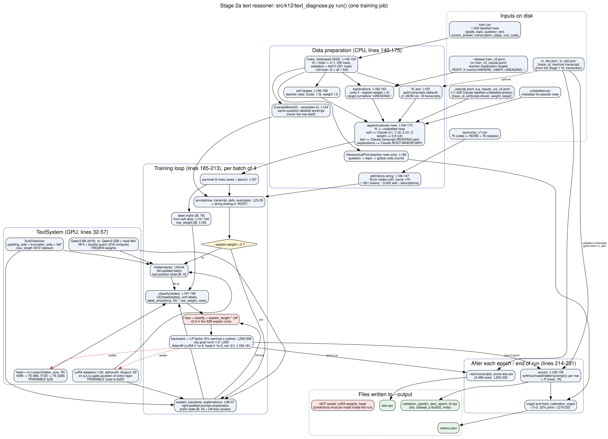

---

### 1. Where this stage sits, and the concepts you need

```
photo --(Stage 1: Qwen3-VL-8B transcriber)--> transcript text
transcript + question + code list --(Stage 2a: THIS SECTION)--> P[76] per row
P(32B) , P(8B) , P(VL image model) --(geometric blend .35/.30/.35)--> top-3 codes --> submission
   (PLAN.md proposes adding Sinkhorn balancing after the blend; the 0.7085 submission does not use it)
```

Concepts used in this section, in plain words:

- **MAP@3 (Mean Average Precision at 3).** For each row we submit 3 ranked codes. A row scores 1 if the true code is first, 1/2 if it is second, 1/3 if it is third and 0 otherwise. The final score is the average over rows. In our code this is `row_scores` / `map3` in `src/k12/core.py:38-51`.
- **Geometric blend.** To combine models, we take a weighted average of their *log*-probabilities, exponentiate, and renormalise each row to sum to 1: `normalize(exp(sum_m w_m * log P_m))`. A code needs support from every model to stay on top.
- **Sinkhorn balancing (mentioned only).** This rescales a probability matrix, alternating over its columns and rows, until the predicted label mix matches a target mix, such as the training label shares. It belongs to the blending stage (PLAN.md), not to this one.
- **Causal LM / decoder.** Qwen3 reads tokens left to right, and the hidden state at position *t* can only "see" tokens 0..*t*. So the state at the last prompt token summarises the whole prompt, and it cannot see anything appended later.
- **LoRA (Low-Rank Adaptation).** We freeze each big weight matrix W (for example 4096x4096) instead of updating it, and learn two thin matrices A (r x in) and B (out x r). The layer then computes `W x + (alpha/r) * B A x`. With r=32 on all seven projection matrices of every block, this trains about 1% of the parameters. Our code does not log the count. By hand arithmetic from the Qwen3 configs, it is roughly 87M for the 8B and roughly 270M for the 32B.
- **QLoRA.** The same LoRA idea, but the frozen base weights are stored in 4-bit **NF4** ("NormalFloat 4", a 4-bit format tuned for weights that are roughly normally distributed). They are dequantised to bf16 for the matmuls. "Double quantization" also compresses the per-block scale factors. This is what lets a 32B model train on one 48-80 GB GPU.
- **Classification head.** A plain `nn.Linear(hidden_size, 76)`. We do **not** make the model generate the code as text. We read a vector and classify it.
- **Distillation / soft labels / pseudo rows.** Claude (the "teacher") labelled unlabelled photos with three ranked codes. We turn those into a probability target such as `{c1: .7, c2: .2, c3: .1}` and train our model (the "student") to match it. These extra rows are called pseudo-labelled rows.
- **Label smoothing.** This mixes a little uniform probability into the target (here 3%), so the model is never pushed to put 100% on one class. It usually improves calibration.
- **Cosine schedule with warmup.** The learning-rate factor is the product of a linear warmup over the first 5% of steps and a half-cosine decay from 1 towards 0 over all steps.
- **Paired, question-grouped bootstrap CI.** This checks whether model A really beats model B on dev. We resample *questions* with replacement, keeping rows of the same question together because they are correlated. Each time we recompute the mean per-row score difference, and after 2,000 draws we take the 2.5% and 97.5% quantiles. If the interval excludes 0, the difference is probably real. See `paired_interval` in `scripts/report_scaling.py:12-16`.

---

### 2. The prompt: `prompt()` (text_diagnose.py:25-29)

```python
def prompt(row, transcript, definitions, examples=''):
    return (f"{definitions}\n\n{examples}Grade: {row.grade}\nTopic: {row.topic_name}\nQuestion: {row.question_text}\n"
            f"Answer key: {row.correct_answer}\nStudent working (line by line):\n{transcript}\n\n"
            "Identify the root major error the rest of the working follows from, or NONE if there is no "
            "major error. ROOT:")
```

The parts, in order:

1. **`definitions`** is built once in `run()` (`text_diagnose.py:146-147`). It is `"Error codes:\n"` followed by one line `ID: name` per taxonomy row, in file order. With `--descriptions`, each line also gets ` - description`.
2. **`examples`** (optional, `--examples K`) shows K labelled workings of *other* students on the same question (see ExampleBank below).
3. The row's **metadata**: grade, topic, question text and answer key.
4. The **transcript**. For the fitting rows this is gold (the teacher's transcription) by default. For validation it is gold text, machine text (`tx_dev.json`), or both.
5. The instruction, ending with **`ROOT:`**. The classifier reads the hidden state at this final token.

Measured prompt sizes (`runs/arch/recipe-audit/a4_tokens.json`, which uses the Qwen2.5 tokenizer as a proxy for Qwen3):

| Item | Tokens |
|---|---|
| Code list, `id: name` only | **921** |
| Code list with descriptions | 3,002 |
| Dev prompt, short definitions, gold text (median / 99th percentile / max) | 1,161 / 1,440 / 1,526 |
| Dev prompt with descriptions (median) | 3,241. All 301 dev rows exceed `--max-length 3072` |
| Gold transcript, train (median / max) | 106 / 550 |
| Machine transcript, dev (median) | 92 |

So in a typical prompt, about 921 of about 1,160 tokens (79%) are the same code list repeated on every row, and the student's working is under 10%. With descriptions turned on, every prompt is longer than 3,072 tokens. The tokenizer truncates from the **left** (`text_diagnose.py:37-38`), so the cut falls on the start of the code list and never on the student's working. Descriptions also make training much slower. In the 32B explanation run, the first 100 rows took 579 s with descriptions and 196 s without (`runs/pod/text32-explain/pod-setup/text32-explain-{desc-aborted,nodesc-stopped}.log`).

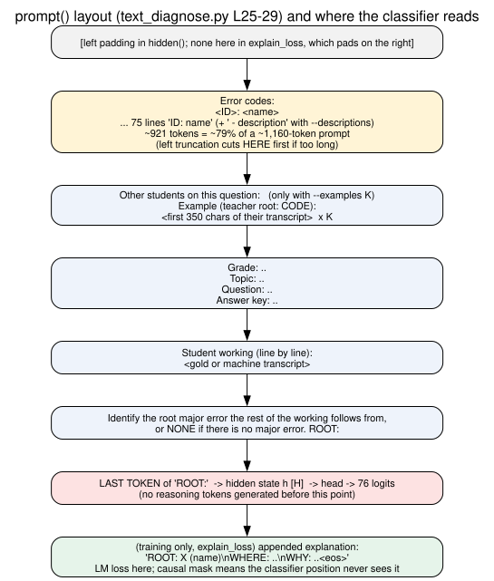

---

### 3. The model: `TextSystem` (text_diagnose.py:32-57)

#### 3.1 Tokenizer settings

```python
self.tokenizer = AutoTokenizer.from_pretrained(model_path)
# Left truncation drops the start of the code list, never the student's working at the end.
self.tokenizer.padding_side = self.tokenizer.truncation_side = 'left'
self.max_length = args.max_length
if self.tokenizer.pad_token is None:
    self.tokenizer.pad_token = self.tokenizer.eos_token
```

**Left padding** matters as much as left truncation. When a batch of 4 prompts of different lengths is padded on the left, every prompt's real last token lands in column `-1`. That is why `hidden()` can simply take `out[:, -1]`. Note that `truncation_side='left'` is a tokenizer-wide setting, so it also applies to the explanation targets in section 4.

#### 3.2 Base model, and QLoRA for the 32B

```python
quantization = None
if args.load_4bit:
    # QLoRA: NF4 frozen weights so a 32B reasoner trains on one 48-80 GB card.
    from transformers import BitsAndBytesConfig
    quantization = BitsAndBytesConfig(load_in_4bit=True, bnb_4bit_quant_type='nf4',
                                      bnb_4bit_use_double_quant=True, bnb_4bit_compute_dtype=torch.bfloat16)
base = AutoModelForCausalLM.from_pretrained(model_path, dtype=torch.bfloat16, device_map={'': 0},
                                            attn_implementation='sdpa', quantization_config=quantization)
```

- 8B: without `--load-4bit` the base is loaded in plain bf16. No 8B launch script in the repo records the exact flags.
- 32B: `--load-4bit` turns on NF4 with double quantization and bf16 compute. All three 32B launch scripts in the repo pass it (`runs/pod/text32-explain/pod-setup/run_text32_full.sh`, `run_text32_explain.sh`, `v4/run.sh`).
- `sdpa` means PyTorch's fused scaled-dot-product attention.
- `device_map={'': 0}` puts the whole model on GPU 0. There is no model parallelism.

#### 3.3 LoRA config

```python
self.model = get_peft_model(base, LoraConfig(r=args.rank, lora_alpha=2 * args.rank, lora_dropout=.05,
                                             target_modules=['q_proj', 'k_proj', 'v_proj', 'o_proj',
                                                             'gate_proj', 'up_proj', 'down_proj']))
for p in self.model.parameters():
    if p.requires_grad:
        p.data = p.data.float()
self.head = nn.Linear(base.config.hidden_size, len(classes), device='cuda')
```

- `r=32` by default (`--rank`) and `alpha = 2r = 64`, so the LoRA update is scaled by alpha/r = 2.
- Adapters sit on **all seven linear layers** of every transformer block: the attention projections q/k/v/o and the MLP projections gate/up/down.
- Trainable LoRA parameters are cast to **fp32** so that the AdamW updates on them are numerically stable. The frozen base stays bf16 (or NF4).
- The **head** maps `hidden_size` to 76 (75 codes + NONE, from `label_space` in `core.py:18-19`). It is fp32 and created directly on the GPU.
- Our code does **not log** the trainable parameter count (see the estimate in section 1). You can print it with `self.model.print_trainable_parameters()`.

#### 3.4 Reading the classifier state: `hidden()` (text_diagnose.py:59-64)

```python
def hidden(self, texts):
    batch = self.tokenizer(texts, return_tensors='pt', padding=True, truncation=True,
                           max_length=self.max_length).to('cuda')
    with torch.autocast('cuda', dtype=torch.bfloat16):
        out = self.model.get_base_model().model(**batch, use_cache=False).last_hidden_state
    return out[:, -1].float()
```

Two details worth understanding:

- `self.model.get_base_model().model` is the **inner decoder stack without `lm_head`**. PEFT injects the LoRA layers in place, so they are still active here. We skip the vocabulary projection (about 152k outputs per token) because this path never needs it.
- `out[:, -1]` gives one vector of shape `[B, H]` (H = 4096 for the 8B, 5120 for the 32B). Because padding is on the left, this is the state at the last token of `ROOT:` for every row.

---

### 4. The explanation loss: `explain_loss()` (text_diagnose.py:66-97)

**Idea.** Besides classifying, the model is taught to *write* a short explanation of where the root error is and why. This is an **auxiliary loss**: an extra training signal that is thrown away at test time. The hope is that it shapes the shared hidden states to encode the reasoning.

**Why right padding here.** The prompt and its explanation are joined into one sequence. With left padding, each row's prompt would end at a different column depending on the length of its explanation. So the function packs the batch itself, padded on the **right**, and records where each prompt ends:

```python
for row, (a, b) in enumerate(zip(prompts, answers)):
    ids[row, :len(a) + len(b)] = torch.tensor(a + b)
    mask[row, :len(a) + len(b)] = 1
    targets[row, len(a) - 1:len(a) + len(b) - 1] = torch.tensor(b)
    ends.append(len(a) - 1)
...
prefix = hidden[torch.arange(len(texts)), torch.tensor(ends)].float()
```

- `a` holds the prompt token ids, left-truncated to `max_length`. `b` holds the explanation ids + `eos`, capped at 256 tokens. Because truncation is left-sided, an over-long explanation loses its **start** (the `ROOT: ...` line) and keeps the end and `eos`. `a4_tokens.json` counts 470 Claude explanations (4.1%) and 11 gold explanations over 255 tokens.
- `targets` is `-100` (ignored) everywhere except over the explanation. Note the one-position shift: the hidden state at position `t` predicts token `t+1`, so the target at position `len(a)-1` (the last prompt token) is the explanation's first token.
- `prefix` is the hidden state at `ends[i] = len(a)-1`, the same `ROOT:` position that `hidden()` reads at inference. Attention is causal, so **the classifier position cannot see the explanation** that follows it. Training and inference therefore see the same information at that position.
- The LM loss is computed only at target positions, in chunks of 512 positions, so the `[positions, vocab]` logits tensor never gets huge. The loss is averaged over all explanation tokens in the batch:

```python
positions = (targets != -100).nonzero(as_tuple=True)
for start in range(0, len(positions[0]), 512):
    r, c = positions[0][start:start + 512], positions[1][start:start + 512]
    logits = lm_head(hidden[r, c]).float()
    reading = reading + F.cross_entropy(logits, targets[r, c], reduction='sum')
return prefix, reading / max(1, len(positions[0]))
```

**Where explanations come from** (`run()`, `text_diagnose.py:160-172`). They are only loaded when `--explain-weight > 0`.

- Teacher rows come from the `target` field of the `--dataset` file, cut before `\nREADING:`. In `train_v3.jsonl`, `evidence_target` (`scripts/build_dataset_v3.py:33-45`) builds the target as `ROOT: CODE (name)\nWHERE: step | span\nWHY: ...`, or `ROOT: NONE (no major misconception)\nFINAL ANSWER: matches/does not match the key`. A variant, `train_v3_claude.jsonl` (`scripts/build_claude_train_why.py`), replaces the WHY line on error rows with Claude's explanation of the gold code.
- Pseudo rows use Claude's `ROOT: c1 (name)\nWHERE: <root_line>\nWHY: <reasoning>`, or just `ROOT: NONE (no major misconception)` for NONE. These are built in `scripts/build_claude_distill.py:56-58`.

A quirk you can see by reading the code: the prompt already ends with `ROOT:`, and every explanation target also starts with `ROOT: ` (true for all 1,500 rows of `train_v3.jsonl` and all 11,426 rows of `claude_unl_v4.jsonl`). The sequence the model learns is therefore `... ROOT:ROOT: CODE (...)`, so the first token the LM loss asks for at the classifier position is "ROOT", not the code. Its effect has **not been measured**.

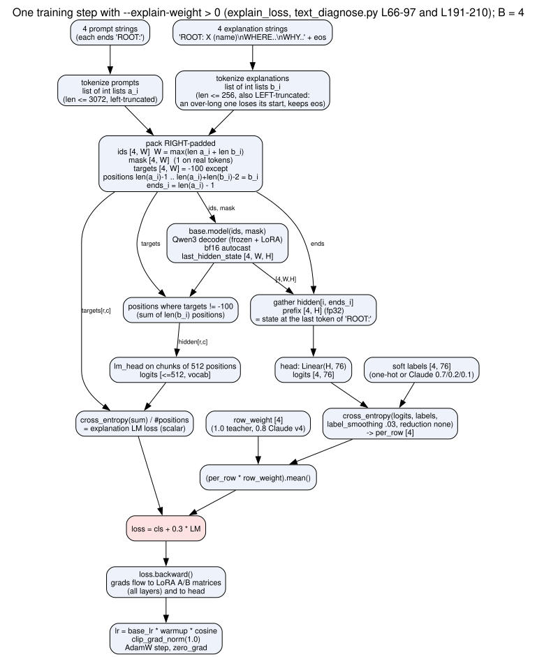

---

### 5. Training data assembly in `run()` (text_diagnose.py:139-184)

| Step | Lines | What happens |
|---|---|---|
| Folds | 148-150 | `make_folds(train, seed=args.split_seed)`, default 2026 (`core.py:64`). Fit = 1,199 rows, dev = fold 0 = 301 rows. `--full-train` fits on all 1,500 rows and skips validation. |
| Smoke test | 151-152, 165 | `--limit N` keeps the first N rows of the fit, validation and pseudo sets |
| Fitting transcripts | 153 | gold by default, or a JSON file via `--fit-transcripts` |
| ExampleBank | 154 | built from **teacher fit rows only**, before pseudo rows are added |
| Soft targets | 156-158 | teacher rows get `{root_code: 1.0}` with weight 1.0 |
| Pseudo rows | 164-173 | rows from `unlabelled.csv` are appended. Their `soft`, `weight`, transcript (the `READING:` part of the target) and explanation come from the pseudo file |
| Prior | 184 | `HierarchicalPrior` fitted on **teacher rows only** (`labelled = fit` is captured at line 158, before pseudo rows are added) |

**Soft labels and pseudo rows in practice.** The v4 distillation (`reports/claude_distill_v4.json`) has 11,426 rows, a 33.3% NONE share, shares `[0.7, 0.2, 0.1]` for Claude's three codes, and a weight of 0.8 per row. Such a row contributes the target `{c1: .7, c2: .2, c3: .1}` with loss weight 0.8. If Claude repeats a code, its shares are added together. A teacher row contributes a one-hot target with weight 1.0. Earlier pseudo files (`claude_unl.jsonl`, 3,427 rows, and `claude_unl_v2.jsonl`, 6,764 rows) were used by the older 32B runs. Under the AGENTS.md rule, Claude is used on training and unlabelled photos only, never on test photos.

```python
labels = torch.zeros(len(idx), len(classes), device='cuda')
for row, i in enumerate(idx):
    for code, share in soft[i].items():
        labels[row, ci[code]] += share
row_weight = torch.tensor([weights[i] for i in idx], device='cuda')

def classify(states):
    per_row = F.cross_entropy(system.head(states), labels, label_smoothing=.03, reduction='none')
    return (per_row * row_weight).mean()
```

`F.cross_entropy` accepts a probability matrix as the target. With `label_smoothing=.03`, the effective target for each class becomes `0.97 * soft + 0.03 / 76`.

### 6. The optimisation loop (text_diagnose.py:176-213)

- **Memory savers** (177-178): gradient checkpointing (activations are recomputed in the backward pass instead of being stored) with `use_reentrant=False`, plus `enable_input_require_grads()` so gradients can flow from the frozen embedding output into the checkpointed blocks.
- **Optimizer** (179-181): AdamW with two parameter groups and weight decay 0.01. The LoRA group uses `lr=1e-4`. The head uses `head_lr=1e-3`, because a new random layer needs bigger steps.
- **Batch**: 4 rows (`--batch-size 4`). There is no gradient accumulation, so each batch is one update, and `updates = epochs * ceil(len(fit)/4)`.
- **Loss** (200-204): `classify(prefix) + explain_weight * LM` when `--explain-weight > 0`, otherwise `classify(hidden(texts))`. The weight is 0.3 in the 32B explanation runs (`run_text32_explain.sh`, `v4/run.sh`). `run_text32_full.sh` (the 32B test model) passes no `--explain-weight`, so it trains with the classification loss only.
- **Schedule** (206-208): a linear warmup over the first 5% of updates, multiplied by a cosine decay:

```python
factor = min(1., (step + 1) / max(1, .05 * updates)) * .5 * (1 + math.cos(math.pi * step / max(1, updates)))
optimizer.param_groups[0]['lr'] = args.lr * factor
optimizer.param_groups[1]['lr'] = args.head_lr * factor
torch.nn.utils.clip_grad_norm_(params + list(system.head.parameters()), 1.)
```

- **Gradient clipping** (209): the total gradient norm is capped at 1.0, which protects against rare huge updates.
- **Logging** (211-213): every 25 steps the code prints a JSON line `{"stage": "train", ..., "loss": ...}` with the loss of **that single batch**, not an average. In `runs/pod/scaling/scale_0.log` the first logged loss is 4.53 at 100 rows. For comparison, ln(76) = 4.33 is the loss of a uniform guess. When the explanation loss is on, it is added to this number.

### 7. Inference: `score()` and the bundles (text_diagnose.py:128-136, 214-231)

```python
@torch.inference_mode()
def score(system, frame, texts, definitions, batch_size, examples=lambda row: ''):
    system.model.eval(); system.head.eval()
    out = []
    for offset in range(0, len(frame), batch_size):
        batch = [prompt(frame.iloc[i], texts[i], definitions, examples(frame.iloc[i]))
                 for i in range(offset, min(offset + batch_size, len(frame)))]
        out.append(system.head(system.hidden(batch)).softmax(-1).cpu().numpy())
    return np.concatenate(out)
```

Each row gets one forward pass and a softmax over 76 classes. There is no generation. After **every epoch**, each validation transcript source is scored and saved:

- `validation_{gold|<json stem>}_epoch_{N}.npz` is written by `save_bundle` (`core.py:97-103`). It holds `ids`, `classes`, `p` (float32, rows renormalised) and `meta` (kind and transcript path).
- `metrics.json` records `map3` and `fixed_calibration_map3` for each epoch and source. The second is `calibrated(p, prior, .25, 2.)` (`holdout_calibration.py:12-14`): soften by temperature 2, then mix in 25% of the hierarchical prior.
- With `--test-transcripts`, the **final** model also scores the 3,498 test rows into `test.npz`.
- `K12_TEXT_RUN_COMPLETE` is printed at the end, and the launch scripts grep for it (for example `v4/run.sh` after its smoke test).

**Important: the LoRA weights and the head are never saved.** Every prediction you will need (dev, test) must be produced inside the same run. That is why the final 32B test model is a separate run, `text32-full`. Its script runs `--full-train --pseudo claude_unl.jsonl --test-transcripts ... --epochs 2`, which is not the same recipe as the dev bundle in `runs/pod/text32/` (epoch 1).

### 8. ExampleBank (text_diagnose.py:107-125)

```python
def __call__(self, row):
    ...
    picked = group[group.trace_id != row.trace_id].head(self.count)
    ...
    lines = [f"Example (teacher root: {r.root_code}):\n{str(r.transcription_steps)[:self.chars]}"
             for r in picked.itertuples(index=False)]
    return 'Other students on this question:\n' + '\n'.join(lines) + '\n\n'
```

For each row, the bank shows up to K other labelled workings of the **same question**, each with its teacher root code. Each question's group is shuffled once with seed 2026, and each transcript is cut to 350 characters. The row itself is never shown. The bank is built from fit rows only, so in a fold run dev rows never leak into it. It is a form of in-context retrieval. Note that it pushes the model even further towards "this question usually has code X", which is the same shortcut PLAN.md identifies as the main weakness (section 10). `docs/handoff.md` records that a run with 3 examples plus descriptions was started, but no result for it is in the repo, so its effect is **not measured** here.

---

### 9. Scores (all on the 301-row dev fold unless stated)

Single models, recomputed from the bundles while writing this guide. They match `runs/arch/ensemble-anatomy/anatomy.json`.

| Model | Bundle | Gold transcripts | Machine transcripts |
|---|---|---|---|
| Qwen3-32B QLoRA, epoch 1 | `runs/pod/text32/validation_*_epoch_1.npz` | 0.6872 | **0.6523** |
| Qwen3-8B, epoch 2 | `runs/pod/tx/text_tx_dev_e2.npz` | not measured | 0.6346 |
| Qwen3-8B, epoch 3 | `runs/pod/tx/text_tx_dev_e3.npz` | not measured | **0.6667** |
| Qwen3-8B, early run, epoch 1 (`docs/handoff.md`) | | 0.570 | 0.542 |

Recall of the true code in the top k (`anatomy.json`): the 32B has recall@3 0.764 and recall@10 0.940. The 8B e3 has recall@3 0.794 and recall@10 0.910.

Notes:

- The 32B is **not** better than the 8B e3 on machine text (0.6523 vs 0.6667), even though it is bigger. The 32B bundle is from epoch 1 and the 8B from epoch 3, and neither run's exact flags are stored in the repo, so this is not a clean size comparison.
- Reading errors cost the 32B 0.0349 here (0.6872 on gold vs 0.6523 on machine text). Inside the blend, PLAN.md measures the paired gain from gold reading at +0.0155, CI [+0.006, +0.026].
- With the fixed calibration (T=2, 25% prior), the 32B machine bundle drops to 0.6401, and the 8B e3 to 0.6501 (both computed here). The prior hurts models that have already learned the question priors.
- A 50/50 geometric blend of only the two text models gives 0.706. This was computed here with an untuned weight. Weight 0.25 on the 32B gives 0.688 and 0.75 gives 0.702.
- The 3-way blend (.35 x 32B, .30 x 8B e3, .35 x VL distilled image model) scores **0.7182** on dev and **0.7085 public** (submission 58240192, `reports/status.json`). Cross-fitted weights give 0.706, which is the honest dev number (PLAN.md).

**The scaling experiment** (`reports/claude_scaling.json`, `scripts/report_scaling.py`). It uses the same 8B recipe for 1 epoch, with the 1,199 teacher rows plus 0%, 25% or 100% of the 11,426 Claude pseudo rows. The logs show `"added": 2856` and `"added": 11426`.

| Claude rows | Machine MAP@3 | Teacher-transcript MAP@3 | Wall-clock s at end of run (training + both dev scorings, `metrics.json`) |
|---|---|---|---|
| 0% (0) | 0.5532 | 0.5781 | 1,404 |
| 25% (2,856) | 0.6661 | 0.6916 | 4,236 |
| 100% (11,426) | **0.6921** | **0.7204** | 12,738 |

Paired, question-grouped bootstrap deltas (machine transcripts):

- 25% vs 0%: **+0.113**, CI [0.073, 0.156]
- 100% vs 0%: **+0.139**, CI [0.095, 0.186]
- 100% vs 25%: +0.026, CI [-0.002, 0.053]. The returns are diminishing: this CI crosses 0.

The 50% run was skipped at the coordinator's request (`runs/pod/scaling/scaling_status.txt`). `scale_100` is the best single model (0.6921), yet it **did not help the ensemble**. Adding it changed the blend by -0.007 to -0.014, and the ensemble stayed at 0.715 vs 0.718 (PLAN.md). The exact CLI flags of the scaling runs, for example whether `--explain-weight` was on, are not saved in the repo.

The 32B explanation runs (`text32-explain`, `text32-v4`) were aborted, stopped or not yet scored, so their dev effect is **not measured**. Only the `--limit 8` smoke test produced a number (0.5 on 8 rows), and an 8-row number means nothing.

---

### 10. The weakness found in PLAN.md

The PLAN's root-cause section (`runs/arch/PLAN.md`, "Root cause in the training recipe") lists these points, all found by reading this file and its data:

1. **The code is chosen before any reasoning.** The classifier reads the state at `ROOT:`. Any explanation comes *after* that position, and causal masking stops it from influencing the decision (see section 4). The explanation loss only shapes features indirectly.
2. **Explanation targets put the code first** (`ROOT: X / WHERE / WHY`). Even the LM part learns to name the code first and justify it afterwards.
3. **Claude wrote the training explanations with the gold label already known** (the `train_v3_claude.jsonl` WHY lines). They mention answer-key numbers in 58% of rows, against 88% for Claude's own zero-shot reasoning.
4. **The 921-token code list is 79% of every prompt**, and codes are shown only as `id: name`. Adding descriptions (3,002 tokens) would truncate 100% of prompts.

Why it matters: about 78% of the 0.10 gap to Claude (Claude scores 0.8189 on dev) comes from 84 error rows on *seen* questions whose true code never appeared for that question in the fit rows. The blend scores 0.431 on them and Claude 0.712. Our models memorise "question -> usual codes". PLAN.md's proposed fix is Stage B, a reason-then-choose 8B student. It writes `ROOT_LINE -> SOLVE/WHERE/WHY` first, then `CODES: c1 c2 c3`. It chooses from 8-12 candidate codes, with descriptions for the candidates only, which takes about 400 tokens instead of the 3,002-token fully described list. It also hides `question_id`.

---

### Key files

- `src/k12/text_diagnose.py`: the whole reasoner (prompt, TextSystem, explain_loss, ExampleBank, score, run, and the CLI at 234-253)
- `src/k12/core.py`: `label_space`, `map3`, `row_scores`, `topk`, `make_folds`, `save_bundle`, `aligned_bundle`
- `src/k12/baseline.py:13-36`: `HierarchicalPrior`
- `src/k12/holdout_calibration.py:12-14`: `calibrated`
- `scripts/build_dataset_v3.py`, `scripts/build_claude_train_why.py`, `scripts/build_claude_distill.py`: explanation and soft-label targets
- `scripts/report_scaling.py` -> `reports/claude_scaling.json`
- `runs/pod/text32-explain/pod-setup/run_text32_full.sh`, `run_text32_explain.sh`, `v4/run.sh`: the real 32B launch commands
- `runs/pod/{text32,tx,scaling,text32-full,text-full}/`: dev and test bundles
- `runs/arch/PLAN.md`, `runs/arch/recipe-audit/a4_tokens.json`, `runs/arch/ensemble-anatomy/anatomy.json`, `docs/handoff.md`, `runs/research/REPORT.md`

---

### Things to try yourself (CPU only)

**1. Load a bundle and compute MAP@3.** The repo's `.venv` has numpy and pandas but not torch, which is fine for this.

```bash
cd ~/Documents/ChatGPT/kaggle-K-12 && PYTHONPATH=src .venv/bin/python -c "
from k12.core import aligned_bundle, label_space, make_folds, read_csv, map3
tr=read_csv('data/raw/train.csv'); cl=label_space(read_csv('data/raw/taxonomy_v1.csv'))
v=tr.loc[make_folds(tr)==0].reset_index(drop=True)
for f in ['runs/pod/text32/validation_gold_epoch_1.npz','runs/pod/text32/validation_tx_dev_epoch_1.npz','runs/pod/tx/text_tx_dev_e3.npz']:
    print(f, round(map3(v.root_code, aligned_bundle(f, v.trace_id.tolist(), cl), cl), 4))"
```

You should get 0.6872, 0.6523 and 0.6667.

**2. Blend the two text models.** Compute `normalize(exp(w*log p32 + (1-w)*log p8))` for w in 0, .25, .5, .75 and 1, and plot MAP@3 against w. You should see 0.6667, 0.688, 0.706, 0.702 and 0.6523. Then ask yourself why choosing w on the same 301 rows is optimistic.

**3. Reproduce a paired bootstrap.** Copy `paired_interval` from `scripts/report_scaling.py`. Compare the 32B on gold vs machine transcripts with `row_scores` per row, and see whether the CI excludes 0.

**4. Build a prompt and look at it.** Importing `prompt` from `k12.text_diagnose` needs torch, so either install CPU torch in a scratch venv or copy the 5-line function. Build the `definitions` string as in lines 146-147 and print `len(definitions) / len(full_prompt)` for a few dev rows. You will see the code list dominate. Keep the output on your machine, because it contains private competition data.

---

### Common confusions

- **"The model generates the code."** It does not. It reads one hidden vector at `ROOT:` and a linear head classifies it. `lm_head` is used only for the auxiliary explanation loss during training.
- **"The explanation helps the decision at test time."** No. At test time no explanation is generated. During training, the explanation sits after the classifier position, where causal attention hides it.
- **Left vs right padding.** `hidden()` uses left padding so that `[:, -1]` is always the last real token. `explain_loss()` packs right-padded sequences by hand and indexes `ends`. Both read the same `ROOT:` position. Qwen3 uses rotary position encoding, in which attention scores depend only on the distance between tokens. So shifting a sequence right by some pad tokens does not change how its real tokens attend to each other (up to bf16 rounding).
- **QLoRA vs LoRA.** Both train the same LoRA adapters. QLoRA only stores the frozen base in 4-bit NF4 to save memory, and the adapters and head are still fp32.
- **"Pseudo rows use Claude on test."** Never. Pseudo rows come from **unlabelled** photos. Test photos never go to Claude, and final predictions are made offline.
- **"`fixed_calibration_map3` is the better number."** It is just a fixed recipe (T=2, 25% prior), and whether it helps depends on the model. It is *lower* than raw `map3` for the 32B, the 8B e2/e3, and scale_25 and scale_100. It is *higher* only for scale_0, the model trained without Claude rows (0.5797 vs 0.5532 on machine text).
- **"Bigger model, better score."** Here the 32B (0.6523) is below the 8B e3 (0.6667) on machine text, and 235B few-shot scores 0.650 (PLAN.md). The gap to Claude comes from memorising question-code pairs, not from model size.
- **"Where are the trained weights?"** They are not saved. Only `.npz` probability bundles and `metrics.json` are written.


---

<a id="04-vision-classifier"></a>

# Stage 2b: the image classifier (Qwen3-VL-8B distilled from Claude)

## Stage 2b: the image classifier (Qwen3-VL-8B distilled from Claude)

### In one paragraph

This component looks straight at the student's photo and gives a probability for each of the 76 labels (75 taxonomy codes plus `NONE`). It is a Qwen3-VL-8B vision-language model with small trainable LoRA adapters and one new linear "root head" on top. The head reads the model's hidden state at the last prompt token.

Two things are added during training only:
- **A reading loss.** A language-modelling loss makes the same network also write a teacher explanation and transcription ("reading-weight").
- **Claude rows.** 3,427 unlabelled photos that Claude Opus labelled are added as soft-labelled rows. This is the "distilled from Claude" part.

At inference the model needs only the photo, the optional question diagram, the question, the answer key, the grade and the topic, so it runs offline. On the 301-row dev fold the distilled model (`runs/pod/dev-distill/validation_epoch_2.npz`) scores **MAP@3 0.6528** on its own. It is the `.35`-weight "VL distill" member of the 3-way blend that scored **0.7085 public**.

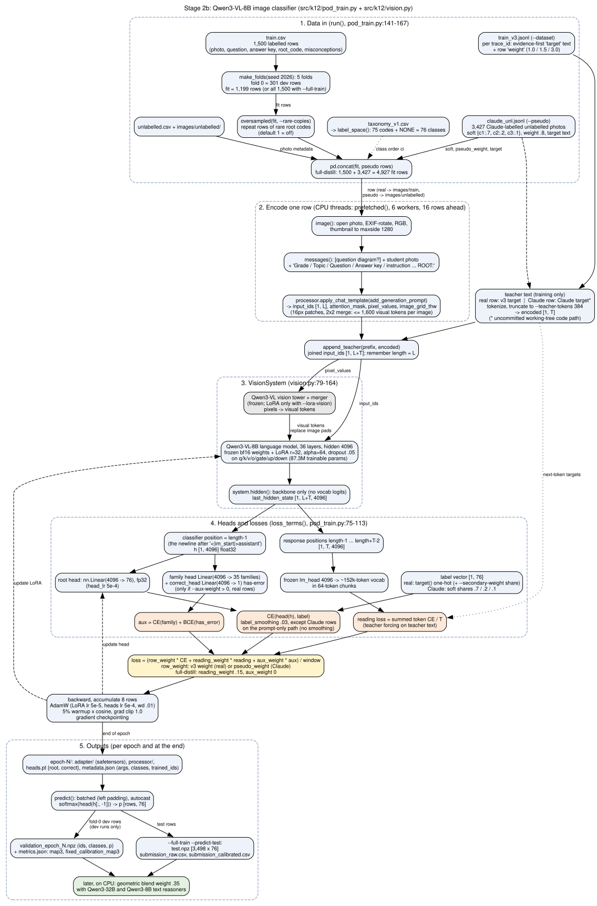

---

### 1. Words you need first

| Term | Plain meaning | Where it shows up here |
|---|---|---|
| **Vision-language model (VLM)** | A language model that also takes images. A vision tower cuts the photo into patches and turns them into "visual tokens". The language model reads those tokens alongside the text. | Qwen3-VL-8B, `vision.py:94-96` |
| **LoRA** (Low-Rank Adaptation) | The 8B weights stay frozen. Next to chosen weight matrices `W` (4096x4096 for `q_proj`) we add a small product `B·A`, where `A` is 32x4096 and `B` is 4096x32. Only `A` and `B` are trained. Each adapted matrix therefore gets 32·(4096+4096) = 262,144 new numbers instead of 16.8M. | `vision.py:114-125` |
| **QLoRA** | LoRA on a base model stored in 4-bit (NF4) to save memory. Only the frozen weights are quantised; the adapters stay in full precision. | `--load-4bit`, `vision.py:89-93`. Tried for a 32B classifier, which reached 0.403 dev after epoch 1 and was stopped (`docs/handoff.md`). |
| **Classification head** | One `nn.Linear(4096 -> 76)` that turns a 4096-number hidden vector into 76 scores. A softmax turns the scores into probabilities. | `vision.py:127` |
| **Cross-entropy (CE)** | The usual classification loss: −log(probability given to the right answer). With a *soft* target it becomes −Σ target_c · log p_c. | `pod_train.py:87, 94, 103` |
| **Label smoothing** | The target is softened from 1.0 on the right code to 0.97, and the remaining 0.03 is spread over all classes. This stops the model from becoming over-confident. | `label_smoothing=.03` at `pod_train.py:94` and `:103`. It applies to real rows, and also to Claude rows on the reading path (§6.2). |
| **Soft labels** | The target is a probability vector instead of a single code, for example `{OOO-01: .7, OOO-02: .2, INT-02: .1}`. | Claude rows, `pod_train.py:81-83` |
| **Distillation** | A small "student" model is trained to copy the outputs of a strong "teacher" (Claude). Here the student copies Claude's ranked codes. In the current working-tree code it can also copy Claude's written explanation (see the caveat in §6.3). | `--pseudo data/v3/claude_unl.jsonl` |
| **Teacher forcing / LM loss** | The real teacher text is fed in, and at each position the model is scored on predicting the next token. | `pod_train.py:105-113` |
| **Auxiliary (multi-task) heads** | Extra small heads trained on related questions ("which error family?", "is there any error?"), in the hope that they shape better shared features. | `auxiliary()`, `pod_train.py:67-72` |
| **Gradient accumulation** | Run 8 single-row passes, add up their gradients, then take one optimiser step. This acts like a batch of 8 without the memory cost. | `--accumulation 8` |
| **Gradient checkpointing** | Activations are not stored during the forward pass; they are recomputed during backward. This trades compute for memory. | `pod_train.py:178` |
| **MAP@3** | The competition metric. You give 3 ranked codes per row. A row scores 1, 1/2 or 1/3 if the true code is 1st, 2nd or 3rd, otherwise 0. The final number is the average over rows. | `core.py:38-51` |

---

### 2. Two scripts, one model class

- **`src/k12/vision.py`** holds the **shared model wrapper** `VisionSystem`, the prompt builder `messages()` and the image loader `image()`.
  - It also contains the original **Kaggle T4 recipe** `train()`: FP16, Qwen3-VL-4B, rank 16, a `--max-pixels 768*768` budget and `maxside` 1024.
  - That recipe produced the first public scores: 0.58216, then 0.598 after calibration.
- **`src/k12/pod_train.py`** is the **RunPod recipe** for the 8B model.
  - Its defaults are BF16, 1280-pixel images and rank 32.
  - It adds the reading loss, dataset v3, Claude pseudo rows, aux heads, secondary weights, rare copies and CPU prefetching.
  - Every 8B image model in this project came from this file.
- **`src/k12/pod_predict.py`** reloads a saved `epoch-N/` folder and scores any CSV by calling the same `predict()` function.

---

### 3. The input: what the model sees

#### 3.1 Loading a photo (`vision.py:50-57`)

```python
def image(data, split, filename, maxside=1024):
    candidates = [data/'images'/split/str(filename), data/str(filename)]
    path = next((p for p in candidates if p.is_file()), None)
    if path is None: raise FileNotFoundError(f'Missing {split} image: {filename}')
    with Image.open(path) as im:
        out=ImageOps.exif_transpose(im).convert('RGB')
    out.thumbnail((maxside,maxside));return out
```

- `exif_transpose` applies the phone's rotation flag, so sideways photos come out upright.
- `thumbnail` shrinks the image until its longer side is at most `maxside` (1280 on the pod). It keeps the aspect ratio and never enlarges.
- `split` picks the folder:
  - real training rows use `images/train`;
  - Claude rows use `images/unlabelled` (`encode_row`, `pod_train.py:42-43`);
  - test rows use `images/test`;
  - question diagrams use `images/questions`.

#### 3.2 The prompt (`vision.py:60-76`)

`messages()` builds a single user turn:
1. If the row has a `question_image_file` (18.2% of train rows), the text `Question diagram:` followed by that image.
2. `Student's handwritten working:` followed by the student photo.
3. A text block, `Grade / Topic / Question / Answer key`, then the instruction:

> "Read the student's actual reasoning. Identify the root major error that the rest of the work follows from, which need not be the first written error. NONE means no major error … Respect crossed-out corrections and do not invent missing steps.\nROOT:"

The same function also supports `task='transcribe'` (used by the transcriber stage) and `task='rank'`.

**What is *not* in the prompt:** the gold transcription, the annotations, `final_answer_correct` and the `question_id`. That is what "identical inputs at train and inference" means in the file docstrings.

#### 3.3 Tokenising (`vision.py:136-138`)

`processor.apply_chat_template(..., add_generation_prompt=True, return_dict=True, return_tensors='pt')` returns:
- `input_ids` `[1, L]`: text tokens, with placeholder `<|image_pad|>` tokens where the images go. Each image is wrapped in `<|vision_start|> … <|vision_end|>`.
- `attention_mask` `[1, L]`.
- `pixel_values` and `image_grid_thw`: the image patches.

The saved processor config (`runs/pod/full-distill/epoch-2/processor/processor_config.json`) sets:
- `patch_size 16` and `merge_size 2`;
- a total-pixel budget of 1,638,400 (= `--max-pixels 1280*1280`) and a minimum of 16,384 (= 128*128). The JSON stores these under the confusingly named keys `size.longest_edge` and `size.shortest_edge`, but they count pixels, not edge lengths.

One visual token therefore covers 32x32 pixels, so a 1280x1280 page becomes at most 1,600 visual tokens. Because `add_generation_prompt=True`, the sequence ends with `<|im_start|>assistant\n`; the saved chat template adds no system message.

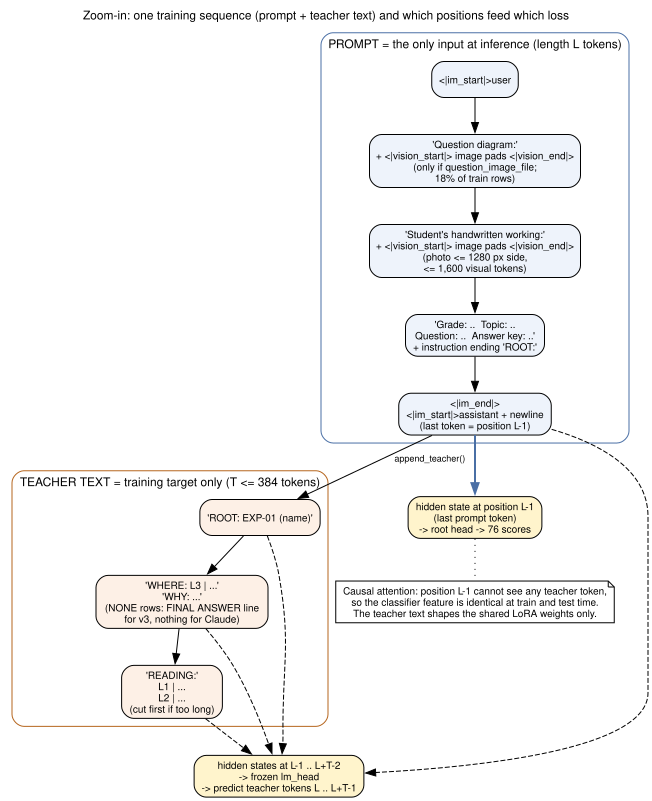

#### 3.4 Keeping the GPU busy: `prefetched()` (`pod_train.py:28-39`)

```python
def prefetched(function, items, workers=6, ahead=16):
    with ThreadPoolExecutor(workers) as pool:
        queue = deque(pool.submit(function, item) for item in items[:ahead])
        for item in items[ahead:]:
            yield queue.popleft().result()
            queue.append(pool.submit(function, item))
        while queue:
            yield queue.popleft().result()
```

Decoding a JPEG, rotating it, resizing it and running the processor all happen on the CPU. Done one at a time, they would leave the GPU waiting between rows. This generator keeps up to 16 future rows "in flight" on 6 background threads. Because it pops from the left of a queue, it still **yields results in the original order**.

It is used in three places:
- training, over the shuffled row order (`pod_train.py:195`);
- `predict()`, over batches with `ahead=4` (`pod_train.py:127`);
- `transcriber.py`, which imports it (`transcriber.py:17`).

---

### 4. The model: `VisionSystem` (`vision.py:79-164`)

1. **Processor.** Loaded with `min_pixels=128*128` and `max_pixels=args.max_pixels`. The tokenizer uses `padding_side='left'` (`:85`). This matters for batched prediction; see §8.
2. **Base model.** `AutoModelForImageTextToText` in `--dtype bfloat16` on one GPU, with SDPA attention. If `--load-4bit` is set, it is quantised to NF4 instead (QLoRA).
3. **LoRA targets** (`:114-125`). Every `nn.Linear` inside `language_model` whose name ends in one of `q_proj, k_proj, v_proj, o_proj, gate_proj, up_proj, down_proj`. With `--lora-vision`, the vision tower's `qkv, proj, linear_fc1, linear_fc2` are added too (`full-distill` records `lora_vision: false`).
   ```python
   self.model=get_peft_model(self.base,LoraConfig(r=args.rank,lora_alpha=args.rank*2,
                lora_dropout=.05,target_modules=targets))
   ```
   - For `full-distill` this gives 36 layers x 7 matrices x (A, B) = 504 tensors and **87,293,952 trainable LoRA numbers**.
   - I counted these from the header of `adapter_model.safetensors` (349 MB, all tensors stored as F32).
   - `lora_alpha = 2·rank` (64 in `adapter_config.json`) means the adapter's output is scaled by alpha/r = 2.
4. **Heads** (`:127-128`). `head = Linear(4096 -> 76)` and `correct_head = Linear(4096 -> 1)`, both in float32. `heads.pt` stores `root.weight [76, 4096]`, `root.bias [76]`, `correct.weight [1, 4096]` and `correct.bias [1]`.
5. **Trainable parameters are cast to float32** (`:132-133`). The frozen base stays in BF16, while the LoRA weights and their optimiser state are fp32, which is more stable.
6. **`hidden()`** (`:140-143`):
   ```python
   def hidden(self,inp):
       inp={k:v.cuda() for k,v in inp.items() if k!='token_type_ids'}
       return self.model.get_base_model().model(**inp,use_cache=False).last_hidden_state
   ```
   - It calls the backbone (`.model`), not the full `ForConditionalGeneration` wrapper.
   - The model therefore returns hidden states `[1, L, 4096]` and **never computes the vocabulary logits (~152k tokens; the tokenizer has 151,669) for every position**.
   - For a 2,000-token prompt those logits would be about 0.6 GB in bf16, or 1.2 GB in fp32. This is an estimate, not measured.

---

### 5. The classification feature: "the last prompt token"

The classifier takes:
- `hidden[:, -1]` when there is no teacher text;
- `hidden[:, length-1]` when teacher text has been appended.

Both are the hidden state of the final newline token in `<|im_start|>assistant\n`. **No text is generated.**

Attention is causal, so this position has "seen" the photo, the question and the instruction. Its 4096 numbers summarise everything the model knows just before it would start answering. The root head maps that summary to 76 scores.

---

### 6. The losses (`loss_terms`, `pod_train.py:75-113`)

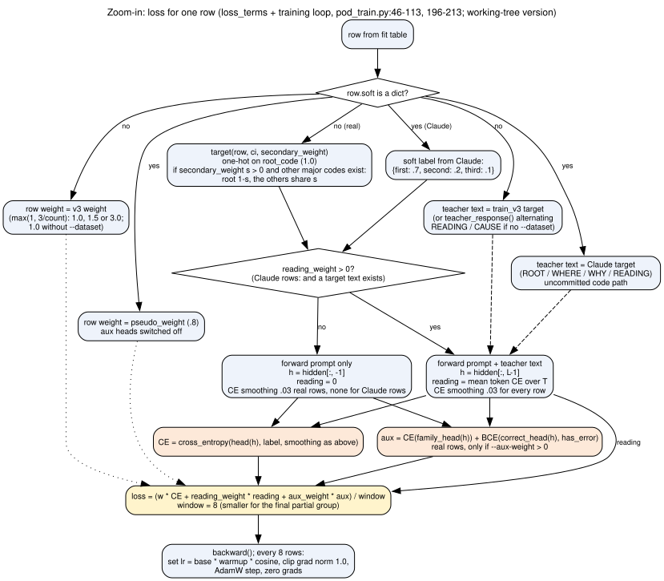

#### 6.1 Root-code target with an optional secondary share (`target`, `:46-57`)

```python
vector = torch.zeros(len(ci), device='cuda')
others = []
if secondary_weight > 0:
    findings = json.loads(str(row.misconceptions).replace('NaN', 'null'))
    others = sorted({f['category'] for f in findings if f.get('severity') == 'major' and not f.get('root')
                     and f.get('category') in ci} - {row.root_code})
vector[ci[row.root_code]] = 1 - (secondary_weight if others else 0)
for code in others:
    vector[ci[code]] += secondary_weight / len(others)
```

By default this is a one-hot vector. With `--secondary-weight s`, any *other* major, non-root errors that annotators marked get a total share `s`, and the root keeps `1 − s`. The idea is to teach ranks 2 and 3 about near-misses. `reports/dataset_v3.json` counts 203 rows with a secondary code and 234 with several major errors.

This was tested as run **D**, together with rare oversampling: dev 0.618 at epoch 3, against 0.619 for the plain run A, so **no gain**. The exact `s` and copy count used are not recorded in `docs/handoff.md`.

#### 6.2 Classification CE

- **Real rows:** `F.cross_entropy(head(h), label, label_smoothing=.03)`, at `:94` (prompt only) or `:103` (with teacher text).
- **Claude rows, two paths in the current working-tree code:**
  - If `reading_weight <= 0`, or the row has no target text, the code uses `F.cross_entropy(head(h), soft_label)` with **no smoothing** (`:87`).
  - Otherwise the row goes down the reading path to `:103`, which applies **`label_smoothing=.03` to the soft label as well**.
  - In the committed version, Claude rows always took the no-smoothing path (see the caveat in §6.3).

#### 6.3 The reading-weight LM loss (`:95-113`)

This is the key idea of run **B** ("teacher-transcription supervision"). Lines 97-113, without the comment and aux lines:

```python
encoded = system.processor.tokenizer(text, add_special_tokens=False, truncation=True,
                                     max_length=args.teacher_tokens, return_tensors='pt')['input_ids']
joined, length = append_teacher(prefix, encoded)
hidden = system.hidden(joined)
prefix_hidden = hidden[:, length - 1].float()
ce = F.cross_entropy(system.head(prefix_hidden), label, label_smoothing=.03)
lm_head = system.model.get_base_model().lm_head
response = hidden[:, length - 1:length + encoded.shape[1] - 1]
encoded = encoded.cuda()
reading = ce.new_zeros(())
for offset in range(0, encoded.shape[1], 64):
    logits = lm_head(response[:, offset:offset + 64]).float()
    reading = reading + F.cross_entropy(logits.reshape(-1, logits.shape[-1]),
                                        encoded[:, offset:offset + 64].reshape(-1), reduction='sum')
return ce, reading / encoded.shape[1], aux
```

Step by step:
1. **Append.** The teacher text (up to `--teacher-tokens 384`) is tokenised and **appended after the prompt** by `append_teacher` (`reading_finetune.py:36-44`). That function extends `input_ids` and the attention mask with ones, and any `token_type_ids` / `mm_token_type_ids` with zeros. The image tensors are unchanged.
2. **One forward pass** covers prompt plus teacher text.
3. **Classifier position.** The classifier reads position `length-1`. Attention is causal (each token sees only earlier tokens), so this position **cannot see the teacher text**. Its feature is computed exactly as at test time, when there is no teacher text.
4. **Next-token predictions.** Positions `length-1` to `length+T-2` each predict the *next* teacher token. They go through the model's own `lm_head` (4096 -> vocabulary), which is frozen because LoRA does not target it. The work is done in **64-token chunks**, so the full `[T, ~152k]` logit matrix never sits in memory at once.
5. **Average.** The summed token CE is divided by `T` to give a per-token average.

**Why it helps.** To write "WHERE: L3 | 27 : 3 = …", the shared LoRA weights must learn to actually *read the handwriting* and locate the error, and that improves the feature the classifier uses.

**Measured on dev:** A (CE only) scored 0.619 and B (reading weight 0.15) scored **0.632** at epoch 3. The paired question-bootstrap 95% interval for B against the submitted 4B reference is [−0.014, +0.060] (`reports/pod_8b_read_dev.json`). The gain is suggestive but not statistically certain.

**Which teacher text?**
- **No `--dataset`:** `teacher_response()` (`reading_finetune.py:25-33`) alternates by row index between `ROOT: X\nREADING: <gold transcription>` and `ROOT: X\nCAUSE: <annotator root text>`. The `index` argument (`k + epoch`, `pod_train.py:198`) exists only for this alternation.
- **With `--dataset train_v3.jsonl`:** the v3 "evidence-first" target (`scripts/build_dataset_v3.py:33-45`), described in §7.
- **Claude rows:** Claude's own `ROOT (name) / WHERE / WHY / READING` text (`scripts/build_claude_distill.py:56-58`). `NONE`-first rows get only `ROOT: NONE (no major misconception)` plus `READING`.

**Caveat: was Claude's text actually used?**
- The code path that uses this text for pseudo rows (`pod_train.py:84-88, 164`) is an **uncommitted** change in the working tree. The committed version (97b4e98) gave Claude rows soft CE only, with no smoothing.
- The run metadata records arguments but not the code version.
- File timestamps point one way. The commit is 03:55 UTC on 11 Nov. `pod_train.py` was last modified at 04:23 UTC, `claude_unl.jsonl` was built at 04:27 UTC, and the `dev-distill` results arrived at 07:23 UTC. So both distill runs **probably** used Claude's text as an LM target, but this is **not recorded**.

#### 6.4 Auxiliary heads (`auxiliary`, `:67-72`)

```python
family = torch.tensor([families[row.root_code.split('-', 1)[0].upper()]], device='cuda')
error = torch.tensor([float(row.root_code != 'NONE')], device='cuda')
return (F.cross_entropy(family_head(hidden), family)
        + F.binary_cross_entropy_with_logits(system.correct_head(hidden).view(-1), error))
```

- **Family head:** a new `Linear(4096 -> 35)`. The 35 families are the code prefixes (`EXP`, `FRA`, `ALG`, … plus `NONE`), built at `:184`.
- **Has-error head:** reuses `correct_head`, with BCE on "root_code ≠ NONE". In the old Kaggle `vision.py` recipe, this same head predicted `final_answer_correct` with weight 0.2 (`vision.py:208-210`).
- **When they are on:** only when `--aux-weight > 0`, and only for real rows. Pseudo rows either return early or set `family_head = None` (`:88`).

The heads were motivated by the failure analysis in `docs/handoff.md`: "68% of lost points are 'saw an error but named the wrong error family'". They were measured as run **E** (`runs/pod/dev-aux`): dev 0.613 at epoch 3 against 0.619 for A, so **no gain**. `full-distill` records `aux_weight 0`.

#### 6.5 Total loss and optimiser (`pod_train.py:196-213`)

```python
if isinstance(row.get('soft'), dict):
    weight = row.pseudo_weight
else:
    weight = args.v3[row.trace_id]['weight'] if args.v3 else 1.
((weight * ce + args.reading_weight * reading + args.aux_weight * aux) / window).backward()
...
if (k + 1) % args.accumulation == 0 or k + 1 == len(order):
    factor = min(1., (step + 1) / max(1, .05 * updates)) * .5 * (1 + math.cos(math.pi * step / max(1, updates)))
    optimizer.param_groups[0]['lr'] = args.lr * factor
    optimizer.param_groups[1]['lr'] = args.head_lr * factor
    torch.nn.utils.clip_grad_norm_(params + heads, 1.)
    optimizer.step(); optimizer.zero_grad(set_to_none=True); step += 1
```

- **Row weight.** It multiplies **only the classification CE**, not the reading loss.
- **`window`.** Dividing by `window` (normally 8, smaller for the last partial group) makes the accumulated gradient an average.
- **Learning-rate schedule.** A linear warm-up over the first 5% of updates, multiplied by a cosine decay to 0.
- **Two learning rates.** LoRA uses `5e-5`. The heads use `5e-4`, ten times higher, because they start from random.
- **Optimiser.** AdamW with weight decay 0.01 and a gradient-norm clip of 1.0.
- **Precision.** `torch.autocast(bfloat16)` (`:197`) runs the matrix maths in BF16, while the heads and losses are computed in fp32 (`.float()`).

---

### 7. Training data: dataset v3, rare copies, Claude rows

#### 7.1 Dataset v3 (`scripts/build_dataset_v3.py`, `data/v3/train_v3.jsonl`)

There is one JSON line per training row, with `root_code`, `family`, `has_error`, `secondary_codes`, `weight`, `target` and `flags`. `reports/dataset_v3.json` reports 1,500 rows, 35 families and 29 up-weighted rows.

**Evidence-first target.** The text puts the decision-relevant part first, so that 384-token truncation cuts the tail (the transcript), not the reason:
```
ROOT: EXP-01 (Power = base × exponent)
WHERE: L1 | <span of the root step>
WHY: <annotator explanation>
READING:
L1 | ...
```
`NONE` rows get `ROOT: NONE (no major misconception)\nFINAL ANSWER: matches/does not match the key`, followed by `READING:`.

**How much gets cut.** I measured token lengths for this guide with the saved tokenizer, with truncation turned off:

| Targets | Median | 90th percentile | Maximum | Over 384 tokens |
|---|---|---|---|---|
| v3 | 207.5 | 349 | 699 | **5.9%** |
| Claude (`claude_unl.jsonl`) | 232 | 364 | 869 | **6.7%** |

**Row weights** (`build_dataset_v3.py:78`): `weight = max(1, 3 / count(root_code))`. A code seen once gets 3.0 and a code seen twice gets 1.5. The actual distribution is 1,471 rows at 1.0, 16 at 1.5 and 13 at 3.0.

Run **v3** (B with these targets) scored dev 0.627 at epoch 2 and 0.6285 at epoch 3. That is level with B (0.632), not better.

#### 7.2 Rare copies (`oversampled`, `pod_train.py:60-64`)

```python
counts = fit.root_code.map(fit.root_code.value_counts())
copies = np.clip(np.ceil(max_copies / counts), 1, max_copies).astype(int)
return fit.loc[fit.index.repeat(copies)].reset_index(drop=True)
```

- **Rule.** With `--rare-copies 3`, a code seen once is repeated 3 times and a code seen twice is repeated twice (ceil(3/2) = 2). Codes with 3 or more examples are left alone.
- **Effect on all 1,500 train rows** (computed for this guide): the table grows to 1,542 rows with 3 copies, 1,513 with 2 and 1,591 with 5.
- **Order.** It runs **before** Claude rows are added, so Claude rows are never duplicated.
- **Verdict.** It is a cruder relative of the v3 row weights, and it was part of the no-gain run D.

#### 7.3 Claude pseudo rows (`pod_train.py:158-167`, `scripts/build_claude_distill.py`)

1. **Labelling.** Claude Opus (`claude-opus-5-5`, `scripts/claude_label.py:23`) looked at **unlabelled** photos, never test photos. For each photo it returned `transcription`, `root_line`, `reasoning` and `first/second/third_code`.
2. **Conversion.** `build_claude_distill.py` turns each answer into a training row:
   - a soft label `{first: .7, second: .2, third: .1}` (shares add up if codes repeat);
   - `weight = .8` by default. The later v3 and v4w builds also use `.5` for error answers longer than 700 output tokens and `1.0` for rare first codes;
   - a target text.

   It then caps rows whose first code is `NONE` at one third of the output, because (per the script's help text) the unlabelled pool contains far more correct work than test does.
3. **The file used here.** The distill runs used `data/v3/claude_unl.jsonl`. `full-distill`'s metadata names `/workspace/data/claude_unl.jsonl` on the pod, and its row count matches. Counted for this guide, the file has **3,427 rows**: all weight 0.8, all with three distinct codes and a target, 1,142 of them `NONE`-first.
4. **Later builds.** They have 6,764 rows (`reports/claude_distill_v3.json`) and 11,426 rows (`reports/claude_distill_v4*.json`). I found no image-model run in `runs/pod` that used them; they fed the text-model experiments.
5. **Joining.** In `run()`, these rows are joined to `unlabelled.csv`, which supplies the grade, topic, question, answer key and image file. The pseudo-label table is stored in new columns `soft`, `pseudo_weight` and `target`, and `root_code` is set to the arg-max code. The rows are then concatenated to the fit table. For `full-distill`, `metadata.json` records `fit_rows: 4927` = 1,500 + 3,427.

There is also an older self-training file, `data/v3/pseudo_v3.jsonl`.
- It has 1,565 rows kept from 9,602 scored unlabelled photos, using confidence ≥ 0.5 on the project's own 8B predictions, with weight 0.5 (`reports/pseudo_v3.json`).
- It has no target text, so its rows always take the soft-CE, prompt-only path through the same `--pseudo` option.
- I found no dev score for an image run trained on it in the reports.

---

### 8. Prediction, saving, validation (`pod_train.py:116-138, 222-238`)

**predict()**
- It groups rows into batches (`--batch-size`, 4 in `full-distill`).
- Each batch is built with the chat template using `padding=True` and **left padding**: short prompts are padded at the *start*, so position `-1` is the real last token for every row.
- It runs under autocast and takes `softmax(head(hidden[:, -1]))`.
- The result goes to `save_bundle()` (`core.py:97-103`), which writes `.npz` files holding `ids`, `classes`, `p` (rows x 76, with rows renormalised) and `meta`.

**After each epoch** the loop does three things:
- It saves `epoch-N/`, containing:
  - `adapter/` (LoRA safetensors and config) and `processor/`;
  - `heads.pt`;
  - `metadata.json`: args, GPU, library versions, SHA-256 hashes of the model config and `train.csv`, class order, `fit_rows`, `trained_ids`.
- Unless `--full-train` is set, it predicts the 301 dev rows into `validation_epoch_N.npz`.
- It writes `metrics.json` with raw `map3` and `fixed_calibration_map3`.

**Fixed calibration** (`holdout_calibration.calibrated`, `:12-14`) works in two steps:
1. It softens the probabilities with temperature 2 (`p^(1/2)`, renormalised).
2. It mixes in 25% of a `HierarchicalPrior`, which is a smoothed per-question and per-topic code frequency (`baseline.py:13-36`).

**`--full-train --predict-test`** trains on all 1,500 rows plus the pseudo rows, with no dev scoring. It then writes `test.npz` (3,498 x 76), `submission_raw.csv` and `submission_calibrated.csv`. `full-distill` was run this way on an RTX A6000 (`runs/pod/full-distill/epoch-2/metadata.json`), with:
- `epochs 2`, `rank 32`;
- `reading_weight 0.15`, `aux_weight 0`;
- `dataset train_v3.jsonl` and `pseudo claude_unl.jsonl`.

**Two different models.**
- The dev number comes from `dev-distill`, which by design was trained on the 1,199 fit rows plus the Claude rows. Its own `metadata.json` was not copied back to this Mac, so its exact arguments are not recorded locally.
- The test predictions come from a separate model, `full-distill`, trained on all 1,500 rows plus the Claude rows.

This keeps the dev score honest, but the test model itself was never scored.

---

### 9. Results (dev = fold 0, 301 rows)

| Run | What changed | Dev MAP@3 | Source |
|---|---|---|---|
| 4B original (`vision.py` Kaggle recipe) | — | 0.5952 raw, 0.607 calibrated | `runs/arch/ensemble-anatomy/anatomy.json`, `reports/pod_8b_cls_dev.json` |
| A `dev-cls` | 8B, CE only | 0.550 / 0.604 / **0.619** (epochs 1/2/3) | handoff, `pod_8b_cls_dev.json` |
| B `dev-read` | + reading LM loss 0.15 | 0.557 / 0.615 / **0.632** | handoff, `pod_8b_read_dev.json` |
| D | A + secondary soft labels + rare copies | 0.529 / 0.611 / 0.618 | handoff |
| E `dev-aux` | A + family and has-error heads | 0.524 / 0.617 / 0.613 | handoff |
| v3 `dev-v3` | B + dataset v3 targets and weights | 0.539 / 0.627 / 0.6285 | handoff, anatomy.json |
| 32B QLoRA classifier | bigger base, 4-bit | 0.403 at epoch 1 (stopped) | handoff |
| **`dev-distill`** | v3 recipe + Claude rows (assumed same arguments as `full-distill`; not recorded locally) | **0.6528** (epoch 2) | anatomy.json, `balance_generality.json` |
| Claude Opus zero-shot (oracle, not deployable) | — | 0.8189 | `reports/claude_dev_opus.json` |

**Extra numbers for `dev-distill`:**
- **Calibration.** Top-1 accuracy is 0.558. With the fixed T=2 / 25%-prior calibration it scores **0.6262**, so calibration *hurts* this model, and the raw probabilities go into the blend. Both numbers were computed for this guide with `core.map3`.
- **By row group** (`runs/arch/ensemble-anatomy/anatomy3.json`):
  - 0.7875 when the true code had already appeared for that question in the fit rows (149 rows);
  - 0.4985 when the question was known but the code was new for it (113 rows, including NONE rows where NONE was new);
  - 0.5855 on questions not seen at all (39 rows).

  This is the "memorising" pattern. `runs/arch/PLAN.md` identifies codes that are new for a known question as the main gap to Claude.
- **Sinkhorn label balancing** (explained in the combiner section), applied to this model alone, gives 0.6645 at λ=0.5 and 0.6744 at λ=1.0 (`runs/arch/label-structure/balance_generality.json`).

**Public scores that include this model** (`reports/status.json`):

| Submission | Blend | Public | Dev |
|---|---|---|---|
| 58234705 | Qwen3-8B text reasoner x VL distill, 50/50 geometric | **0.68283** | 0.6932 |
| 58240192 | 3-way geometric: .35 (32B text) / .30 (8B text) / .35 (VL distill) | **0.7085** | 0.7182 |

The 3-way weights were picked on dev; cross-fitted weights give 0.706 (`PLAN.md`).

A **geometric blend** multiplies the models' probabilities, each raised to its weight (`p = Π p_i^{w_i}`, then renormalised). A label ranks high only if *every* model gives it reasonable probability.

Training time and cost for the distill runs are **not recorded** in the files I read; `reports/runpod_budget.json` has no distill entry.

---

### Key files

- `src/k12/pod_train.py`: RunPod trainer and predictor. `prefetched` :28, `target` :46, `oversampled` :60, `auxiliary` :67, `loss_terms` :75, `predict` :116, `run` :141, CLI `parser` :242.
- `src/k12/vision.py`: `image` :50, `messages` :60, `VisionSystem` :79 (LoRA :114, heads :127, `encode` :136, `hidden` :140, `save` :159), old Kaggle `train` :167.
- `src/k12/reading_finetune.py`: `teacher_response` :25, `append_teacher` :36.
- `src/k12/pod_predict.py`: rescoring a saved checkpoint.
- `src/k12/core.py`: `label_space` :18, `topk` :31, `map3` :50, `make_folds` :64, `save_bundle` :97.
- `src/k12/holdout_calibration.py` (`calibrated` :12) and `src/k12/baseline.py` (`HierarchicalPrior` :13).
- `scripts/build_dataset_v3.py` -> `data/v3/train_v3.jsonl`, `reports/dataset_v3.json`.
- `scripts/build_claude_distill.py` -> `data/v3/claude_unl*.jsonl`, `reports/claude_distill*.json`.
- `runs/pod/dev-distill/validation_epoch_2.npz` (dev probabilities), `runs/pod/full-distill/epoch-2/` (checkpoint), `runs/pod/full-distill/test.npz`.
- `reports/pod_8b_cls_dev.json`, `reports/pod_8b_read_dev.json`, `runs/arch/ensemble-anatomy/anatomy*.json`, `docs/handoff.md`, `runs/arch/PLAN.md`.

---

### Things to try yourself (CPU only)

**1. Score the dev bundle.** This should print `301 0.6528…` and then `0.6262…`:
```python
# run from the repo root with: PYTHONPATH=src python3
from k12.core import read_csv, label_space, make_folds, map3, aligned_bundle
from k12.baseline import HierarchicalPrior
from k12.holdout_calibration import calibrated
tr = read_csv('data/raw/train.csv'); cl = label_space(read_csv('data/raw/taxonomy_v1.csv'))
f = make_folds(tr); fit, val = tr[f != 0], tr[f == 0].reset_index(drop=True)
p = aligned_bundle('runs/pod/dev-distill/validation_epoch_2.npz', val.trace_id.tolist(), cl)
print(len(val), map3(val.root_code, p, cl))
prior = HierarchicalPrior(cl).fit(fit).predict_proba(val)
print(map3(val.root_code, calibrated(p, prior, .25, 2.), cl))
```
Extension: loop over `w in [0, .1, .25]` and `T in [1, 2]` to see which calibration settings help. Then split the score by `val.root_code == 'NONE'`.

**2. Look inside the checkpoint.**
- Run `torch.load('runs/pod/full-distill/epoch-2/heads.pt', map_location='cpu', weights_only=True)` and print the shapes. You should see `root.weight [76, 4096]` and `correct.weight [1, 4096]`, plus their biases.
- Read the JSON header of `adapter/adapter_model.safetensors`. The first 8 bytes give the header length (little-endian), and the header lists every tensor's shape.
- Count the parameters (87,293,952), and check that `q_proj` has `lora_A [32, 4096]` and `lora_B [4096, 32]`.

**3. Rebuild the targets by hand.**
- `from k12.pod_train import oversampled` runs on CPU. Call `oversampled(tr, 3)` and confirm it returns 1,542 rows. Which codes were copied, and how many times?
- `target()` creates its tensor on `cuda`. Copy it into your notebook with `device='cpu'`, then print the label vector for a row that has secondary codes in `train_v3.jsonl`, using `s=.2`.

**4. Check how much teacher text is cut off.**
- Load `runs/pod/full-distill/epoch-2/processor/tokenizer.json` with `tokenizers.Tokenizer.from_file`. **Call `.no_truncation()` first**, because the saved file has a 384-token truncation setting baked in.
- Measure the token lengths of the `target` fields in `train_v3.jsonl` and `claude_unl.jsonl`. You should find about 6–7% over 384.
- Read one long target and see which part is lost.

---

### Common confusions

- **"Does the model generate the answer?"** No. It reads one hidden vector at the last prompt token and applies a linear head. The text after `ROOT:` is only a training target. Prediction is a single forward pass, and nothing is decoded.
- **"Does the teacher transcription leak into predictions?"** No. It is appended *after* the classifier position, and causal attention stops that position from looking ahead. At inference no teacher text exists, and the feature is computed the same way.
- **Four different weights.**
  - `weight` / `pseudo_weight` scale the per-row classification CE.
  - `--reading-weight` scales the LM loss.
  - `--aux-weight` scales the family and has-error losses.
  - `--secondary-weight` changes the *target vector*, not the loss scale.
- **`correct_head` in `heads.pt`.** In `full-distill`, `aux_weight=0`, so `correct_head` is never in the optimiser. What is saved is its random (seeded) initial value, and it should be ignored. `pod_train.predict()` does not use it either; only the old `VisionSystem.predict()` reports it.
- **"Distilled" does not mean Claude runs at test time.** Claude labelled training and unlabelled photos only. The final predictions come from the offline Qwen3-VL-8B checkpoint.
- **Dev model vs test model.** `validation_epoch_2.npz` comes from `dev-distill` (fit rows plus Claude rows). `test.npz` comes from `full-distill` (all 1,500 rows plus Claude rows). The 0.6528 is an estimate for a sibling model, not a score of the shipped one.
- **Label smoothing on Claude rows depends on the path.** In the current working-tree code, smoothing is skipped only when a Claude row goes through the prompt-only branch (`:87`). That happens with no target text or `reading_weight <= 0`. With reading on and a target present, as in `full-distill`, line 103 applies 0.03 smoothing to the soft label too. The committed version always skipped it.
- **Rare copies and v3 weights both target rare codes, in different ways.**
  - Copies repeat rows: more gradient steps, and the image is seen several times.
  - Weights scale the loss of a single pass.
  - Neither showed a measurable dev gain alone.
  - Claude rows add genuinely new examples of rare codes, but only a few in the file used here. For example, `MEA-05` has 2 train rows and 3 Claude first-code rows in the 3,427-row `claude_unl.jsonl`. The later 6,764-row build has 16 (`reports/claude_distill_v3.json`).
- **Why batch prediction pads on the left.** Taking `[:, -1]` must hit each row's real last token. With right padding, short prompts would end in pad tokens.


---

<a id="05-teacher"></a>

# The teacher: Claude Opus labels and distillation data

## The teacher: Claude Opus labels and distillation data

### In one paragraph

Our offline models learn from more than the 1,500 human-labelled photos. They also learn from a **teacher**: Claude Opus 5.5, called through the paid Anthropic API on **training and unlabelled photos only, never test photos**. For each photo, `scripts/claude_label.py` asks Claude for four things in a fixed JSON format: a line-by-line transcription, the line where the root error enters, a short explanation, and its three most likely misconception codes. On the 301-photo dev fold, that zero-shot answer scores **MAP@3 0.819**. Our best offline blend scores 0.718 (about 0.706 once its weights are cross-fitted). `scripts/build_claude_distill.py` turns Claude's answers on 26,202 unlabelled photos into 11,426 soft-labelled training rows. The soft shares are .7/.2/.1, each row has a weight, and NONE is capped at 1/3 of the rows. `scripts/build_dataset_v3.py` builds the matching gold rows from the 1,500 labelled photos. The students learn from both, and only those offline students make the final predictions. Two students are documented as trained on these rows: the Qwen3-VL-8B image classifier and the Qwen3-8B text models. The API cost $186.61 on the main key and $25.33 on a second key.

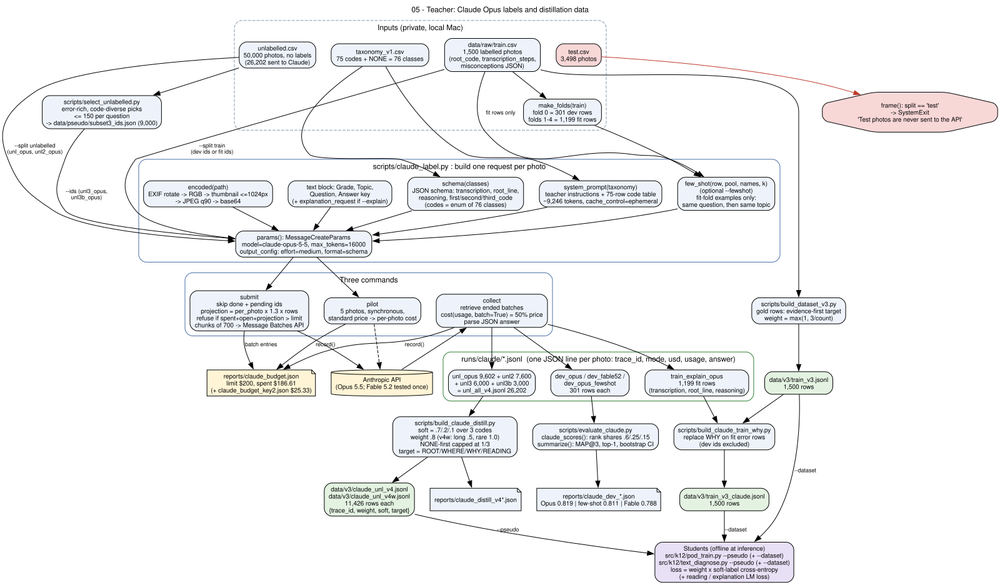

---

### 1. Concepts you need first

| Term | Plain meaning | Where it shows up here |
|---|---|---|
| **Teacher / student (distillation)** | A strong, expensive model (the teacher) labels data. A smaller, cheaper model (the student) is trained to copy those labels. At inference, only the student runs. | Claude is the teacher. Two students are documented as trained on Claude rows: the Qwen3-VL-8B image classifier (`runs/pod/dev-distill`) and the Qwen3-8B text models (scaling study). No file checked records whether the 32B text model used Claude rows. |
| **Pseudo-label** | A label produced by a model rather than a human. It is noisy, but it is cheap and there are many of them. | Claude's codes on 26,202 of the 50,000 unlabelled photos. |
| **Soft label** | Instead of "the answer is A" (one-hot), the target is a distribution such as A 0.7, B 0.2, C 0.1. The student is rewarded for putting some probability on near-misses too. | `soft = {A: .7, B: .2, C: .1}` in every distillation row. |
| **Row weight** | A multiplier on one row's loss. A weight of 0.5 means "learn half as much from this row". | Claude rows: 0.8 normally, 0.5 for low-confidence ones in v4w. Gold rows: up to 3.0 for very rare codes, but only in the image trainer with `--dataset`; the text trainer gives every gold row 1.0. |
| **MAP@3** | The competition metric. You submit 3 ranked codes per photo. You get 1 point if the true code is 1st, 1/2 if 2nd, 1/3 if 3rd and 0 otherwise, averaged over photos. | `row_scores` / `map3` in `src/k12/core.py:38-51`. |
| **Batch API** | You send many requests at once and collect the results later (asynchronously). It costs **half price**. | `submit` / `collect` commands. |
| **Prompt caching** | If many requests start with the same long prefix, the API stores it once. Later requests read it at 1/20 of the normal input price ($0.20/M instead of $4/M for Opus). | The ~9,246-token system prompt (instructions + taxonomy table). |
| **Structured output (JSON schema)** | The API forces the reply to match a JSON schema, so it always parses. Enum fields can only take allowed values. | The `transcription / root_line / reasoning / first_code / second_code / third_code` schema. |
| **Paired question bootstrap CI** | Resample *questions* (not rows) 2,000 times with replacement, recompute the per-row score difference between two systems each time, and take the 2.5% and 97.5% quantiles. If the interval excludes 0, the difference is probably real. Grouping by question matters because photos of the same question are correlated. | `summarize()` in `scripts/evaluate_working_verifier.py:154-171` (seed 2026). |
| **Dev fold / fit folds** | `make_folds(train)` (`src/k12/core.py:64`) splits the 1,500 labelled photos into 5 folds. Fold 0 (301 rows) is the development set. The other 1,199 rows are "fit" rows used for training. | Every dev number in this section is on fold 0. |

---

### 2. Why this is allowed (and where the line is)

- **Competition rule.** The organiser forbids external APIs in the *final solution* and requires offline reproducibility. A follow-up reply allows commercial-API pseudo-labels on **train/unlabelled data** (cited in `docs/competition_research.md:24`). The same line also says "we use no paid APIs". That sentence predates 11 Nov and is now out of date.
- **User authorisation.** AGENTS.md, 11 Nov 2026: the paid Claude API may be used *"for training and unlabelled photos only, never test photos. Final predictions must come from offline models."* The working limit is $200, tracked in `reports/claude_budget.json`.
- **The code enforces it.** `frame()` refuses the test split before any image is read:

```python
# scripts/claude_label.py:165-173
def frame(args):
    if args.split == 'test':
        raise SystemExit('Test photos are never sent to the API')
    data = Path(args.data)
    rows = read_csv(data / ('train.csv' if args.split == 'train' else 'unlabelled.csv'))
    if args.ids:
        keep = json.loads(Path(args.ids).read_text())
        rows = rows.set_index('trace_id').loc[keep].reset_index()
    return rows
```

- **Dev labels are measurement only.** Claude's answers on the 301 dev photos are used only to *score* Claude. `runs/arch/PLAN.md` tags anything that uses them **O = oracle**. They are never training data. Few-shot examples come only from fit folds (`claude_label.py:215-216`: `pool = train[make_folds(train) != 0]`). `build_claude_train_why.py:18-23` drops dev IDs, and none of the 1,199 explain rows is a dev ID (checked).
- **No test hand-labelling.** No human or API looks at test photos. The test CSV is produced by offline students only, and every submission still needs the user's explicit OK.

---

### 3. `scripts/claude_label.py`: asking the teacher

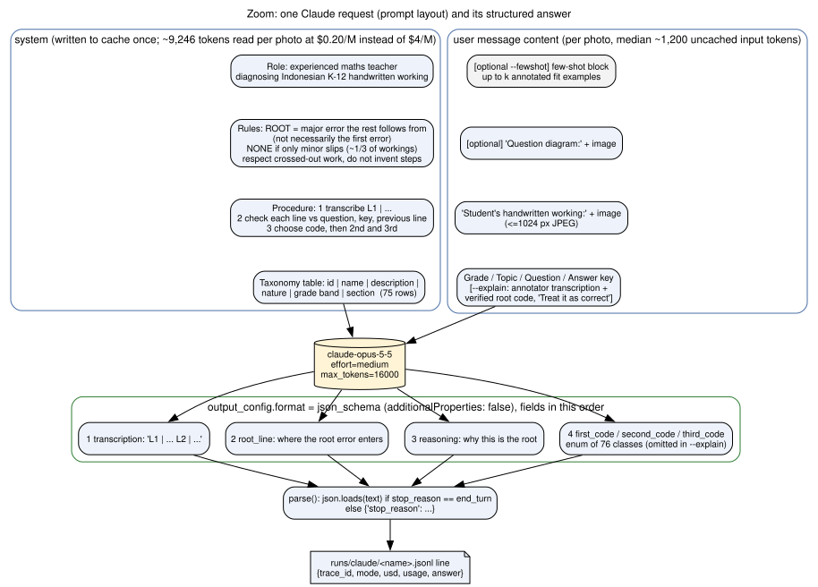

#### 3.1 Model, prices, budget files

```python
# scripts/claude_label.py:23-31
MODEL = 'claude-opus-5-5'
# USD per million tokens (Anthropic pricing page, 11 Nov 2026); batch requests cost half.
PRICES = {'claude-opus-5-5': {'input_tokens': 4.0, 'output_tokens': 20.0, 'cache_read_input_tokens': .2,
                              'cache_creation_input_tokens': 5.0},
          'claude-fable-5-2': {'input_tokens': 8.0, 'output_tokens': 40.0, 'cache_read_input_tokens': .2,
                               'cache_creation_input_tokens': 10.0}}
RATES = PRICES[MODEL]
BUDGET = Path('reports/claude_budget.json')
KEY = Path.home() / '.config/k12/anthropic_key'
```

`cost(usage, batch)` (lines 40-42) multiplies each usage field by its rate and halves the total for batch requests. `record()` (lines 49-54) appends a timestamped log entry to the budget file and adds the amount to `spent_usd`. `configure()` (lines 176-179) lets one run switch model, key file and budget file. That is how the Fable test and the `unl3b_opus` run were charged to the second key and logged in `reports/claude_budget_key2.json`. The key file is read (line 36) but never printed.

#### 3.2 The system prompt (cached)

`system_prompt(taxonomy)` (lines 57-71) builds one long string in three parts:
1. **Role and rules.** "You are an experienced mathematics teacher…". The ROOT is *the major error the rest of the working follows from, not necessarily the first error*. Claude should answer NONE when there are only minor slips. "About a third of workings are NONE, and false alarms on correct work are as harmful as missed errors." It must respect crossed-out work and must not invent steps.
2. **Procedure.** Transcribe as `L1 | ...`, check each line against the question, the key and the previous line, choose a code, then give a 2nd and a 3rd.
3. **The taxonomy table.** One line per code: `id | name | description | nature | grade band | section`. There are 75 codes; adding NONE gives a label space of 76 classes (`label_space()` in `src/k12/core.py:18-19`).

Every request sends this same text, so it is marked `cache_control: ephemeral` (line 155). In the `unl_opus` run, 1 request wrote the cache and **9,601 of 9,602 read it**. Each read covered a median of **9,246 tokens** at $0.20/M instead of $4/M (measured from `usage` in `runs/claude/unl_opus.jsonl`). Rough arithmetic (an estimate, not measured): without caching, each batch photo would cost about 9,246 × ($4 − $0.20)/M × 0.5 ≈ **$0.018 more**. That is about 3.4× the observed $0.0073.

#### 3.3 The per-photo user message

`params()` (lines 144-157) assembles the content blocks in this order:

```python
# scripts/claude_label.py:145-157
content = [{'type': 'text', 'text': shots}] if shots else []
if str(row.question_image_file).strip():
    content += [{'type': 'text', 'text': 'Question diagram:'},
                encoded(images / 'questions' / row.question_image_file)]
content += [{'type': 'text', 'text': "Student's handwritten working:"}, encoded(images / split / row.image_file),
            {'type': 'text', 'text': f'Grade: {row.grade}\nTopic: {row.topic_name}\nQuestion: {row.question_text}\n'
                                     f'Answer key: {row.correct_answer}'
                                     + (explanation_request(row, names) if names else '')}]
return MessageCreateParamsNonStreaming(
    model=MODEL, max_tokens=16000,
    system=[{'type': 'text', 'text': system, 'cache_control': {'type': 'ephemeral'}}],
    output_config={'effort': effort, 'format': schema(classes, explain=bool(names))},
    messages=[{'role': 'user', 'content': content}])
```

- `encoded()` (lines 90-97) fixes phone rotation (`exif_transpose`), converts the photo to RGB and shrinks it so its long side is at most 1024 px. It then saves it as JPEG quality 90 and base64-encodes it. The median uncached input per photo is about 1,160-1,200 tokens (image + text).
- `effort='medium'` (CLI default, line 190) controls how much the model thinks before answering.
- `max_tokens=16000` is generous. The median output was 515 tokens on dev and about 366 on unlabelled photos. No run had a truncated or refused answer: across all eight runs, 0 rows had a non-`end_turn` stop reason (checked in the JSONL files).

#### 3.4 The structured output schema

```python
# scripts/claude_label.py:81-87
code = {'type': 'string', 'enum': classes}
return {'type': 'json_schema', 'schema': {
    'type': 'object', 'additionalProperties': False,
    'required': ['transcription', 'root_line', 'reasoning', 'first_code', 'second_code', 'third_code'],
    'properties': {'transcription': {'type': 'string'}, 'root_line': {'type': 'string'},
                   'reasoning': {'type': 'string'}, 'first_code': code, 'second_code': code,
                   'third_code': code}}}
```

The order of the fields matters. The model writes the **transcription first, then the root line, then the reasoning, and only then the codes**. That is "reason, then decide". The code fields are an `enum` of the 76 classes, so Claude cannot invent a code. That is why every distillation report shows `"skipped": {}`. `parse()` (lines 160-162) loads the JSON. If generation did not finish normally, it stores `{'stop_reason': ...}` instead.

#### 3.5 Two optional modes

- **`--fewshot k`** (`few_shot()`, lines 116-141) puts up to *k* annotated **fit-fold** examples in front of the photo, same-question examples first and then same-topic ones. A CRC32 hash of the two trace IDs gives a deterministic "random" order. Each example shows the question, key, transcription, root code and the annotator's explanation. It raised the median uncached input from 1,201 to 2,796 tokens. The value of *k* used for `dev_opus_fewshot` is not recorded in the reports.
- **`--explain`** (`explanation_request()`, lines 100-113) works on the train split only (checked at lines 204-205; line 202-203 also forbids combining it with `--fewshot`). It gives Claude the annotators' transcription *and* the verified root code ("Treat it as correct") and asks only *why*. The schema then drops the code fields (lines 75-80). This produced `runs/claude/train_explain_opus.jsonl` (1,199 fit rows). There is a caveat in `runs/arch/PLAN.md` §1: these label-conditioned explanations mention answer-key numbers in 58% of rows, against 88% for Claude's own zero-shot reasoning.

#### 3.6 The three commands and the budget guard

| Command | What it does | Price |
|---|---|---|
| `pilot` (lines 223-241) | Sends 5 photos one by one (synchronously) and checks the budget before each one. Prints the measured per-photo cost and the batch estimate (half). | standard |
| `submit` (lines 243-268) | Skips photos that are already done or in an open batch. Projects cost as `per_photo × 1.3 × rows` (a 30% safety margin), using `--per-photo` if given, or else the run's observed batch cost. **Refuses** if spent + open-batch projections + this projection > limit. Sends chunks of 700 photos (sized for the 256 MB batch limit, line 191). | batch (50%) |
| `collect` (lines 270-279, `collect_one` 282-301) | For every ended batch, writes one JSONL line per succeeded result, marks the batch collected and records the real cost. | batch (50%) |

```python
# scripts/claude_label.py:255-258
per_photo = args.per_photo or sum(observed) / len(observed)
projected = per_photo * 1.3 * len(rows)
if state['spent_usd'] + sum(b['projected_usd'] for b in state['batches'] if not b['collected']) + projected > state['limit_usd']:
    raise SystemExit(f'Projected ${projected:.2f} for {len(rows)} photos exceeds the remaining budget')
```

Each output line in `runs/claude/<name>.jsonl` has the form `{trace_id, mode: pilot|batch, usd, usage, answer}`.

#### 3.7 Which photos were labelled

- `dev_*` runs: the 301 dev photos (5 pilot + 296 batch).
- `unl_opus` (9,602) and `unl2_opus` (7,600): unlabelled photos. `unl_all.jsonl` combines these two: 17,202 rows (ID sets verified identical).
- `unl3_opus` (6,000) and `unl3b_opus` (3,000): positions 0-5,999 and 6,000-8,999 of one 9,000-photo list, `data/pseudo/subset3_ids.json`, written by `scripts/select_unlabelled.py`. That script estimates each remaining photo's likely codes from its question's code mix. It then greedily picks photos whose expected codes are still scarce, with at most 150 per question. Because the list is in pick order, the earliest picks are the most error-rich. Claude's NONE-first share was 76.2% for `unl_opus` and fell to 61.2% for `unl3_opus`. For `unl3b_opus` (the later picks) it was back up to 74.0%. All three shares are measured.
- `unl_all_v4.jsonl` combines all four unlabelled runs: **26,202 rows** (verified). `unl_opus` comes first in the file.
- `train_explain_opus`: 1,199 fit photos in `--explain` mode.

---

### 4. How good is the teacher? `scripts/evaluate_claude.py`

Claude gives three ranked codes but no probabilities. `claude_scores()` turns the ranks into a pseudo-probability matrix, so Claude can be scored and blended like any model:

```python
# scripts/evaluate_claude.py:20-30
p = np.full((len(ids), len(classes)), 1e-4)
missing = 0
for row, trace in enumerate(ids):
    answer = answers.get(trace, {})
    codes = [answer.get(k) for k in ('first_code', 'second_code', 'third_code')]
    if not any(codes):
        missing += 1
    for share, code in zip(shares, codes):
        if code in index and p[row, index[code]] < share:
            p[row, index[code]] = share
return normalize(p), missing
```

Every class starts at a tiny floor of 1e-4, so no probability is exactly 0. That keeps geometric blends (products of powers) from collapsing to zero. The 1st, 2nd and 3rd codes get the **rank shares .6/.25/.15**, and the row is renormalised. `main()` then does three things:
- It scores with `summarize()`: MAP@3, top-1, recall@3, MAP@3 on error rows and on NONE rows, and a paired question bootstrap CI against a reference. The reference is the calibrated image model (lines 45-47), or another Claude run when `--baseline` is given (lines 48-49).
- It counts four failure types (lines 53-61). These are a false alarm on a NONE row, a missed error (Claude said NONE), a wrong family (the code prefix before `-` differs) and a right family with the wrong code.
- Optionally, it tries geometric blends `claude^w × other^(1-w)` with w = .5 and .7 (lines 62-67).

**Measured dev results (301 rows, fold 0):**

| Run | MAP@3 | Top-1 | Recall@3 | Error-row MAP@3 | NONE MAP@3 | Delta vs reference, 95% CI | Cost | $/photo (batch) |
|---|---|---|---|---|---|---|---|---|
| `dev_opus` (zero-shot) | **0.819** | 0.738 | 0.920 | 0.761 | 0.934 | +0.212 vs image model [+0.161, +0.261] | $2.75 | $0.0088 |
| `dev_opus_fewshot` | 0.811 | 0.754 | 0.877 | 0.743 | 0.944 | −0.008 vs Opus [−0.034, +0.017] | $3.48 | $0.0112 |
| `dev_fable52` (key 2) | 0.788 | 0.714 | 0.884 | 0.730 | 0.903 | −0.031 vs Opus [−0.055, −0.006] | $3.88 | $0.0123 |

Sources: `reports/claude_dev_opus.json`, `reports/claude_dev_opus_fewshot.json` and `reports/claude_dev_fable52.json`. Costs come from the budget logs, and $/photo from the `usd` field of the batch rows.

How to read this:
- Few-shot raised top-1 slightly but lowered recall@3. The net change is not significant (the CI spans 0), and it costs more, so zero-shot Opus became the teacher.
- Fable was significantly worse and about 40% more expensive per photo. Key 2 therefore spent nothing more on Fable (approval note in `claude_budget_key2.json`).
- Opus's dev errors were 7 false alarms on NONE rows, 7 errors called NONE, **51 wrong family** and 14 right family but wrong code. Most of its mistakes are choosing the wrong *kind* of error, not missing that there is one.
- For context, `runs/arch/PLAN.md` §1 reports our best offline blend at **0.7182**. That figure includes about 0.012 of optimism from tuning on dev; cross-fitted, it is 0.706. The gap to Claude is 0.1008, CI [0.063, 0.138]. About 78% of that gap comes from 84 error rows of *seen* questions whose true code never appeared for that question in the fit rows.

---

### 5. Gold rows: `scripts/build_dataset_v3.py` → `data/v3/train_v3.jsonl`

This script uses **human labels only** (no API). For each of the 1,500 training rows it writes:

| Field | Meaning |
|---|---|
| `root_code`, `family` (e.g. `ALG`), `has_error` | the label, its prefix, and whether it is NONE |
| `secondary_codes` | other *major* annotated errors that are not the root (lines 63-65). 203 rows have at least one. |
| `weight` | `max(1, 3 / count(root_code))` (line 78). Codes seen once get 3.0 (13 rows), codes seen twice get 1.5 (16 rows), and all others get 1.0. In total 29 rows are upweighted (`reports/dataset_v3.json`). |
| `target` | an "evidence-first" text: `ROOT / WHERE / WHY` (NONE rows: `ROOT / FINAL ANSWER`), then `READING:` + transcription |
| `flags` | unclear (75), crossed_out (314), multiple_major (234), answer_correct_but_error (30), answer_wrong_but_none (19), root_step_missing (0) |

```python
# scripts/build_dataset_v3.py:36-45
if row.root_code == 'NONE':
    answer = 'matches' if str(row.final_answer_correct).lower() == 'true' else 'does not match'
    head = f'ROOT: NONE (no major misconception)\nFINAL ANSWER: {answer} the key'
else:
    root = next((f for f in findings if f.get('root')), {})
    step = root.get('step') or '?'
    span = normalize(root.get('span') or lines(row.transcription_steps).get(step, ''))
    head = (f"ROOT: {row.root_code} ({names.get(row.root_code, '')})\n"
            f"WHERE: {step} | {span}\nWHY: {normalize(root.get('text', ''))}")
return f'{head}\nREADING:\n{transcript}'
```

The decision comes first so that truncation keeps it (the docstring says "so truncation keeps the decision-relevant part"). The median target is 464.5 characters, and the median evidence head is 293.5. In the students, gold rows are one-hot labels. In the image trainer, `--secondary-weight > 0` changes that. `pod_train.target()` (`src/k12/pod_train.py:46-57`) then moves that much probability from the root to the other major codes, so ranks 2-3 learn near-misses. The image trainer also uses each gold row's `weight` from this file when `--dataset` is given (line 205). The text trainer uses weight 1.0 for every gold row (`text_diagnose.py:157`).

**Variant `train_v3_claude.jsonl`.** `scripts/build_claude_train_why.py` replaces the short annotator `WHY:` on fit error rows with Claude's `--explain` reasoning. ROOT, WHERE, READING, NONE rows and dev rows are left unchanged (lines 22, 29-32).

---

### 6. Teacher rows: `scripts/build_claude_distill.py` → `data/v3/claude_unl_v4*.jsonl`

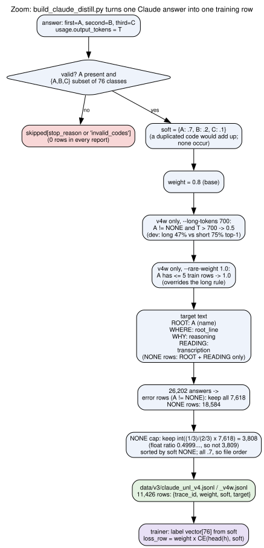

#### 6.1 Soft label from ranks

```python
# scripts/build_claude_distill.py:43-49
codes = [answer.get(k) for k in ('first_code', 'second_code', 'third_code')]
if not codes[0] or not set(codes) <= classes:
    skipped[answer.get('stop_reason', 'invalid_codes')] += 1
    continue
soft = {}
for share, code in zip(args.shares, codes):
    soft[code] = soft.get(code, 0) + share
```

The default shares are **.7/.2/.1**. A duplicated code would *add* its shares here (`claude_scores` takes the max instead), but no duplicates occur in the 26,202 answers (measured).

#### 6.2 Row weights (confidence)

```python
# scripts/build_claude_distill.py:51-55
weight, kind = args.weight, 'base'
if args.long_tokens and first != 'NONE' and record['usage']['output_tokens'] > args.long_tokens:
    weight, kind = args.long_weight, 'long'
if args.rare_weight and first in rare:
    weight, kind = args.rare_weight, 'rare' if kind == 'base' else 'rare_long'
```

- **Base 0.8.** A teacher row counts a bit less than a human row (1.0).
- **Long answers → 0.5** (only when `--long-tokens` is set, as in v3 and v4w). On dev, Opus error answers longer than 700 output tokens had the right first code only **47%** of the time (79 rows), against **75%** for shorter ones (121 rows). This is measured, and it matches the docstring. Long reasoning signals that Claude was unsure.
- **Rare first code → 1.0** (only when `--rare-weight` is set). If the first code has 5 or fewer training rows, the teacher is the main source of examples for it, so its rows count fully. This rule overrides the long rule.

#### 6.3 Target text

The target reads `ROOT: <code> (<name>)` / `WHERE: <root_line>` / `WHY: <reasoning>` / `READING:` / `<transcription>`. NONE rows keep only ROOT and READING (lines 56-58). The format matches the gold rows, so one trainer can read both.

#### 6.4 The NONE cap

```python
# scripts/build_claude_distill.py:62-66
errors = [r for r in rows if not r['target'].startswith('ROOT: NONE')]
nones = [r for r in rows if r['target'].startswith('ROOT: NONE')]
keep_none = int(args.none_share / (1 - args.none_share) * len(errors))
nones = sorted(nones, key=lambda r: -r['soft'].get('NONE', 0))[:keep_none]
rows = errors + nones
```

Claude puts NONE first on **70.9%** of the 26,202 unlabelled photos (18,584 rows, measured). Train is 33.7% NONE: 506 of 1,500, measured from `train.csv` (`runs/research/REPORT.md` quotes 29%). Keeping all of them would teach the student to say NONE far too often. With `none_share = 1/3` the ratio is (1/3)/(2/3). In exact arithmetic that is 0.5, which would give 3,809. In floating point it is 0.49999999999999994, so `int(0.4999… × 7,618)` gives **3,808**. The script therefore keeps 3,808 NONE rows next to all 7,618 error rows, for 11,426 rows in total and a NONE share of 33.3% (`reports/claude_distill_v4.json`).

#### 6.5 The output files

| File | Built from | Rows | Settings | Report |
|---|---|---|---|---|
| `data/v3/claude_unl.jsonl` | `unl_opus` | 3,427 | defaults (all 0.8) | `reports/claude_distill.json`. That file now shows a later rerun (6,764 rows) and has no settings block. |
| `data/v3/claude_unl_v2.jsonl` / `_v3.jsonl` | `unl_all` (17,202) | 6,764 | v2: all 0.8. v3: long 700→0.5, rare 1.0 (5,398 × 0.8, 1,194 × 0.5, 172 × 1.0) | `reports/claude_distill_v3.json` |
| `data/v3/claude_unl_v4.jsonl` | `unl_all_v4` (26,202) | 11,426 | all weights 0.8 | `reports/claude_distill_v4.json` |
| `data/v3/claude_unl_v4w.jsonl` | `unl_all_v4` | 11,426 | weights: 9,169 × 0.8, 1,992 × 0.5, 265 × 1.0 | `reports/claude_distill_v4w.json` |
| `data/v3/scale_25.jsonl`, `scale_50.jsonl` | subsets of v4 | 2,856 / 5,713 | data-scaling study | `reports/claude_scaling.json` (no 50% run is reported) |
| `data/v3/pseudo_v3.jsonl` | **our own model**, not Claude (`scripts/build_pseudo_labels.py`) | 1,565 | top-5 soft, confidence ≥ 0.5, weight 0.5 | `reports/pseudo_v3.json` |

Each Claude row is `{trace_id, weight, soft, target}`. The reports also list rare-code coverage. For example, FRA-03 has 3 training rows and gains 25 Claude first-code rows in v4. Eight rare codes get no Claude rows at all (ANG-02, CHK-01, LIN-01, PRO-01/02/03, SET-01, STA-03), and PRO-03 has no rows anywhere.

#### 6.6 How a student consumes it

**Text student** (`src/k12/text_diagnose.py`). The pseudo rows are appended at lines 164-173, and the loss is built here:

```python
# src/k12/text_diagnose.py:191-199
labels = torch.zeros(len(idx), len(classes), device='cuda')
for row, i in enumerate(idx):
    for code, share in soft[i].items():
        labels[row, ci[code]] += share
row_weight = torch.tensor([weights[i] for i in idx], device='cuda')

def classify(states):
    per_row = F.cross_entropy(system.head(states), labels, label_smoothing=.03, reduction='none')
    return (per_row * row_weight).mean()
```

`F.cross_entropy` with a probability vector as the target is soft-label cross-entropy: the student's 76-way softmax is pulled toward {A: .7, B: .2, C: .1}. Each Claude row feeds the text student in two other ways:
- Claude's **transcription becomes the input text** the text student reads (`fit_text`, line 169), in place of a gold transcript.
- The part of the target before `READING:` becomes the optional explanation language-model loss target (line 172, used when `--explain-weight > 0`, lines 200-202).

**Image student** (`src/k12/pod_train.py`). The rows are loaded at lines 158-167. The soft label vector is built at lines 81-83. Without a reading target, a pseudo row gets plain CE with no label smoothing (line 87). With `--reading-weight > 0`, the whole target text (ROOT … READING + transcription) is appended after the image prompt and becomes a language-model "reading" target (lines 95-113, CE with smoothing .03 at line 103). The row weight is read at lines 202-203 (`row.pseudo_weight`) and multiplied into the loss at line 206.

---

### 7. Costs (all from `reports/claude_budget*.json`)

| Run | Photos | USD | Key |
|---|---|---|---|
| dev_opus | 301 | 2.75 | 1 |
| dev_opus_fewshot | 301 | 3.48 | 1 |
| unl_opus | 9,602 | 70.06 | 1 |
| unl2_opus | 7,600 | 55.53 | 1 |
| unl3_opus | 6,000 | 44.55 | 1 |
| train_explain_opus | 1,199 | 10.23 | 1 |
| **Key 1 total** | | **186.61 of $200 limit** | |
| dev_fable52 | 301 | 3.88 | 2 |
| unl3b_opus | 3,000 | 21.46 | 2 |
| **Key 2 total** | | **25.33** (of a $100 approved limit; the API then refused for low credit, and the key is unusable until its owner adds credit) | |

The observed Opus batch cost is about **$0.0072-0.0074 per unlabelled photo** and $0.0085 per explain photo. `runs/arch/PLAN.md` §3 records **$13.39 left** on key 1 and spends nothing by default.

**Was it worth it?** The scaling study measured a single Qwen3-8B text student on dev, scored on machine transcripts (`reports/claude_scaling.json`):

| Claude rows used | 0% | 25% | 100% |
|---|---|---|---|
| Single 8B | 0.553 | 0.666 | 0.692 |

Going from 0% to 25% gives +0.113 [CI 0.073, 0.156], and going from 25% to 100% gives only +0.026 [CI −0.002, +0.053]. The returns diminish fast. Per `runs/arch/PLAN.md` §1, the *ensemble* barely moves: 0.715 vs 0.718. `REPORT.md` estimates that all 11,426 rows add about +0.025 over a well-trained 8B that uses real rows alone, and it advises against random labelling of more photos.

---

### 8. Label skew: NOT-01 is about 57× over-represented

- **Source.** `runs/research/q5-datasets/label_shift_correction_probe.json` gives a training-mix-to-gold ratio of **57.36 for NOT-01** ("imprecise/incomplete notation without affecting correctness", a *careless* code) and 19.48 for NOT-02.
- **Mechanism** (measured on `unl_all_v4.jsonl`). Claude gives NOT-01 as **second_code in 17,021 of 26,202 answers**, and 16,557 of those are NONE-first rows. It is effectively saying "no major error, but the notation is sloppy". NOT-01 is first only 22 times (and third 2,537 times). After distillation, **5,010 of the 11,426 kept rows** still carry NOT-01 in their soft label. `train.csv` has exactly **1** NOT-01 row.
- **Why it matters.** A student trained on this mix learns a class prior that dev and test do not have. A post-hoc correction (divide by the training-mix prior, multiply by the gold prior^τ) helped one pseudo-trained 8B by about +0.027. On the submitted ensemble it gave about 0 (cross-fit −0.010 to +0.001; `REPORT.md` Q5). Sinkhorn balancing depends on the same question. It rescales the probability matrix so that each class's total matches a target mix. Toward the train label mix it gives +0.019 on dev (`PLAN.md` Step 0). Toward Claude's label mix it gives −0.066, and toward a uniform mix −0.019 (`PLAN.md` §6).
- **Proposed fix (not run).** If the 8B is retrained, remove NOT-01, NOT-02 and REL-01 from the soft secondary slots and reweight teacher rows toward the train code mix (`REPORT.md` Q5 table). The estimated gain is 0 to +0.01; it is unmeasured.

---

### Key files

- `scripts/claude_label.py`: API labeller (prompt, schema, caching, batch, budget, test refusal)
- `scripts/evaluate_claude.py`: rank shares → pseudo-probabilities, dev scoring, failure types, blends
- `scripts/evaluate_working_verifier.py:154-171`: `summarize()` with the paired question bootstrap
- `scripts/build_claude_distill.py`: teacher answers → soft-labelled rows (shares, weights, NONE cap)
- `scripts/build_dataset_v3.py`: gold rows with evidence-first targets and rare weights
- `scripts/build_claude_train_why.py`: swaps in Claude's label-conditioned WHY on fit rows
- `scripts/select_unlabelled.py`: picks error-rich, code-diverse unlabelled photos for `unl3*`
- `scripts/collect_claude_dataset.py`: gathers all Claude-labelled photos into `data/claude_dataset/` (private)
- `src/k12/core.py`: `label_space`, `make_folds`, `topk`, `row_scores`, `map3`
- `src/k12/text_diagnose.py:155-205` and `src/k12/pod_train.py:46-113, 158-167, 200-206`: where the soft rows are consumed
- Data: `runs/claude/*.jsonl`, `data/pseudo/subset3_ids.json`, `data/v3/train_v3.jsonl`, `data/v3/train_v3_claude.jsonl`, `data/v3/claude_unl_v4.jsonl`, `data/v3/claude_unl_v4w.jsonl`, `data/v3/dev_ids.json`
- Reports: `reports/claude_dev_opus.json`, `reports/claude_dev_opus_fewshot.json`, `reports/claude_dev_fable52.json`, `reports/claude_distill_v4*.json`, `reports/claude_scaling.json`, `reports/dataset_v3.json`, `reports/claude_budget.json`, `reports/claude_budget_key2.json`

---

### Things to try yourself (CPU only, no API calls)

Run from the repo root with `PYTHONPATH=src:scripts .venv/bin/python`. The system Python fails to import SciPy because of a NumPy binary mismatch.

1. **Reproduce the teacher's dev scores.**
   ```python
   from k12.core import read_csv, label_space, make_folds, map3
   from evaluate_claude import claude_scores
   train = read_csv('data/raw/train.csv'); classes = label_space(read_csv('data/raw/taxonomy_v1.csv'))
   dev = train.loc[make_folds(train) == 0].reset_index(drop=True)
   for run in ['dev_opus', 'dev_opus_fewshot', 'dev_fable52']:
       p, _ = claude_scores(f'runs/claude/{run}.jsonl', dev.trace_id.tolist(), classes)
       print(run, round(map3(dev.root_code, p, classes), 4))
   ```
   You should see 0.8189 / 0.8106 / 0.7879. Then pass `shares=(.7, .2, .1)`. The score does not change, because MAP@3 depends only on the order of the codes.

2. **See when shares *do* matter.** Load a student bundle with `aligned_bundle('runs/pod/dev-distill/validation_epoch_2.npz', ids, classes)`. Blend it as `normalize(c**w * s**(1-w))` for w in (.5, .7), with shares (.6,.25,.15) and with (.9,.05,.05). Rechecked for this guide: the student alone scores 0.6528, and the blends range from 0.797 (shares .6/.25/.15, w=.5) to 0.817 (shares .9/.05/.05, w=.7). Treat this as an **oracle** exercise only: Claude cannot be used on test, so these blends can never be submitted.

3. **Recompute the NONE cap and the skew.** Count `first_code == 'NONE'` in `runs/claude/unl_all_v4.jsonl` (expect 18,584 of 26,202). Apply `int((1/3)/(1 - 1/3) * errors)`, compare it with `reports/claude_distill_v4.json`, and print `(1/3)/(1 - 1/3)` to see why the result is 3,808 rather than 3,809. Then count which slot NOT-01 sits in (first / second / third).

4. **Check the confidence weighting.** For the error answers in `runs/claude/dev_opus.jsonl`, split on `usage.output_tokens > 700` and compute top-1 accuracy against `train.csv`. Expect about 0.47 (79 rows) vs 0.75 (121 rows). Then try thresholds of 500 and 900. Rechecked: at 500 it is 0.61 vs 0.70, and at 900 it is 0.28 vs 0.69. The direction holds, but the split gets sharper as the threshold rises.

---

### Common confusions

- **"Claude is part of the model."** No. Claude only produces *training targets*. The submitted CSV comes from offline students. Claude never sees a test photo, and `frame()` refuses the test split.
- **"0.819 is our score."** It is the *teacher's* score on 301 dev rows, an oracle reference. Our offline blend is 0.718 on dev (0.706 cross-fitted). The best public score so far is 0.7085 (`reports/status.json`). No Claude prediction was ever submitted. Submitted blends do include students *trained on* Claude's labels, such as the distilled Qwen3-VL-8B image classifier.
- **Two different rank shares.** `.6/.25/.15` (evaluate) turns ranks into probabilities for scoring and blending. `.7/.2/.1` (distill) is the soft *training target*. Neither changes Claude's own MAP@3.
- **`weight` vs `soft`.** `soft` says *which* codes the student should believe, and how much. `weight` says *how loudly* the whole row speaks in the loss.
- **"The NONE cap keeps the most confident NONE rows."** In practice every NONE-first row has soft NONE = 0.7. Python's stable sort therefore keeps them in file order, and `unl_opus` rows come first.
- **v4 vs v4w.** The rows, order, soft labels and targets are identical (checked). Only the weights differ: v4 is all 0.8, while v4w adds long-answer 0.5 and rare 1.0.
- **"teacher_map3" in `reports/claude_scaling.json`** means the student was scored on *gold (annotator) transcripts*, not on Claude's. "machine" means our own transcriber's output.
- **`pseudo_v3.jsonl` is not Claude data.** It holds 1,565 rows labelled by our own image model.
- **Explain-mode rationales are not independent evidence.** Claude was told the answer first, so these WHY lines rationalise a given label. They also lean less on the answer key (58% mention it, vs 88% for zero-shot).
- **Budget numbers.** Costs are recorded at *collect* time from real `usage`. The `projected_usd` in each batch entry is only the 1.3× safety projection used to block over-spending.


---

<a id="06-ensemble"></a>

# Stage 3: combining the models (blend, balancing, evaluation)

## Stage 3: combining the models (blend, balancing, evaluation)

### In one paragraph

Stages 1 and 2 each produce a **probability bundle**. A bundle is an `.npz` file with one row per photo and one column per class: 75 taxonomy codes plus `NONE`, so 76 columns.

Stage 3 combines three of these bundles (Qwen3-32B text, Qwen3-8B text, Qwen3-VL-8B image) with a **weighted geometric mean**, weights .35 / .30 / .35. That blend is the submission that scored **0.7085 public** (dev 0.7182).

On top of the blend we can apply **Sinkhorn label balancing**, a CPU-only post-processing step. It nudges the predicted class frequencies toward the label mix seen in train. On dev it raised MAP@3 to **0.7370** (+0.019, question-grouped 95% CI [+0.006, +0.033]). That CSV is staged and **has not been submitted**.

Every number in this section is judged with two tools:
- **Cross-fitting** keeps the tuning honest.
- A **question-grouped bootstrap** gives the error bars.

Those tools also showed that every fancier combiner we tried either lost to the plain blend or tied with it. That includes stackers, routers, priors and the `stack_models.py` judge.

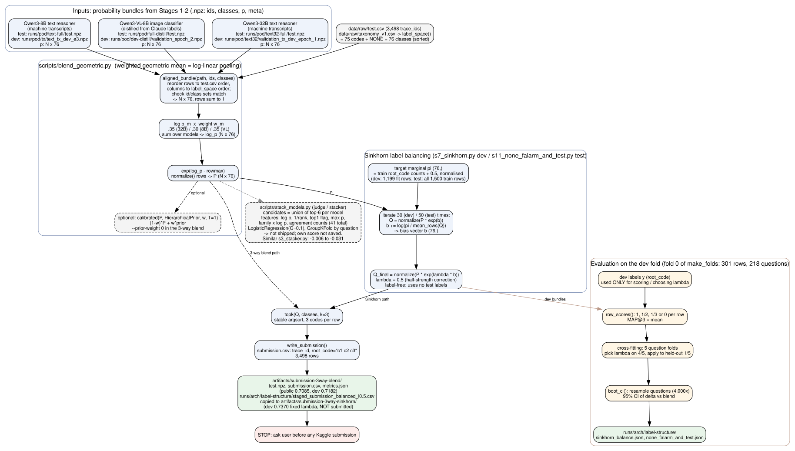

---

### 1. What goes in: probability bundles

Every model in the project writes its predictions with `save_bundle` (`src/k12/core.py:97`) and reads them back with `aligned_bundle` (`src/k12/core.py:106`). A bundle holds:

- `ids`: the photo ids (`trace_id`).
- `classes`: the 76 class names.
- `p`: an N x 76 float32 matrix whose rows sum to 1.
- `meta`: a small JSON note.

`aligned_bundle` matters more than it looks. Different models may store rows and columns in different orders, so it re-indexes both to the order you ask for. It also refuses to continue if the id set or the class set differs:

```python
# src/k12/core.py:106-114
def aligned_bundle(path, ids, classes):
    with np.load(path, allow_pickle=False) as b:
        old_ids, old_classes = b['ids'].tolist(), b['classes'].tolist()
        if len(set(old_ids)) != len(old_ids) or set(old_ids) != set(ids):
            raise ValueError('Prediction ID sets differ')
        ...
        ii, cc = {x: i for i, x in enumerate(old_ids)}, {x: i for i, x in enumerate(old_classes)}
        return normalize(b['p'][[ii[x] for x in ids]][:, [cc[x] for x in classes]])
```

The class order comes from `label_space` (`core.py:18-19`). It is the sorted set of taxonomy ids plus `NONE`.

The three members, from `runs/arch/PLAN.md` section 1 and `artifacts/submission-3way-blend/metrics.json`:

| Weight | Model | Dev bundle (trained on fit rows) | Test bundle (trained on all 1,500 train rows) | Dev MAP@3 alone |
|---|---|---|---|---|
| .35 | Qwen3-32B text reasoner on machine transcripts | `runs/pod/text32/validation_tx_dev_epoch_1.npz` | `runs/pod/text32-full/test.npz` | 0.6523 |
| .30 | Qwen3-8B text reasoner on machine transcripts | `runs/pod/tx/text_tx_dev_e3.npz` | `runs/pod/text-full/test.npz` | 0.6667 |
| .35 | Qwen3-VL-8B image classifier distilled from Claude labels | `runs/pod/dev-distill/validation_epoch_2.npz` | `runs/pod/full-distill/test.npz` | 0.6528 |

The single-model numbers are the λ=0 entries (`component_32b`, `component_8b`, `component_vl`) in `runs/arch/label-structure/sinkhorn_balance.json`.

No single member reaches 0.67, yet the blend reaches 0.7182. The members make partly different mistakes, and the blend cancels some of them.

**The dev fold.** `make_folds` (`src/k12/core.py:64`) assigns fold 0 as the development set: 301 rows from 218 questions. The other 1,199 rows are the "fit" rows that train the dev versions of the models. The split balances label counts across folds (round-robin stratification), which matters later for Sinkhorn.

---

### 2. The metric: MAP@3 in plain words

Each photo has exactly one true root code. We submit three ranked guesses. A row scores:

- 1 if the truth is our 1st guess;
- 1/2 if it is our 2nd;
- 1/3 if it is our 3rd;
- 0 otherwise.

MAP@3 is the average over rows. With one true label per row, "mean average precision at 3" reduces to exactly this.

```python
# src/k12/core.py:38-51
def row_scores(y, predictions):
    ...
    for target, codes in zip(y, predictions):
        if isinstance(codes, str):
            codes = codes.split()
        hits = [1.0 / (i + 1) for i, c in enumerate(list(codes)[:3]) if c == target]
        scores.append(hits[0] if hits else 0.0)
    return np.asarray(scores)

def map3(y, p, classes):
    return float(row_scores(y, topk(p, classes)).mean())
```

`topk` (`core.py:31-35`) uses a **stable** argsort, so ties are broken the same way every time. Only the **ranking** inside each row matters to MAP@3. The actual probability values do not.

---

### 3. The weighted geometric blend (`scripts/blend_geometric.py`)

**Concept.** There are two natural ways to average probability vectors:

- **Arithmetic mean**: `sum_m w_m * p_m`. One confident model can drag a class up even when the others think it is impossible.
- **Geometric mean**, also called *log-linear pooling* or "product of experts": compute `prod_m p_m ^ w_m`, then renormalise. In log space this is a weighted sum of log-probabilities. If any model gives a class almost zero probability, the product stays small, so each model can veto a class. A class wins only when all models find it at least plausible.

On our dev fold the geometric version wins clearly (both numbers reproduced on CPU):

- geometric .35/.30/.35: **0.7182**;
- arithmetic with the same weights: **0.7071**. This is `A_arith_.35/.30/.35(fixed)` in `runs/arch/combiner-headroom/s2_grids.json`, delta −0.011.

**How our code does it** (`scripts/blend_geometric.py:24-31`):

```python
for spec in args.inputs:                       # "name=path.npz:weight"
    name, rest = spec.split('=', 1)
    path, weight = rest.rsplit(':', 1)
    log_p = log_p + float(weight) * np.log(aligned_bundle(path, ids, classes))
    recipe[name] = {'path': path, 'weight': float(weight)}
scores = normalize(np.exp(log_p - log_p.max(axis=1, keepdims=True)))
if args.prior_weight:
    scores = calibrated(scores, HierarchicalPrior(classes).fit(train).predict_proba(test), args.prior_weight, 1.)
```

Line by line:

1. Each input is parsed as `name=path:weight`. `rsplit(':', 1)` splits on the last colon, so paths that contain colons still work.
2. The log of each aligned bundle is multiplied by its weight and added up. The result is an N x 76 matrix of log-scores.
3. **Numerical stability trick.** Subtract the row maximum before `exp`. Otherwise very negative logs underflow to 0. Subtracting a constant from a row does not change that row after normalising.
4. `normalize` divides each row by its sum, so rows become probabilities again.
5. `--prior-weight` is optional. If set, `calibrated()` (`src/k12/holdout_calibration.py:12-14`) mixes in a per-question "usual codes" prior. It computes `(1-w)*softened + w*prior`, where `softened = normalize(max(scores, 1e-12) ** (1/T))`. The blend script passes T=1, so the softening changes nothing and the mix is simply `(1-w)*scores + w*prior`. The 3-way submission used **`prior_weight: 0.0`**, so the prior was off. When cross-fitted, question priors measured −0.004 to −0.005 (PLAN section 4).

The script then writes three files to `--output` (`blend_geometric.py:32-41`):

- `test.npz`: the blended bundle;
- `submission.csv`: `trace_id,root_code`, with three space-separated codes per row;
- `metrics.json`: the recipe, the share of rows with `NONE` ranked first, the dev score you passed in, and a SHA-256 fingerprint of the CSV.

**Real output** (`artifacts/submission-3way-blend/metrics.json`):

| Field | Value |
|---|---|
| rows | 3,498 |
| recipe | text32 (text32-full) .35, text8 (text-full) .30, distill8b (full-distill) .35 |
| prior_weight | 0.0 |
| none_first_share | 0.354 |
| development_map3 | 0.7182 |
| public MAP@3 (from `reports/status.json`, refs 58240192 / 58240232; the second is an accidental duplicate of the same file) | **0.7085** |

**A detail worth knowing.** The script does **not** compute `development_map3`. You pass it in with `--development-map3`, after running the same recipe on the dev bundles yourself. The script cannot check it, so treat it as a note, not a measurement.

**Where did .35/.30/.35 come from?** The weights were picked by looking at dev. `runs/arch/combiner-headroom/s2_grids.json` measured how much that flatters the dev score:

- the best in-sample weights, (.30, .30, .40), score 0.7187;
- **cross-fitted** weights (explained in section 6) score **0.7063**: delta −0.012, CI [−0.021, −0.004].

So about 0.012 of the 0.7182 is optimism from choosing weights on the same rows we score. The cross-fitted 0.706 is close to the public 0.7085. This is why PLAN.md calls 0.706, not 0.718, the "honest baseline".

---

### 4. Sinkhorn label balancing

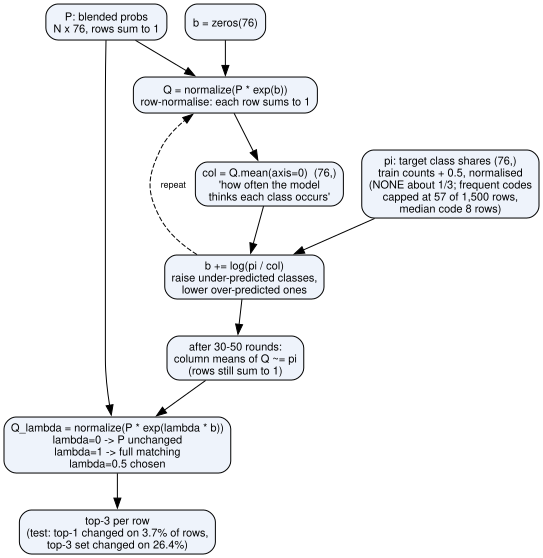

#### 4.1 The problem it fixes: label shift

The train labels look **capped**:

- The most frequent codes stop at exactly 57 rows. Five codes (OTH-00, ANS-01, FRM-01, WOP-01, CAL-01) have exactly 57.
- The median code has only 8 rows, and 74 of the 76 classes appear at all.
- NONE is 506 of 1,500 rows (0.337). Measured on the fit rows with +0.5 smoothing, the NONE share is `NONE_share_train` 0.328 in `runs/arch/label-structure/prior_shift.json`.

Our members were trained on a mix in which Claude pseudo-labels on unlabelled photos dominate, and that mix is very different. For example, `runs/research/ARCHITECTURE_FROM_PAPERS.md` (around line 91) notes that NOT-01 is 57× over-represented relative to gold.

A model absorbs the label frequencies it was trained on. As a result, the blend over-predicts some codes and under-predicts others. A label-free diagnostic in `prior_shift.json` compares how often each code is top-1 on test with how often train frequencies say it should be:

| Code | Top-1 count on test | Expected from train shares |
|---|---|---|
| NONE | 1,239 | 1,146.7 |
| WOP-01 | 168 | 131.5 |
| FRM-01 | 75 | 131.5 |
| FRA-04 | 1 | 18.4 |

12 codes are never top-1 on test at all (`test_codes_never_top1` in `prior_shift.json`, also in `none_falarm_and_test.json`).

#### 4.2 The concept

**Sinkhorn–Knopp matrix scaling** is an old algorithm with a simple loop: alternately rescale a matrix's rows and columns until the row sums and column sums hit chosen targets. In our case:

- **rows** must sum to 1, because each photo's probabilities must sum to 1;
- **column means** should equal a target class distribution `pi`, the train label shares.

The fix is a single **bias vector `b`**, one number per class, added in log space. Classes the model under-predicts get a positive bias, and over-predicted classes get a negative one. This is the same idea as classical *prior correction* (Saerens et al. 2002, cited in `ARCHITECTURE_FROM_PAPERS.md`), done jointly over the whole set.

It is **transductive**: it looks at all the test rows together. It is also **label-free**: it never uses test labels, only the model's own predictions plus the train label counts. One consequence is that a row's final ranking can depend slightly on the other rows in the batch.

**λ (lambda)** sets how strong the correction is. The final scores are `P * exp(λ·b)`, renormalised:

- λ=0 means no change;
- λ=1 means full matching;
- λ=0.5 means "go halfway". Halfway hedges against the target `pi` being only approximately right for test.

#### 4.3 How our code does it: dev experiment (`runs/arch/label-structure/s7_sinkhorn.py`)

```python
# s7_sinkhorn.py:8-13
pi_fit = np.bincount(fit.root_code.map(ci), minlength=len(classes)) + .5; pi_fit /= pi_fit.sum()
def sinkhorn(P, target, lam, iters=30):
    b = np.zeros(P.shape[1]); Q = P
    for _ in range(iters):
        Q = normalize(P * np.exp(b)); b += np.log(target / Q.mean(0))
    return normalize(P * np.exp(lam * b))
```

- **Line 8.** Count each class among the 1,199 **fit** rows (never the dev labels) and add 0.5 to every count. Two classes never appear in train. This "add-half" smoothing keeps a class with zero examples from getting a target of 0, which would make `log(0)` blow up. Then normalise the counts to shares.
- **Inside the loop.** `normalize` fixes the rows. `Q.mean(0)` is "how often the model currently thinks each class occurs". Adding `log(target / Q.mean(0))` pushes each class's bias toward its target.
- **After the loop.** Only `λ·b` is applied to the original `P`.

`P` here is the dev blend from `common.py:13-18`. It uses the same three models and weights as the test blend, but with their dev bundles.

Then the script (`s7_sinkhorn.py:14-29`):

- tries λ over the grid `{0, .1, .25, .5, .75, 1}`;
- **cross-fits** λ over 5 question folds;
- puts a question-grouped CI on the gain over the plain blend.

It also tests balancing each member on its own (`s7_sinkhorn.py:30-33`).

**Measured results** (`runs/arch/label-structure/sinkhorn_balance.json`; the λ=0, 0.5 and 1 rows were reproduced on CPU):

| λ | Dev MAP@3 (in-sample) |
|---|---|
| 0 (plain blend) | 0.7182 |
| 0.1 | 0.7243 |
| 0.25 | 0.7281 |
| **0.5** | **0.7370** |
| 0.75 | 0.7348 |
| 1.0 | 0.7287 |

| Summary | Value |
|---|---|
| Fixed λ=0.5, delta vs blend | +0.0188, CI [+0.0056, +0.0333] |
| Cross-fitted λ (folds chose 0.5, 0.75, 0.5, 0.5, 0.5) | 0.7337, delta +0.0155, CI [+0.0011, +0.0306] |
| Error rows: blend → λ=0.5 | 0.618 → 0.642 |
| NONE rows: blend → λ=0.5 | 0.916 → 0.926 |

`runs/arch/test-combine/cpu_test.json` contains a separate stage-0 cross-fit (`cpu_test.py:66`) over λ ∈ {0, .25, .5, .75}, with the fusion weight w fixed at 0. All 5 folds chose λ=0.5, so its cross-fitted score equals the fixed-λ 0.7370.

**Does balancing help each model on its own?** Mostly yes, but not always:

- In `sinkhorn_balance.json`, the 32B goes from 0.652 to 0.710 at λ=1. The 8B goes from 0.667 to 0.675, and the VL from 0.653 to 0.674.
- `balance_generality.json` shows that the gain is not universal. The 0%-Claude 8B (`scale_0`) drops from 0.5532 to 0.546 at λ=0.5. The 235B few-shot drops from 0.6495 to 0.6318 at λ=1.

**Balance each member, or only the final blend?** `runs/arch/label-structure/s8_component_balance.py` balanced each member before blending, with an optional extra balance of the blend at strength 0 or 0.5. Its cross-fitted results (`component_balance.json`) were 0.7298 to 0.7331 across 3 seeds, with CIs whose lower ends sit just below 0. That is no better than balancing the blend once.

#### 4.4 How our code does it: test (`s11_none_falarm_and_test.py`)

```python
# s11_none_falarm_and_test.py:16-23
pi = np.bincount(tr.root_code.map(ci), minlength=len(classes)) + .5; pi /= pi.sum()
lp = (.35*np.log(aligned_bundle(ROOT/'runs/pod/text32-full/test.npz', tids, classes)) + .30*np.log(...text-full...)
      + .35*np.log(...full-distill...))
PT = normalize(np.exp(lp - lp.max(1, keepdims=True)))
b = np.zeros(len(classes))
for _ in range(50):
    b += np.log(pi / normalize(PT * np.exp(b)).mean(0))
QT = normalize(PT * np.exp(.5 * b))
```

The differences from the dev version are deliberate:

- the target `pi` now uses **all 1,500 train rows**, because the test models were trained on all of train;
- it runs 50 iterations instead of 30;
- λ is fixed at 0.5.

The script rebuilds the same blend that `blend_geometric.py` produced. Its own `note` asks you to check that the components match. They do: `artifacts/submission-3way-blend/metrics.json` lists the same three test bundles and weights. The script writes `test_blend_balanced_l0.5.npz` and `staged_submission_balanced_l0.5.csv` into `runs/arch/label-structure/` (`s11_none_falarm_and_test.py:30-31`).

**Test-side effects**, measured without labels (`none_falarm_and_test.json`; the first two rows were reproduced from the two CSVs):

| Measure | Value |
|---|---|
| Rows whose top-1 changed | 3.7% |
| Rows whose top-3 set changed | 26.4% |
| NONE top-1 share | 0.354 → 0.359 |
| Codes never top-1 | 12 → 12 |

The staged result was copied to `artifacts/submission-3way-sinkhorn/`. Its CSV hash `1c17a4f2…` matches `runs/arch/label-structure/staged_submission_balanced_l0.5.csv`. Its `metrics.json` says `"submitted": false`.

#### 4.5 Risks (from the adversarial test `runs/arch/test-pragmatist/t2_sinkhorn.json`)

- **The dev fold flatters Sinkhorn.** `make_folds` stratifies labels, so dev's label mix is unusually close to fit's: L1 distance 0.109, against 0.322 expected for a random split. The test then perturbed the target the way a random train/test split would:
  - effective sample size 1,050: mean gain +0.011, positive in 98.3% of draws;
  - effective sample size 301: mean gain +0.005, positive in 81.7% of draws.
- **A wrong target hurts badly.** Using Claude's unlabelled-photo label mix as the target gives **−0.066**. A uniform target gives −0.019.
- **Transfer to the test models is unverified.** On the 34 classes with at least 10 rows, the dev bias vector and the test bias vector correlate only 0.47 (Pearson; Spearman 0.37). The test models are trained on full train; the dev models only on fit rows.

PLAN.md therefore expects about **+0.01 on public (estimate)**, not +0.019. Only a public submission can show whether test labels follow the train mix, and that needs the user's explicit permission.

---

### 5. The judge / stacker (`scripts/stack_models.py`)

**Concept.** *Stacking* trains a second-level model that learns how much to trust each base model, possibly differently in different situations. This one works per candidate code:

1. Gather each model's top-6 codes for a photo (`--top`, default 6).
2. For each candidate, describe how the models feel about it (features).
3. Train a logistic regression to predict "is this candidate the true code?" (`--c`, default 0.1).

```python
# stack_models.py:37-45
for i in range(rows):
    pool = dict.fromkeys(j for n in names for j in orders[n][i, :top])   # ordered union of top-k
    for j in pool:
        row = []
        for n in names:
            logp, recip = np.log(max(models[n][i, j], 1e-9)), 1 / ranks[n][i, j]
            row += [logp, recip, ranks[n][i, j] == 1, models[n][i].max()]
            row += [logp * (fam[j] == f) for f in FAMILIES]   # family-specific trust
        row += [sum(ranks[n][i, j] == 1 for n in names), sum(ranks[n][i, j] <= 3 for n in names)]
```

**Features.** With 3 models there are 13 features per model plus 2 agreement counts, 41 in total. Per model there are:

- 4 general features: log-probability, reciprocal rank, an is-top-1 flag, and the model's maximum probability (a confidence measure);
- 9 family-gated copies of the log-probability, one per family in `FAMILIES` (`stack_models.py:22`). Codes from other families get zeros here.

The 2 agreement counts are how many models rank the candidate 1st, and how many rank it in their top 3.

**Cross-fitting the judge** (`stack_models.py:80-82`). `GroupKFold(n_splits=5)` splits the candidate rows **by question_id**. All candidates of a photo, and all photos of a question, land in the same fold. Each candidate's confidence therefore comes from a judge that never saw that question.

`scores_from` (`stack_models.py:51-54`) turns the confidences into a full 76-column matrix:

- each candidate gets `confidence + 1e-3`;
- every other class gets `1e-6 × fallback`, where the fallback is an **equal-weight** geometric blend.

Candidates therefore always outrank non-candidates.

For test, the judge is refit on all dev candidates (`stack_models.py:99-102`).

**Results.**

- **Its own output is not in the repo.** There is no `artifacts/stacked/` folder, so its score is **not measured** in any saved file.
- **The closest measured equivalent** is `runs/arch/combiner-headroom/s3_stacker.py`. It uses similar candidate-level features plus prior features, with question-grouped cross-fitting. Results are in `s3_stacker_base3.json`:

| Stacker | Dev MAP@3 | Delta vs blend |
|---|---|---|
| LR, C=0.01 | 0.7122 | −0.006 |
| LR, C=0.1 | 0.7050 | −0.013 |
| LR, C=1 | 0.7013 | −0.017 |
| Gradient boosting (3 settings) | 0.687–0.696 | −0.022 to −0.031 |

**A trap in `stack_models.py`.** Its `ci_vs_ref` compares against an **old reference**: the vision epoch-3 bundle mixed with a 25% question prior at temperature 2 (`calibrated(..., .25, 2.)`, `stack_models.py:84-85`). It does not compare against the 0.7182 blend, so a positive CI there does not mean it beats the current blend. Compare its `stacked_crossfit.map3` with 0.7182 (or the honest 0.706) yourself.

---

### 6. Honest evaluation: cross-fitting and question-grouped bootstrap

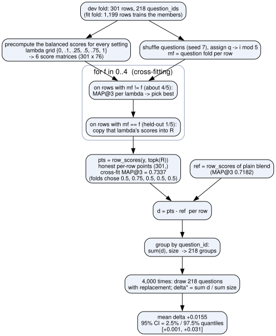

#### 6.1 Cross-fitting

**Concept.** Suppose you try 6 values of λ on the dev rows and report the best score. That score is optimistic, because you partly picked the λ that got lucky on these rows.

*Cross-fitting* fixes this:

1. Split the dev rows into 5 parts.
2. For each part, choose λ using only the other 4 parts, then apply it to the held-out part.
3. Stitch the 5 held-out pieces together and score once.

That final score evaluates the whole **procedure** ("pick λ on data, then apply it"), which is what will happen on test.

It differs from ordinary cross-validation in one way: the expensive models are **not** retrained. Only the cheap knob (λ, blend weights, stacker) is re-chosen per fold.

**Our code splits by question, not by row** (`s7_sinkhorn.py:14-23`):

```python
qs = dev.question_id.unique().copy(); np.random.default_rng(7).shuffle(qs)
g = {q: i % 5 for i, q in enumerate(qs)}; mf = np.array([g[q] for q in dev.question_id])
...
for f in range(5):
    m = mf != f                                    # the 4 folds used for choosing
    sc = [row_scores(y[m], topk(cache[l][m], classes)).mean() for l in grid]
    l = grid[int(np.argmax(sc))]; ch.append(l); R[~m] = cache[l][~m]
```

Two photos of the same question are similar. If one sat in the choosing part and the other in the held-out part, information would leak into the held-out score. Splitting by question prevents that.

The cost of honesty in our numbers:

| Setting | In-sample | Cross-fitted |
|---|---|---|
| λ | 0.7370 | 0.7337 |
| Blend weights | 0.7187 | 0.7063 |

#### 6.2 Question-grouped bootstrap CI

**Concept.** A *bootstrap* estimates uncertainty by resampling your data with replacement many times and recomputing the statistic each time. The spread of the recomputed values shows how much the result could move on similar data.

We bootstrap the **paired difference** between the new method and the reference on the same rows. Pairing cancels most of the per-row difficulty.

The 301 dev rows come from only 218 questions. Rows of the same question tend to succeed or fail together, so treating them as independent can make the CI too narrow. We therefore resample **questions**, not rows.

```python
# runs/arch/label-structure/common.py:20-28
def boot_ci(new_pts, ref_pts, groups=None, B=4000, seed=2026):
    d = np.asarray(new_pts) - np.asarray(ref_pts)
    rng = np.random.default_rng(seed)
    if groups is None:
        s = rng.integers(0, len(d), (B, len(d))); b = d[s].mean(1)
    else:
        g = pd.DataFrame({'g': groups, 'd': d}).groupby('g').d.agg(['sum', 'size']).to_numpy()
        s = rng.integers(0, len(g), (B, len(g))); b = g[s, 0].sum(1)/g[s, 1].sum(1)
    return float(d.mean()), [float(x) for x in np.quantile(b, [.025, .975])]
```

1. `d` is the per-row difference in points. Each value lies between −1 and +1, and most are 0.
2. Group `d` by question into (sum, size) pairs.
3. Draw 218 question indices with replacement, 4,000 times.
4. For each draw, compute `sum of d / number of rows`. This is the MAP@3 delta of that pseudo-dataset. Dividing by rows rather than questions keeps the row-level meaning.
5. The 2.5% and 97.5% quantiles form the 95% interval. If the lower end is above 0, the gain is unlikely to be luck from which questions happened to land in dev.

`summarize` in `scripts/evaluate_working_verifier.py:154-171`, which `stack_models.py` uses, does the same thing with 2,000 draws.

**What the CI does not cover:**

- seed-to-seed variation of the trained models (no model has a second seed; PLAN section 6, question 3);
- the gap between the dev bundles and the full-train test bundles.

---

### 7. Why almost every combiner failed (PLAN.md section 4)

PLAN.md reports that every cross-fitted combiner, prior or stacking variant landed between **−0.031 and +0.006** relative to the 0.7182 blend. Examples (`runs/arch/combiner-headroom/*.json`):

| Combiner | Dev MAP@3 | Delta |
|---|---|---|
| Cross-fitted blend weights | 0.7063 | −0.012 |
| Gold question prior (log-linear) | 0.7139 | −0.004 |
| LR stacker | 0.701–0.712 | −0.006 to −0.017 |
| Gradient-boosting stacker | 0.687–0.696 | −0.022 to −0.031 |
| Route to the most confident model | 0.6949 | −0.023 |
| Confidence-weighted geometric | 0.7145 | −0.004 |
| Reciprocal-rank blend | 0.7171 | −0.001 |
| Adding scale_100 (best single 8B) as a 4th member | 0.7111 | −0.007 |

One measured exception sits outside that range. `s4_pool.json` shows that adding the 235B few-shot model as a 4th member, with a cross-fitted weight, gives 0.7342 (+0.016). Its CI [−0.006, +0.038] crosses 0. PLAN.md files this under "bigger models", not combiners: after Sinkhorn it is worth only +0.008 (CI crossing 0), and running it on test would cost about $15.

Why, in plain words:

1. **The errors are shared.** About 78% of the 0.10 gap to Claude sits on 84 error rows whose true code never appeared for that question in the fit rows (PLAN section 1). All three members learned the same shortcut: "question → its usual codes." When all three are wrong in the same direction, re-weighting them cannot produce the right answer. A combiner can only rearrange evidence the members already contain. It needs **new** evidence, which is why PLAN.md proposes a reason-then-choose student instead.
2. **Small data, many knobs.** On 301 rows, CIs are about ±0.03. A stacker with 41 features or a boosted tree fits noise. The more flexible the combiner, the worse it did: LR was −0.006 at C=0.01 and −0.017 at C=1, and boosting was worse still.
3. **The blend already does the easy part.** The truth is in the blend's top 3, 5 and 10 on 0.831, 0.894 and 0.940 of rows. Telling NONE apart from errors already has an AUC of 0.947. What is left is hard re-ranking that the members' probabilities cannot inform.
4. **Sinkhorn is the exception because it fixes a different kind of error.** It corrects a **global bias**: the label shift between the training mix and the test mix. That is a single 76-number vector, estimated label-free from every row in the batch (301 on dev, 3,498 on test). Only one knob, λ, is tuned on dev labels. It is not row-level re-weighting, so it does not need much labelled data.

---

### Key files

- `/Users/gaddamshivateja/Documents/ChatGPT/kaggle-K-12/scripts/blend_geometric.py`: weighted geometric blend; writes `submission.csv`, `test.npz` and `metrics.json`.
- `/Users/gaddamshivateja/Documents/ChatGPT/kaggle-K-12/artifacts/submission-3way-blend/metrics.json`: the recipe behind public 0.7085.
- `/Users/gaddamshivateja/Documents/ChatGPT/kaggle-K-12/runs/arch/label-structure/common.py`: dev blend (`blend`, lines 13-18) and `boot_ci` (lines 20-28).
- `/Users/gaddamshivateja/Documents/ChatGPT/kaggle-K-12/runs/arch/label-structure/s7_sinkhorn.py`: Sinkhorn on dev, with the λ grid, cross-fit and CI.
- `/Users/gaddamshivateja/Documents/ChatGPT/kaggle-K-12/runs/arch/label-structure/s11_none_falarm_and_test.py`: Sinkhorn on test; writes the staged CSV.
- `/Users/gaddamshivateja/Documents/ChatGPT/kaggle-K-12/runs/arch/label-structure/{sinkhorn_balance,none_falarm_and_test,component_balance,balance_generality,prior_shift}.json`: results.
- `/Users/gaddamshivateja/Documents/ChatGPT/kaggle-K-12/artifacts/submission-3way-sinkhorn/metrics.json`: the balanced CSV, staged and not submitted.
- `/Users/gaddamshivateja/Documents/ChatGPT/kaggle-K-12/runs/arch/test-pragmatist/t2_sinkhorn.json`: Sinkhorn stress test (target noise, wrong target).
- `/Users/gaddamshivateja/Documents/ChatGPT/kaggle-K-12/runs/arch/test-combine/cpu_test.json`: independent stage-0 λ cross-fit.
- `/Users/gaddamshivateja/Documents/ChatGPT/kaggle-K-12/scripts/stack_models.py`: candidate-level LR judge.
- `/Users/gaddamshivateja/Documents/ChatGPT/kaggle-K-12/runs/arch/combiner-headroom/`: all failed-combiner measurements (`s2_grids.json`, `s3_stacker_base3.json`, `s4_pool.json`, `s6_router.json`).
- `/Users/gaddamshivateja/Documents/ChatGPT/kaggle-K-12/src/k12/core.py`: `label_space`, `normalize`, `topk`, `row_scores`, `map3`, `write_submission`, `make_folds`, `save_bundle`, `aligned_bundle`.
- `/Users/gaddamshivateja/Documents/ChatGPT/kaggle-K-12/runs/arch/PLAN.md`: sections 1, 3 (step 0), 4, 5 and 6.

---

### Things to try yourself (CPU only, a few seconds each)

Run these from the repo root with `PYTHONPATH=src .venv/bin/python your_script.py`. Keep your scripts outside `runs/arch/label-structure/`, because the `s*.py` scripts there overwrite their JSON outputs when run. All numbers below were reproduced on CPU while this guide was checked.

**Exercise 1: rebuild the blend and compare geometric with arithmetic.** You should get 0.7182 and 0.7071.

```python
import numpy as np
from k12.core import read_csv, label_space, make_folds, aligned_bundle, normalize, map3
tr = read_csv('data/raw/train.csv'); classes = label_space(read_csv('data/raw/taxonomy_v1.csv'))
dev = tr.loc[make_folds(tr) == 0].reset_index(drop=True); ids, y = dev.trace_id.tolist(), dev.root_code.to_numpy()
M = {'runs/pod/text32/validation_tx_dev_epoch_1.npz': .35, 'runs/pod/tx/text_tx_dev_e3.npz': .30,
     'runs/pod/dev-distill/validation_epoch_2.npz': .35}
P = {p: aligned_bundle(p, ids, classes) for p in M}
lp = sum(w * np.log(P[p]) for p, w in M.items()); G = normalize(np.exp(lp - lp.max(1, keepdims=True)))
A = sum(w * P[p] for p, w in M.items())
print('geometric', map3(y, G, classes), 'arithmetic', map3(y, A, classes))
```

Then try doubling every weight (use `2*lp` and subtract its own row max). The score stays 0.7182. Explain why (see Common confusions).

**Exercise 2: run Sinkhorn by hand and watch it converge.** Continue from exercise 1:

1. Build `pi` from the fit rows (`tr.loc[make_folds(tr) != 0]`, counts + 0.5).
2. Run the 30-step loop from `s7_sinkhorn.py:9-13`.
3. After each step, print `np.abs(normalize(G*np.exp(b)).mean(0) - pi).sum()`. It should shrink from about 0.063 after step 1, to about 0.007 after step 6, to about 4e-5 after step 30.
4. Score λ in {0, 0.5, 1}. You should get 0.7182 / 0.7370 / 0.7287.

Bonus: print the 5 classes with the largest positive `b` and the 5 with the largest negative `b`.

**Exercise 3: see what grouping does to the CI.** Import `boot_ci` from `runs/arch/label-structure/common.py`. Let `new` and `ref` be the `row_scores` of the λ=0.5 and λ=0 rankings. Compute both `boot_ci(new, ref)` and `boot_ci(new, ref, dev.question_id.to_numpy())`, then compare the interval widths. On this data the grouped interval is only slightly wider: [+0.0056, +0.0333] against [+0.0061, +0.0327] for rows. Most questions have only one or two dev rows, so grouping changes little here. It matters more when many rows share a question.

**Exercise 4: inspect the staged test change, without submitting.**

1. Load `artifacts/submission-3way-blend/submission.csv` and `artifacts/submission-3way-sinkhorn/submission.csv` with pandas.
2. Count the rows where the first code differs (expect 3.7%) and the rows where the set of three codes differs (26.4%).
3. Tabulate which codes gained top-1 positions and which lost them.
4. Load `artifacts/submission-3way-blend/test.npz` and confirm `p.shape == (3498, 76)`.

---

### Common confusions

- **"Doubling all blend weights changes the blend."** It does not change the ranking. Multiplying every weight by c raises the blended distribution to the power c, which makes it sharper (c > 1) or flatter (c < 1). The order inside each row stays the same, so MAP@3 is unchanged. Only the **ratios** of the weights matter for ranking. Sharpness does matter for any later step that reads probability values, such as the arithmetic prior mix or Sinkhorn, because `Q.mean(0)` depends on it.
- **"Geometric mean means averaging the three top-3 lists."** No. It multiplies full 76-class probability vectors. A class that one model scores near zero is vetoed even if the other two like it.
- **"Sinkhorn here is optimal transport with a cost matrix."** It is plain Sinkhorn–Knopp scaling: find one per-class bias so that column means match a target while rows still sum to 1. There is no cost matrix and no training.
- **"Sinkhorn uses test labels."** It does not. It uses the model's test predictions and the **train** label counts. It is transductive, though: the prediction for one photo depends slightly on the rest of the test set.
- **"+0.019 dev means +0.019 public."** The dev fold is label-stratified, which flatters Sinkhorn. PLAN.md expects about +0.01 on public. The gain could turn negative if test labels do not follow the train mix: it is −0.066 with a Claude-mix target.
- **"0.7370 vs 0.7337: which is the real dev number?"** 0.7370 uses the fixed λ=0.5. 0.7337 is the cross-fitted procedure, in which one fold picked 0.75. Both are reported in `artifacts/submission-3way-sinkhorn/metrics.json`. The cross-fitted one is the safer estimate.
- **"0.7182 is our honest dev score."** It includes about 0.012 of weight-selection optimism. Cross-fitted weights give 0.706, close to public 0.7085.
- **"Train has about 57 rows per code."** No. 57 is the **cap** on the most frequent codes. The median code has 8 rows, and NONE has 506 of 1,500.
- **"Dev bundles and test bundles come from the same models."** They do not. Dev bundles come from models trained on the 1,199 fit rows. Test bundles come from models retrained on all 1,500 rows. No fit-only test bundles exist, so nobody has directly measured whether λ and the weights transfer (PLAN section 6, question 2).
- **"`stack_models.py` printed a positive CI, so it beats the blend."** Its CI reference is the old vision+prior model (`stack_models.py:84-85`), not the 3-way blend. Compare its MAP@3 with 0.7182 / 0.706.
- **"A bootstrap CI covers all uncertainty."** It only covers which questions happened to land in dev. It says nothing about training-seed noise (unmeasured) or about the differences between the dev and test models.
- **"`development_map3` in metrics.json is computed by the blend script."** It is typed in by hand with `--development-map3`.


---

<a id="07-candidate-student"></a>

# Stage 4 (new): the candidate-aware student

## Stage 4 (new): the candidate-aware student

### In one paragraph

Our existing models do well on codes they have already seen for a question. They do badly when a student makes a kind of mistake that is **new for that question**. On those 84 dev rows the blend scores 0.431 MAP@3 and Claude scores 0.712. The candidate-aware student is built to close that gap. It is Qwen3-8B with a LoRA adapter.

It does not choose from all 76 codes. Its prompt holds:
- the question;
- the answer key;
- the transcript;
- **10 candidate codes**, each with its description and, when one exists, a short example of that code on the same question.

The student first writes a short diagnosis (`ROOT_LINE`, `WHY`), then a single letter. At that point we read the probabilities of the letters A to J and map them back to codes. We then fuse the result with the existing blend (`P0 · P_B^w`, then Sinkhorn balancing). The fused model ships only if it passes four gates that were declared in advance.

> **Results: pending.** When this was written, the full Qwen3-8B run had not produced any dev predictions. Every number below is either a dataset statistic or a baseline measured before this stage existed. The only predictions so far come from CPU smoke tests on a tiny random model. They show that the code runs; they are not results.

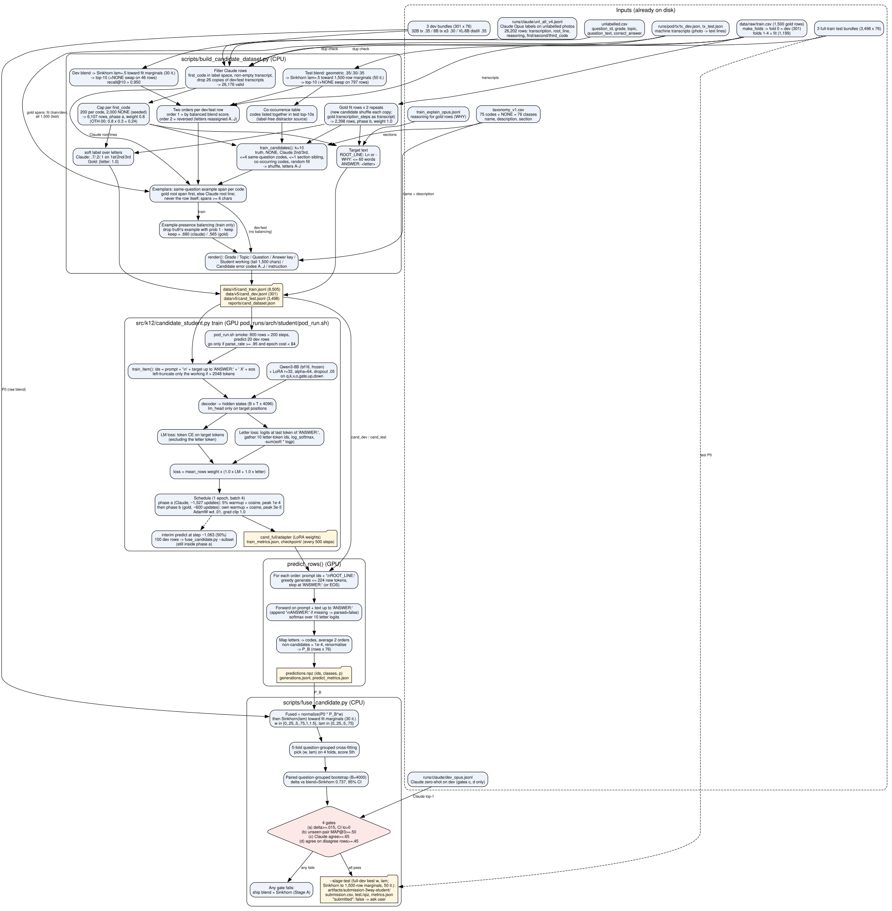

---

### 1. Why this stage exists: the gap analysis

`runs/arch/PLAN.md` §1 splits the dev fold (301 rows, fold 0) into four kinds of row and compares the reference blend with Claude Opus zero-shot:

| Row kind | Rows | Blend | Claude | Share of the 0.10 gap |
|---|---|---|---|---|
| Error rows on a **seen question**, with a **code never seen for that question** in the fit rows | 84 | **0.431** | **0.712** | about 78% |
| Error rows on **unseen questions** | 22 | 0.432 | 0.727 | about 21% |
| Error rows whose code **was** seen for the question | 94 | 0.830 | 0.812 | −5.5% (the blend wins) |
| NONE rows | 101 | 0.916 | 0.934 | about 6% |

The reference blend scores MAP@3 0.7182. It is a geometric blend of three models: the 32B text model (weight .35), the 8B text model (.30) and the VL-8B image model distilled from Claude (.35). Claude scores 0.8189.

**What the table means.** The fine-tuned classifiers have memorised which codes go with each question. When a student makes a different kind of mistake, they fall back on the usual codes. On the error rows whose code is new for the question, the blend's top-1 is one of that question's training codes 36% of the time. Claude's top-1 is one of them only 11% of the time (PLAN §1).

Two facts make a *candidate re-ranker* the natural fix:
- **Recall is not the problem.** The truth is in the raw blend's top 10 on 0.940 of dev rows.
- **The candidate list does not hold us back.** Claude restricted to the blend's top 10 still scores 0.802–0.807. This is an oracle diagnostic, so it cannot be deployed.

So the job is to **re-rank 10 candidates by actually reading the working**, not by remembering the question.

The design also borrows two changes from the literature survey (`runs/research/ARCHITECTURE_FROM_PAPERS.md`):
- **Change #2: train on Claude pseudo-labels first, then on gold.** A *pseudo-label* is a label that a model produced rather than a human.
- **Change #3: show candidates with same-question exemplars, and score with letter logits.** An *exemplar* is a real example of the code. One cited paper (2310.02439) found that picking from 4 candidates instead of about 100 raised GPT-4 from 39.8% to 91.9%.

---

### 2. Concepts you need first

- **LoRA (Low-Rank Adaptation).** The 8 billion weights of the base model stay frozen. Beside chosen weight matrices W, we add a small trainable update `B·A`. Here those matrices are the attention projections q, k, v and o and the MLP projections gate, up and down.
  - For a W of shape d_out × d_in, A is r × d_in and B is d_out × r, with rank r = 32.
  - Only A and B train. For Qwen3-8B with r = 32 on all seven projections this comes to about 87 million parameters, roughly 1% of the base. That figure is computed from the published layer shapes; no real run has logged it.
  - `lora_alpha` scales the update. It is 64 here, which is 2r.
- **QLoRA.** The same idea, but the frozen base is stored in 4-bit NF4 to save memory. It is available as `--load-4bit` (`candidate_student.py:58-63`). `pod_run.sh` does **not** use it and loads the model in bf16.
- **Distillation and soft labels.** Distillation means training the smaller model to imitate a stronger teacher, here Claude. A Claude row does not give one "correct" label. It says something like "70% the 1st code, 20% the 2nd, 10% the 3rd". That is a *soft label*. Cross-entropy against a soft label is `−Σ soft_i · log p_i`.
- **Letter-logit scoring.** At every position, a language model outputs a score (logit) for every token in its vocabulary, and those scores predict the *next* token. Each candidate is labelled with a letter, and each of `" A"` … `" J"` is a single token. So the 10 logits for those tokens, read at the last token of `ANSWER:`, form a 10-way classifier. No new head is needed.
- **MAP@3.** For each row we submit 3 ranked codes. A hit in position 1, 2 or 3 scores 1, 1/2 or 1/3; a miss scores 0. The metric is the mean over rows (`src/k12/core.py:38-51`).
- **Geometric blending.** Combine models with a weighted average of log-probabilities, then renormalise: `p ∝ Π p_m^{w_m}`. A code needs support from every model; a high score from one model is not enough.
- **Sinkhorn balancing.** Our models over-predict some codes. Sinkhorn learns one additive log-bias b per class. The bias is chosen so that the **average** predicted distribution over rows matches a target label mix, here the training label frequencies with +0.5 smoothing. λ ∈ [0, 1] applies only part of that bias.
- **Cross-fitting.** This is how we pick hyperparameters (here w and λ) without fooling ourselves. We split the dev questions into 5 groups. For each group, we choose the setting on the other 4 groups and score it on the held-out group. No row's score ever saw that row during selection.
- **Question-grouped paired bootstrap CI.** We resample *questions*, not rows, with replacement, 4,000 times. Each time we recompute the mean difference "new − reference". The 2.5% and 97.5% quantiles give a 95% confidence interval. Grouping by question matters because rows on the same question are correlated.

---

### 3. The dataset builder: `scripts/build_candidate_dataset.py`

This script runs on CPU. It renders **complete prompts and targets** into JSONL files, so the trainer can stay generic (`SPEC.md:17`).

**Outputs** (`reports/cand_dataset.json`):

| File | Rows |
|---|---|
| `data/v5/cand_train.jsonl` | 8,505: 6,107 Claude rows in phase a + 2,398 gold rows in phase b |
| `data/v5/cand_dev.jsonl` | 301 |
| `data/v5/cand_test.jsonl` | 3,498 |

#### 3.1 Training rows: two sources, two phases

**Claude rows (phase a)**, `build_candidate_dataset.py:209-226` and `:309-333`:
- **Source.** `runs/claude/unl_all_v4.jsonl`, which has 26,202 lines. These are Claude Opus labels on *unlabelled* photos, which the API rule in AGENTS.md allows. Each row carries Claude's transcription, root line, reasoning and three ranked codes.
- **Filters.** The first code must be in the label space and the transcription must be non-empty. A row is also dropped if its normalised transcript equals a dev or test transcript on the same question. That rule dropped 26 rows, leaving 26,176 valid rows.
- **Caps.** At most 200 rows per first code and 2,000 NONE rows, chosen with a seeded RNG. That leaves 6,107 rows.
- **Weights.** 0.8, or 0.8 × 0.3 = 0.24 when the first code is OTH-00. PLAN notes that Claude's precision on OTH-00 is only 0.21.
- **Transcript.** Claude's own transcription.

**Gold rows (phase b)**, `:334-347`:
- **Source.** The 1,199 *fit* gold rows (folds 1–4), with weight 1.0.
- **Transcript.** The human `transcription_steps`.
- **Repeats.** Each row appears twice, each copy with a different candidate shuffle, giving 2,398 rows.
- **Hard rule.** No dev (fold 0) trace_id appears as a training row or as an exemplar source for training rows. This is asserted at `:461`.

The three splits read different transcripts:

| Rows | Transcript |
|---|---|
| Claude training rows | Claude's transcription |
| Gold training rows | Human transcription |
| Dev and test rows | Our machine transcriber's output (§3.6) |

#### 3.2 Choosing the 10 candidates for a training row

Training rows have no model predictions, so `train_candidates` (`:285-307`) builds a plausible list:

```python
for c in [truth, 'NONE', *extra]:          # extra = Claude's 2nd/3rd codes
    add(c)
cnt = Counter(qcount.get(q, Counter())); cnt[own_code] -= 1
for c, n in sorted(cnt.items(), key=lambda x: (-x[1], x[0])):
    if n > 0 and taken < 4 and c not in cands and len(cands) < args.k:
        add(c); taken += 1                  # up to 4 codes seen on this question
sib = [c for c in section.get(taxonomy.get(truth, {}).get('section'), []) if c != truth]
for c in (rng.permutation(sib)[:args.max_siblings] if sib else []):
    add(str(c))                             # at most 1 same-section sibling
nb = cooc.get(truth)                        # codes that co-occur with truth in TEST top-10s
...
return [cands[i] for i in rng.permutation(len(cands))]   # shuffle -> letters A..J
```

The list is filled in this order:
1. The truth.
2. NONE.
3. Claude's 2nd and 3rd codes.
4. Up to 4 codes seen on this question, most frequent first, counting fit gold rows and Claude rows. These are **hard negatives**: plausible wrong answers that directly attack the "question → usual code" shortcut.
5. One sibling from the same taxonomy section.
6. Codes that co-occur with the truth in the label-free test-blend top-10 lists (`:265-283`). They are taken in a random order weighted by co-occurrence count.
7. Random codes, until there are 10.

Then the list is shuffled. The report confirms two things: the truth is among the candidates on 100% of training rows, and every training row has 10 candidates including NONE.

#### 3.3 Shortcut fixes (deviations from SPEC, listed in the docstring at `:7-14`)

A model learns whatever cue predicts the label most cheaply. The first draft had two cheap cues.

**1. Section plurality.** SPEC filled the candidates with *all* same-section siblings of the truth. The truth's section would then hold the most candidates, so "pick from the biggest section" becomes a shortcut that dev lists do not support. The fix caps siblings at `--max-siblings 1` and fills the rest from test co-occurrence. Here is the measured share of rows where the truth's section is the plurality section:

| Split | Share |
|---|---|
| train_claude | 0.479 |
| train_gold | 0.587 |
| dev error rows | 0.481 |
| dev unseen-pair rows | 0.593 |

Average number of same-section distractors:

| Split | Distractors |
|---|---|
| train_claude | 2.44 |
| train_gold | 2.43 |
| dev error rows | 2.14 |
| dev unseen-pair rows | 2.56 |

**2. Example presence.** A candidate shows an example only if one exists for that (question, code) pair. On Claude rows the truth had an example 0.917 of the time, against 0.624 for distractors, so "the line with an example is the answer" was a free shortcut. Lines `:349-363` drop the truth's example with a probability chosen so that the two rates match:

| Source | Truth before | Distractor | Keep prob. | Truth after |
|---|---|---|---|---|
| Claude | 0.9172 | 0.6241 | 0.6804 | 0.6236 |
| Gold | 0.6285 | 0.3553 | 0.5654 | 0.3665 |

**Other fixes:**
- WHY is capped at 60 words (`why()`, `:67-80`). The concluding sentence, the one that names the error, is kept when it is 30 words or fewer.
- Example spans shorter than 6 characters are skipped.
- Claude NONE rows get `ROOT_LINE: -`.
- Literal "nan" header fields are filled from other rows of the same question. This filled 192 `topic_name` values.

#### 3.4 Exemplars: "On this question, e.g. …"

`Exemplars` (`:122-138`) builds a pool keyed by (question_id, code):
- **Gold rows come first.** Their example is the `span` of the root misconception.
- **Then Claude rows.** Their example is the text of the `root_line` line of Claude's transcription. These come from all 26,176 valid Claude rows, not only the 6,107 picked ones.
- **Order** is deterministic, by a seeded hash. The row's own trace_id is never used.

Training and dev use the fit-only bank (`ex_fit`); test uses the bank built from all 1,500 gold rows (`ex_all`). Both banks also contain the Claude spans.

Share of non-NONE candidate lines that carry an example:

| Split | Share |
|---|---|
| Claude training rows | 0.581 |
| Gold training rows | 0.324 |
| Dev | 0.326 |
| Test | 0.359 |

#### 3.5 The prompt and the target

`render()` (`:141-154`) writes this layout (`SPEC.md:32-50`):

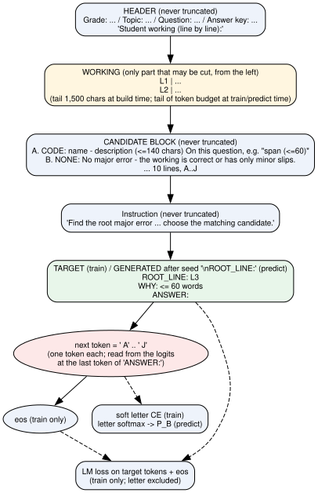

```
Grade: {grade}
Topic: {topic_name}
Question: {question_text}
Answer key: {correct_answer}
Student working (line by line):
{transcript, last 1,500 chars}

Candidate error codes:
A. {code}: {name} - {description <=140 chars} On this question, e.g. "{span <=60 chars}"
B. NONE: No major error - the working is correct or has only minor slips.
...
Find the root major error the rest of the working follows from (or NONE ...) and choose the matching candidate.
```

The target (training only) puts the **reasoning first and the letter last**:

```
ROOT_LINE: L3          (or "-" for NONE)
WHY: <=60 words of diagnosis
ANSWER: C
```

Where the parts come from:

| Row source | WHY text | Soft label |
|---|---|---|
| Claude | Claude's own reasoning | `.7/.2/.1` over the letters of Claude's codes 1, 2 and 3, renormalised if one is missing |
| Gold | Reasoning from `train_explain_opus.jsonl`; if that is missing, the root misconception's `text` | `{letter: 1.0}` |

Token lengths, measured with the Qwen2.5-vocabulary tokenizer of the tiny test model:

| Measure | Value |
|---|---|
| Training prompt + target, p50 | 852 |
| Training prompt + target, p99 | 1,135 |
| Training prompt + target, max | 1,440 |
| Training rows over 2,048 | 0 |
| Training target, p50 / p99 | 100 / 148 |

Each of `" A"` … `" J"` is a single token (`candidate_letters_single_token: true`).

#### 3.6 Dev and test rows: candidates from the blend, in two orders

Dev rows (`:381-387`):
- **Blend.** The three dev bundles are combined geometrically (.35/.30/.35). The result is Sinkhorn-balanced with λ = 0.5 toward the fit-row label mix, for 30 iterations.
- **Candidates.** The top 10 codes. If NONE is not among them, it replaces the 10th. This happened on 46 dev rows and 797 test rows.
- **Orders.** Order 1 sorts by balanced blend score. Order 2 is the reverse, with the letters reassigned (`:371-379`).

Measured on dev:

| Measure | Value |
|---|---|
| Recall@10 of the truth, all rows | **0.950** (raw blend without NONE swap: 0.940) |
| Recall@10, error rows only | 0.925 |
| Balanced blend's top-1 accuracy | 0.648 |

Test rows use the full-train test bundles, balanced toward all 1,500 training labels for 50 iterations (`:275-277`). Machine transcripts come from `runs/pod/tx/tx_dev.json` and `tx_test.json`.

**Leakage checks** (`reports/cand_dataset.json` → `leakage`):

| Check | Value |
|---|---|
| Dev ids as training rows | 0 |
| Dev ids as training exemplar sources | 0 |
| Dev ids as dev exemplar sources | 0 |
| Gold training prompts containing a dev gold transcript verbatim | 2 |

Those 2 rows are probably near-duplicate short workings. `runs/arch/student/checks/check_data.json` finds only 1 such match at 40 characters or more.

---

### 4. The trainer: `src/k12/candidate_student.py train`

#### 4.1 Model

`Student.__init__` (`:43-78`):
- Loads the base model given by `--model`. On CUDA it uses bf16 with SDPA attention; `pod_run.sh` passes Qwen3-8B. On CPU it falls back to the cached tiny random Qwen2 in float32, for smoke tests.
- Wraps it with `LoraConfig(r=32, lora_alpha=2r=64, lora_dropout=.05, target_modules=[q,k,v,o,gate,up,down])`.
- Casts the trainable LoRA weights to float32, which keeps the optimizer updates precise.

`letter()` (`:80-85`) asserts that each `" X"` encodes to exactly one token.

#### 4.2 Building one training sequence

`train_item` (`:106-118`):

```python
k = target.rindex(ANSWER) + len(ANSWER)
answer = target[k:].strip()                       # e.g. "C"
head = self.encode('\n' + target[:k])             # "\nROOT_LINE: ...\nWHY: ...\nANSWER:"
tail = [self.letter(answer), self.tokenizer.eos_token_id]
prompt, cut = self.prompt_ids(row['prompt'], self.max_length - len(head) - len(tail))
...
return {'ids': prompt + head + tail, 'start': len(prompt),
        'answer': len(prompt) + len(head) - 1, ...}
```

`'answer'` is the index of the last token of `ANSWER:`. The output logits at that position predict the *next* token, which is the letter.

`prompt_ids` (`:90-101`) splits the prompt into three parts: header, working, and candidate block plus instruction. It left-truncates **only the working**, so the candidates and the target always survive. It raises an error if the header and candidate block alone exceed the budget (default `--max-length 2048`).

#### 4.3 The loss (two parts)

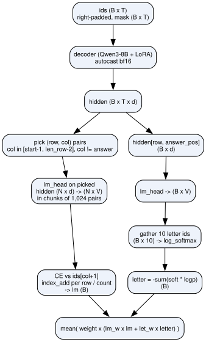

`Student.loss` (`:124-149`), simplified:

```python
c = [c for c in range(x['start'] - 1, len(x['ids']) - 1) if c != x['answer']]
...
ce = F.cross_entropy(self.lm_head(hidden[r, c]).float(), ids[r, c + 1], reduction='none')
token_ce = token_ce.index_add(0, r, ce)
lm = token_ce / torch.bincount(rows, minlength=len(items)).clamp(min=1)
answer = self.lm_head(hidden[torch.arange(len(items)), answer_positions]).float()
letter = torch.stack([-(soft_r * answer[r, x['letters']].log_softmax(-1)).sum() for r, x in ...])
return (weight * (lm_weight * lm + letter_weight * letter)).mean(), lm.mean(), letter.mean()
```

**LM loss.** Ordinary next-token cross-entropy over the target tokens (the diagnosis plus EOS), averaged per row. The letter token is **excluded**, so it is not trained twice.

**Letter loss.** At the answer position, take the logits of only the 10 candidate-letter tokens. Apply log-softmax over those 10 and dot the result with the soft label. This is a 10-way soft classifier inside the language model.

**Total.** Each row's loss is multiplied by its row weight (0.8, 0.24 or 1.0) and then averaged. Defaults: `lm_weight = letter_weight = 1.0`.

**Efficiency trick.** The code runs the decoder once to get the hidden states. It then applies `lm_head` only at the positions it needs, in chunks of 1,024 (row, position) pairs. `lm_head` is vocabulary size × hidden size, the most expensive projection. The code never builds full B × T × V logits.

#### 4.4 Phase a, then phase b, each with its own cosine

`plan()` (`:196-203`) orders every epoch in two blocks: all phase-a (Claude) batches, shuffled, then all phase-b (gold) batches, shuffled. Gradient-accumulation windows never mix phases.

`lr_at()` (`:208-210`):

```python
n, peak = max(1, total[name]), args.lr * (args.phase_b_lr_mult if name == 'b' else 1.)
return peak * min(1., (k + 1) / max(1, .05 * n)) * .5 * (1 + math.cos(math.pi * k / n))
```

Each phase has its own 5% warmup and its own cosine decay:

| Phase | Rows | Updates | Peak lr |
|---|---|---|---|
| a (Claude) | 6,107 | about 1,527 | 1e-4 |
| b (gold) | 2,398 | about 600 | 3e-5 (0.3 × 1e-4) |

These updates assume batch 4 and grad-accum 1, as `pod_run.sh` sets them: 6,107/4 and 2,398/4, rounded up.

**Why a cosine per phase?** The module docstring (`:8-9`) explains that one cosine over the whole epoch left the gold rows at about 2% of the peak learning rate, so they would barely move the model. This is the "pretrain on teacher labels, then refine on human labels" recipe from change #2.

Other settings:
- AdamW with weight decay 0.01, and gradient clipping at 1.0.
- Gradient checkpointing (`use_reentrant=False`).
- A JSON log line every `--log-every` steps (default 25), with loss, lm_loss, letter_loss and rows/s.
- An optional checkpoint every N steps, and an optional interim dev prediction at 50% of updates.

#### 4.5 Pod orchestration: `runs/arch/student/pod_run.sh`

1. **Install and download** (`:6-10`). Pinned torch, transformers and peft; Qwen3-8B into `/workspace/models`.
2. **Smoke test** (`:14-19`). 600 phase-a rows + 200 phase-b rows = 200 steps at batch 4, then a prediction on 20 dev rows. Timeout 45 minutes.
3. **Automatic go/no-go** (`:20-32`):

   ```python
   cost = 8505 / rps / 3600 * rate
   ok = m['parse_rate'] >= .95 and cost < 4.
   ```

   The script continues only if both conditions hold:
   - at least 95% of generations contain `ANSWER:`;
   - the projected cost of a full training epoch is under $4.

   `rps` is the training rows/s from the last smoke log line, so the projection leaves out prediction time.
4. **Full run** (`:34-37`). The full epoch, with a 6-hour timeout. It saves a checkpoint every 500 steps, runs an interim prediction on 100 dev rows at 50% of updates, then saves the adapter and runs the full dev prediction. Test prediction is launched separately, only after the dev gates pass.

The interim abort rule (PLAN step 4): stop if, on those 100 rows, the student's recall@3 on unseen-pair rows is no better than the blend's. It is checked with `fuse_candidate.py --subset` (`:66-85`), which requires the student to beat the better of the raw blend and blend + Sinkhorn (`:81`).

Note the timing. 50% of 2,127 updates is about step 1,063, which is still inside phase a. So the interim check sees a model that has **not yet trained on any gold rows**.

---

### 5. Inference: `predict_rows` (`candidate_student.py:253-320`)

For each dev or test row, and for each of its 2 candidate orders:

1. **Prefill.** Append the seed `"\nROOT_LINE:"` to the prompt tokens, so the model starts in the right format. The working is left-truncated to fit `max_length − max_new_tokens − seed − 8` tokens.
2. **Generate.** Greedy decoding, up to `--max-new-tokens` (code default 224; SPEC said 160), stopping at the string `ANSWER:` or at EOS (`generate`, `:164-177`). Batches use left padding.
3. **Read the letter.** If `ANSWER:` was produced, cut the text right after it. If not, append `"\nANSWER:"` and flag the row as **unparsed**. Then run one forward pass on prompt + text and take the softmax over the 10 letter logits at the last position (`letter_probs`, `:151-162`).
4. **Map back to codes.** Letters become codes through that order's `codes_per_prompt`. The two orders' probabilities are averaged per code. Every non-candidate code gets 1e-4, and the row is renormalised to a 76-way distribution.
5. **Save** three files:
   - `predictions.npz`, in the same bundle format as every other model (ids, classes, p);
   - `generations.jsonl`, with the text, parsed flag, truncation flag and letter probabilities;
   - `predict_metrics.json`, with the parse rate and rows/s, and on dev also MAP@3, per-order MAP@3 and candidate recall.

**Why two orders?** Language models have a **position bias**: they favour early letters or early list positions. Averaging the forward and reversed lists cancels much of that bias. This is the Eedi 2nd-place reversed-order trick, cited under change #3 in ARCHITECTURE_FROM_PAPERS.

---

### 6. Fusion and gates: `scripts/fuse_candidate.py` (CPU)

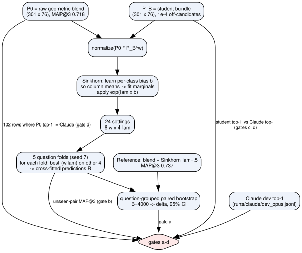

#### 6.1 Fusion formula

```python
def sinkhorn(P, target, lam, iters):
    b = np.zeros(P.shape[1])
    for _ in range(iters):
        b += np.log(target / normalize(P * np.exp(b)).mean(0))
    return normalize(P * np.exp(lam * b))

def fuse(P0, PB, w, lam, target, iters):
    F = normalize(P0 * np.clip(PB, 1e-12, None) ** w) if w else P0
    return sinkhorn(F, target, lam, iters) if lam else F
```

(`fuse_candidate.py:35-44`)

- **P0** is the *raw* geometric blend (MAP@3 0.718). **P_B** is the student bundle.
- **w** sets how much we trust the student. w = 0 ignores it; w = 1 is a plain product of the two.
- **Sinkhorn** then repeatedly nudges a per-class bias b until the mean prediction matches the fit-row label frequencies (+0.5 smoothing; `marginals`, `:29-32`). The final output applies `λ·b`.

#### 6.2 Cross-fitted selection (`:136-151`)

- **Grid.** w ∈ {0, .25, .5, .75, 1, 1.5} × λ ∈ {0, .25, .5, .75}, which is 24 settings, all precomputed.
- **Folds.** Dev questions are shuffled (seed 7) and dealt round-robin into 5 groups. For each group, the best setting on the other 4 groups is applied to that group. This gives the cross-fitted prediction matrix `R` and its per-row scores `cf`.
- **Reference.** Blend + Sinkhorn at a fixed λ = 0.5, with dev MAP@3 **0.737**. The script also reports a "λ-only cross-fitted" reference (`R0`, w = 0).
- **Bootstrap.** `boot_ci` (`:47-52`) resamples questions 4,000 times and returns the mean Δ and its 95% CI.

#### 6.3 The four gates (all must pass; `:159-162`, PLAN step 5)

| Gate | Test | Threshold | Baseline today |
|---|---|---|---|
| (a) | Cross-fitted fused MAP@3 − blend+Sinkhorn | Δ ≥ +0.015 **and** CI lower bound > 0 | reference 0.737 |
| (b) | Cross-fitted fused MAP@3 on the 106 "unseen-pair" rows (84 new-code + 22 unseen-question) | ≥ 0.50 | raw blend 0.431; blend+Sinkhorn 0.451; scale_100 8B 0.44 |
| (c) | Student-alone top-1 agrees with Claude's top-1 on those 106 rows | ≥ 0.65 | scale_100: 0.49 |
| (d) | Student-alone top-1 agrees with Claude on the 102 rows where the raw blend's top-1 and Claude's top-1 differ | ≥ 0.45 | best existing student: 0.245 |

The blend+Sinkhorn figure in gate (b) was measured on CPU while this guide was being checked.

Why four gates?
- (a) asks whether the student helps overall.
- (b) asks whether it helps where we are weak.
- (c) and (d) ask whether it learned *Claude-like reasoning* rather than a different kind of memorisation.

PLAN notes that the proposals' original gates "could pass with zero real gain", so these corrected gates were agreed in advance.

**Staging.** With `--stage-test`, the script refuses to stage if any gate fails, unless `--allow-failed-gates` is set (that flag is for pipeline checks only). If every gate passes, the script:
- applies the full-dev best (w, λ) to the test bundles, with Sinkhorn toward all 1,500 training labels (50 iterations);
- writes `artifacts/submission-3way-student/submission.csv`, `test.npz` and `metrics.json`; `metrics.json` includes the CSV's sha256 and `"submitted": false`.

The script never submits; the user must approve each submission. If any gate fails, the plan falls back to shipping blend + Sinkhorn.

#### 6.4 Results

> **Results: pending.** None of the following has been measured yet:
> - student-alone MAP@3, parse rate and per-order scores;
> - cross-fitted fused MAP@3, Δ and CI;
> - gates (a)–(d);
> - test staging.
>
> PLAN gives an *estimate*, not a measurement, for "Stage B passes the corrected gate": 0.75–0.76 on dev and about 0.73–0.75 on public, with a 25–35% probability.

---

### Key files

| File | What it holds |
|---|---|
| `runs/arch/student/SPEC.md` | Build spec: row format (`:15-30`), prompt (`:32-50`), target (`:52-64`), candidates (`:66-93`), exemplars (`:95-107`), data selection (`:109-127`), trainer (`:129-161`), fusion and gates (`:163-177`) |
| `scripts/build_candidate_dataset.py` | `why` `:67`, `Exemplars` `:122`, `render` `:141`, Claude filter `:209`, co-occurrence `:265`, `train_candidates` `:285`, phase a `:309`, phase b `:334`, example balancing `:349`, dev/test rows `:371-387`, report and leakage asserts `:396-461` |
| `src/k12/candidate_student.py` | `Student` `:43`, `prompt_ids` `:90`, `train_item` `:106`, `loss` `:124`, `letter_probs` `:151`, `generate` `:164`, `train` / `plan` / `lr_at` `:180-250`, `predict_rows` `:253` |
| `scripts/fuse_candidate.py` | `geo` `:24`, `sinkhorn` `:35`, `fuse` `:42`, `boot_ci` `:47`, `unseen_pairs` `:59`, `interim` `:66`, cross-fit `:136-151`, gates `:159`, staging `:181` |
| `runs/arch/student/pod_run.sh` | Pod install, 200-step smoke, automatic go/no-go, full epoch, dev predict |
| `reports/cand_dataset.json` | Row counts, per-code counts, recall@10, shortcut checks, example balance, token lengths, leakage |
| `runs/arch/student/checks/` | Leakage and alignment audits (`check_data.json`), cost estimate (`cost.py`) |
| `runs/arch/PLAN.md` | Gap analysis (§1), Stage B design (§2), steps 2–6 and gates (§3) |
| `src/k12/core.py` | `row_scores` / `map3` `:38-51`, `make_folds` `:64`, `save_bundle` / `aligned_bundle` `:97-114` |

---

### Things to try yourself (CPU only)

All of these run on CPU from the repo root with `PYTHONPATH=src:scripts .venv/bin/python`. None of them touch pods, APIs or Kaggle.

**1. Reproduce the baselines the gates compare against.**

```python
from fuse_candidate import DEV, geo, sinkhorn, marginals, unseen_pairs
from k12.core import read_csv, label_space, make_folds, map3, row_scores, topk
tr = read_csv('data/raw/train.csv'); classes = label_space(read_csv('data/raw/taxonomy_v1.csv'))
f = make_folds(tr); dev, fit = tr[f == 0].reset_index(drop=True), tr[f != 0].reset_index(drop=True)
P0 = geo(DEV, dev.trace_id.tolist(), classes)
print(map3(dev.root_code, P0, classes))                      # raw blend
for lam in (0, .25, .5, .75, 1):
    print(lam, map3(dev.root_code, sinkhorn(P0, marginals(fit.root_code, classes), lam, 30), classes))
newc, unq = unseen_pairs(fit, dev.root_code.to_numpy(), dev.question_id.to_numpy())
s = row_scores(dev.root_code.to_numpy(), topk(P0, classes)); print(newc.sum(), s[newc].mean())
```

When this guide was checked, the script printed:

| Setting | Dev MAP@3 |
|---|---|
| Raw blend | 0.7182 |
| Sinkhorn λ = 0.25 | 0.7281 |
| Sinkhorn λ = 0.5 | **0.737** |
| Sinkhorn λ = 0.75 | 0.7348 |
| Sinkhorn λ = 1 | 0.7287 |
| Raw blend on the 84 new-code rows | **0.431** |

Notice that full balancing (λ = 1) is *worse* than half balancing. As an extension, also print `unq.sum()` and `s[unq].mean()`. The check gave 22 rows at 0.432, and the λ = 0.5 blend scored 0.451 on all 106 unseen-pair rows.

**2. Check the single-token letter assumption and look at a training row.** Use any Python that has `tokenizers`; the builder uses `/usr/bin/python3`.

```python
import glob, os, json
from tokenizers import Tokenizer
t = Tokenizer.from_file(sorted(glob.glob(os.path.expanduser(
    '~/.cache/huggingface/hub/models--trl-internal-testing--tiny-Qwen2ForCausalLM-2.5/snapshots/*/tokenizer.json')))[0])
print(t.encode('ANSWER: B', add_special_tokens=False).tokens)   # ['ANS','WER',':','ĠB']
row = json.loads(open('data/v5/cand_train.jsonl').readline())
print(row['source'], row['weight'], row['soft'], row['codes'])
```

`ĠB` means "space + B" as a single token. That is why the letter loss can read one logit per candidate. Then try `' AA'` or `'A'` without the space and see what changes.

**3. Measure recall and position effects on the dev candidate file.** Load `data/v5/cand_dev.jsonl` and compute three shares:
- rows whose `truth` is in `codes_per_prompt[0]` (expect 0.950);
- rows where it is in the first 3, which is the balanced blend's own top-3 recall after the NONE swap;
- rows where NONE sits in the last slot, which shows where the NONE swap put it.

Then check that `codes_per_prompt[1]` is exactly the reverse of order 1.

**4. Toy fusion.** Make a 3-row × 4-class `P0` and a `PB` that puts 0.9 on one candidate and 1e-4 elsewhere. Compute `normalize(P0 * PB**w)` for w ∈ {0, .5, 1, 1.5} and watch how quickly the student overrides the blend. Then run `sinkhorn` toward a uniform target with λ = 0.5 and compare the column means before and after.

---

### Common confusions

- **"The student chooses among 76 codes."** No. It only ever sees 10 lettered candidates. The 76-way bundle is built afterwards: the candidate probabilities, plus 1e-4 for every other code. On its own the student can only re-rank the balanced blend's top 10, so its ceiling is the 0.950 recall@10. In the fusion with w ≥ 1, the non-candidates are pushed down by a factor of roughly 1,000, so they almost disappear.
- **"The diagnosis text is the prediction."** No. The WHY text is never parsed into a code. It exists so that the letter is chosen *after* reasoning, and it trains through the LM loss. The prediction is purely the softmax over the 10 letter logits at the `ANSWER:` position.
- **"Parse rate < 1 means missing predictions."** No. If `ANSWER:` is never generated, the code appends `"\nANSWER:"` and still reads the letters. The row gets a prediction but is flagged `parsed: false`. The smoke gate requires a parse rate of at least 0.95.
- **"Letters mean the same code across orders."** They do not. In order 2 the list is reversed and the letters are reassigned, so `A` in order 1 is `J` in order 2. Averaging happens per **code**, not per letter.
- **"Phase b is a second epoch on gold."** No. It is the second half of the *same* epoch, with its own warmup and cosine at 0.3× the peak lr. The interim check at 50% of updates runs before any gold row has been seen.
- **"Example presence was made uninformative everywhere."** Only in training. On dev error rows the truth still has an example more often than distractors (0.660 vs 0.321), because the blend's candidates come from the question's history. The student is deliberately not taught to exploit that cue; the fusion with P0 already carries that prior.
- **"Unseen-pair truth can't have an example."** It can: 0.341 on those dev rows. Examples also come from Claude labels on *unlabelled* photos of the same question, not only from fit gold rows.
- **"Fusion uses the balanced blend."** It does not. Candidates come from the Sinkhorn-*balanced* blend, but the fusion starts from the *raw* blend P0 and applies Sinkhorn once at the end. Applying it twice would double-count the correction.
- **"The smoke-test MAP@3 is a result."** It is not. `runs/arch/student/smoke_v5/` used a tiny random model on CPU, with a parse rate of 0.0. It only shows that the pipeline runs end to end.
- **"Gates (c) and (d) use the fused model."** They do not. They use the **student alone** (`st = PB.argmax`) against Claude's top-1. Gate (d)'s row set is where the **raw** blend's top-1 differs from Claude's. Gate (b) uses the cross-fitted **fused** scores.
- **"Train and dev see the same kind of transcript."** They do not. Claude rows use Claude's transcription, gold rows use the human transcription, and dev and test use our machine transcriber's output.


---

<a id="08-infrastructure"></a>

# Infrastructure: pods, budgets, safety and submissions

## Infrastructure: pods, budgets, safety and submissions

### In one paragraph

Your Mac is the control room. It holds the competition data, every secret (RunPod key, Kaggle token, Claude key) and every budget file. GPU work runs on rented RunPod pods that only ever get code and data, never credentials. `scripts/runpod_pod.py` creates pods (trying several approved GPU types in turn), records each one in `reports/runpod_budget.json`, works out spend from timestamps, and terminates pods. Three separate "kill switches" protect the money: a spend **watchdog**, a **dead-man switch** on `runs/heartbeat`, and a per-pod **cap timer**. Pods run a detached `run.sh` that reports progress through a one-line status file and stops itself at a **predeclared gate**. Kaggle is used only for CPU notebooks that bundle the photos, and for submissions. Each submission needs your explicit OK and is logged with its SHA-256 in `reports/status.json`.

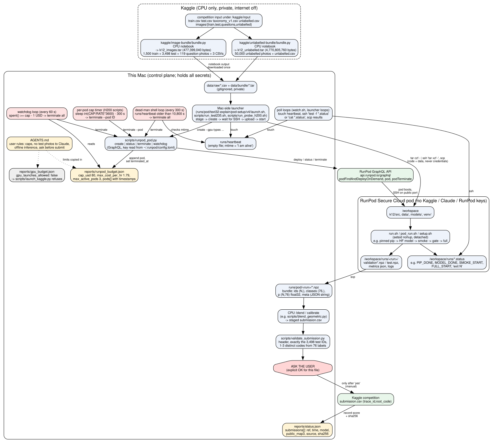

---

### 1. The rulebook: `AGENTS.md`

Everything in this section enforces the rules in `AGENTS.md`. It is a dated list, and **later entries narrow or override earlier ones for their own scope**:

| Rule (AGENTS.md line) | What it means in practice |
|---|---|
| L3: "Keep Gemma running; continue K-12 on CPU" (8 Nov) | No K-12 Kaggle GPU jobs at all. `reports/gpu_budget.json` has `"gpu_launches_allowed": false`. |
| L4–L9: Kaggle free GPUs only, 10 h hard cap, keep a 4 h reserve, use `scripts/launch_kaggle.py` | Still in force for Kaggle jobs. The launcher refuses anyway (see section 7). |
| L10: CPU-only dependency preparation is allowed | This is why the CPU bundling notebooks are fine (section 6). |
| L11: RunPod Secure Cloud, 48 GB or more, at most **$1.79/hr**, **$80 total cap** | Encoded in `reports/runpod_budget.json` (`cap_usd: 80.0`, `max_cost_per_hr: 1.79`). |
| L11: "never copy Kaggle credentials to a pod" | Data goes Mac → pod over SSH. The pod never downloads from Kaggle. |
| L12: Claude API on training and unlabelled photos only, never test; $200 working limit | Tracked in `reports/claude_budget.json`: `spent_usd` 186.6112 of `limit_usd` 200 (PLAN.md: "$186.61 of $200 spent, $13.39 left"). |
| L13: never submit without explicit permission for that specific submission | Build, validate and stage CSVs, then ask. |
| L14: do not claim a score from smoke tests, in-sample predictions or unlaunched jobs | Only completed public scores go into `status.json`. |
| L15: final inference offline; keep data private; no hand-labelling test | See section 10. |

> Plain words: a **hard cap** is a limit the code checks before acting. A soft goal is just a target. Most of the scripts below exist to turn the AGENTS.md sentences into hard caps.

---

### 2. `scripts/runpod_pod.py`: the pod manager (133 lines)

It is one CLI with four subcommands (`runpod_pod.py:120-133`): `create`, `status`, `terminate`, `watchdog`. It talks to RunPod's **GraphQL API**. GraphQL is a single HTTPS endpoint where you POST a query (a read) or a "mutation" (a write action).

```python
def gql(query, variables=None):
    key = tomllib.loads((Path.home() / '.runpod/config.toml').read_text())['apikey']
    request = urllib.request.Request(
        'https://api.runpod.io/graphql', data=json.dumps({'query': query, 'variables': variables or {}}).encode(),
        headers={'Content-Type': 'application/json', 'Authorization': f'Bearer {key}', 'User-Agent': 'k12-cli'})
```
(`runpod_pod.py:18-26`). The key is read from `~/.runpod/config.toml` at call time and is never printed or written anywhere else. The launchers call this script with `python -I` ("isolated mode": `PYTHONPATH` is ignored, and neither the script's folder nor user site-packages goes on `sys.path`), so a stray `json.py` lying around cannot hijack it.

#### 2.1 The budget file is the source of truth

`reports/runpod_budget.json` holds the policy (`cap_usd 80`, `max_cost_per_hr 1.79`, `watchdog_margin_usd 1`, `minimum_session_usd 2`, `max_active_pods 3`, the approved `gpu_types` list, the dev `gate` text, the `approval` history) and a `pods[]` ledger. Each ledger entry has `id, gpu, cost_per_hr, created_at, terminated_at`.

Spend is **computed, not fetched**:

```python
def spent(budget):
    total = 0.
    for pod in budget['pods']:
        end = datetime.fromisoformat(pod['terminated_at']) if pod.get('terminated_at') else now()
        total += (end - datetime.fromisoformat(pod['created_at'])).total_seconds() / 3600 * pod['cost_per_hr']
    return total
```
(`runpod_pod.py:41-46`). A pod that is still running is charged up to "now", so the number grows every second. This is an estimate from local timestamps. It is not RunPod's invoice, which can also include container disk and the few seconds before `created_at` is written.

The ledger lists 10 pods: RTX A6000 ($0.59), L40S ($1.09), RTX 6000 Ada ($0.99), A100 SXM ($1.79) and one H200 SXM ($5.29). `PLAN.md` puts spend at "about $54 by 00:01 UTC 12 Nov". Recomputing `spent()` locally gave **about $56.3 at 01:11 UTC** and **$56.48 at 01:15 UTC**, with two pods still active (`a7cevylabnswz1` A100 at $1.79/hr and `6c9dmwpwmjusor` RTX 6000 Ada at $0.99/hr, so it was rising at $2.78/hr).

#### 2.2 `create`: guards, then GPU fallbacks

See the zoom-in diagram below. In order:

1. **Pre-checks** (`runpod_pod.py:50-54`): refuse if 3 pods are already active, or if `spent + $2 minimum session > $80 cap`.
2. **Fallback loop** (`runpod_pod.py:56-77`): `gpu_types` is `--gpu-types` if given, otherwise the approved list. `max_rate` is `--max-rate` if given, otherwise the budget's 1.79 (`:57`). For up to `--attempts` passes (default 10), the loop tries each GPU type in order. The call is `podFindAndDeployOnDemand` with `cloudType: 'SECURE'`, the SSH public key in the `PUBLIC_KEY` env var, `startSsh`, port `22/tcp`, a 120 GB container disk by default and no network volume (`volumeInGb: 0`). Only a `SUPPLY_CONSTRAINT` error (that GPU is sold out) moves on to the next GPU. Any other error is raised. After a full pass with no pod it sleeps 30 s, including after the last pass, before giving up.
3. **Rate check after deploy** (`runpod_pod.py:78-80`): if the returned `costPerHr` is above `max_rate`, the pod is terminated at once.
4. **Ledger write** (`runpod_pod.py:81-84`): append the pod with `terminated_at: null` and print the pod JSON as the last line. The launchers parse that line with `tail -1`.

```python
            except RuntimeError as exc:
                if 'SUPPLY_CONSTRAINT' not in str(exc):
                    raise
                print(f'attempt {attempt + 1}: {gpu} unavailable', flush=True)
        if pod:
            break
        time.sleep(30)
```
(`runpod_pod.py:69-75`)

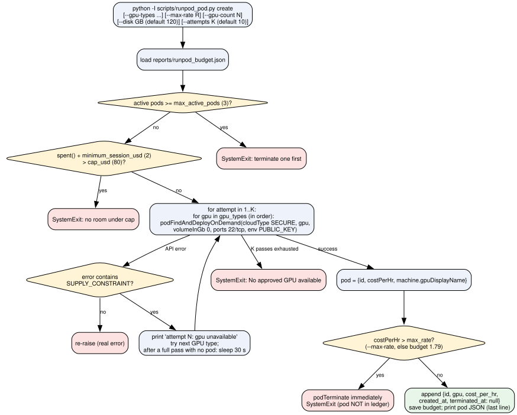

Subtleties worth knowing:
- The rate is checked **after** the pod exists. A too-expensive pod lives for a few seconds and is never written to the ledger, so `spent()` slightly undercounts in that case.
- `--max-rate` and `--gpu-types` are levers that need your approval. The budget file's `scale_probe` block records the approval for the 235B probe ($15 probe budget). The code never reads that block. The H200 scripts pass `--max-rate 5.29` explicitly (`scripts/run_test235.sh:15-16`, `scripts/run_probe_h200.sh:12-13`), while `scale_probe.max_rate` says 3.6. The code doesn't enforce the approval text; it relies on the approval having been given.

#### 2.3 `status` and `terminate`

- `status` (`runpod_pod.py:87-94`) queries each non-terminated pod for `desiredStatus`, uptime and port mappings, then prints `{"spent_usd", "cap_usd"}`. The launchers scrape the public IP and public port mapped to private port 22 from this output to build the `ssh -p PORT root@HOST` command (e.g. `run_test235.sh:32-36`).
- `terminate` (`runpod_pod.py:97-105`) calls `podTerminate` on every active pod, or only on `--pod ID`, and stamps `terminated_at`. Terminate deletes the pod and its disk. Anything not copied back to the Mac is gone.

#### 2.4 `watchdog`: the spend kill switch

```python
def watchdog(args):
    """Terminate once spend reaches the cap minus a margin; poll every minute."""
    while True:
        budget = load_budget()
        if all(pod.get('terminated_at') for pod in budget['pods']):
            print('no active pod'); return
        if spent(budget) >= budget['cap_usd'] - budget['watchdog_margin_usd']:
            print(f'cap reached at {spent(budget):.2f} USD', flush=True)
            terminate(args); return
```
(`runpod_pod.py:108-117`; line 117 is `time.sleep(60)`). It fires at $79 ($80 − $1 margin) and exits on its own when no pod is active. `launch.sh` starts it only if one isn't already running: `pgrep -f "runpod_pod.py watchdog" || nohup ... watchdog &` (`runs/pod/text32-explain/pod-setup/v4/launch.sh:26`). The H200 scripts do not start it; they rely on their own cap timer (section 4). Its limitation (`docs/handoff.md:50`): it **only runs while the Mac is awake**. If the laptop sleeps, nothing local can stop a pod. That is why pod-side `timeout` commands exist.

---

### 3. The dead-man switch on `runs/heartbeat`

> Plain words: a **dead-man switch** acts when a regular "I'm still here" signal *stops*. A watchdog acts when a bad value appears. Here the heartbeat is just the file's modification time.

The checker is **not a checked-in script**. It is a long-running shell loop started from an agent session (visible in the process list). Condensed:

```sh
touch runs/heartbeat && while true; do
  age=$(( $(date +%s) - $(stat -f %m runs/heartbeat) ))
  if [ $age -gt 10800 ]; then
    echo "no heartbeat for ${age}s ..."; .venv/bin/python -I scripts/runpod_pod.py terminate; break
  fi
  sleep 300
done
```

Every 5 minutes it checks the heartbeat's age. If nobody has touched the file for **3 hours** (10,800 s), it terminates **all** K-12 pods. The heartbeat is touched by:
- launchers at key steps (`launch.sh:23,40`, `run_test235.sh:14,31,51`, `run_probe_h200.sh:11,45`);
- polling loops while a pod job runs (`runs/pod/text32-explain/pod-setup/v4/watch.sh:8`, every 180 s, for at most 11 h = 39,600 s).

So if the agent or the poller crashes, or the session dies while a pod is idle or stuck, the pods stop within about 3 h 5 min instead of billing all night. This is a different failure from the watchdog's: there, money is running out; here, nobody is watching. The flip side: a legitimate long job is also killed if no poller touches the heartbeat for 3 h. Always keep a poller running.

---

### 4. The third switch: per-pod cap timers

For the expensive H200 runs, the launcher starts a background timer right after `create`:

```sh
LIMIT=$($PY -c "print(int($CAP / $RATE * 3600) - 300)")
( sleep "$LIMIT"; $PY -I scripts/runpod_pod.py terminate --pod "$POD" > /dev/null 2>&1; echo "cap timer fired" ) &
TIMER=$!
DEADLINE=$($PY -c "import time; print(int(time.time() + $LIMIT - 720))")
```
(`scripts/run_test235.sh:23-26`). With CAP=16 and RATE=5.29 the timer is int(10,888.5) − 300 = **10,588 s** (about 2.94 h). `DEADLINE` is copied to the pod (`run_test235.sh:46`) as `/workspace/runs/probe_deadline`, 12 minutes before the kill. `src/k12/scale_probe.py:84-86,135` reads it and does not start a chunk whose projected end (with 20% slack) would pass it. Rows it never reached keep a constant score (`np.full(..., 1e-4)`, `scale_probe.py:149`), which becomes uniform after normalisation, so the other ensemble members decide those rows. The polling loop checks `kill -0 "$TIMER"` to tell whether the timer already fired (`run_test235.sh:52`).

| Switch | Trigger | Scope | Where |
|---|---|---|---|
| watchdog | estimated spend ≥ $79 | all pods | `runpod_pod.py:108-117` |
| dead-man | heartbeat older than 3 h | all pods | ad-hoc shell loop (not in repo) |
| cap timer | wall-clock budget for one pod | one pod | `run_test235.sh:23-24`, `run_probe_h200.sh:21-22` |
| pod-side `timeout` | 45 min smoke, 6 h full (pod_run.sh); 10,800 s / 7,200 s for the 235B probes | one process | `pod_run.sh:17,34`, `probe_test_setup.sh:30`, `probe_setup.sh:20` |
| predeclared gate | dev metric or cost misses its threshold | the run | `pod_run.sh:20-32` |

---

### 5. Data transfer: Mac → pod → Mac over SSH

There is no shared drive and no Kaggle token on the pod. Everything goes through SSH using `~/.runpod/ssh/runpodctl-ssh-key`. The public half is injected at create time.

The **staging pattern** (`runs/pod/text32-explain/pod-setup/v4/launch.sh`):
1. **Leak check before spending** (`launch.sh:11-16`): assert that the extra training subset (a jsonl of explanation rows) shares no `trace_id` with the dev fold or with `train.csv`. This keeps dev numbers honest.
2. **Stage a clean tree** in `mktemp -d` (`launch.sh:18-22`): CSVs, the jsonl dataset, dev/test transcripts and `src/k12`, with `__pycache__` removed.
3. **Create the pod, start the watchdog, wait for SSH** (`launch.sh:24-38`): up to 40 tries, 15 s apart, each one running `ssh ... true`.
4. **Stream it in one pipe** and launch detached (`launch.sh:41-42`):

```sh
(cd $STAGE && COPYFILE_DISABLE=1 tar czf - data k12 get32.py run.sh runs) | ssh ... \
  "mkdir -p /workspace && cd /workspace && tar xzf - 2>/dev/null && chmod +x run.sh && \
   (setsid nohup /workspace/run.sh $NAME $LIMIT ... > /workspace/runs/run.log 2>&1 < /dev/null &) && echo launched"
```

- `tar czf - | ssh 'tar xzf -'` compresses on the Mac and unpacks on the pod in one stream, without a temporary archive.
- `COPYFILE_DISABLE=1` stops macOS from adding `._*` AppleDouble junk files to the tar.
- `setsid nohup ... < /dev/null &` puts the job in its own session with all streams redirected. The SSH command returns at once, and the job survives the SSH disconnect.

**Getting results back:** polling loops either run `ssh 'test -f /workspace/runs/<x>.status'` (`run_test235.sh:50`, `run_probe_h200.sh:44`) or `cat` the status file (`watch.sh:9`), then `scp` the outputs into `runs/pod/<run>/`. `run_test235.sh:53-54` also copies **partial** results every 2 minutes, "in case the pod disappears". `launch.sh` is text-only and sends no photos. Jobs that need photos get them from the Kaggle bundles (section 6), which are sent from the Mac over SSH as AGENTS.md L11 requires. `docs/handoff.md:52` documents the pod layout: `/workspace/k12*` code, `/workspace/data/competition_data`, `/workspace/models/{qwen3-vl-8b,qwen3-8b}`.

---

### 6. Kaggle CPU notebooks that bundle the photos

Downloading competition photos one file at a time from Kaggle is rate-limited (`docs/handoff.md:56`). The fix is two tiny **private, CPU-only, internet-off** Kaggle scripts. Each reads the competition input inside Kaggle and writes one `.tar` to `/kaggle/working`, and you then download the notebook output once. CPU notebooks use no GPU quota (AGENTS.md L10).

```python
hits = [p.parent for p in Path('/kaggle/input').rglob('train.csv') if (p.parent / 'taxonomy_v1.csv').exists()]
assert len(hits) == 1, hits
root = hits[0]
with tarfile.open('/kaggle/working/k12_images.tar', 'w') as tar:
    for name in ['train.csv', 'test.csv', 'taxonomy_v1.csv']:
        tar.add(root / name, arcname=f'competition_data/{name}')
    for split in ['train', 'test', 'questions']:
        tar.add(root / 'images' / split, arcname=f'competition_data/images/{split}')
```
(`kaggle/image-bundle/bundle.py:5-15`, condensed). Both `kernel-metadata.json` files set `"is_private": true, "enable_gpu": false, "enable_internet": false`.

| Notebook | Output | Contents (counted from the local tar listings) |
|---|---|---|
| `kaggle/image-bundle` | `data/bundle/k12_images.tar`, 477,399,040 bytes | train 1,500, test 3,498, questions 119 photos + 3 CSVs |
| `kaggle/unlabelled-bundle` | `data/bundle/unl/k12_unlabelled.tar`, 4,770,805,760 bytes | 50,000 unlabelled photos + `unlabelled.csv` |

The unlabelled script looks for `unlabelled.csv` only in a folder named `competition_data` (`unlabelled-bundle/bundle.py:5-6`), because a legacy duplicate sits at the dataset root. It also skips the train/test/questions folders, which the first bundle already has (`:14`). Both archives sit under `data/`, which is gitignored, so they never reach git.

---

### 7. Kaggle GPU guard: `scripts/launch_kaggle.py` (currently always refuses)

K-12 runs no Kaggle GPU jobs right now. The launcher still shows the "reserve the worst case" idea that the RunPod scripts copy.

- `launch()` refuses unless the timeout is between 0 and 6 h and the notebook is private, offline and on the free T4 (`launch_kaggle.py:118-122`). It also refuses a duplicate of an already-running version (`:123-125`).
- `budget_check()` stops first if `gpu_launches_allowed` is false (`:76-77`). That is where every K-12 attempt stops today, before any arithmetic. Otherwise it stops if the weekly quota window changed, because a reset does not renew the 10 h allowance (`:80-81`), and if any active Kaggle session is not registered (`:84-91`).
- The worst case reserves every active job's *remaining timeout* plus overhead and margin:

```python
def projected_hours(used,reservations,timeout,overhead=.1,margin=.25):
    remaining=sum(max(0,r['timeout_seconds']-r.get('observed_seconds',0))/3600+overhead for r in reservations)
    return used+remaining+timeout/3600+overhead+margin
```
(`launch_kaggle.py:44-46`). Admission needs `total <= 10` h **and** at least 4 h of quota left afterwards (`:98-111`). The last snapshot in `gpu_budget.json` has `quota_snapshot_used_hours` = 21.12 against the 10 h hard cap, so even a 1 h job would project to 22.47 h and be refused. The whole run holds a file lock (`fcntl.flock`, `:152-154`) so two launchers cannot both pass the check at once.

---

### 8. The pod run script pattern: `runs/arch/student/pod_run.sh`

This is the newest pod-side script, for the reason-then-choose student. It is a good template: everything the Mac needs to know is in **one status file** (`/workspace/runs/cand.status`), and the run decides go/no-go by itself.

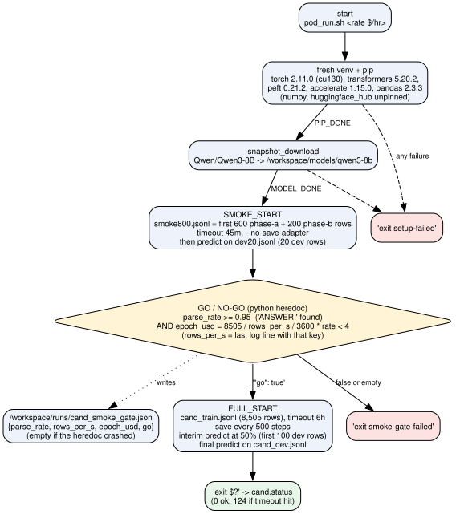

1. **Setup with pinned versions** (`pod_run.sh:6-10`): a fresh venv, then `torch==2.11.0` (cu130 wheels), `transformers==5.20.2`, `peft==0.21.2`, `accelerate==1.15.0`, `pandas==2.3.3`, then `Qwen/Qwen3-8B` from Hugging Face. Status goes `PIP_DONE` → `MODEL_DONE`. Any failure in that `&&` chain writes `exit setup-failed`. Pinning makes a rerun install the same versions of the main libraries. It is not complete: `numpy`, `huggingface_hub` and `hf_xet` are unpinned, and the model download has no fixed revision.
2. **Smoke subset** (`:14-15`): the first 600 phase-a and first 200 phase-b rows of `cand_train.jsonl` (800 rows, which is 200 steps at batch size 4), and the first 20 dev rows.
3. **Smoke run** under `timeout 45m` (`:16-19`) with `--no-save-adapter`, so no time is spent writing the adapter.
4. **Automatic go/no-go gate** (`:20-32`): the gate PLAN.md Step 3 declared before the run:

```python
rate = float(sys.argv[1])
m = json.load(open('/workspace/runs/cand_smoke/predict_dev20/predict_metrics.json'))
logs = [json.loads(l) for l in open('/workspace/runs/cand_smoke.log') if l.startswith('{') and 'rows_per_s' in l]
rps = logs[-1]['rows_per_s']
cost = 8505 / rps / 3600 * rate
ok = m['parse_rate'] >= .95 and cost < 4.
```
   The run continues only if two things hold. First, at least 95% of generated prompts (each dev row is generated once per candidate order) contain the `ANSWER:` marker (`candidate_student.py:28,276`; PLAN.md calls this "`CODES:` present"). Second, the measured speed puts one pass over the 8,505 training rows under $4. Note what that speed is. `logs[-1]` is the **last** log line with `rows_per_s`, which is the `predict_done` record of the 20-row dev predict (`candidate_student.py:306,319`), not a training record. So the cost estimate uses generation throughput. Whether that over- or under-estimates the real epoch cost is **not measured**. If the smoke run crashes, the metrics file is missing and the heredoc fails. `GATE` then comes back empty (an empty `cand_smoke_gate.json` is still written), and the `case` falls through to `exit smoke-gate-failed`. That is the safe direction.
5. **Full run** under `timeout 6h` (`:33-37`). It checkpoints every 500 steps, runs an **interim predict** on the first 100 dev rows at 50% of the updates (PLAN.md Step 4's abort point), then predicts on all dev rows. The last line writes `exit $?` (`:38`). That is 0 on success, or 124 if `timeout` killed it.

> Plain words: a **predeclared gate** is a pass/fail rule written down *before* you see the result. If you choose the threshold afterwards, you can talk yourself into continuing a run that should stop. AGENTS.md L11 requires stopping pods when such a gate fails.

PLAN.md's later gates for this student (Step 5) are evaluated on the Mac, on CPU. Among other conditions, the student must beat blend+Sinkhorn (0.737) by at least +0.015, with the bootstrap CI's lower bound above 0. The pod script only automates the cheap smoke gate. No result of this pod run exists locally yet (there are no `runs/pod/*cand*` outputs), so whether it passed any gate is **not measured** at the time of writing.

Older launchers follow the same shape, with different status files (`/workspace/runs/text32-v4.status`, `fewshot235_test.status`, `probe235.status`).

---

### 9. Submissions: staging, permission and the log

#### 9.1 Build → validate → ask → submit → record

1. **Blend on CPU** from `.npz` bundles. A bundle holds `ids (N,)`, `classes (76,)`, `p (N,76) float32` and a JSON `meta` string. It is written by `save_bundle` (`src/k12/core.py:97-103`) and read back by `aligned_bundle` (`core.py:106-114`). `aligned_bundle` reorders rows and columns by name and refuses if the ID or class sets differ, which prevents silent misalignment.
2. **Write top-3** with `write_submission` (`core.py:54-61`).
3. **Validate** (`scripts/validate_submission.py:8-17`): the header must be exactly `trace_id,root_code`, the file must hold exactly the 3,498 test IDs with no duplicates, and each row needs 1–3 distinct codes, all from the 76-label space (75 taxonomy codes + `NONE`). Use `read_csv` (`core.py:13-15`), which sets `keep_default_na=False`; otherwise pandas turns the literal label `NONE` into a missing value.
4. **Stage and ask.** The CSV sits in `artifacts/...` or `runs/arch/...` until you approve that specific file. For example, `runs/arch/label-structure/staged_submission_balanced_l0.5.csv` is staged and **not submitted**; PLAN.md says "submit only with your explicit OK".
5. **Record** the result in `reports/status.json`.

#### 9.2 `reports/status.json` submissions log (real entries)

| Kaggle ref | Model (short) | Dev MAP@3 | Public MAP@3 |
|---|---|---|---|
| 58126216 | Qwen3-VL-4B LoRA epoch 3 | not recorded | 0.58216 |
| 58133839 | 4B, T=2 + 25% hierarchical prior | not recorded | 0.598 |
| 58221584 | 8B transcription-trained classifier 0.7 / 4B 0.3, 10% prior | 0.6467 | 0.62383 |
| 58228022 | transcriber → Qwen3-8B reasoner 0.6 / 8B classifier 0.4 | 0.6838 | 0.66183 |
| 58234705 | 8B reasoner × VL-8B distilled from Claude labels, 50/50 | 0.6932 | 0.68283 |
| 58240192 | 3-way: 32B QLoRA .35 / 8B .30 / VL distill .35 | 0.7182 | **0.7085** |
| 58240232 | same file, same SHA-256 | 0.7182 | 0.7085 |

Each entry stores `source` (the CSV path) and `sha256`. The hash proves which exact file was scored: `shasum -a 256 artifacts/submission-3way-blend/submission.csv` gives `886f61a0…`, matching both of the last two entries. The last entry is marked "Accidental duplicate of 58240192 (same file and hash) from a second waiter; used a daily slot, no score effect". A "waiter" was an ad-hoc background command waiting to submit. Two were running. With 5 submissions a day (`docs/handoff.md:8`) and a deadline of 17 Nov 00:00 UTC, a wasted slot matters. This is one reason for the per-file permission rule from 11 Nov.

`best_public_map3` is 0.7085. The milestone is 0.82, and the public top 3 in the 8 Nov snapshot were 0.8445 / 0.842 / 0.83916.

#### 9.3 The permission rule

AGENTS.md L13, plus the auto-memory note "Kaggle submit needs permission": **never submit without your explicit OK for that specific file.** Approving one CSV does not approve the next one. No checked-in file calls `kaggle competitions submit` (a grep of `scripts/`, `src/`, `runs/`, `kaggle/` and `docs/` finds none). Submitting is a manual, approved step.

---

### 10. Reproducibility and the offline requirement

- **Offline final inference.** Test predictions must come from models whose weights we hold. Claude-generated labels are training targets only. The Claude API never sees a test photo (AGENTS.md L12), and test transcripts (`runs/pod/tx/tx_test.json`) come from our own Qwen3-VL-8B transcriber. Kaggle jobs must have `enable_internet: false` (`launch_kaggle.py:120`).
- **Open-source obligation.** Winners must publish full training and inference code under an open licence (`docs/handoff.md:11`). That is why pod scripts pin the main library versions and the data-prep steps (bundles, folds, datasets) are scripts, not manual clicks.
- **Deterministic splits.** `make_folds(seed=2026)` (`core.py:64-94`) groups rows with the same question ID and the same normalised transcription, so the 301-row dev fold (fold 0) cannot leak exact copies of fit rows.
- **Privacy.** `.gitignore` excludes `data/`, `runs/`, `artifacts/`, `.kaggle/`, `kaggle.json`, `*.csv`, `*.npz`, `*.jsonl`, `.env` and `.env.*`. Results and photos stay local.
- **What git does *not* hold yet.** Because `runs/` is ignored, `runs/arch/student/pod_run.sh`, `runs/pod/text32-explain/pod-setup/v4/launch.sh`, `watch.sh` and the dead-man loop are not in git. `scripts/run_test235.sh`, `scripts/run_probe_h200.sh`, `src/k12/candidate_student.py`, `src/k12/scale_probe.py` and `reports/claude_budget.json` are untracked (`??` in `git status`), and `scripts/runpod_pod.py` has uncommitted edits. Copy the pod scripts into a tracked folder and commit them before the code-sharing deadline.
- **Provenance.** Budget files record who approved what and when (`runpod_budget.json["approval"]`, `claude_budget.json["approval"]`), and the submission log records hashes.

---

### Key files

- `/Users/gaddamshivateja/Documents/ChatGPT/kaggle-K-12/AGENTS.md`: the dated user rules
- `/Users/gaddamshivateja/Documents/ChatGPT/kaggle-K-12/scripts/runpod_pod.py`: create / status / terminate / watchdog
- `/Users/gaddamshivateja/Documents/ChatGPT/kaggle-K-12/reports/runpod_budget.json`: RunPod policy and pod ledger
- `/Users/gaddamshivateja/Documents/ChatGPT/kaggle-K-12/runs/heartbeat`: dead-man heartbeat (empty file; only its mtime matters)
- `/Users/gaddamshivateja/Documents/ChatGPT/kaggle-K-12/runs/arch/student/pod_run.sh`: pod-side run with status file and automatic gate
- `/Users/gaddamshivateja/Documents/ChatGPT/kaggle-K-12/runs/pod/text32-explain/pod-setup/v4/launch.sh` and `watch.sh`: Mac-side stage/upload/launch and heartbeat poller
- `/Users/gaddamshivateja/Documents/ChatGPT/kaggle-K-12/scripts/run_test235.sh`, `scripts/run_probe_h200.sh`: H200 runs with cap timers and partial-result rescue
- `/Users/gaddamshivateja/Documents/ChatGPT/kaggle-K-12/src/k12/scale_probe.py`: reads `probe_deadline` and stops starting chunks
- `/Users/gaddamshivateja/Documents/ChatGPT/kaggle-K-12/src/k12/candidate_student.py`: writes the `parse_rate` and `rows_per_s` the smoke gate reads
- `/Users/gaddamshivateja/Documents/ChatGPT/kaggle-K-12/kaggle/image-bundle/bundle.py`, `kaggle/unlabelled-bundle/bundle.py`: CPU bundling notebooks
- `/Users/gaddamshivateja/Documents/ChatGPT/kaggle-K-12/scripts/launch_kaggle.py`, `reports/gpu_budget.json`: Kaggle GPU admission control (disabled for K-12)
- `/Users/gaddamshivateja/Documents/ChatGPT/kaggle-K-12/scripts/validate_submission.py`, `src/k12/core.py`: submission checks, bundles, MAP@3
- `/Users/gaddamshivateja/Documents/ChatGPT/kaggle-K-12/reports/status.json`: submissions log
- `/Users/gaddamshivateja/Documents/ChatGPT/kaggle-K-12/reports/claude_budget.json`: Claude API spend log
- `/Users/gaddamshivateja/Documents/ChatGPT/kaggle-K-12/docs/handoff.md`: pod layout and operations notes (partly stale, see below)
- `/Users/gaddamshivateja/Documents/ChatGPT/kaggle-K-12/runs/arch/PLAN.md`: current plan, budgets and gates

---

### Things to try yourself (all CPU, no pods, no APIs)

Run these from the repo root with `.venv/bin/python -I`.

**1. Load the three dev bundles and recompute MAP@3 and the 3-way geometric blend.**

> **MAP@3**: for each row you rank 3 codes. You score 1, 1/2 or 1/3 if the true code is 1st, 2nd or 3rd, otherwise 0, and then average over rows. **Geometric blending**: average the *log*-probabilities with weights, then exponentiate. A code must be fairly likely under every model to stay on top.

```python
import json, numpy as np, sys; sys.path.insert(0, 'src')
from k12.core import read_csv, aligned_bundle, map3
tr = read_csv('data/raw/train.csv').set_index('trace_id')
ids = json.load(open('data/v3/dev_ids.json')); y = tr.loc[ids, 'root_code'].tolist()
cls = sorted(np.load('runs/pod/dev-distill/validation_epoch_2.npz')['classes'].tolist())
fs = {'32b': 'runs/pod/text32/validation_tx_dev_epoch_1.npz', '8b': 'runs/pod/tx/text_tx_dev_e3.npz',
      'vl': 'runs/pod/dev-distill/validation_epoch_2.npz'}
P = {k: aligned_bundle(f, ids, cls) for k, f in fs.items()}
for k in P: print(k, round(map3(y, P[k], cls), 4))
logp = .35*np.log(P['32b']) + .30*np.log(P['8b']) + .35*np.log(P['vl'])
print('blend', round(map3(y, np.exp(logp - logp.max(1, keepdims=True)), cls), 4))
```
When this guide was checked, it printed 32b 0.6523, 8b 0.6667, vl 0.6528 and blend **0.7182** on the 301 dev rows. That matches PLAN.md and the `development_map3` of submission 58240192. Equal weights (1/3 each) gave 0.7126. Try other weights and see how far the score moves.

**2. Compute RunPod spend without touching the API.**
```python
import sys; sys.path.insert(0, 'scripts')
from runpod_pod import load_budget, spent   # importing does not call the API; gql() runs only inside create/status/terminate
print(round(spent(load_budget()), 2))
```
Run it twice a minute apart while a pod is active and watch it grow. Then work out by hand when the watchdog would fire ($79). Do **not** run `runpod_pod.py status`: it calls the API.

**3. Validate a staged CSV and check its hash against the log.**
```sh
.venv/bin/python -I scripts/validate_submission.py runs/arch/label-structure/staged_submission_balanced_l0.5.csv
shasum -a 256 artifacts/submission-3way-blend/submission.csv   # compare with status.json sha256
```
The first command prints `VALID: 3498 rows, ...`. Then copy a CSV to your scratch folder, delete one row or add a 4th code, and watch the validator reject it.

**4. Replay the Kaggle admission arithmetic.**
```python
import sys; sys.path.insert(0, 'scripts'); from launch_kaggle import projected_hours
print(projected_hours(21.12, [], 3600))   # 22.47 > hard cap 10, so refused
print(projected_hours(2.0, [{'timeout_seconds': 7200, 'observed_seconds': 1800}], 3600))   # 4.95
```
The second call shows how an active job's *remaining* timeout (5,400 s = 1.5 h, plus 0.1 h overhead) is reserved, not its elapsed time.

---

### Common confusions

- **"AGENTS.md says no paid compute, yet we rent pods and use the Claude API."** Line 4 is from 8 Nov. Lines 11–12 (10–11 Nov) are later, dated, scoped authorisations: RunPod up to $80, and Claude up to $200 on non-test photos. The Kaggle-GPU rules still apply to Kaggle jobs.
- **"The handoff says a $50 cap."** `docs/handoff.md` was last updated 11 Nov ~04:00 UTC. The cap was later raised to $70, then $80 (see `runpod_budget.json["approval"]`). `reports/runpod_budget.json` and AGENTS.md are current. Several top-level fields in `status.json` (`budget`, `monitoring`, `next_required`) also date from the Kaggle-only era. Treat `submissions[]` as the reliable part.
- **"`spent()` is what RunPod will bill."** No. It is elapsed time × listed rate from the local ledger. Disk charges, boot seconds and an over-rate pod that was killed at once are not included. Keep the $1 margin.
- **Watchdog vs dead-man vs cap timer.** Watchdog: "money is running out" (all pods). Dead-man: "nobody has checked in for 3 h" (all pods). Cap timer: "this one pod's time is up". All three run on the Mac and stop if it sleeps. Only the pod-side `timeout` and gate keep working without the Mac. They end the *job*, not the *billing*: an idle pod still costs money until it is terminated.
- **"The dead-man switch is in the repo."** It isn't. It is a shell loop in a background session. If you start fresh, recreate it (or a script version) before leaving pods unattended.
- **"`terminate` = stop."** Terminate destroys the pod and its disk. Copy results back first. This is why the launchers `scp` partial outputs while the job runs.
- **"Smoke-test score = a result."** AGENTS.md L14 forbids claiming it. A 20-row smoke run tests that the pipeline works (parsing, speed, cost), not accuracy.
- **"The smoke gate measured training speed."** It reads the last `rows_per_s` in the log. In `pod_run.sh` that comes from the dev-predict summary, so it measures generation speed.
- **"Validated = OK to submit."** Validation checks format only. Submitting still needs your explicit yes for that file, and a duplicate submit still burns a daily slot (ref 58240232).
- **"Kaggle bundles use GPU quota."** They are CPU-only notebooks (`enable_gpu: false`), so they use none.


---

<a id="09-history-lessons"></a>

# Experiment history and lessons learned

## In one paragraph

The public MAP@3 went from **0.58216 to 0.70850** in six distinct submissions over four days (8 to 11 November 2026). Each step changed one big thing:
1. a fine-tuned 4B vision model;
2. calibration with a prior;
3. a bigger 8B vision model with a "reading" loss;
4. splitting the job into *read the photo* and *diagnose the text*;
5. training on Claude-labelled unlabelled photos (distillation);
6. a 3-way blend that adds a 32B text reasoner.

Many more ideas failed than succeeded. Bigger models without fine-tuning (Qwen3.5-27B, Qwen3-235B), smarter combiners and stackers, and better readers were all measured and gave no gain that held up. External datasets and speed rewrites in Rust or C++ were assessed and ruled out on evidence, without being run. The gap analysis in `runs/arch/PLAN.md` explains why. Claude Opus scores 0.819 on dev, about 0.10 above us. About 78% of that gap sits on one kind of row: a question we have seen before, where the student made a type of error that never appeared for that question in training. Our models have learned "question → its usual codes", and nothing tried so far breaks that shortcut. The honest outlook is about 0.72–0.74 public by 17 November, and nothing measured supports 0.80 or more.

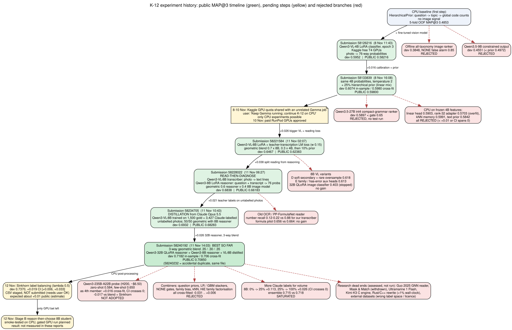

---

## 1. Concepts you need for this chapter

These ideas come up again and again below. Each gets one plain-words explanation here.

- **MAP@3 (mean average precision at 3).** For each photo you submit up to 3 ranked codes. A correct code scores 1 at rank 1, 1/2 at rank 2 and 1/3 at rank 3; anything else scores 0. The score is the average over all photos. Our implementation is in `src/k12/core.py:38-51`:
  ```python
  def row_scores(y, predictions):
      ...
      for target, codes in zip(y, predictions):
          ...
          hits = [1.0 / (i + 1) for i, c in enumerate(list(codes)[:3]) if c == target]
          scores.append(hits[0] if hits else 0.0)
      return np.asarray(scores)

  def map3(y, p, classes):
      return float(row_scores(y, topk(p, classes)).mean())
  ```
  There are 76 classes: 75 taxonomy codes plus `NONE` (`label_space`, `core.py:18-19`).
- **Dev fold.** `make_folds` (`core.py:64`) splits the 1,500 training rows into 5 folds.
  - Fold 0 (**301 rows**) is the *development* (dev) set. Every number in this chapter is measured on it.
  - The other **1,199 rows** are the *fit* rows the dev models were trained on.
  - Test has 3,498 rows. Its labels are hidden, and only Kaggle's public leaderboard scores it.
- **LoRA / QLoRA.** LoRA leaves a big model's weights frozen and trains small low-rank "adapter" matrices added to some layers, which makes training cheap. Our text reasoner puts LoRA on all attention and MLP projections (`src/k12/text_diagnose.py:50-52`). QLoRA does the same on top of a base model stored in 4-bit NF4, so a 32B model fits on one GPU (`text_diagnose.py:44-47`).
- **Distillation / soft labels.** A strong "teacher" (Claude Opus) labels unlabelled photos, and a smaller "student" (our Qwen model) is trained to copy it. With soft labels the target is a spread of probability over several codes, not a single code. We put 0.7/0.2/0.1 on Claude's ranked top 3. That is the default `--shares` in `scripts/build_claude_distill.py:24`, and it is recorded in the settings of `reports/claude_distill_v3.json`, `_v4.json` and `_v4w.json`.
- **Geometric blending.** To combine models, raise each model's probabilities to a weight, multiply them, then renormalise. This equals a weighted sum of log-probabilities. A code needs support from every model to rank high. See `scripts/blend_geometric.py:24-29`:
  ```python
  for spec in args.inputs:
      name, rest = spec.split('=', 1)
      path, weight = rest.rsplit(':', 1)
      log_p = log_p + float(weight) * np.log(aligned_bundle(path, ids, classes))
      recipe[name] = {'path': path, 'weight': float(weight)}
  scores = normalize(np.exp(log_p - log_p.max(axis=1, keepdims=True)))
  ```
- **Hierarchical prior.** A model with no image signal at all. It asks how often each code was the answer for this question, backs off to the topic when the question has few rows, and backs off to all rows after that. See `src/k12/baseline.py:13-36` (`question_strength=2.0`, `topic_strength=8.0`). It was the very first baseline, and it was mixed in at 10–25% in early submissions.
- **Cross-fitting.** If you pick a setting (a blend weight, a λ) on the same 301 rows you then score, the score is optimistic. Cross-fitting avoids this:
  1. Split the dev rows into 5 groups *by question* (for example `s7_sinkhorn.py:14-15`).
  2. For each group, pick the setting on the other 4 groups.
  3. Score that setting on the held-out group.

  This is how the plan computes an honest number.
- **Paired question-grouped bootstrap CI.** This tests whether "new − old" is a real difference.
  - Resample *questions* 4,000 times. Questions, not rows, because rows from one question are correlated.
  - Take the 2.5% and 97.5% quantiles of the mean difference. See `runs/arch/label-structure/common.py:20-28`.
  - If the interval contains 0, the gain is not established.
  - On 301 rows the paired standard error is about 0.013, so one run cannot confirm a gain smaller than about +0.02 (`runs/research/REPORT.md:5`).
- **Sinkhorn balancing.** Each class gets one scaling factor, applied to every row, so that the *average* predicted class mix on the evaluated set matches a target mix (here, the training label counts). It needs no labels on the evaluated set. λ controls how far toward full balancing to go. Covered in §5.

---

## 2. The score timeline: what changed each time

All submissions are recorded in `reports/status.json` under the `submissions` key.

| # | Ref | Time (UTC) | What changed | Dev MAP@3 | Public MAP@3 | Public Δ |
|---|---|---|---|---|---|---|
| 0 | n/a | first step | CPU hierarchical prior, no image (`reports/baseline_metrics.json`) | 0.4853 (5-fold OOF) | n/a | n/a |
| 1 | 58126216 | 8 Nov 11:43 | Qwen3-VL-4B LoRA classifier, epoch 3, Kaggle free T4 | 0.5952 | **0.58216** | n/a |
| 2 | 58133839 | 8 Nov 16:08 | Same probabilities, temperature 2 + 25% hierarchical prior | 0.6074 (in-sample) / 0.5980 (cross-fit) | **0.59800** | +0.0158 |
| 3 | 58221584 | 11 Nov 02:07 | Qwen3-VL-8B LoRA with teacher-transcription loss; geometric 0.7 × 8B · 0.3 × 4B; 10% prior | 0.6467 | **0.62383** | +0.0258 |
| 4 | 58228022 | 11 Nov 06:27 | Read-then-diagnose: VL-8B transcriber → Qwen3-8B LoRA reasoner; geometric 0.6 reasoner · 0.4 VL-8B | 0.6838 | **0.66183** | +0.0380 |
| 5 | 58234705 | 11 Nov 10:43 | VL-8B distilled from Claude Opus 5.5 labels (1,500 real + 3,427 Claude rows); 50/50 with 8B reasoner | 0.6932 | **0.68283** | +0.0210 |
| 6 | 58240192 | 11 Nov 14:03 | 3-way: Qwen3-32B QLoRA reasoner .35 + Qwen3-8B reasoner .30 + VL-8B distilled .35 | 0.7182 (in-sample) / 0.706 (cross-fit) | **0.70850** | +0.0257 |
| (6b) | 58240232 | 11 Nov 14:05 | Accidental duplicate of 58240192 (same SHA-256), sent by a second waiter process. It used up a daily slot and had no score effect. | | 0.70850 | 0 |

### Step 1: a fine-tuned vision model (0.58216)

- **What:** Qwen3-VL-4B with a LoRA adapter and a 76-way classification head, trained for 3 epochs on Kaggle's free T4 GPUs. Photo in, 76 probabilities out.
- **Evidence:**
  - Dev MAP@3 by epoch was 0.434 → 0.586 → 0.595 (`status.json` → `experiments[k12-vision-development].epoch_metrics_from_live_log`).
  - The prior alone scores 0.497 on the same rows, so the photo added about +0.10, CI [+0.057, +0.140].
- **Weakness:** it called 17.8% of NONE rows an error, and labelled 11.5% of error rows NONE.

### Step 2: calibration plus a prior (0.59800)

- **What:** no new model. The 4B probabilities were softened with temperature 2 (raised to the power 1/2), then mixed linearly with the hierarchical prior at weight 0.25. Code: `src/k12/holdout_calibration.py:12-14`:
  ```python
  def calibrated(image,prior,weight,temperature):
      softened=normalize(np.maximum(image,1e-12)**(1/temperature))
      return (1-weight)*softened+weight*prior
  ```
- **Lesson:** the in-sample dev score was 0.6074 and the cross-fit score was 0.5980. Public came in at exactly 0.59800. This was the first sign that **cross-fitted dev numbers predict public; in-sample ones do not**.

### The pause (8–10 Nov): CPU only

- An unrelated Gemma job on the same Kaggle account was consuming the shared GPU quota. The user chose "Keep Gemma running; continue K-12 on CPU" (`AGENTS.md`). The queued K-12 GPU run was cancelled.
- Every CPU idea on frozen 4B features failed (§3.2).
- On 10 Nov the user approved paid RunPod GPUs, which made steps 3–6 possible.

### Step 3: bigger vision model plus a reading loss (0.62383)

- **What:** Qwen3-VL-8B with two losses.
  - The usual classification loss.
  - An extra language-model loss for writing the annotator's transcription of the photo (`--reading-weight 0.15`).
- **The idea:** forcing the model to *read* the working should help it *diagnose*. The combined loss is at `src/k12/pod_train.py:206`:
  ```python
  ((weight * ce + args.reading_weight * reading + args.aux_weight * aux) / window).backward()
  ```
- **Evidence** (`docs/handoff.md:22-31`, dev at epoch 3):

  | Run | Dev MAP@3 |
  |---|---|
  | Run A, plain 8B | 0.619 |
  | Run B, + reading loss (weight 0.15) | **0.632** |
  | B^0.7 · 4B^0.3, then 10% prior | **0.647** |

- **Caveat:** against the submitted 4B recipe (0.6074), Run B's paired CI was still [−0.014, +0.060] (`reports/pod_8b_read_dev.json`, `paired_question_bootstrap_delta_95`). So the reading loss was a plausible gain, not a proven one.

### Step 4: read, then diagnose (0.66183, the largest single jump)

- **What:** split the problem into two models.
  1. **Transcriber.** A Qwen3-VL-8B LoRA writes the student's working as text lines (photo → text lines).
  2. **Reasoner.** A Qwen3-8B text model with LoRA and a linear classifier head (`text_diagnose.py:56`).
     - Input: the taxonomy code list, then grade, topic, question, answer key and transcript.
     - Output: 76 probabilities.
     - The prompt is built in `src/k12/text_diagnose.py:25-29`.
- **Why it worked:**
  - **The transcriber reads well.** On dev photos it reached number recall 0.88 and precision 0.91; older OCR got 0.12–0.22 recall (`docs/handoff.md:35`).
  - **Text is easier to reason over.** Given good text, a text-only LLM reasons about the maths much better than a vision model reasoning about pixels.
  - **Machine reading costs little.** At epoch 1 the reasoner scored 0.570 on teacher transcripts and 0.542 on machine transcripts, a cost of about 0.03 (`docs/handoff.md:36`).

### Step 5: distillation from Claude (0.68283)

- **What:**
  - Claude Opus 5.5 (paid API, on **training and unlabelled photos only, never test**) labelled thousands of the 50,000 unlabelled competition photos with a ranked top 3.
  - The VL-8B was then trained on 1,500 real rows plus 3,427 Claude rows with soft targets.
  - Inference stays fully offline: only the Qwen weights are used at test time.
  - The API budget later covered 17,503 photos in total (`reports/claude_budget.json`).
- **Teacher quality:** Claude scored **0.8189** on the 301 dev photos (`reports/claude_dev_opus.json`). That is far above any of our models, so it is a good teacher.
- **Data scaling** (`reports/claude_scaling.json`, 8B text reasoner on machine transcripts):

  | Claude labels added | Dev MAP@3 | Δ (95% CI) |
  |---|---|---|
  | 0% | 0.5532 | n/a |
  | 25% | 0.6661 | +0.113 vs 0% [0.073, 0.156] |
  | 100% | 0.6921 | +0.026 vs 25% [−0.002, +0.053] |

  The first quarter of the labels did almost all of the work.

### Step 6: the 3-way blend with a 32B reasoner (0.70850, current best)

- **What:** a geometric blend at .35/.30/.35 of three models (`runs/arch/PLAN.md:20-24`):

  | Member | Epoch | Dev MAP@3 alone |
  |---|---|---|
  | Qwen3-32B QLoRA text reasoner | 1 | 0.652 |
  | Qwen3-8B text reasoner | 3 | 0.667 |
  | Distilled VL-8B | 2 | 0.653 |

- **Why it worked:** no single member beats 0.667, but the blend reaches 0.718. The members make *different* mistakes, so multiplying their probabilities cancels some errors.

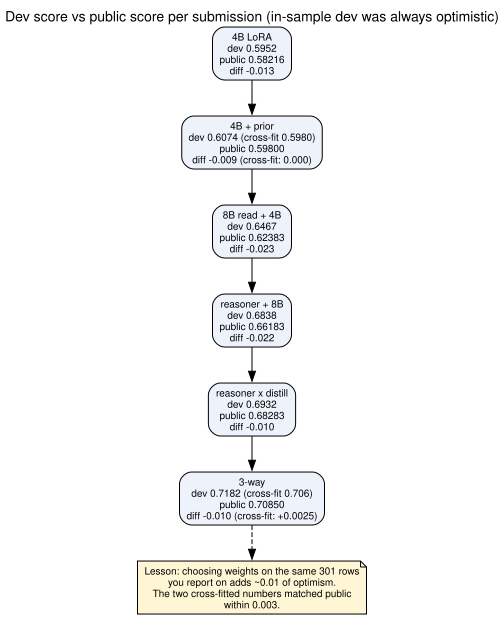

**Lesson from the dev-vs-public pairs:**
- In-sample dev was always higher than public, by 0.009 to 0.023.
- A cross-fitted number exists only for submissions 2 and 6. In both it lands within 0.003 of public (0.5980 vs 0.59800; 0.706 vs 0.7085).
- **Picking the 3-way weights on dev adds about 0.012 of optimism.** The blend scores 0.718 in-sample against 0.706 cross-fitted, CI [−0.021, −0.004] (`PLAN.md:61`, `PLAN.md:210`).

---

## 3. Experiments that failed, and why

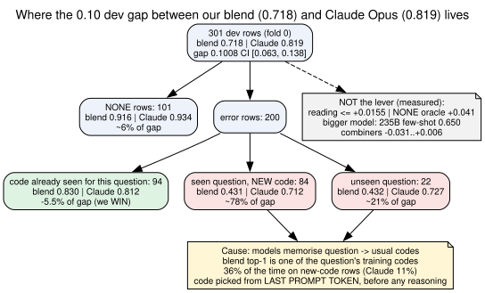

### 3.1 Big models without fine-tuning

| Experiment | Dev MAP@3 | Why it failed | Source |
|---|---|---|---|
| Offline all-taxonomy image ranker | 0.3848 | It over-diagnosed, calling 85% of NONE rows an error. Version 1 also ran out of memory on one T4 with the long taxonomy prompt. | `status.json` experiments |
| Qwen3.5-9B, code-only constrained output | 0.4551 | Worse than the no-image prior (0.4972). It missed 53.5% of errors as NONE. | same |
| Qwen3.5-27B int4 compact-grammar ranker | 0.5897 | Failed its predeclared 0.65 gate, so no test run. It took 2,171 s for 301 rows. | `status.json`, `reports/qwen35_27b_result.json` |
| **Qwen3-235B-A22B probe** (one H200, about $6.50) | zero-shot 0.584; few-shot (4 examples) **0.650** | Still below our 0.718 ensemble. | `runs/pod/probe235/REPORT.md` |

**More on the 235B probe:**
- **Scale does help at equal information.** With both models few-shot, 235B beat 32B by +0.054, CI [+0.014, +0.094].
- **Fine-tuning helps about as much as scale.**
  - The 32B went from 0.596 few-shot to 0.652 fine-tuned (+0.056).
  - A fine-tuned 235B might reach about 0.70–0.71. That is an extrapolation, not a measurement.
  - A 235B fine-tune was estimated at $150–300, far above the remaining cap.
- **As a 4th ensemble member it adds little.**
  - Probe report: +0.012 over the *equal-weight* 3-way blend (0.713), CI [−0.014, +0.037].
  - With the weight cross-fitted on the real blend: +0.016 with a CI crossing 0, and −0.017 against blend + Sinkhorn (`PLAN.md:213`).
  - Its gain sits on rows we already get right. Unseen-pair rows go 0.431 → 0.429.
- **Setup lessons** (`runs/pod/probe235/REPORT.md:30-33`):
  - vLLM 0.33 needs the venv's CUDA 13 NVRTC on `LD_LIBRARY_PATH` and the venv `bin` on `PATH`. `scripts/probe_setup.sh:15-17` does both.
  - FlashInfer cannot be built with the image's nvcc 12.4. Point `CUDA_HOME` at the venv's CUDA 13, or set `VLLM_USE_FLASHINFER_SAMPLER=0`.
  - Start the model download in parallel with `pip install`. The setup script itself still downloads after pip.

**Lesson:** a bigger general model is not a better *diagnoser* of these specific student errors. The literature review found the same: in MAP 2025, going from Qwen3-8B to 32B gained the winner only +0.003 (`runs/research/ARCHITECTURE_FROM_PAPERS.md:14`).

### 3.2 CPU tricks on frozen features (the 8–10 Nov pause)

All of these are on the reused dev fold (`status.json` and `reports/experiment_results_2026-11-08.md:9-21`). They use two different references:
- The adapters and kNN are compared against the same 4B model on cached batched features, at **0.5980**.
- The two prior ideas are compared against the fixed in-sample blend, at **0.6074**.

| Idea | Dev MAP@3 | Reference | Verdict |
|---|---|---|---|
| Linear head refit | 0.5903 | 0.5980 | worse |
| Rank-32 residual adapter | 0.5703 | 0.5980 | **overfit**: fit-rows MAP 0.960, dev fell |
| Regularised rank-8 adapter | 0.5991 | 0.5980 | +0.001, CI spans 0, below the +0.01 screen |
| kNN feature memory (k=8), confidence-gated | 0.5991 | 0.5980 | insufficient gain |
| Conditional-prior odds correction | 0.6074 | 0.6074 | Δ 0.000, CI [−0.021, +0.018] |
| Question-text logistic prior | 0.5842 | 0.6074 | worse, Δ −0.023, CI [−0.043, −0.005] |

**Lesson:** you cannot squeeze new information out of features that do not contain it. More output capacity just memorised the 1,199 fit rows.

### 3.3 Training-recipe variants that did not help

From `docs/handoff.md:22-30`. The VL-8B variants are at epoch 3:

| Variant | Dev MAP@3 |
|---|---|
| Run A (plain 8B, reference) | 0.619 |
| D: soft secondary labels + rare-code oversampling | 0.618 |
| E: error-family and has-error auxiliary heads | 0.613 |
| 32B QLoRA image classifier | 0.403 at epoch 1, stopped |

### 3.4 Combiners, priors and stackers

`PLAN.md:58` and `ARCHITECTURE_FROM_PAPERS.md` §2 and §4 list everything tried on top of the 3-way blend, all cross-fitted:
- question priors (−0.004);
- logistic-regression and gradient-boosting stackers;
- NONE gates, family bias and routing;
- within-question kNN over about 27k transcriptions: 1,199 gold + 26,161 Claude-labelled (−0.006 to 0.000);
- HiE family factorisation (−0.004 raw, −0.008 on the Sinkhorn base).

Every variant lands between **−0.031 and +0.006**.

**Lesson:** once three strong members are blended, re-weighting their outputs is exhausted. A real gain needs *new evidence*, not a new way to mix old evidence.

### 3.5 Reading upgrades

- **Perfect reading is worth little** (`runs/arch/reading-impact/results.json`).
  - Single models: swapping the machine transcript for the gold one improves them by +0.025 to +0.035.
  - Ensemble: only about +0.0155 (32B reading gold, CI [+0.006, +0.026]).
- **Most lost points are not reading errors.** 17.0 of the 30.3 gap points are on rows our transcriber read exactly right (`PLAN.md:55`).
- **Claude does not read better than our transcriber.** Median page character error rate is 0.124 for Claude and 0.095 for ours (`PLAN.md:55`).
- **The PP-FormulaNet formula-reader pilot gave no diagnosis gain**: 0.656 vs 0.664 (`runs/research/REPORT.md:139`).
- **The worry that "VLMs over-correct student errors" does not apply here.** Our transcriber turned a wrong final answer right on only 8 of 173 rows (`ARCHITECTURE_FROM_PAPERS.md:81`).

### 3.6 More data

- **More Claude labels are saturated.**
  - Going from 0% to 100% Claude labels lifted a single 8B from 0.553 to 0.692.
  - The *ensemble* only reached 0.715, against 0.718 without them (`PLAN.md:57`).
  - Labelling the whole 50k pool would cost about $174 for roughly nothing (`REPORT.md:177`).
  - The API budget stands at $186.61 spent of $200 (`reports/claude_budget.json`).
- **External datasets don't fit** (`runs/research/REPORT.md` Q5, lines 156-183):
  - **MathWriting, CROHME, HME100K.** Single-expression handwriting sets. MathWriting is non-commercial, and the other two licences are unverified.
  - **ProcessBench, PRM800K.** They label LLM solution steps as right or wrong, not student misconceptions.
  - **Eedi 2024, MAP 2025, ScratchMath, FERMAT, ErrorRadar and others.** Each one fails on at least one count: a different label space, typed or deliberately perturbed text, a small or Chinese-only set, or an unverified licence.
  - No external set uses our 75 codes.
- **Self-training on our own ensemble's labels was ruled out.** The teacher would be weaker (0.718 vs 0.819) and would reinforce its own mistakes.

### 3.7 Research dead ends (assessed, not run)

From `runs/research/REPORT.md`:

| Idea | Why not |
|---|---|
| Guo 2025 EfficientNet + GNN formula reader (Q1) | It reads single formulas, it is weaker than CoMER on CROHME, and its tables are inconsistent. |
| Mask & Match, arXiv 2508.06107 (Q4) | Withdrawn by the authors, and no code was released. |
| Ultramarine 1 Flash (Q2) | 331 GB in FP8, so it cannot run offline on Kaggle. Its RL post-training was text-only. |
| Kimi-K3-in-C CPU engine (Q3) | 5.6–26.5 s per token, so the 3,498 test rows (about 4.1M prompt tokens) would take weeks. |
| Rust/C++ rewrite (Q3) | Tokenising takes 0.3 ms per prompt and image preprocessing 6.4 ms per photo, both already in native code. Against 1–2 s of GPU time per row, a rewrite saves under 1% of wall-clock. |

**The one transferable efficiency lesson from Q3:** the 921-token taxonomy list is most of every prompt. It is about 72% of a training row and 78% of an inference prompt (`REPORT.md:92`); `PLAN.md:67` says 79%. **The prompt is the real speed lever.**

---

## 4. The gap analysis: where the remaining 0.10 lives

This table (`runs/arch/PLAN.md:28-33`) is the most important result in the project. It splits the 301 dev rows by *whether we have seen this situation before*:

| Where | Rows | Blend | Claude | Share of gap |
|---|---|---|---|---|
| Error rows, seen question, **code never seen for that question** in fit rows | 84 | 0.431 | 0.712 | **about 78%** (+0.282, CI [0.204, 0.366]) |
| Error rows from **unseen questions** | 22 | 0.432 | 0.727 | about 21% |
| Error rows whose code **was** seen for that question | 94 | **0.830** | 0.812 | −5.5% (we win) |
| NONE rows | 101 | 0.916 | 0.934 | about 6% |

Total gap: 0.1008, CI [0.063, 0.138] (`PLAN.md:26`).

**How to read it:**
- **Familiar situations:** our fine-tuned blend already *beats* Claude.
- **A mistake that is new for the question:** we fall back on the question's usual codes. On those rows our top-1 is one of the question's training codes 36% of the time, against 11% for Claude (`PLAN.md:38`).
- **Ranking, not recall, is the problem.** The truth is in our top 10 on 94% of rows, so a perfect reranker of the top 10 would score 0.940. That is an oracle number (`PLAN.md:46-47`).

**The root cause in code** (`PLAN.md:63-67`). The text reasoner picks its code from the **last prompt token**, before any reasoning has happened. The prompt ends with `ROOT:` (`text_diagnose.py:25-29`), and the head reads `out[:, -1]` (`text_diagnose.py:59-64`):

```python
def prompt(row, transcript, definitions, examples=''):
    return (f"{definitions}\n\n{examples}Grade: {row.grade}\nTopic: {row.topic_name}\nQuestion: {row.question_text}\n"
            f"Answer key: {row.correct_answer}\nStudent working (line by line):\n{transcript}\n\n"
            "Identify the root major error the rest of the working follows from, or NONE if there is no "
            "major error. ROOT:")
...
        return out[:, -1].float()
```

The explanation targets also put the code first (`ROOT: X / WHERE / WHY`). So the model never has to work the problem out before committing. The easiest shortcut is "this question → its usual codes".

---

## 5. The one thing that survived: Sinkhorn balancing

- **What it does.** The blend's average predicted class mix on dev differs from the training label mix. Sinkhorn repeatedly adjusts a per-class log-bias `b` until the average prediction for each class matches the target. It then applies a fraction λ of that bias. Code: `runs/arch/label-structure/s7_sinkhorn.py:8-13`:
  ```python
  pi_fit = np.bincount(fit.root_code.map(ci), minlength=len(classes)) + .5; pi_fit /= pi_fit.sum()
  def sinkhorn(P, target, lam, iters=30):
      b = np.zeros(P.shape[1]); Q = P
      for _ in range(iters):
          Q = normalize(P * np.exp(b)); b += np.log(target / Q.mean(0))
      return normalize(P * np.exp(lam * b))
  ```
- **Result** (`runs/arch/label-structure/sinkhorn_balance.json`):

  | Setting | Dev MAP@3 | Notes |
  |---|---|---|
  | No balancing | 0.7182 | the 3-way blend |
  | λ = 0.5, fixed | **0.7370** | Δ +0.019, CI [+0.006, +0.033] |
  | λ cross-fitted | 0.7337 | Δ +0.016, CI [+0.001, +0.031]. λ = 0.5 was chosen in 4 of 5 folds (0.75 in one). `PLAN.md:132` says "all 5 folds", but the JSON `choices` field is [0.5, 0.75, 0.5, 0.5, 0.5]. |

  It helps error rows (0.618 → 0.642) and NONE rows (0.916 → 0.926).
- **Risk.**
  - It only helps if the *test* labels follow the training label mix. With Claude's label mix as the target, the change is −0.066 (`PLAN.md:137`, `PLAN.md:238`).
  - The CSV is staged at `runs/arch/label-structure/staged_submission_balanced_l0.5.csv`. Under the user's rule it is **not submitted** without their explicit OK.
  - Expected public gain is about +0.01 (an estimate).

---

## 6. Lessons learned

1. **Splitting a hard problem into easier sub-problems beat scaling.**
   - Read-then-diagnose (+0.038 public) was the biggest single jump.
   - Neither the 235B zero-shot (0.584) nor its few-shot run (0.650) caught up with the fine-tuned 8B reasoner (0.667).
2. **A strong teacher's labels are worth a lot, then saturate quickly.** The first 25% of Claude labels gave +0.113. The next 75% gave +0.026, with a CI crossing 0.
3. **Ensembles help when their members differ.**
   - The 3-way blend beats its best member by about +0.05.
   - A fourth, *similar* member (scale_100, the best single 8B) gave −0.007 to −0.014 (`PLAN.md:142`).
4. **Tune on one set, report on another.**
   - In both cases where it was measured, in-sample tuning on the dev rows added about 0.01 of optimism.
   - The cross-fitted numbers matched public within 0.003.
5. **Predeclare gates.**
   - The 27B ranker (gate 0.65) and the frozen-feature adapters (+0.01 screen) were each stopped after one dev run.
   - The bar was written down before the run, so no time or quota went to test inference or promotion.
6. **Diagnose before you build.**
   - The gap table showed that reading, NONE handling, model size and combiners are *not* the lever.
   - That saved money that would otherwise have gone to a better transcriber or a 235B fine-tune.
7. **The real bug can be a design choice.** "Pick the code from the last prompt token, before reasoning" looks harmless, but it invites the question-to-code shortcut.
8. **Speed work only matters where the time actually goes.** Profile first. The prompt length (the 921-token code list) is the lever, not the Python glue.
9. **Process hygiene matters.**
   - A second waiter process re-submitted the same file (58240232) and wasted a daily slot.
   - Pods need watchdogs and explicit termination.

---

## 7. Honest outlook

From `runs/arch/PLAN.md:222-233`:

| Scenario | Dev (cross-fitted) | Public (estimate) | Probability (estimate) |
|---|---|---|---|
| Blend + Sinkhorn only (ships no matter what) | 0.734–0.737 (measured) | about 0.715–0.72; could be lower if the test label mix differs | n/a |
| + 32B-all retrain as 4th member | +0 to +0.01 | +0 to +0.01 | about 40% that it helps at all |
| Stage B reason-then-choose student passes its gate | 0.75–0.76 | about 0.73–0.75 | about 25–35% |
| Stage B reaches Claude-like accuracy on unseen pairs | about 0.79–0.80 | about 0.78 | at most 10–15% |

- **Stage B** is the one remaining GPU bet, specified in `runs/arch/student/SPEC.md`.
  - **Model:** a Qwen3-8B LoRA.
  - **Input:** about 10 candidate codes taken from the top 10 of the Sinkhorn-balanced blend, each shown with its meaning and a same-question example.
  - **Output:** it writes `ROOT_LINE:` and `WHY:` first, then `ANSWER: <letter>` (`SPEC.md:54-58`). The letter probabilities become a 76-way bundle.
  - **Status:** the PLAN sketch (`PLAN.md:90`) ended with `CODES: c1 c2 c3`; SPEC.md replaced that with the letter answer. At the time of writing Stage B had been smoke-tested on CPU (`runs/arch/student/smoke_v5/`). Its full-run dev result is **not measured** in these reports.
- **Budget at plan time** (`PLAN.md:125-126`):
  - RunPod: about $54 of the $80 cap spent by 12 Nov 00:01 UTC.
  - Claude API: $13.39 left.
- **Leaderboard context.** The public top 3 were 0.8445 / 0.842 / 0.83916 on 8 Nov (`status.json` → `public_leaderboard_snapshot`). The immediate milestone of 0.82 has not been reached, and **nothing measured supports 0.80+ by 17 Nov**.

---

## Key files

- `reports/status.json`: every submission (ref, time, model, public score, SHA-256) and the early Kaggle experiments with their decisions.
- `docs/handoff.md`: state on 11 Nov, the dev table for the 8B variants, and transcriber quality.
- `runs/arch/PLAN.md`: gap analysis, recommended pipeline, what not to do, honest expected range.
- `runs/research/REPORT.md`: Q1–Q5 research (papers, Ultramarine, Kimi-K3/Rust, Mask & Match, datasets).
- `runs/research/ARCHITECTURE_FROM_PAPERS.md`: literature-backed ranked changes and the CPU probes (kNN, family, over-correction).
- `runs/pod/probe235/REPORT.md`: the 235B scale probe.
- Budget and result reports: `reports/claude_scaling.json`, `reports/claude_dev_opus.json`, `reports/claude_budget.json`, `reports/runpod_budget.json`, `reports/pod_8b_read_dev.json`.
- `reports/experiment_results_2026-11-08.md`: the CPU-only phase.
- Sinkhorn work in `runs/arch/label-structure/`: `s7_sinkhorn.py`, `common.py`, `sinkhorn_balance.json`, `staged_submission_balanced_l0.5.csv`.
- Core code:
  - `src/k12/core.py` (MAP@3, folds);
  - `scripts/blend_geometric.py`;
  - `src/k12/holdout_calibration.py`;
  - `src/k12/baseline.py`;
  - `src/k12/text_diagnose.py`;
  - `src/k12/pod_train.py`;
  - `scripts/build_claude_distill.py`.
- `runs/arch/student/SPEC.md`: the Stage B design.

---

## Things to try yourself

All of these run on CPU in seconds from the repo root with `PYTHONPATH=src .venv/bin/python`. They only read local dev bundles. Run them from a scratch script: `s7_sinkhorn.py` itself rewrites `sinkhorn_balance.json`.

1. **Reproduce the 0.7182 blend and its members.** In a scratch script:
   ```python
   import sys; sys.path.insert(0, 'runs/arch/label-structure')
   from common import *
   tr, tax, classes, folds, dev, fit = load()
   ids, y = dev.trace_id.tolist(), dev.root_code.to_numpy()
   P = blend(ids, classes)
   print(map3(y, P, classes))   # expect 0.7182
   ```
   Then load each member with `aligned_bundle(ROOT/'runs/pod/tx/text_tx_dev_e3.npz', ids, classes)` and score it alone. Do the same for `runs/pod/text32/validation_tx_dev_epoch_1.npz` and `runs/pod/dev-distill/validation_epoch_2.npz`. You should see 32B 0.652, 8B 0.667 and VL 0.653, all below the blend.
2. **Apply Sinkhorn and get a CI.**
   1. Copy the `sinkhorn` function from `s7_sinkhorn.py:9-13`.
   2. Compute `pi_fit` from `fit.root_code`, as on line 8.
   3. Compare `row_scores(y, topk(sinkhorn(P, pi_fit, .5), classes))` against the unbalanced scores with `boot_ci(new, ref, dev.question_id.to_numpy())`. Expect about (+0.0188, [0.0056, 0.0333]).
   4. Try λ = 1.0 (in-sample 0.7287). Then try a *uniform* target instead of `pi_fit`: the plan measured −0.019 for it (`PLAN.md:238`).
3. **Measure your own optimism.**
   1. Grid the three blend weights, for example each in {.2, .3, .4, .5}, renormalised.
   2. Pick the best weights on all 301 rows.
   3. Repeat with 5-fold question-grouped cross-fitting, as in `s7_sinkhorn.py:14-23`.

   The in-sample best should beat the cross-fitted score by roughly 0.01.
4. **Rebuild the gap table.**
   1. Using `fit`, build the set of `(question_id, root_code)` pairs.
   2. Split the dev error rows into three buckets: "question unseen", "pair seen" and "pair new".
   3. Compute the blend's MAP@3 in each bucket and compare with the 0.432 / 0.830 / 0.431 in §4.

---

## Common confusions

- **"Dev 0.718 means public 0.718."** No. 0.718 is in-sample: the weights were chosen on those same rows. The honest cross-fitted figure is 0.706, and public was 0.7085.
- **"The duplicate submission was a second model."** No. 58240232 is the same file (same SHA-256) as 58240192, sent by accident.
- **"Claude makes the predictions."** No. Claude only labelled *training and unlabelled* photos. Every test prediction comes from offline Qwen models, as the rules require.
- **"A bigger model will fix it."** The 235B few-shot scored 0.650 alone. Its ensemble gain had a CI crossing 0, and it sat on rows we already get right.
- **"Better OCR will fix it."** Perfect reading is worth about +0.0155 to the ensemble when measured, and +0.022 by estimate. Most lost points are on rows that were read correctly.
- **"MAP@3 rank shares are the metric."** No. The 0.6/0.25/0.15 shares in the 235B probe only turn *generated* code lists into probabilities. The metric itself gives 1, 1/2 or 1/3 for a hit at rank 1, 2 or 3.
- **"Sinkhorn is a free +0.019 on public."** It is measured on dev, where the fold was built to match the fit label mix, and that flatters it (`PLAN.md:133`). On public, expect about +0.01. It could be negative if the test labels follow a different mix.
- **"A CI that excludes 0 proves the method works on test."** The interval covers only sampling noise among dev questions. It does not cover the noise from selecting models and settings on this same fold, or a shift between dev and test.


---

