

<h1 class="title">Misconception Detection in K-12 Student Math Workings</h1>

System architecture, complete experiment record, and diagnosis

Project record for 8 – 13 November 2026 · written 13 November 2026 · internal study document

<strong>Abstract.</strong> The task is to look at a photo of a student's handwritten maths working and name the
root misconception behind it, as up to three ranked codes out of 75 error codes plus NONE. The metric is MAP@3.
Our best public score is <strong>0.71716</strong>. It comes from an offline pipeline of open models: a transcriber
turns the photo into text, two text models and one image model each give a probability for all 76 labels, and the
three are blended and balanced. Claude Opus, used only as a teacher on training and unlabelled photos, scores 0.819
on our 301-row development set. The top of the public leaderboard was 0.8465 when last read.

This report records every experiment, with its score and verdict, and explains the architecture from the smallest
part to the whole system. The main finding is that all of our gap to Claude sits on one kind of row: an error whose
code the model has never seen on that question. There we score 0.45 and Claude scores 0.715. Our models are nearly
perfect once they have seen an example of the exact question-and-error pair, and close to guessing when they have not.
Every attempt to fix this with more teacher data, larger models, a reason-first student, retrieval, or manufactured
examples has failed its pre-set test, although the last one moved the target rows for the first time (+0.077).

## Contents

[TOC]

## 1. How to read this report

- **Sections 2–3** explain the task and the system, from one data row up to the whole pipeline. Read these first if
  you want to understand how a prediction is made.
- **Section 4** explains how we measure, and how much a score can be trusted.
- **Section 5** is the full experiment record in time order, with every score.
- **Section 6** analyses where the points are lost.
- **Section 7** covers the new designs tested on 12–13 November.
- **Section 8** is my diagnosis: what the problem is.
- **Section 9** lists open questions and untested ideas, clearly marked as untested.
- **Section 10** is the cost ledger. The appendices hold a glossary, a file map and the raw tables.

Three rules apply to every number here.

1. **"Dev" means the 301-row development set** (fold 0 of the 1,500 labelled rows). A dev score is not a
   leaderboard score. Our dev scores have run about 0.02 above the public score.
2. **One dev score has a standard error of about 0.023.** A difference under about 0.02 between two models means
   nothing unless it is a paired comparison with a range that stays above zero.
3. **Ranges in square brackets** are 95% ranges from a paired bootstrap over questions.

No student's work is quoted in this report. All figures are aggregates.

## 2. The task, the data and the metric

### 2.1 The task

A student answers a maths question on paper. We get a photo of that working, the question text, the answer key, the
grade and the topic. We must return up to three codes, in order, for the **root** misconception: the major error the
rest of the working follows from. If there is no major error the answer is `NONE`.

The competition is *Misconception Detection in K-12 Student Math Workings* on Kaggle. It is not a code competition:
we upload a CSV of predictions. Final predictions must come from models that run offline. The deadline is
17 November 2026, 00:00 UTC.

### 2.2 The data

| Set | Rows | Questions | What we have |
|---|---|---|---|
| Labelled training set | 1,500 | 462 | Photo, question, answer key, teacher transcription, annotations, root code |
| Test set | 3,498 | 492 | Photo, question, answer key. No labels. |
| Unlabelled pool | 50,000 | 284 | Photos and question fields only |
| Taxonomy | 75 codes + NONE | | Code, name, description, section |

Facts that shape everything later:

- **About a third of rows are NONE** (33.7% of the training set).
- **Few examples per question.** The training set has about 3.2 rows per question; the test set has about 7.1.
- **95.7% of test rows are on a question that also appears in the training set.** The question is usually familiar;
  the particular mistake often is not.
- **Thirteen codes have one training example**, and two have none.
- **The pool covers only 284 questions.** 28% of test rows are on questions with no pool photos at all.

<figure>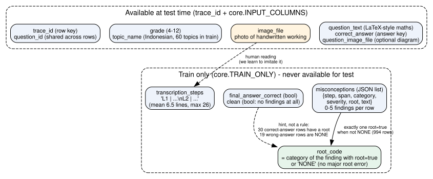<figcaption>Figure 1. One labelled training row. The fields
in the lower part exist only for training rows; a test row has only the photo and the question fields.</figcaption></figure>

<figure>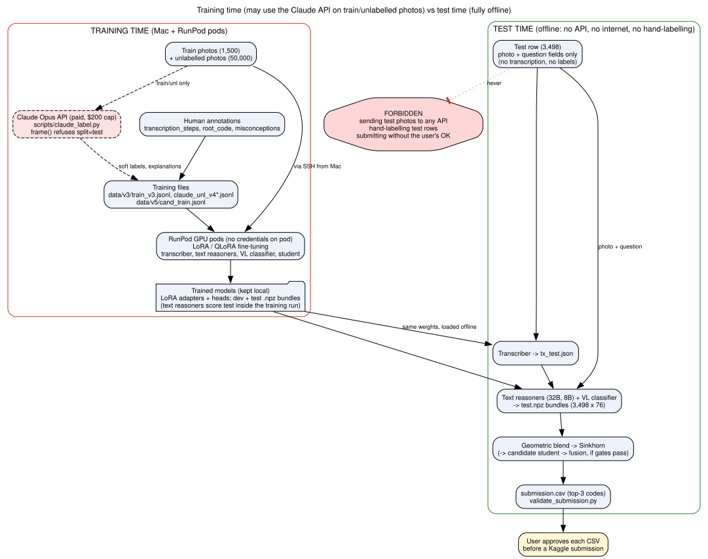<figcaption>Figure 2. What is available at training time and at
test time. Anything a model reads at test time must come from the photo and the question fields.</figcaption></figure>

### 2.3 The metric: MAP@3

For each row we give up to three codes in order. The row scores 1 if the first is right, 1/2 if the second is right,
1/3 if the third is right, and 0 otherwise. The final score is the average over rows.

<figure>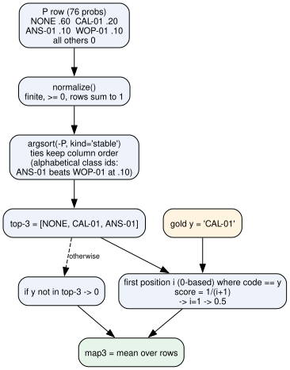<figcaption>Figure 3. How one row is scored.</figcaption></figure>

Two consequences. Getting the right code into second place is worth half a point, so a model's second and third
choices matter. And a model that is very sure and wrong loses more than a model that hedges.

## 3. The system, from the smallest part to the whole

The deployed system has four steps. Figure 4 shows them in one line; the sections below open each box.

<figure>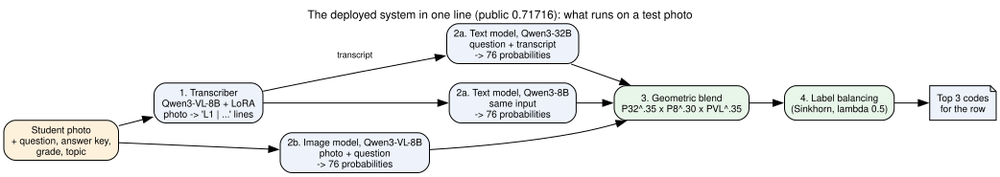<figcaption>Figure 4. What runs on one test photo in the best submission
(public 0.71716).</figcaption></figure>

### 3.1 Step 1: the transcriber (photo → text)

| Item | Detail |
|---|---|
| Model | Qwen3-VL-8B with a LoRA adapter (rank 32) on the language-model layers |
| Input | The photo (longest side up to 1280 pixels), the question diagram if any, grade, topic, question, answer key |
| Output | The working as numbered text lines (L1, L2, L3, ...), one per written line |
| Training | 1,199 teacher transcriptions (the fit rows), 2 epochs, learning rate 1e-4 |
| Decoding | Greedy, up to 512 new tokens, repetition penalty 1.05 |
| Quality on dev | Recovers 88% of the numbers in the teacher transcript; 91% of the numbers it writes are right |
| Code | `src/k12/transcriber.py`, `src/k12/vision.py` |

Weak points measured later: the annotated error text survives in only 55% of machine transcripts, and line order is
sometimes scrambled. Earlier CPU readers were far worse (Tesseract recovered 12% of numbers).

<figure>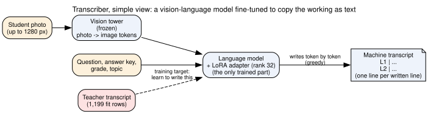<figcaption>Figure S1. The transcriber, simple view.</figcaption></figure>

<figure>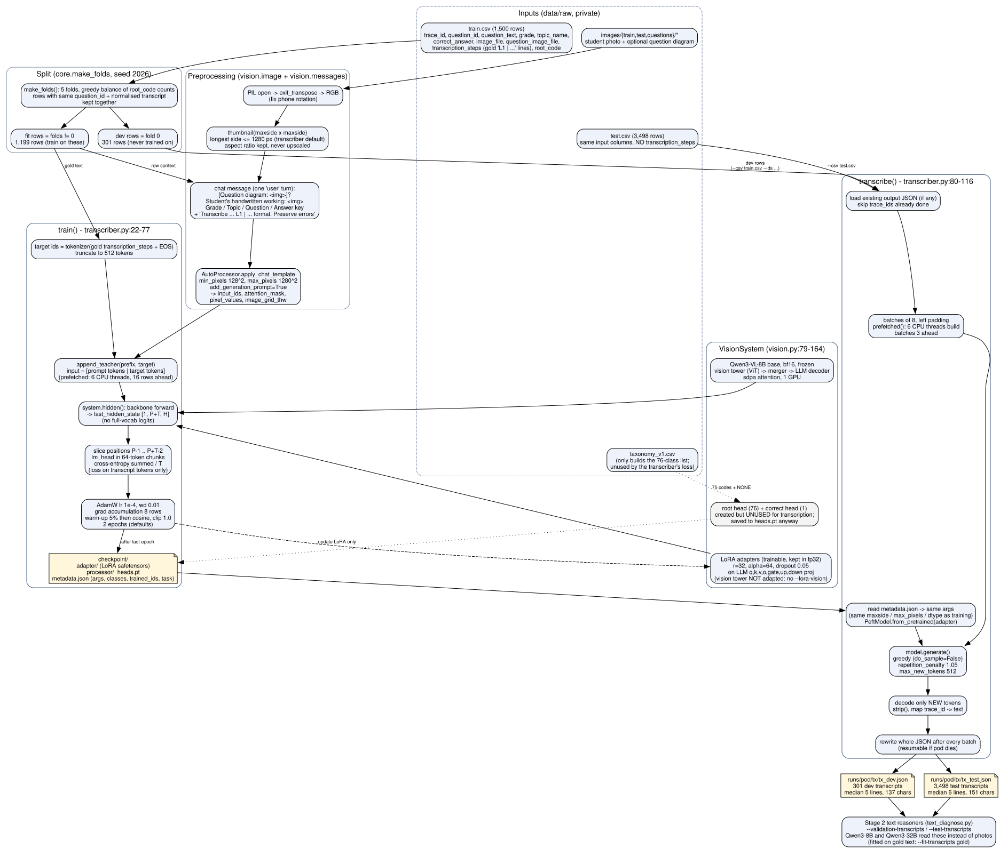<figcaption>Figure 5. The transcriber, detailed view with file and line references: training and use. This diagram is dense; zoom in to read it.</figcaption></figure>

### 3.2 Step 2a: the text models (question + transcript → 76 probabilities)

Two models share one design: Qwen3-8B and Qwen3-32B (the 32B is loaded in 4-bit).

**The prompt** is plain text: the list of 76 codes with their names, then grade, topic, question, answer key, then
the transcript, then the words `ROOT:`.

**The readout.** The model does not write an answer. We take the model's internal vector at the last prompt token and
pass it through one linear layer with 76 outputs. A softmax turns those into probabilities.

**Training.** Cross-entropy on the root code with label smoothing 0.03; LoRA rank 32 on the attention and MLP
projections; learning rate 1e-4 for the adapter and 1e-3 for the new head; batch size 4; 5% warm-up then cosine decay.
Claude-labelled rows carry soft labels (0.7, 0.2, 0.1 for Claude's first, second and third code) and weight 0.8.
An optional extra loss makes the model also write the teacher's explanation after the prompt.

<figure>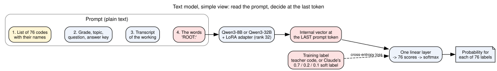<figcaption>Figure S2. The text model, simple view.</figcaption></figure>

<figure>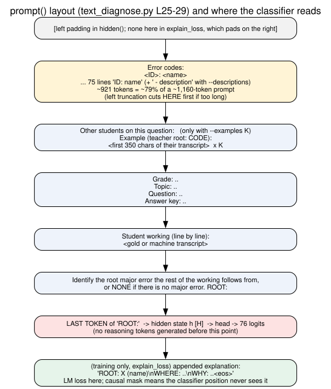<figcaption>Figure 6. Layout of the text model's
prompt. The decision is read at the final token, before the model has written anything.</figcaption></figure>

<figure>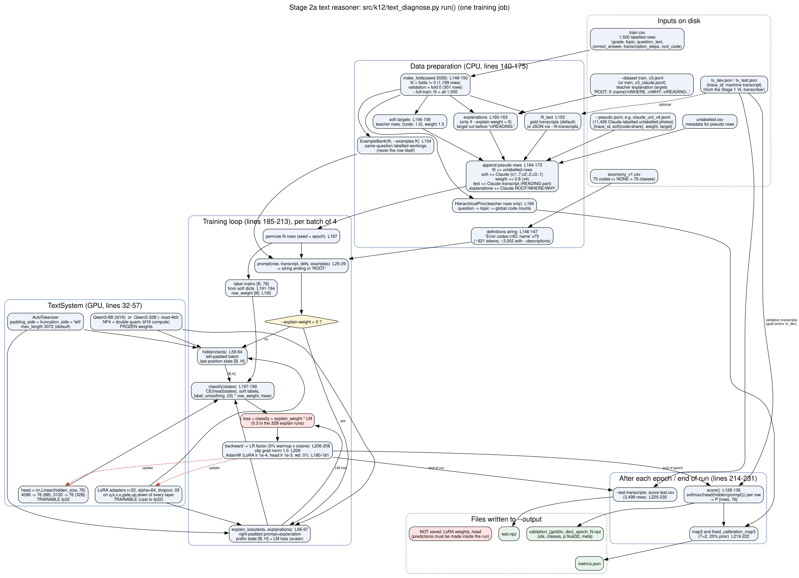<figcaption>Figure 7. The text model end to end, detailed view (data preparation, model, training loop, outputs). Zoom in to read it.</figcaption></figure>

Two properties of this design matter for the diagnosis in section 8:

- **The decision is taken before any reasoning is written.** Nothing forces the model to find the wrong line first.
- **Codes are 76 anonymous outputs.** The model reads code names in the prompt, but the head that decides has no
  link between "ALG-04 on question 17" and "ALG-04 on question 230" except what the training rows teach.

### 3.3 Step 2b: the image model (photo + question → 76 probabilities)

| Item | Detail |
|---|---|
| Model | Qwen3-VL-8B with LoRA (rank 32) on the language-model layers; the vision tower is frozen |
| Input | The photo, the question diagram if any, grade, topic, question, answer key, a short instruction ending in `ROOT:` |
| Readout | Last-token vector → one linear layer → 76 probabilities |
| Training rows | 1,500 teacher rows + 3,427 Claude-labelled pool photos, 2 epochs |
| Losses | Cross-entropy on the code, plus 0.15 × a loss for writing the teacher's reading of the working |
| Code | `src/k12/pod_train.py`, `src/k12/vision.py` |

This is the only member that sees the handwriting directly. It used 3,427 of the 26,202 Claude-labelled photos.

<figure>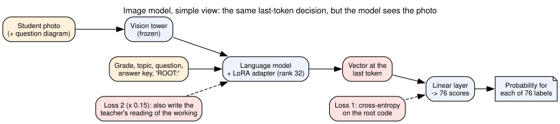<figcaption>Figure S3. The image model, simple view.</figcaption></figure>

<figure>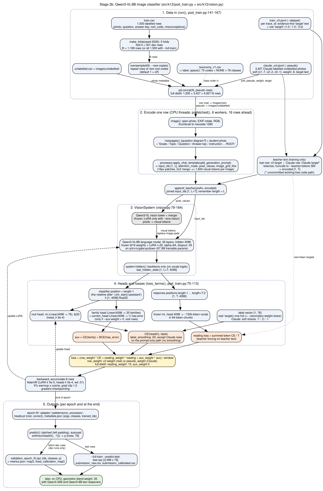<figcaption>Figure 8. The image model, detailed view. Zoom in to read it.</figcaption></figure>

### 3.4 The teacher: Claude labels (training time only)

Claude Opus was asked, for each training or pool photo, to transcribe the working, name the root line, explain, and
give three ranked codes. It never saw a test photo. Its labels are used in two ways: as soft training targets for
our models, and as a yardstick (0.819 on dev).

<figure>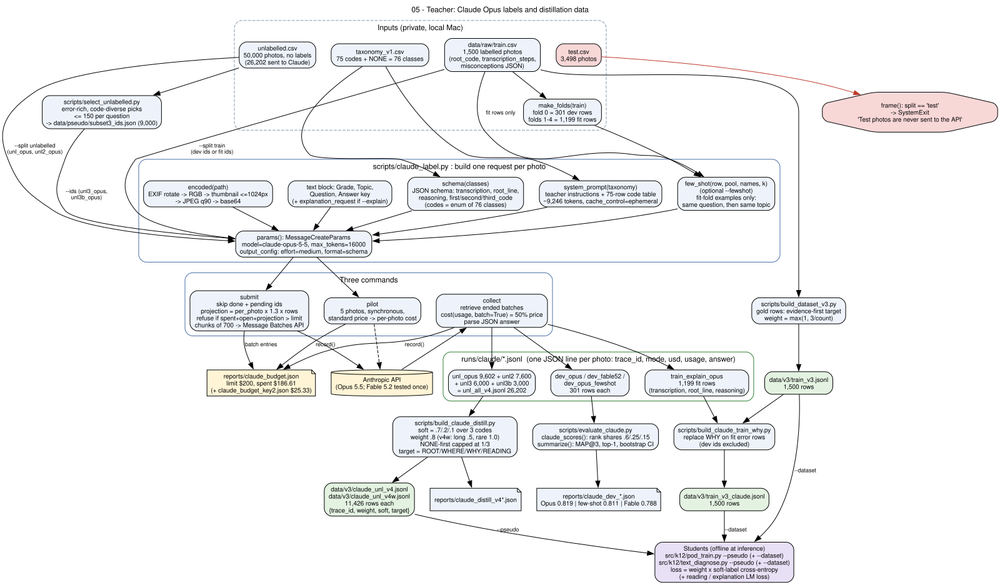<figcaption>Figure 9. How teacher labels are produced, costed and turned into training rows (detailed view; zoom in).</figcaption></figure>

<figure>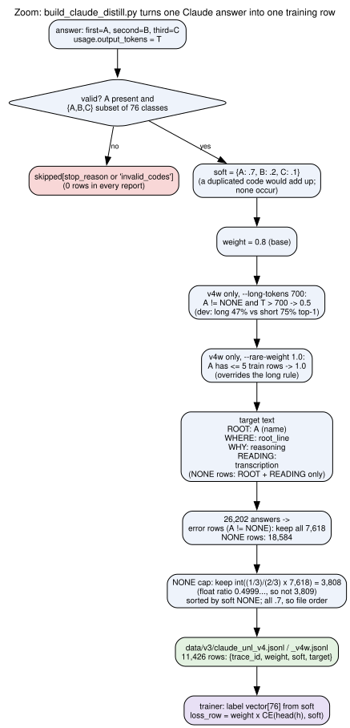<figcaption>Figure 10. Turning Claude's three
ranked codes into a soft training target.</figcaption></figure>

### 3.5 Step 3: the blend

Each member gives a probability for each of the 76 labels. We multiply them with fixed weights (a geometric blend):

score(code) = P32B text(code)0.35 × P8B text(code)0.30 × Pimage(code)0.35, then rescaled so the 76 scores sum to 1

A geometric blend rewards codes that every member finds plausible and punishes a code that any member rules out.

<figure>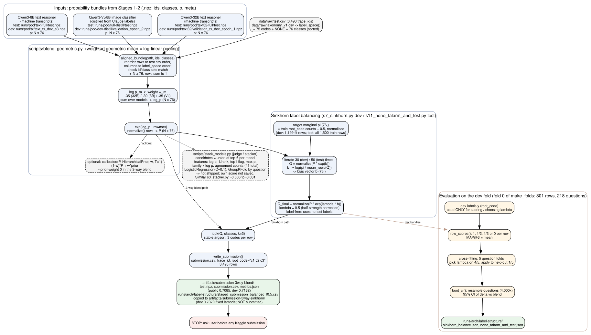<figcaption>Figure 11. The blend, balancing and evaluation, detailed view (zoom in).</figcaption></figure>

### 3.6 Step 4: label balancing (Sinkhorn)

The blend predicts some codes too often and others too rarely. Balancing rescales the scores so that the share of
each predicted label moves toward its share in the training set. It uses no test labels. With strength 0.5 it added
+0.019 on dev and +0.009 on the public board.

<figure>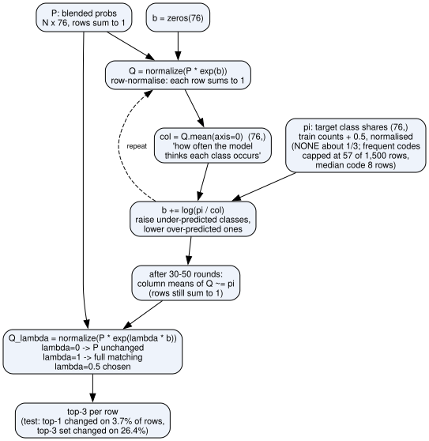<figcaption>Figure 12. Label balancing.</figcaption></figure>

### 3.7 The whole system

<figure>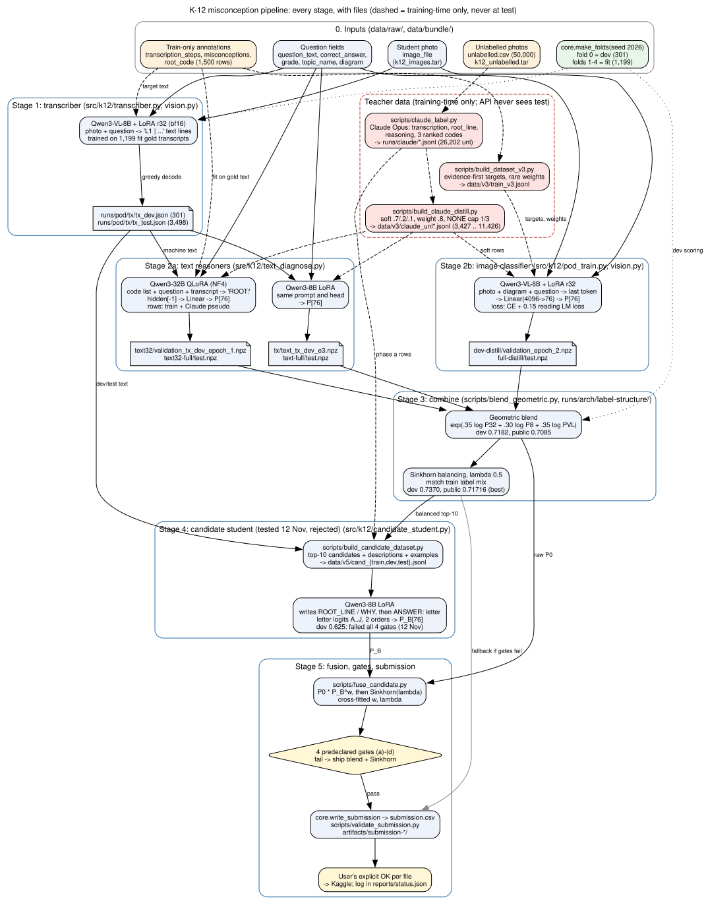<figcaption>Figure 13. Every stage with its files. Dashed
lines are training-time only. Stage 4 (the candidate student) was built and tested but is not part of the submission.</figcaption></figure>

## 4. How we measure

- **Development set.** The 1,500 labelled rows are split into 5 folds, keeping duplicate workings together. Fold 0
  (301 rows) is the dev set; the other 1,199 rows are the fit set. Models for the leaderboard are retrained on all 1,500.
- **Row types.** Every dev row falls in one of three types, by its true label and the fit set:

| Row type | Rows | Meaning |
|---|---|---|
| No error | 101 | True label is NONE |
| Seen pair | 94 | An error whose code already appears for this question in the fit set |
| Hard rows | 106 | An error whose code is new for the question (84), or a question not in the fit set (22) |

- **Paired bootstrap over questions.** To compare two models we resample whole questions, because rows of the same
  question are not independent.
- **Cross-fitting.** Any setting chosen on dev (a blend weight, a balancing strength) is chosen on four fifths of the
  questions and scored on the remaining fifth. A number tuned and scored on the same rows is marked "in-sample".
- **Pass marks are written before the run.** Each paid experiment had its gate fixed in advance.

**How far to trust dev.** The standard error of one score is 0.023, and the 95% range of the blend is 0.673–0.761.
Several early ideas were accepted or dropped on differences smaller than that. Dev has also been used many times, so
its best scores are slightly optimistic: 0.737 on dev became 0.717 on the public board.

## 5. The complete experiment record

<figure>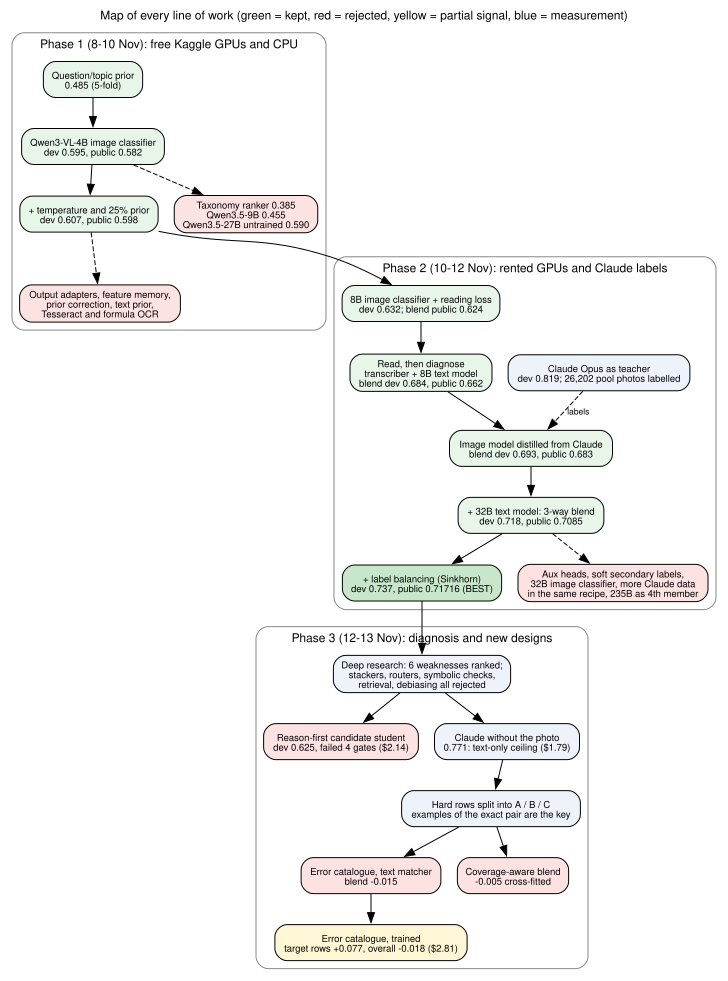<figcaption>Figure 14. Map of every line of work.</figcaption></figure>

### 5.1 Submissions

<figure>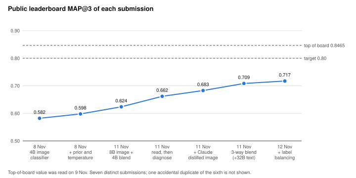<figcaption>Figure 15. Public score of each submission.</figcaption></figure>

| # | Date (UTC) | What was submitted | Dev | Public |
|---|---|---|---|---|
| 1 | 8 Nov | Qwen3-VL-4B image classifier, epoch 3 | 0.595 | 0.58216 |
| 2 | 8 Nov | The same, with temperature 2 and a 25% question/topic prior | 0.607 | 0.59800 |
| 3 | 11 Nov | 8B image classifier with reading loss, blended 0.7/0.3 with the 4B, 10% prior | 0.647 | 0.62383 |
| 4 | 11 Nov | Read-then-diagnose: transcriber → 8B text model, blended 0.6/0.4 with the 8B image model | 0.684 | 0.66183 |
| 5 | 11 Nov | 8B text model × image model distilled from Claude labels, 50/50 | 0.693 | 0.68283 |
| 6 | 11 Nov | 3-way blend: 32B text + 8B text + distilled image (0.35 / 0.30 / 0.35) | 0.718 | 0.70850 |
| 7 | 12 Nov | The 3-way blend with label balancing, strength 0.5 | 0.737 | **0.71716** |

Submission 6 was also uploaded a second time by accident (same file, same score). Nothing was submitted on 13 Nov.

### 5.2 Phase 1 (8–10 Nov): free Kaggle GPUs and CPU

Budget: 10 hours of two T4 GPUs. 8.86 hours were used.

| ID | Experiment | Result (dev unless stated) | Verdict |
|---|---|---|---|
| 1.1 | Question/topic prior: predict the codes this question and topic usually get | 0.485 (5-fold), 0.497 on fold 0 | Reference |
| 1.2 | Qwen3-VL-4B image classifier, LoRA, 3 epochs | 0.434 → 0.586 → 0.595 by epoch | Kept; public 0.582 |
| 1.3 | Taxonomy ranker: untrained 4B scores every code | 0.385; says "error" on 85% of correct workings | Rejected |
| 1.4 | Qwen3.5-9B untrained, 48-row pilot | 0.559 against prior 0.531, range spans zero | Inconclusive |
| 1.5 | Qwen3.5-9B untrained, all 301 rows, code-only output | 0.455; calls 54% of error rows NONE | Rejected |
| 1.6 | Qwen3.5-27B untrained (4-bit), brief evidence then 3 codes | 0.590; gate was 0.65 | Rejected |
| 1.7 | Temperature 2 and 25% prior on the 4B outputs | 0.607 in-sample, 0.598 cross-fitted | Kept; public 0.598 |
| 1.8 | Small output adapters on frozen 4B features | 0.590 / 0.570 / 0.599 (three sizes) | Rejected: over-fits |
| 1.9 | Feature memory: nearest neighbours in feature space | 0.577 alone, 0.599 gated | Rejected |
| 1.10 | Prior odds correction | 0.607, change 0.000 | Rejected |
| 1.11 | Text prior blended in | 0.584 cross-fitted (−0.023) | Rejected |
| 1.12 | Diagnostic: word-and-character classifier on teacher transcripts | 0.534 (5-fold) | Reading alone does not solve it |
| 1.13 | CPU readers: Tesseract; PP-FormulaNet on cropped regions | Number recall 12% and 22% | Rejected as readers |
| 1.14 | Rank fusion of 4B with the 27B; a learned re-ranker over both | 0.626; 0.650 | Dev-only; the 27B has no test predictions |
| 1.15 | Reading-supervised 4B run | Cancelled while queued (quota conflict) | No result |

Lessons from phase 1: a trained small model beat untrained larger ones; the 4B model's top-8 held the right code for
89% of rows, so ranking, not recall, was the limit; and nothing done after the model (adapters, priors, memory) helped.

### 5.3 Phase 2 (10–12 Nov): rented GPUs and Claude labels

| ID | Experiment | Result (dev) | Verdict |
|---|---|---|---|
| 2.1 | Qwen3-VL-8B image classifier ("A") | 0.550 → 0.604 → 0.619 | Baseline for this phase |
| 2.2 | A + loss for writing the teacher transcription ("B") | 0.557 → 0.615 → 0.632 | Kept |
| 2.3 | A + soft secondary labels and rare-code oversampling | 0.618 | No gain |
| 2.4 | A + error-family and has-error helper heads | 0.613 | No gain |
| 2.5 | B with evidence-first targets (dataset v3) | 0.627 at epoch 2 | No clear gain |
| 2.6 | Qwen3-VL-32B image classifier, 4-bit | 0.403 after epoch 1, stopped | Rejected |
| 2.7 | Blend B0.7 × 4B0.3 with 10% prior | 0.647 | Public 0.624 |
| 2.8 | Transcriber (section 3.1) | Number recall 0.88, precision 0.91 | Kept |
| 2.9 | Qwen3-8B text model, 1 epoch | 0.570 on teacher transcripts, 0.542 on machine | Kept |
| 2.10 | Qwen3-8B text model, 3 epochs, teacher labels only | 0.667 on machine transcripts | Deployed member |
| 2.11 | Blend: text 0.6, image B 0.4 | 0.684 | Public 0.662 |
| 2.12 | Claude Opus on the 301 dev photos | **0.819**; hard rows 0.715 | Yardstick |
| 2.13 | Claude Fable on dev; Claude Opus with 4 examples in the prompt | 0.788; 0.811 | No better than plain Opus |
| 2.14 | Claude Opus labels for the pool | 26,202 photos labelled | Teacher data |
| 2.15 | Image model distilled from Claude (1,500 + 3,427 rows) | 0.653 | Deployed member |
| 2.16 | Blend: 8B text × distilled image, 50/50 | 0.693 | Public 0.683 |
| 2.17 | Qwen3-32B text model, 4-bit, 1 epoch | 0.652 machine, 0.687 teacher transcripts | Deployed member |
| 2.18 | 3-way blend | 0.718 (0.706 with cross-fitted weights) | Public 0.7085 |
| 2.19 | Text 8B with 0 / 2,856 / 11,426 Claude rows | 0.553 / 0.666 / 0.692 | Best single model; no gain inside the blend |
| 2.20 | Untrained Qwen3-32B and Qwen3-235B on transcripts | 0.518 and 0.584; with 4 examples 0.596 and 0.650 | Not added |
| 2.21 | 235B (with examples) as a fourth blend member | +0.012, range −0.014 to +0.037 | Not added: range crosses zero, about $15 |
| 2.22 | Label balancing (Sinkhorn), strength 0.5 | 0.737 in-sample, 0.7337 cross-fitted | Public **0.71716** |
| 2.23 | 32B text with explanation targets (v4); first candidate-student run | Stopped unfinished when all pods were terminated | No result |

### 5.4 Phase 3a (12 Nov): diagnosis on CPU

A large CPU-only study ranked six weaknesses and tested many repairs. Results that survived independent re-checking:

| Idea tested | Result | Verdict |
|---|---|---|
| Learned stackers and combiners over existing members | −0.004 to +0.002 | Rejected |
| Dividing out the question prior; a self-prior | Best strength was zero; −0.008 | Rejected |
| Nearest neighbours inside one question over teacher and Claude labels | 0.42–0.45 alone; −0.006 to 0 fused | Rejected |
| Masking the question text at training time (proxy) | +0.005, range −0.021 to +0.027 | Rejected |
| Symbolic step checker | Checks 40% of lines; finds the root line 42% of the time | Rejected |
| Product-of-experts debiasing | No-error and seen-pair rows collapse | Rejected |
| Programmatic mal-rule synthesis | Supply ten times below estimate; no gain | Rejected |
| "Prefer the specific code over the generic one" rule | −0.006 | Rejected |
| Appending examples from other questions to candidate cards | −0.052 on new-pair matching | Rejected |
| Perfect teacher transcripts for the blend | +0.012 to +0.016 | Reading is not the main gap for classifiers |

My own cross-checks the same day:

| Check | Result |
|---|---|
| Our blend fused with Claude's real dev answers | 0.824, i.e. +0.005 over Claude [−0.009, +0.019] |
| Claude + our memory of teacher labels; + learned stacker; + learned remap | −0.003; −0.016; −0.002 |
| Claude's 79 wrong first answers | Spread over 69 different (Claude code, teacher code) pairs: not systematic |
| Simulated student that copies Claude on 50 / 70 / 80 / 90 / 100% of rows, fused | 0.760 / 0.780 / 0.795 / 0.810 / 0.824 |
| Final-answer lookup inside one question | Covers 52 rows; 0.827 against the blend's 0.885 there |
| "Answer key in the transcriber prompt leaks into transcripts" (my earlier claim) | Not supported: 25.9% against 26.2%. Retracted. |

Free fixes applied: full code descriptions in the candidate-student data (7,378 of 9,705 prompts had a description
cut mid-sentence); the text trainer now saves its weights.

### 5.5 Phase 3b (12–13 Nov): paid tests of new designs

| ID | Experiment | Cost | Result | Verdict |
|---|---|---|---|---|
| 3.1 | Reason-first candidate student (Stage B), Qwen3-8B, 9,705 rows | $2.14 | Dev 0.625; hard rows 0.417; fused −0.011 [−0.030, +0.009] | Failed all four gates |
| 3.2 | Claude Opus without the photo, on our machine transcripts | $1.79 | Dev 0.771; hard rows 0.637 | Text-only ceiling is under 0.80 |
| 3.3 | Error catalogue, text matcher (CPU pilot, 1,503 synthetic workings) | $0 | Blend −0.015 [−0.029, −0.002] | Rejected |
| 3.4 | Coverage-aware blend | $0 | −0.005 [−0.023, +0.012] cross-fitted | Rejected |
| 3.5 | Error catalogue, trained: paired run with and without it | $2.81 | Target rows +0.077; overall −0.018 | Pass mark not met |

Section 7 describes these five in detail.

## 6. Where the points are lost

### 6.1 The gap is in one row type

<figure>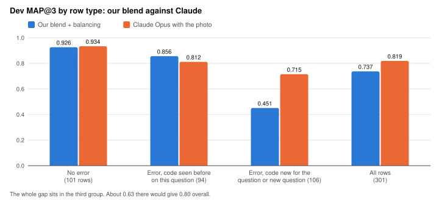<figcaption>Figure 16. Our blend against Claude by row type.</figcaption></figure>

On no-error rows we match Claude. On seen-pair rows we beat it, because we have learned the annotators' habits for
each question. On hard rows we are at 0.451 and Claude is at 0.715. Holding the other two fixed, reaching 0.80
overall needs about 0.63 on hard rows.

### 6.2 No open model does well on hard rows

<figure>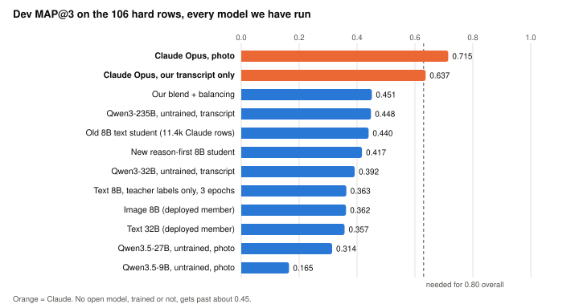<figcaption>Figure 17. Hard rows, every model.</figcaption></figure>

The best open result is 0.448, from Qwen3-235B with no training at all. Our training has never lifted the hard rows
above what untrained models already do: the 32B text model scored 0.392 untrained and 0.357 after our training.

### 6.3 Our models learn pairs, not codes

<figure>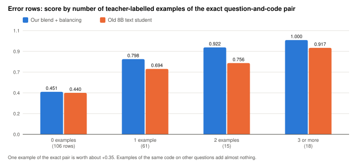<figcaption>Figure 18. The memorisation step curve.</figcaption></figure>

With no example of the exact question-and-code pair the blend scores 0.45. With one example it scores 0.80; with two,
0.92; with three or more, 1.00. Claude is nearly flat across these bins. The true code of a hard row exists on some
*other* question in the fit set for 96% of hard rows, with a median of 24 examples, and that does not help.

A label-free sign of the same thing on the test set: two students on the same question get the same first code from
us 42% of the time. In the training labels that happens 27% of the time.

### 6.4 More teacher data does not fix it

<figure>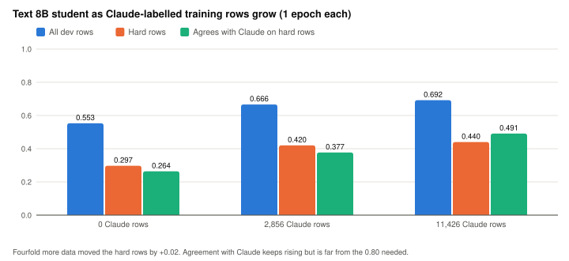<figcaption>Figure 19. Growing the Claude-labelled training set.</figcaption></figure>

Going from 2,856 to 11,426 Claude rows moved the hard rows from 0.420 to 0.440. Inside the blend the gain vanished
(0.715 → 0.718). Agreement with Claude's first answer on hard rows rose from 26% to 38% to 49%, about 11 points per
fourfold increase. All 26,202 rows would give roughly 56% in this recipe.

### 6.5 Reader and reasoner, separated

| Who reasons | Reads the photo | Reads a teacher transcript | Reads our machine transcript |
|---|---|---|---|
| Claude Opus | 0.819 (hard 0.715) | not run | 0.771 (hard 0.637) |
| Our old 8B student | cannot | 0.720 | 0.692 (hard 0.440) |
| Our 32B text model | cannot | 0.687 | 0.652 (hard 0.357) |

Reading the hard-row numbers down the last column: on the *same* transcripts, Claude scores 0.637 and our models
about 0.44. So of the 0.27 gap on hard rows, about 0.19 is reasoning on identical input and about 0.08 is reading.
Reading across the first row: no text-only model reading these transcripts can pass 0.771.

### 6.6 The hard rows split by example coverage

<figure>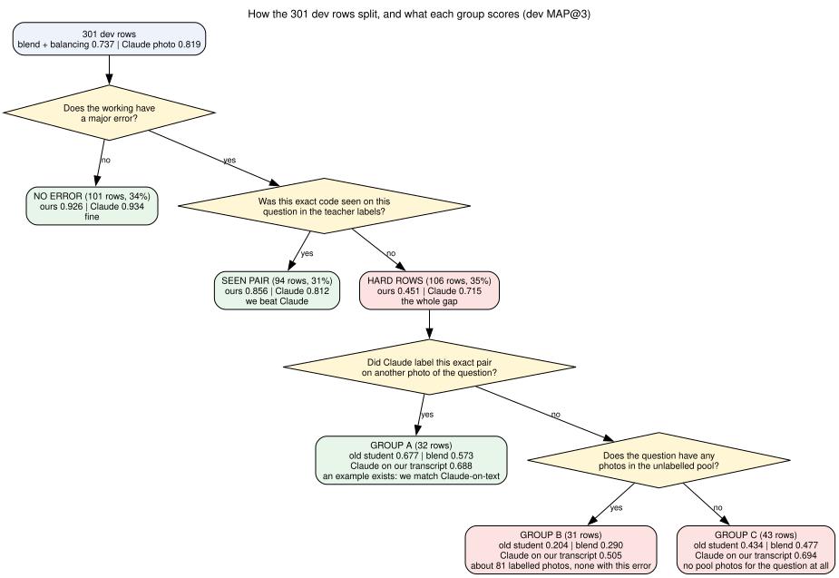<figcaption>Figure 20. How the dev rows split.</figcaption></figure>

<figure>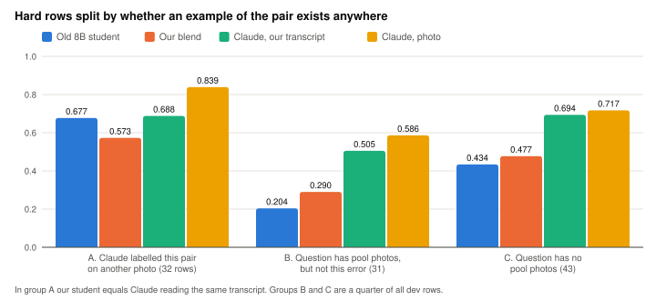<figcaption>Figure 21. Scores in groups A, B and C.</figcaption></figure>

- **Group A (32 rows).** Claude labelled this exact pair on another photo of the question. Our old student, trained
  on those labels, scores 0.677: the same as Claude reading the same transcript (0.688).
- **Group B (31 rows).** The question has about 81 labelled pool photos and none shows this error. Every open model
  scores 0.16–0.29 here; Claude scores 0.505 from the transcript.
- **Group C (43 rows).** The question has no pool photos. Our models score 0.43–0.48; untrained 235B scores 0.55.

Only 30% of hard rows have their pair anywhere in Claude's pool labels.

## 7. New designs tested on 12–13 November

### 7.1 The reason-first candidate student (Stage B)

**Idea.** Make the model reason before it decides, and let it read what each code means. The prompt shows the
transcript and ten lettered candidate codes (the blend's top ten), each with its name, description and, where one
exists, an example from the same question. The model writes the root line, a short explanation, then a letter. We read
the probabilities of the letters after the explanation, average over two orderings of the candidates, and fuse with the blend.

<figure>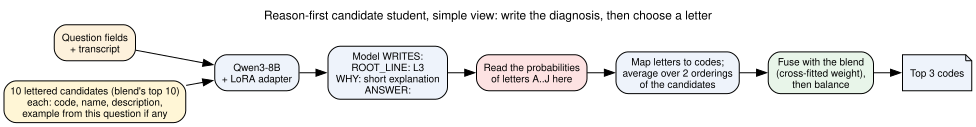<figcaption>Figure S4. The candidate student, simple view.</figcaption></figure>

<figure>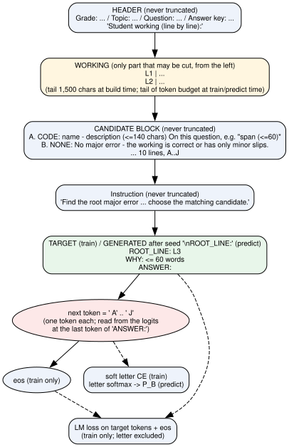<figcaption>Figure 22. The candidate
student's prompt and target.</figcaption></figure>

<figure>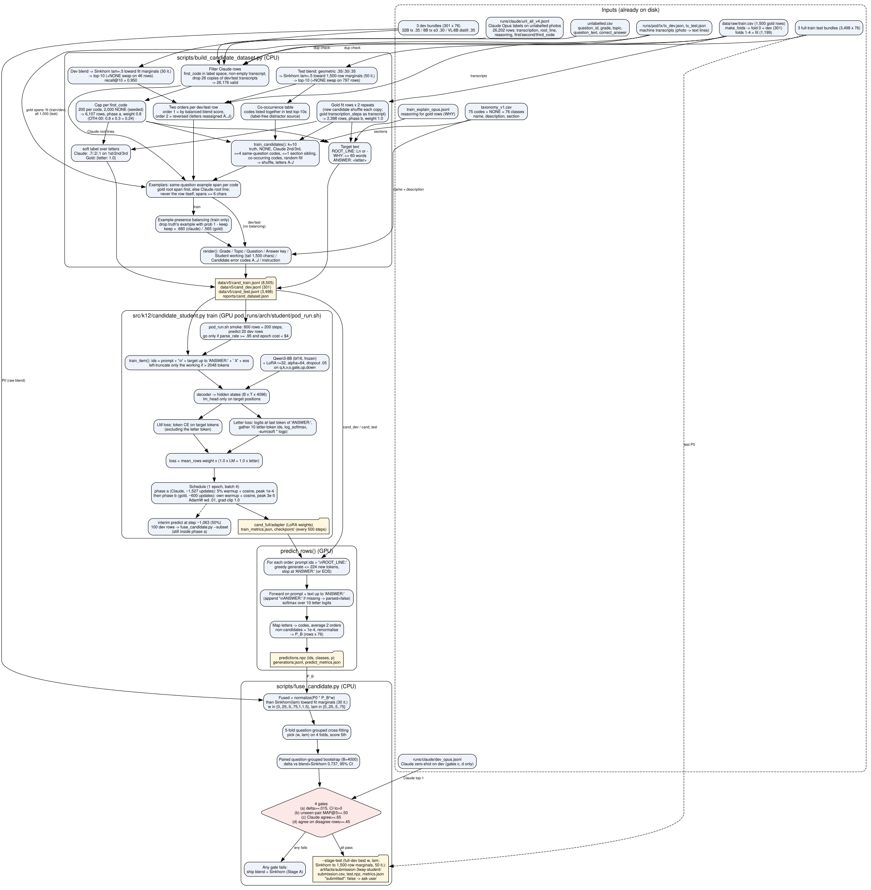<figcaption>Figure 23. The candidate student end to end, detailed view (zoom in).</figcaption></figure>

**Run.** Qwen3-8B, LoRA rank 32, one epoch on 9,705 rows (6,107 Claude rows, 2,398 teacher rows, 1,200 contrast
rows), RTX 6000 Ada, $2.14.

<figure>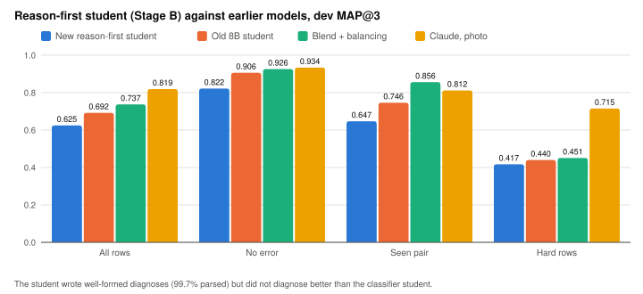<figcaption>Figure 24. The student against earlier models.</figcaption></figure>

| Gate | Needed | Got |
|---|---|---|
| Fused gain over the cross-fitted reference | ≥ +0.015, range above 0 | −0.011 [−0.030, +0.009] |
| Fused score on hard rows | ≥ 0.50 | 0.462 |
| Agrees with Claude's first answer on hard rows | ≥ 0.65 | 0.387 |
| Same, where blend and Claude disagree | ≥ 0.45 | 0.255 |

**What the outputs show.** The answers were well formed (99.7% parsed). The student gave one code at least 95%
probability on 187 of 301 rows and was right on 69% of those, so its second and third choices carry little
information. The two orderings picked the same code on 70% of rows. It named a root line within one line of the
teacher's on 67% of error rows; accuracy was 0.50 when the line was right and 0.26 when it was wrong.

**Conclusion.** At this size and data volume, writing reasoning first did not make the model diagnose better than
the plain classifier student.

### 7.2 Claude without the photo

**Question.** Could any text-only model reading our transcripts reach 0.80? **Method.** Claude Opus on the 301 dev
rows with no photo and no question diagram, given our machine transcript. **Result.** 0.771 against 0.819 with the
photo: −0.048 [−0.076, −0.020]. The loss is spread evenly over well-read and badly-read rows and is not caused by
the missing diagrams. **Conclusion.** The text route is capped under 0.80, and the bigger part of our gap is still
reasoning (section 6.5).

### 7.3 The error catalogue

**Idea.** Group A shows that one example of the exact pair is enough. So manufacture the examples we lack: for each
question, write in advance what each plausible mistake would look like on that exact question.

<figure>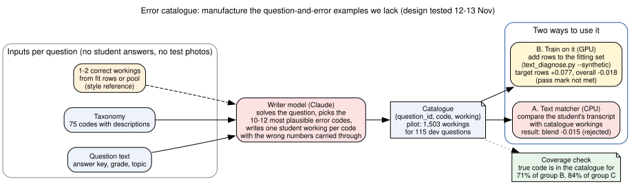<figcaption>Figure 25. The error catalogue.</figcaption></figure>

**Pilot build.** For 115 dev questions, a writer model produced 1,503 synthetic student workings (10–12 codes per
question). It saw only the question, answer key, taxonomy and correct workings from fit or pool rows; never a dev
student's work or label.

**Test A: text matcher (CPU).** Compare each student's transcript with the catalogue workings of its question.

| Measure | Group A | Group B | Group C | Seen pair |
|---|---|---|---|---|
| True code has a catalogue example | 0.97 | 0.71 | 0.84 | 1.00 |
| Matcher alone, real examples | 0.609 | none exist | none exist | 0.681 |
| Matcher alone, synthetic examples | 0.328 | 0.269 | 0.244 | 0.446 |
| Blend → blend with synthetic matcher | 0.573 → 0.557 | 0.290 → 0.269 | 0.477 → 0.415 | 0.848 → 0.844 |

The catalogue contains the right code for most rows that had nothing, but synthetic workings do not look enough like
real transcripts for a text comparison. Fusing the matcher lowered the blend by 0.015.

**Test B: train on it (GPU, $2.81).** The same recipe and seed twice: arm 1 on 1,199 teacher rows and 2,856 Claude
rows; arm 2 the same plus the 1,503 catalogue rows at weight 0.5. Arm 1 reproduced an earlier run exactly (0.6661).

<figure>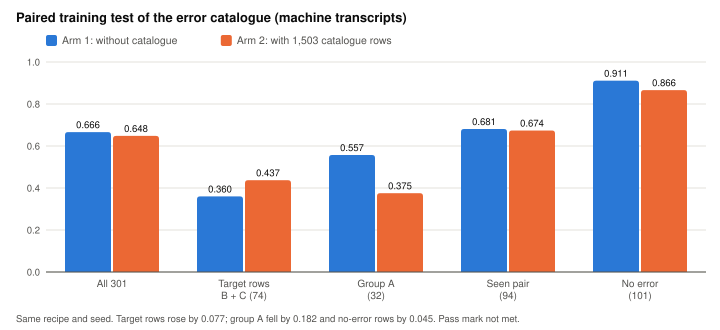<figcaption>Figure 26. The paired training test.</figcaption></figure>

| Dev rows, machine transcripts | Arm 1 | Arm 2 | Change | Paired range |
|---|---|---|---|---|
| All 301 | 0.666 | 0.648 | −0.018 | [−0.054, +0.018] |
| Target rows, B + C (74) | 0.360 | 0.437 | +0.077 | [−0.013, +0.167] |
| Group C (43) | 0.422 | 0.527 | +0.105 | |
| Group B (31) | 0.274 | 0.312 | +0.038 | |
| Group A (32) | 0.557 | 0.375 | −0.182 | [−0.323, −0.049] |
| Seen pair (94) | 0.681 | 0.674 | −0.007 | |
| No error (101) | 0.911 | 0.866 | −0.045 | [−0.085, −0.008] |

The pass mark was: target rows up by at least 0.08 with the range above zero, and seen-pair and no-error rows down by
no more than 0.02. It was not met.

**Reading of the result.**

- The catalogue did teach something real: target rows rose, 17 better against 9 worse. On teacher transcripts the
  catalogue model is better overall (0.692 → 0.720) and group A is unchanged.
- The catalogue shows each question with about ten different codes. The model can then no longer answer from the
  question alone. That helps where the usual code is wrong (B and C) and hurts where it is right (A), most of all on
  noisy machine transcripts.
- The pilot added 1,503 error workings and no correct ones, which pushed the model away from NONE (30.6% of rows
  predicted NONE against 35.2%). Full label balancing removes most of that loss, but the model stays 0.006 below arm 1.
- As a fourth blend member the catalogue model adds nothing (−0.003, cross-fitted).

### 7.4 The coverage-aware blend

**Idea.** Choose the extra blend member by whether the question has pool photos, which is known at test time.
**Result.** In-sample it looked like +0.008 on pool questions and +0.027 on the rest. Cross-fitted over 20 fold
splits it was −0.005 [−0.023, +0.012]. **Conclusion.** The apparent gain was selection noise.

## 8. Diagnosis: what the problem is

In order of importance, with the evidence for each.

**1. We have a memoriser and no generalist.** Our models decide from one vector, before any reasoning, and learn
which codes go with which question. That makes them excellent on seen pairs (0.856, above Claude) and weak on new
ones (0.45). Evidence: the step curve (Figure 18); the 42% against 27% same-question agreement on test; training
never lifting hard rows above untrained models.

**2. The thing that would fix it is a model that can diagnose a mistake it has not seen on that question, and no
open model we can run does that.** Evidence: Figure 17. The best open result on hard rows is 0.448 from a 235B model;
Claude gets 0.637 from the same text. Teaching an 8B to reason first did not close the gap (0.417).

**3. Where an example exists we are already at Claude's level; the missing ingredient is examples for the right
pairs.** Evidence: group A (0.677 against 0.688). Only 30% of hard rows have their pair in the pool labels, and 28%
of test rows are on questions with no pool photos. Manufactured examples moved the target rows (+0.077) but harmed
other rows; this is the only lever that has moved the hard rows at all.

**4. Reading caps the text route.** Evidence: Claude loses 0.048 without the photo; the annotated error text is in
only 55% of machine transcripts. This is the smaller part of the gap (about 0.08 of 0.27 on hard rows) but it means
the last points need a model that looks at the photo.

**5. Little labelled data for a wide label space.** 1,199 fit rows, 462 questions, 76 labels, 13 codes with one
example. Teacher conventions are learned per question, three rows at a time.

**6. The yardstick is noisy.** 301 rows, standard error 0.023, used many times. Gains under 0.02 cannot be seen,
which makes small honest improvements hard to confirm and easy to imagine.

**What is *not* the problem**, on the evidence: detecting whether there is an error at all (0.926 against 0.934);
blend weights or calibration; the amount of Claude-labelled data in the current recipe; and the transcriber copying
the answer key.

**One-sentence version.** We built a system that recognises mistakes it has met before on a question, and the
competition is decided by mistakes it has not met.

## 9. Open questions and untested ideas

Nothing in this section has been measured. Each item says what would test it.

| Open question | Why it matters | Cheapest test |
|---|---|---|
| Does a repaired catalogue give a net gain? Add correct workings in the right share, and make synthetic workings look like machine transcripts. | The only lever that moved the target rows | One paired run, about $3 |
| Is catalogue damage to group A caused by transcript noise? | Arm 2 is fine on teacher transcripts and bad on machine ones | Score both arms on Claude's transcripts of the dev photos (already on disk), $0 |
| Does model size help inside a reason-first recipe? | The "size does not matter" result compared unequal training | Same candidate recipe on a larger open model; cost not estimated |
| Can an image-reading student reach Claude-on-photo level? | Reading caps text at 0.771 | Large run; no evidence it would work at 8B |
| How much is the public board noise? | We do not know the public share of the test set | None that is safe; assume about ±0.01 |
| Why did balancing transfer at half its dev value? | It is the last thing that worked | Compare predicted label shares on test before and after, $0 |
| Would more teacher-quality labels per question help more than anything else? | The step curve says one or two examples per pair are decisive | Not available: test photos cannot be labelled |

Things I would not spend on again without new evidence: more Claude labels in the current recipe; stackers, routers
and priors over the existing members; retrieval by text similarity; untrained large models as extra members.

## 10. Cost ledger

| Resource | Limit | Used | Left |
|---|---|---|---|
| RunPod GPU rental | $80 | $62.85 | $17.15 |
| Claude API | $200 | $188.40 | $11.60 |
| Kaggle free GPU for this project | 10 hours | 8.86 hours | about 1 hour |

| Paid step on 12–13 Nov | Cost |
|---|---|
| Reason-first candidate student | $2.14 |
| Claude without the photo | $1.79 |
| Paired error-catalogue test | $2.81 |

Standing rules: nothing is launched or submitted without explicit approval for that one job; final predictions come
from offline models; Claude is never given a test photo; no test row is labelled by hand.

## Appendix A. Glossary

| Term | Meaning |
|---|---|
| MAP@3 | The metric: 1, 1/2 or 1/3 for the right code in first, second or third place; average over rows |
| Dev | The 301-row development set (fold 0) |
| Fit set | The other 1,199 labelled rows |
| Root code | The code of the major error the rest of the working follows from |
| NONE | No major error |
| Seen pair | An error row whose code already appears on that question in the fit set |
| Hard rows | Error rows whose code is new for the question, or whose question is new |
| Groups A / B / C | Hard rows split by whether an example of the pair exists (section 6.6) |
| Pool | The 50,000 unlabelled photos |
| Teacher transcript | The annotators' transcription of a training photo |
| Machine transcript | Our transcriber's output |
| LoRA / QLoRA | Training a small adapter on a frozen model; QLoRA does this on a 4-bit model |
| Last-token head | Reading the decision from the model's internal vector at the end of the prompt |
| Geometric blend | Multiplying the members' probabilities, each raised to a weight |
| Sinkhorn balancing | Rescaling scores so predicted label shares move toward the training shares |
| Cross-fitted | A setting chosen on some questions and scored on others |
| Gate / pass mark | A threshold written before a run that decides whether its result is used |

## Appendix B. File map

| What | Where |
|---|---|
| Transcriber | `src/k12/transcriber.py`, `src/k12/vision.py` |
| Text models | `src/k12/text_diagnose.py` (option `--synthetic` adds catalogue rows) |
| Image model | `src/k12/pod_train.py`, `src/k12/pod_predict.py` |
| Candidate student | `src/k12/candidate_student.py`, `scripts/build_candidate_dataset.py`, `scripts/fuse_candidate.py` |
| Claude labelling | `scripts/claude_label.py` (option `--transcripts` is the no-photo mode) |
| Blend and submission | `scripts/blend_geometric.py`, `scripts/validate_submission.py`, `artifacts/submission-3way-sinkhorn/` |
| Pod control and budget | `scripts/runpod_pod.py`, `reports/runpod_budget.json`, `runs/deep/stageB/collect.py` |
| Stage B run and report | `runs/deep/stageB/`, `runs/deep/stageB/fuse_arm1.json` |
| Error catalogue | `runs/deep/catalog/`, `data/v6/synthetic_catalog_dev_pilot.jsonl` |
| Earlier deep study | `runs/deep/DEEP_PLAN.md`, `runs/arch/PLAN.md` |
| Running record of this audit | `docs/model_audit_plan_2026-11-12.md` |
| Code-level study guide | `docs/study/K12_STUDY_GUIDE.pdf` |
| Status and submissions | `reports/status.json` |

## Appendix C. Every model by row group (dev MAP@3)

| Model | All | No error | Seen pair | A | B | C |
|---|---|---|---|---|---|---|
| Claude Opus, photo | 0.819 | 0.934 | 0.812 | 0.839 | 0.586 | 0.717 |
| Claude Opus, our transcript | 0.771 | 0.931 | 0.752 | 0.688 | 0.505 | 0.694 |
| Blend + balancing | 0.737 | 0.926 | 0.856 | 0.573 | 0.290 | 0.477 |
| Old 8B student (11,426 Claude rows) | 0.692 | 0.906 | 0.746 | 0.677 | 0.204 | 0.434 |
| Text 8B, teacher labels only, 3 epochs | 0.667 | 0.866 | 0.794 | 0.385 | 0.242 | 0.434 |
| Image 8B, distilled | 0.653 | 0.875 | 0.743 | 0.547 | 0.156 | 0.372 |
| Text 32B | 0.652 | 0.931 | 0.686 | 0.490 | 0.188 | 0.380 |
| Qwen3-235B with 4 examples | 0.650 | 0.810 | 0.750 | 0.464 | 0.258 | 0.473 |
| Reason-first student | 0.625 | 0.822 | 0.647 | 0.531 | 0.253 | 0.450 |
| Qwen3-235B, untrained | 0.584 | 0.782 | 0.525 | 0.510 | 0.242 | 0.550 |
| Qwen3-32B, untrained | 0.518 | 0.734 | 0.429 | 0.568 | 0.156 | 0.430 |

Row counts: no error 101, seen pair 94, A 32, B 31, C 43.

## Appendix D. Sources of the numbers

Every figure in this report comes from a file in the repository: `reports/status.json` (submissions and phase 1),
`docs/handoff.md` (phase 2 dev table), `runs/pod/probe235/REPORT.md` (scale probe), `runs/deep/DEEP_PLAN.md` and
`runs/arch/PLAN.md` (phase 3a), `runs/deep/stageB/fuse_arm1.json` (candidate student), `runs/claude/dev_opus*.jsonl`
(Claude runs), `runs/deep/catalog/pod_out/` (paired test), and `docs/model_audit_plan_2026-11-12.md` sections 8–12,
where the scripts and intermediate numbers are recorded. The charts are generated by `docs/study/report/build_figs.py`.
