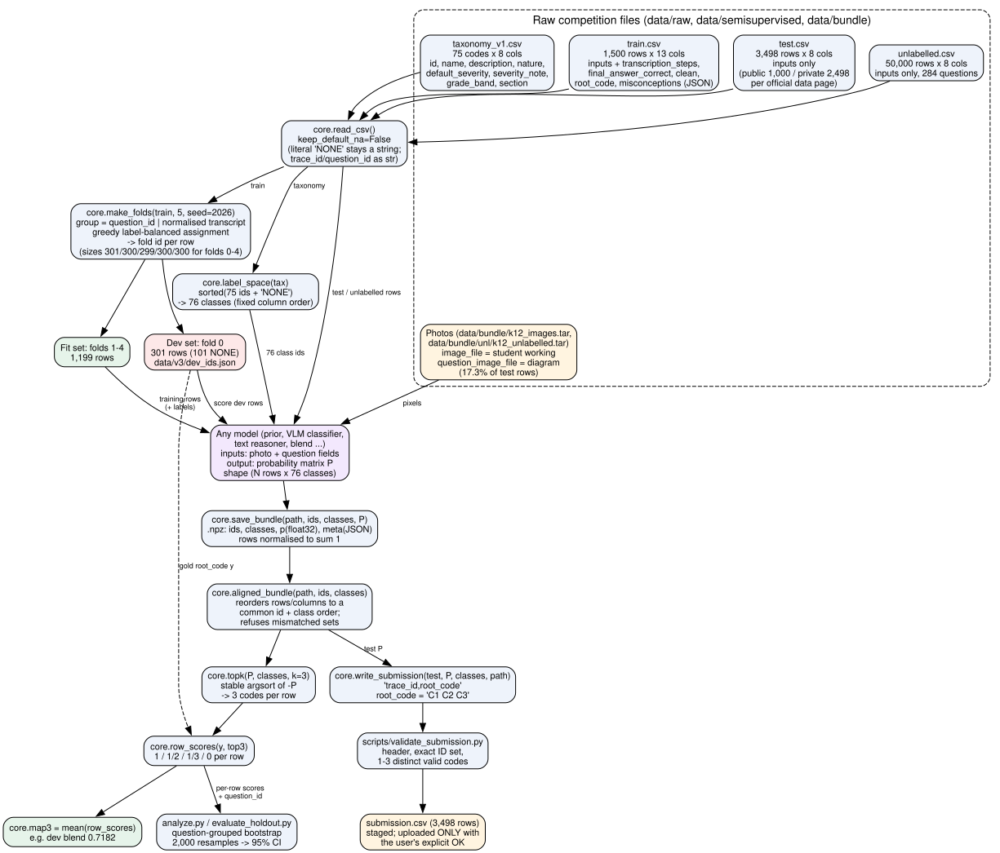
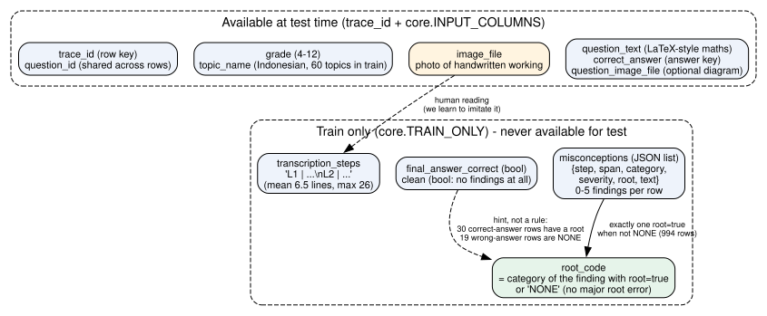
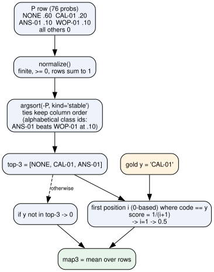

<a id="01-problem-data"></a>

# The problem, the data and the metric

## The problem, the data and the metric

### In one paragraph

Each row in this competition is a photo of a student's handwritten maths working, together with the question it answers (text, optional diagram, answer key, grade, topic). We must name the root misconception, meaning the single error that best explains what went wrong, as one of 75 taxonomy codes, or `NONE` if the work has no major root error. We get 1,500 labelled training rows that carry a lot of extra annotation (a human transcription of the photo and step-level error findings), 3,498 test rows that carry none of it, and 50,000 unlabelled photos. Every model in this repo turns a row into a 76-way probability vector. The shared code in `src/k12/core.py` ranks that vector, keeps the top 3 codes, and scores them with MAP@3, which gives 1 point for a correct first guess, 1/2 for second and 1/3 for third. All development numbers in the project come from one held-out split: fold 0 of `make_folds`, 301 rows.



---

### 1. The task, as the competition defines it

From `docs/competition_research.md` and `docs/handoff.md`:

- **Goal:** for each test `trace_id`, predict up to **3 distinct, space-separated codes in confidence order**. The truth is one `root_code`.
- **What "root" means:** the host's clarification (linked in `competition_research.md`) says the root is *the pedagogically central cause, not mechanically the first error*. A student can make a small slip on line 2 and a big conceptual error on line 5, and the root can be the line-5 error.
- **Inputs available at test time:** the student photo, the question text, an optional question diagram, the answer key, the grade and the topic.
- **Deadline:** 17 November 2026. `docs/handoff.md` records it as 00:00 UTC; `docs/competition_research.md` notes that the overview text says 23:59 UTC while the page header shows 00:00 UTC, and takes the earlier time to be safe. The project treats 16 November as the last working day.
- **Leaderboard context:** on 8 November the public top 3 were 0.8445 / 0.842 / 0.83916 (`reports/status.json`). Our best public score so far is **0.7085** (submission 58240192, `reports/status.json`).

### 2. What one row looks like



`core.py` splits the columns into two groups (`src/k12/core.py:8-10`). `trace_id` is the row key and sits outside both lists, so test has 8 columns: `trace_id` plus the 7 `INPUT_COLUMNS`.

```python
INPUT_COLUMNS = ['question_id', 'grade', 'topic_name', 'question_text',
                 'question_image_file', 'correct_answer', 'image_file']
TRAIN_ONLY = {'root_code', 'transcription_steps', 'final_answer_correct', 'clean', 'misconceptions'}
```

**Input columns (in train, test and unlabelled):**

| Column | What it is | Notes from our data |
|---|---|---|
| `trace_id` | Row key (12 hex chars), also the photo name | Never shared between train, test and unlabelled (checked: 0 overlaps). |
| `question_id` | UUID of the question | Many students answer the same question: 462 questions in train (3.25 rows each on average), 492 in test (7.11 rows each). |
| `grade` | 4 to 12 | Train counts by grade: 4:97, 5:211, 6:174, 7:246, 8:250, 9:127, 10:184, 11:132, 12:79. |
| `topic_name` | Topic in **Indonesian**, e.g. `Bilangan Berpangkat` (powers) | 60 topics in train. The most common is `Operasi Bilangan Bulat` (integer operations, 104 rows). |
| `question_text` | Question in Indonesian, with LaTeX-style maths (`$3^x = \dfrac{1}{27}$`) | |
| `question_image_file` | Optional diagram for the question | Present on 18.2% of train rows and 17.32% of test rows. |
| `correct_answer` | Answer key, sometimes LaTeX (`$4a^2 - 4$`) | |
| `image_file` | Photo of the student's handwritten working | The main evidence. |

**Train-only columns (never available for test):**

| Column | What it is |
|---|---|
| `transcription_steps` | A human transcription of the photo, one line per step: `L1 \| 3^x = 1/27, 27 :3 = −9\nL2 \| x = −9 ...`. On average 6.5 lines (median 6, max 26). |
| `final_answer_correct` | Whether the student's final answer matches the key (517 True, 983 False). |
| `clean` | True when the annotators found **no** issue at all (449 rows). |
| `misconceptions` | JSON list of step-level findings: `{"step": "L1", "span": "27 :3 = −9", "category": "EXP-01", "severity": "major", "root": true, "text": "..."}`. |
| `root_code` | The label: the `category` of the finding marked `root: true`, or `NONE`. |

What the annotations tell us (computed from `data/raw/train.csv`):

- **Number of findings per row:** 0 findings on 449 rows, 1 on 744, 2 on 224, 3 on 70, 4 on 12 and 5 on 1.
- **One root per error row:** every non-NONE row has exactly one finding with `root: true`, and its category always equals `root_code` (0 mismatches over 994 rows).
- **NONE does not mean "clean":** 506 rows are `NONE`, but only 449 are `clean`. The other 57 NONE rows contain only `minor` findings (66 minor findings, 0 major). So `NONE` means "no major root error", not "no mistakes at all".
- **Every root finding is `major`** (994/994).
- **The answer key is a hint, not a rule** (`reports/data_audit.json`): 30 rows with a correct final answer still have a root error, and 19 rows with a wrong final answer are `NONE`.

The extra train-only columns are why the project can train a **transcriber** (photo to text, imitating `transcription_steps`) and use findings as auxiliary signals. None of them may be used as an input at test time.

### 3. The label space: 75 taxonomy codes plus NONE

`data/raw/taxonomy_v1.csv` has 75 rows and the columns `id, name, description, nature, default_severity, severity_note, grade_band, section`. The id prefix (the part before the dash) defines a **family**, and families group into 12 **sections**:

| Section | Codes | Families (id prefixes) |
|---|---|---|
| ADVANCED TOPICS | 12 | FUN, INV, LIN, SIM, QUA, LOG, EXP, SEQ, SET |
| CROSS-STRAND | 12 | ANS, CAL, VIS, WOP, FRM, NOT, CHK, UNT, REL |
| NUMBER — Place Value & Operations | 9 | PV, OPS, OOO, KPF |
| DATA & PROBABILITY | 8 | STA, PRO |
| NUMBER — Fractions | 6 | FRA |
| NUMBER — Operation Properties, Powers, Ratios | 6 | EXP, RAT |
| ALGEBRA | 6 | ALG |
| MEASUREMENT | 5 | MEA |
| NUMBER — Integers | 4 | INT |
| GEOMETRY | 4 | GEO, ANG, COR |
| NUMBER — Decimals | 2 | Dec |
| CATCH-ALL | 1 | OTH (`OTH-00` "Other / uncategorized") |

Things to notice:

- **The EXP prefix appears in two sections.** You cannot always recover the section from the prefix alone; use the `section` column.
- **CROSS-STRAND codes are generic**, e.g. `CAL-01` "Simple arithmetic/copy slip", `WOP-01` "Wrong operation inferred from word-problem misreading", `FRM-01` "Wrong formula chosen / recalled incompletely" and `ANS-01` "Stopped at an intermediate quantity / wrong answer form". They can apply to any topic. In its "wrong part of the taxonomy" analysis, `runs/arch/PLAN.md` names confusion between the generic codes (CAL, WOP, FRM, ANS, OTH) and topic-specific codes as the main confusion.
- **`nature`** is procedural (37), conceptual (33), careless (3) or meta (1), and blank for OTH-00. **`default_severity`** is major (65) or minor (9), and blank for OTH-00.

The code builds the class list in one place (`src/k12/core.py:18-19`):

```python
def label_space(taxonomy):
    return sorted(set(taxonomy['id'].astype(str)) | {'NONE'})
```

This gives **76 classes in alphabetical order**. Every probability matrix in the project has its columns in this order (bundles also store the order explicitly; see section 8).

A subtle but important detail is in `read_csv` (`src/k12/core.py:13-15`):

```python
def read_csv(path):
    # Literal NONE is a class. Never allow pandas to interpret labels as nulls.
    return pd.read_csv(path, keep_default_na=False, dtype={'trace_id': str, 'question_id': str})
```

By default pandas turns the string `"NONE"` into a missing value (NaN). That would silently delete our largest class, so every CSV in the repo is read through this function. Empty `question_image_file` cells become `''` rather than NaN for the same reason.

### 4. Class balance: a long tail with one giant class

Counts of `root_code` in train (1,500 rows):

| Group | Codes | Rows |
|---|---|---|
| `NONE` | 1 | 506 (33.7%) |
| Exactly 57 rows: OTH-00, ANS-01, FRM-01, WOP-01, CAL-01 | 5 | 285 |
| 21 to 56 rows (e.g. EXP-04 47, VIS-01 41, INT-04 39, OOO-01 30) | 11 | 329 |
| 6 to 20 rows | 32 | 334 |
| 2 to 5 rows | 12 | 33 |
| Exactly 1 row ("singletons") | 13 | 13 |
| In taxonomy but **never** in train: NOT-02, PRO-03 | 2 | 0 |

The error-row totals add up to 994 (= 1,500 − 506). By section, the error rows are dominated by CROSS-STRAND (336 rows), then Place Value & Operations (129) and Advanced Topics (113).

Why this matters:

- **The cap at 57.** Five codes sit at exactly 57 rows, which suggests the organisers capped common classes (PLAN.md: "train looks capped near 57 rows per code ... but nobody verified it"). `runs/arch/PLAN.md` builds the one CPU-only gain that survived testing, **Sinkhorn balancing**, on this observation. Sinkhorn balancing is an iterative rescaling that nudges a probability matrix so that the predicted label counts over the test set match a target mix (here the train label mix). The plan measures +0.019 on dev with λ = 0.5 (0.7370, CI [+0.006, +0.033]), but warns that the sign depends on the target: using Claude's label mix as the target gave −0.066, and a uniform mix gave −0.019. So if test labels do not follow the train mix, the step can hurt. The method has its own chapter; here it is enough to know that the class counts above are its target.
- **Singletons.** A singleton's single row lands in exactly one fold, so a model evaluated on that fold has never seen the class. `make_folds` says this is deliberate (see section 6).
- **Never-seen codes.** NOT-02 and PRO-03 must stay in the 76-way output, because test may contain them. We must not invent examples for them.
- **The simplest baseline.** The hierarchical prior in `src/k12/baseline.py:13-36` ignores the photo entirely. It predicts "codes this question usually gets", smoothed toward the topic's codes and then the global label mix. It scores **0.48533 out-of-fold MAP@3** (CI 0.4577 to 0.5128; top-3 recall 0.6727; `reports/baseline_metrics.json`). Everything else has to beat this.

```python
pt = (t + self.b * self.global_p) / (t.sum() + self.b)        # topic counts smoothed to global
result.append((q + self.a * pt) / (q.sum() + self.a))         # question counts smoothed to topic
```

(`src/k12/baseline.py:33` and `:35`.) This is **Bayesian smoothing** (a Dirichlet prior): a question with few rows borrows strength from its topic, and a topic with few rows borrows from the global distribution. `question_strength = 2` and `topic_strength = 8` act as pseudo-counts. The global distribution itself adds 0.5 to every class count (`baseline.py:21`), so codes never seen in train still get a small probability.

### 5. Test set and unlabelled pool

**test.csv:** 3,498 rows, the 8 input columns only. According to the official data description (recorded in `docs/competition_research.md`) they split into 1,000 public and 2,498 private rows, and the splits are student-disjoint, share questions, and are stratified by root code and grade. (`runs/arch/PLAN.md` section 6, question 7, lists the public split size and the daily submission limit as unknown, so recheck both on the competition page.)

**"95.7% of test questions seen in train":** precisely, **95.71% of test rows** belong to a `question_id` that also appears in train (`reports/data_audit.json`, key `test_questions_seen_in_train`). Counted per unique question, 92.5% of the 492 test questions appear in train (computed here). This is the single most important structural fact:

- A model can memorise "which codes this question usually gets". That is why a photo-free question prior already reaches 0.485 on its own. (Added on top of the current blend, extra question priors measured −0.004 to −0.005 in PLAN.md, because the fine-tuned models have already absorbed this signal.)
- `runs/arch/PLAN.md` shows the price of that shortcut. Our blend scores 0.830 on the 94 dev error rows whose code was already seen for that question (better than Claude's 0.812), but only **0.431** on the 84 error rows from a seen question whose true code never appeared for that question in the fit rows, i.e. the student made an error **new for that question**. Those rows hold about 78% of the gap to Claude Opus zero-shot (0.8189).

**Unlabelled pool** (`data/semisupervised/competition_data/unlabelled.csv`): 50,000 rows with the same 8 columns as test. Photos are in `data/bundle/unl/k12_unlabelled.tar` (train and test photos are in `data/bundle/k12_images.tar`).

- They cover only **284 questions**; 97.6% of rows are on questions that also appear in train.
- They skew toward lower grades: 4:6,924, 5:9,026, 6:9,203, 7:6,818, 8:6,208, 9:6,546, 10:2,515, 11:2,123, 12:637.
- Only 2.4% of rows have a question diagram.
- Uses in the project: pseudo-labels (`data/v3/pseudo_v3.jsonl`, 1,565 confidence-filtered soft pseudo-labels built by `scripts/build_pseudo_labels.py`, which keeps each row's top codes with renormalised probabilities, drops rows below a confidence threshold and caps NONE) and Claude labels, which `AGENTS.md` allows on training and unlabelled photos only, **never on test photos**. **Pseudo-labelling** means letting a model (or an external teacher) label unlabelled rows and training on those guesses, usually only the confident ones.

### 6. Folds and the dev split: `make_folds`

**Cross-validation** splits the training rows into K parts ("folds"). You train on K−1 of them and evaluate on the one held out, so the score reflects rows the model never saw. Most of this project does not train 5 models. It uses one split: **fold 0 is the development (dev) set (301 rows); folds 1 to 4 are the fit set (1,199 rows)**. `competition_research.md` intended fold 4 as an untouched audit fold.

`src/k12/core.py:71-94` (abridged to the key lines):

```python
for i, r in enumerate(train.itertuples(index=False)):
    text = ' '.join(str(r.transcription_steps).lower().split())
    key = str(r.question_id) + '|' + text
    groups.setdefault(key, []).append(i)
...
rng.shuffle(items)
items.sort(key=lambda g: -len(g))
for ix in items:
    labels = train.iloc[ix].root_code.tolist()
    costs = sum((counts[c] for c in labels), np.zeros(n_splits))
    candidates = np.flatnonzero(costs == costs.min())
    small = sizes[candidates]
    candidates = candidates[small == small.min()]
    f = int(rng.choice(candidates))
```

In plain words:

1. **Group duplicates.** Rows with the same question and the same lower-cased, whitespace-normalised transcription form one group, so a duplicate can never sit on both sides of the split. In this data every one of the 1,500 rows forms its own group (checked: 1,500 distinct keys; `reports/data_audit.json` also reports 0 exact duplicate context transcripts), so the grouping is only a safeguard.
2. **Shuffle (seed 2026), then process large groups first.** Python's sort is stable, so groups of equal size keep their shuffled order.
3. **Balance the labels greedily.** For each group, the "cost" of each fold is how many rows with the same label(s) it already holds. The group goes to the cheapest fold; ties go to the smallest fold, then to a random choice. The result is round-robin stratification: each label is spread as evenly as possible.

Result: fold sizes 301 / 300 / 299 / 300 / 300 (folds 0 to 4). Dev has **101 NONE rows**, and the capped codes ANS-01 (12), WOP-01, FRM-01, CAL-01 and OTH-00 (11 each) have 11 to 12 rows each. `data/v3/dev_ids.json` stores the same 301 IDs (verified equal).

What the split does **not** do:

- **It is not grouped by question.** The same question appears in fit and dev, which mimics test (questions are shared). Even so, 39 dev rows (13%) come from questions absent from fit, against 4.3% of test rows absent from train, so dev is somewhat harder on unseen questions.
- **It is not grouped by student,** because student IDs are not provided (the docstring, `core.py:65-70`, says so).
- **It exposes rare classes on purpose.** 5 singleton rows sit in dev, so 5 dev codes never appear in fit.
- **It cannot show public/private variance.** On 301 rows the paired standard error of a MAP@3 difference is about 0.013 (`runs/research/REPORT.md`), so changes smaller than about +0.02 cannot be confirmed from one run.

`make_folds` takes a `seed` argument, and several modules (for example `transcriber.py`, `vision.py`, `vllm_ranker.py`, `evaluate_holdout.py`) expose a `--split-seed` option. Always use the default 2026 when you compare against project numbers.

### 7. The metric: MAP@3, and how our code computes it

**MAP@3** ("mean average precision at 3") with a single true label per row reduces to this: look at your top 3 guesses, find the position of the true code, and score 1 for position 1, 1/2 for position 2, 1/3 for position 3, and 0 if it is absent. The final score is the mean over rows.

The code has three steps.

**`normalize`** (`src/k12/core.py:22-28`) rejects non-finite or negative values and empty rows, then scales each row to sum to 1.

**`topk`** (`src/k12/core.py:31-35`):

```python
def topk(p, classes, k=3):
    p = normalize(p)
    if p.shape[1] != len(classes) or len(set(classes)) != len(classes):
        raise ValueError('Class order does not match scores')
    return np.asarray(classes)[np.argsort(-p, axis=1, kind='stable')[:, :k]]
```

`kind='stable'` matters for ties: equal probabilities keep their column order, which is alphabetical.

**`row_scores` and `map3`** (`src/k12/core.py:38-51`):

```python
hits = [1.0 / (i + 1) for i, c in enumerate(list(codes)[:3]) if c == target]
scores.append(hits[0] if hits else 0.0)
...
def map3(y, p, classes):
    return float(row_scores(y, topk(p, classes)).mean())
```



**Worked example** (run with the real functions on a toy 4-class space `['ANS-01','CAL-01','NONE','WOP-01']`):

| Row | Probabilities (ANS, CAL, NONE, WOP) | Top 3 | Truth | Score |
|---|---|---|---|---|
| 1 | .10 .20 .60 .10 | NONE, CAL-01, ANS-01 | NONE | 1 |
| 2 | .50 .30 .10 .10 | ANS-01, CAL-01, NONE | CAL-01 | 1/2 |
| 3 | .40 .30 .20 .10 | ANS-01, CAL-01, NONE | NONE | 1/3 |
| 4 | .25 .25 .25 .25 | ANS-01, CAL-01, NONE | WOP-01 | 0 |

MAP@3 = (1 + 0.5 + 0.333 + 0) / 4 = **0.4583**. Row 4 shows the tie rule: with all values equal, the stable sort returns the alphabetical first three, and WOP-01 is dropped. (Row 1 also has a tie, ANS-01 and WOP-01 at .10; ANS-01 wins because it comes first alphabetically.)

Consequences for strategy:

- **Always submit 3 codes.** A 2nd or 3rd guess can only add points, never remove them.
- **Only the order of the top 3 matters.** Calibration (whether the probabilities are "honest") does not change the score directly. It matters only when you **combine** models, because the blend multiplies or averages probabilities. That is why the project spends effort on geometric blending and balancing.
- **MAP@3 sits between accuracy and recall@3.** For the prior baseline: top-1 accuracy 0.339, MAP@3 0.485, recall@3 0.673 (`reports/baseline_metrics.json`).

**Confidence intervals:** the project reports **question-grouped bootstrap** 95% intervals. A bootstrap estimates uncertainty by resampling the evaluation set with replacement many times (here 2,000) and recomputing the score each time; the middle 95% of those scores is the interval. Our code resamples whole **questions**, not rows, because rows of the same question are correlated. From `src/k12/analyze.py:57-61`:

```python
# Resample whole question groups: less optimistic than treating similar rows as independent.
agg = out.groupby('question_id').score.agg(['sum','size']).to_numpy()
rng = np.random.default_rng(2026)
sample = rng.integers(0, len(agg), (2000, len(agg)))
boot = agg[sample, 0].sum(axis=1) / agg[sample, 1].sum(axis=1)
```

A **paired** bootstrap applies the same resampling to the per-row score **difference** between two models scored on the same rows, which removes the shared row difficulty and gives a tighter interval for "is A better than B?". `src/k12/evaluate_holdout.py:24-27` does exactly this for a model against the hierarchical prior (`delta = scores - reference`, grouped by question, 2,000 resamples). PLAN.md's "+0.019, CI [+0.006, +0.033]" style numbers are question-grouped bootstrap intervals of the same kind (PLAN.md line 4), computed by the diagnosis scripts rather than by this exact function.

### 8. Prediction bundles: the project's common currency

Every model writes its probabilities as a **bundle**: a `.npz` file with `ids`, `classes`, `p` (float32, rows sum to 1) and `meta` (JSON). See `save_bundle`, `src/k12/core.py:97-103`. `aligned_bundle` (`src/k12/core.py:106-114`) loads one and reorders its rows and columns to the caller's ID and class order. It **refuses** a bundle whose ID set or class set differs, which prevents silent misalignment when you blend models trained by different scripts.

Real dev bundles (each 301 x 76), scored here with `map3`:

| Bundle | `meta.kind` | Dev MAP@3 |
|---|---|---|
| `runs/pod/text32/validation_tx_dev_epoch_1.npz` (Qwen3-32B text, machine transcripts) | text_diagnosis_development | 0.6523 |
| `runs/pod/tx/text_tx_dev_e3.npz` (Qwen3-8B text, machine transcripts) | text_diagnosis_development | 0.6667 |
| `runs/pod/dev-distill/validation_epoch_2.npz` (Qwen3-VL-8B distilled from Claude) | pod_image_predictions | 0.6528 |
| Geometric blend .35 / .30 / .35 of the three | | **0.7182** (reproduces PLAN.md) |

A **geometric blend** is a weighted average of log-probabilities (equivalently, a weighted product of probabilities) followed by re-normalisation. A code that one model strongly rejects stays low. PLAN.md notes that 0.7182 includes about 0.012 of optimism from choosing weights on the same dev rows: cross-fitted weights give 0.706, close to the public 0.7085. **Cross-fitting** means choosing a setting on some dev folds and scoring it on the others, so the reported score never comes from rows that chose it.

### 9. Submission format and validation

`write_submission` (`src/k12/core.py:54-61`) writes `trace_id,root_code`, where `root_code` is the top-3 joined by spaces:

```
trace_id,root_code
dc6fc95e7f65,MEA-04 FRM-01 CAL-01
5b18569f3365,NONE FRA-04 CAL-01
```

(First lines of `artifacts/submission-3way-blend/submission.csv`, the 0.7085 public file.)

`scripts/validate_submission.py:8-17` checks:

- the header is exactly `trace_id,root_code`;
- the ID set is exactly the 3,498 test IDs, with no duplicates;
- each row has 1 to 3 **distinct** codes, all from the 76-class label space.

Under the project rule from 11 November (`AGENTS.md`), a validated CSV is **staged** and only uploaded after the user explicitly approves that specific file.

### 10. Rules that shape the design

Summarised from `docs/competition_research.md` and `AGENTS.md`. The binding text is the official rules page.

- **Submissions:** 5 per day; select at most 2 final entries (`competition_research.md`, `handoff.md`; PLAN.md asks to recheck the daily limit).
- **Offline final inference.** External APIs are not allowed in the final solution. The organisers allow commercial-API pseudo-labels on train and unlabelled data. The project used Claude for training and unlabelled photos only, under a budget tracked in `reports/claude_budget.json`, and never on test photos. (`competition_research.md` was written on 8 November and still says "We use no paid APIs"; the user authorised the Claude API on 11 November.)
- **No hand-labelling** of validation or test records, and no human prediction.
- **Data privacy:** use the data only for this competition, do not identify students, do not redistribute images.
- **Model size:** models up to the Nemotron 550B reference size are allowed, with no compute restriction from the sponsor. Our own limits are budgets: Kaggle GPU caps, a RunPod cap of $80, and the Claude API cap of $200.
- **Reproducibility:** winners must supply training and inference code under Apache 2.0.

### Key files

- `/Users/gaddamshivateja/Documents/ChatGPT/kaggle-K-12/src/k12/core.py`: `read_csv`, `label_space`, `normalize`, `topk`, `row_scores`, `map3`, `write_submission`, `make_folds`, `save_bundle`, `aligned_bundle`
- `/Users/gaddamshivateja/Documents/ChatGPT/kaggle-K-12/data/raw/train.csv`, `test.csv`, `taxonomy_v1.csv`
- `/Users/gaddamshivateja/Documents/ChatGPT/kaggle-K-12/data/semisupervised/competition_data/unlabelled.csv`
- `/Users/gaddamshivateja/Documents/ChatGPT/kaggle-K-12/data/v3/dev_ids.json` (the 301 fold-0 IDs)
- `/Users/gaddamshivateja/Documents/ChatGPT/kaggle-K-12/src/k12/baseline.py` (hierarchical prior)
- `/Users/gaddamshivateja/Documents/ChatGPT/kaggle-K-12/src/k12/analyze.py` and `src/k12/evaluate_holdout.py` (slices, bootstrap CIs)
- `/Users/gaddamshivateja/Documents/ChatGPT/kaggle-K-12/scripts/validate_submission.py`
- `/Users/gaddamshivateja/Documents/ChatGPT/kaggle-K-12/scripts/build_pseudo_labels.py` (how `pseudo_v3.jsonl` is filtered)
- `/Users/gaddamshivateja/Documents/ChatGPT/kaggle-K-12/reports/data_audit.json`, `reports/baseline_metrics.json`, `reports/status.json`
- `/Users/gaddamshivateja/Documents/ChatGPT/kaggle-K-12/docs/competition_research.md`, `docs/handoff.md`, `runs/arch/PLAN.md`

### Things to try yourself (CPU only, a few seconds each)

Run these from the repo root with `python3`. They read local files only.

**1. Load a bundle and compute MAP@3 on dev.**
```python
import sys; sys.path.insert(0, 'src')
from k12.core import read_csv, label_space, make_folds, aligned_bundle, map3, topk, row_scores
tr = read_csv('data/raw/train.csv'); classes = label_space(read_csv('data/raw/taxonomy_v1.csv'))
dev = tr[make_folds(tr) == 0]
P = aligned_bundle('runs/pod/tx/text_tx_dev_e3.npz', dev.trace_id.tolist(), classes)
print(map3(dev.root_code.tolist(), P, classes))           # expect 0.6667
s = row_scores(dev.root_code, topk(P, classes))
print('NONE rows', s[dev.root_code.values == 'NONE'].mean(), 'error rows', s[dev.root_code.values != 'NONE'].mean())
```
Question to answer: is the model weaker on NONE rows or on error rows?

**2. Reproduce the 0.7182 geometric blend, then change the weights.** Load the three bundles from the table in section 8, compute `L = sum(w_i * log(clip(P_i, 1e-12)))`, exponentiate, and score. Try `w = [1/3, 1/3, 1/3]` and `[0.5, 0, 0.5]`. Notice how small the differences are compared with the ±0.013 standard error.

**3. Break the tie rule.** Build a matrix whose rows are all equal (e.g. `np.ones((1, 76))`) and confirm that `topk` returns `ALG-01 ALG-02 ALG-03` (the first three ids in alphabetical order). Then explain why a model that outputs near-uniform probabilities is biased toward codes early in the alphabet.

**4. Measure the question shortcut.** For each dev error row, check whether its `root_code` appears among the fit rows of the same `question_id`. Then compare the mean `row_scores` of the two groups for any bundle. You should see the "seen pair vs new pair" gap that PLAN.md calls the main lever (blend: 0.830 vs 0.431).

### Common confusions

- **"NONE means the student made no mistakes."** No. 57 NONE rows contain minor findings. NONE means no *major root* error.
- **"A correct final answer means NONE."** No: 30 rows contradict it, and 19 wrong-answer rows are NONE.
- **"The root is the first error."** No. It is the pedagogically central error, per the host's clarification.
- **"75 classes."** The output is **76**-way (75 codes plus NONE), and NOT-02 and PRO-03 must stay in it even though train has no examples.
- **"I can use `transcription_steps` as a feature."** Only for training (as a target or as supervision). Test has no transcription, so at inference it must come from our own transcriber.
- **"`pd.read_csv` is fine."** It turns `NONE` into NaN. Always use `core.read_csv`.
- **"95.7% of test questions are seen."** It is 95.71% of test **rows**. Per unique question the share is 92.5%.
- **"Dev 0.718 means public 0.718."** Weights tuned on dev are optimistic by about 0.012; cross-fitted 0.706 matched public 0.7085. Never quote in-sample or smoke-test numbers as scores.
- **"Fold 0 is grouped by question or student."** Neither. Questions are shared across folds on purpose, and student IDs do not exist.
- **"Probabilities must be calibrated for MAP@3."** The metric only uses the order of the top 3. Calibration matters only when combining models.
- **"Topic names are English."** They are Indonesian (e.g. `Operasi pecahan` = fraction operations), and so are the questions.

