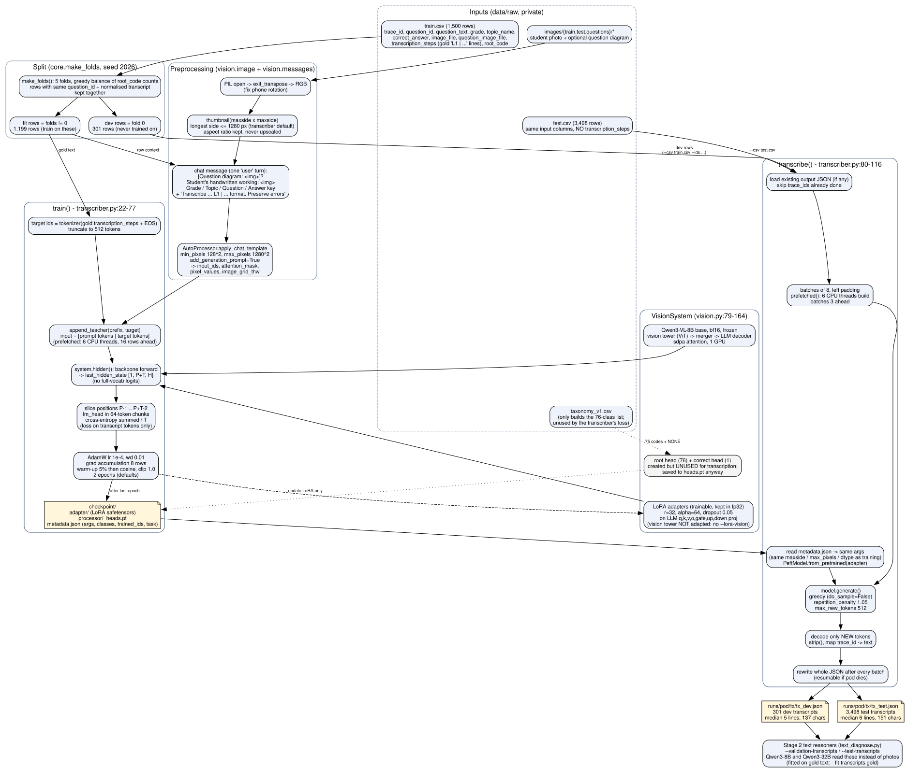
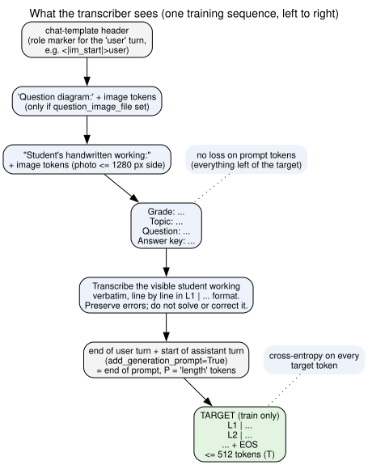
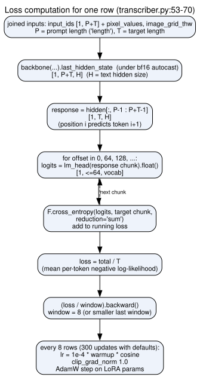

<a id="02-transcriber"></a>

# Stage 1: the transcriber (photo to text)

## Stage 1: the transcriber (photo to text)

### In one paragraph

The transcriber is a Qwen3-VL-8B vision-language model with small LoRA adapters. We trained it to look at a photo of a student's handwritten working and write that working out as numbered text lines (`L1 | ...`, `L2 | ...`), copying the teacher transcriptions in `train.csv`. It was trained on the 1,199 "fit" rows. It then transcribed the 301 dev photos into `runs/pod/tx/tx_dev.json` and the 3,498 test photos into `runs/pod/tx/tx_test.json`. That lets the Stage 2 text reasoners (Qwen3-8B and Qwen3-32B) work on text instead of pixels.

Its reading is good but not perfect: number recall is 0.88 and the median normalised character error rate is 0.095. Even so, giving the downstream models perfect (gold) text would add only about **+0.035 MAP@3** to one model, and **+0.0155 to +0.022** to the full ensemble. That is why the project treats diagnosis, not reading, as the bottleneck.



---

### 1. Why a separate "reader" stage at all?

The task: given a photo of a student's working, name the root misconception (one of 75 taxonomy codes or `NONE`), ranked top 3. There are two ways to attack this:

- **End to end:** one vision model looks at the photo and outputs a code directly. This is `vision.py`'s classifier path (`VisionSystem.predict`, `vision.py:145-157`).
- **Read, then diagnose:** first turn the photo into text (this stage). Then a strong *text* model reasons over the question, the answer key and the transcript (Stage 2, `src/k12/text_diagnose.py`).

The second route lets us use larger text-only models such as the Qwen3-32B reasoner. It also lets us measure two questions separately: "did we read it right?" and "did we diagnose it right?". The handoff records when this direction paid off. The text reasoner scored 0.570 with teacher transcripts and 0.542 with machine transcripts. Its conclusion: "Reading costs only ~0.03; diagnosis is now the bottleneck" (`docs/handoff.md:35-36`).

The current reference blend is described in `runs/arch/PLAN.md` (section 1, lines 18-24). Two of its three models read the transcriber's output: the 32B text reasoner (weight .35) and the 8B text reasoner (weight .30). The third is the VL-8B image classifier distilled from Claude (weight .35).

---

### 2. Concepts you need first

**Vision-language model (VLM).** A language model with an image encoder attached. Qwen3-VL has three parts:
- a vision tower (a ViT), which cuts the image into small patches and turns each patch into a vector;
- a merger, which compresses neighbouring patch vectors into "image tokens";
- the language-model decoder, which reads image tokens and text tokens in one sequence.

To the decoder, an image is just a long run of special tokens in the prompt. Bigger images produce more image tokens, which costs more memory and time.

**LoRA (Low-Rank Adaptation).** Fine-tuning all 8B weights is expensive. LoRA freezes each original weight matrix `W` (shape `d_out × d_in`) and learns a small correction `B·A`:
- `A` is `r × d_in` and `B` is `d_out × r`, with a small rank `r` (here 32).
- The layer computes `W x + (alpha/r)·B A x`.
- Only `A` and `B` are trained. For an 8B decoder at rank 32 on all seven projections, that is roughly 1% of the parameters. The exact count was not logged.
- The adapter is saved separately from the base model and is small next to it (exact size not recorded locally). It can be attached to the frozen base model later.

**QLoRA.** The same idea, but the frozen base weights are stored in 4-bit (NF4) to save memory. `vision.py:89-93` supports this through `--load_4bit`, but **the transcriber does not use it**. Its parser has no 4-bit flag, so the base model loads in bf16. The 4-bit path is there for the 32B QLoRA classifier experiment (the code comment says "so a 32B model fits a 48 GB card"; see `docs/handoff.md:30`).

**bf16 / autocast.** bf16 is a 16-bit float format with the same range as float32 but less precision.
- The transcriber loads the base weights directly in bf16 (`vision.py:94-96`).
- The trainable LoRA weights are cast up to float32 (`vision.py:132-133`).
- `torch.autocast('cuda', dtype=bf16)` makes the matrix multiplications, including the fp32 LoRA ones, run in bf16. The optimiser still updates fp32 master copies of the LoRA weights.

**Teacher forcing / next-token loss.** To teach a model to *write* a text, we feed it `[prompt | target]`. At each target position, it must predict the next target token. The loss is cross-entropy: the average negative log-probability of the correct next token. We compute loss **only on the target tokens**, never on the prompt. This is called "completion-only" loss.

**Gradient checkpointing.** This saves GPU memory by not storing every intermediate activation. The activations are recomputed during the backward pass instead. That is slower, but it lets long image+text sequences fit.

**Gradient accumulation.** We process one row at a time but update the weights only every 8 rows, summing gradients in between. That simulates a batch size of 8.

**Greedy decoding.** At inference, always pick the single most likely next token (`do_sample=False`). It is deterministic, which is what you want for transcription.

**Repetition penalty.** At generation time, Hugging Face penalises every token id that already appears in the sequence. That includes the prompt, so digits from the question or answer key are penalised too. A positive score is divided by 1.05 and a negative score is multiplied by 1.05. This mildly discourages the model from looping on the same line.

**CER (character error rate).** CER = (Levenshtein edit distance between machine and gold text) / (length of gold text). The edit distance counts the minimum number of single-character inserts, deletes and substitutions. 0 is perfect. CER can exceed 1 when the machine writes far too much, for example by looping.

**MAP@3.** For each row you get 1 point if the true code is your 1st guess, 1/2 if 2nd, 1/3 if 3rd, otherwise 0. MAP@3 is the mean over rows (`core.py:38-51`). A "+0.03" gain means about 9 extra points on the 301-row dev set.

**Bootstrap confidence interval (CI).** Resample the 301 dev rows with replacement 10,000 times, recompute the metric difference each time, and take the 2.5th and 97.5th percentiles. If the interval excludes 0, the effect is probably real.
- `runs/arch/reading-impact/common.py:32-37` implements this as `boot()`, a **row-level** paired bootstrap with seed 0.
- Most other CIs in `PLAN.md` are question-grouped instead (`PLAN.md:4`): they resample whole questions, so rows of the same question move together.

---

### 3. Data in: what the transcriber learns from

`train.csv` has 1,500 rows. Each row has:
- a student photo (`image_file`);
- an optional question diagram (`question_image_file`, present on 18.2% of train rows and 17.3% of test rows);
- question context (`grade`, `topic_name`, `question_text`, `correct_answer`);
- the **gold transcription** `transcription_steps`.

The gold transcription is a teacher-written, line-numbered copy of the working in the format `L1 | ...` / `L2 | ...`. It sometimes includes markup such as crossed-out markers. A reading audit found markup-like cross-out annotations in 158 gold rows (`runs/research/q1-formula-paper/reading_audit2.json`).

`test.csv` has the same input columns **but no `transcription_steps`**. That is the whole reason this stage exists: at test time we must produce the text ourselves, offline.

**The split** (`core.py:64-94`, `make_folds`) has 5 folds with seed 2026. Rows are first grouped by `question_id` plus the lower-cased, whitespace-collapsed transcript, so duplicates never straddle folds. Each group then goes to the fold where its `root_code`s are currently rarest (ties go to the smaller fold, then a random choice). The docstring calls this "round-robin stratification". Fold 0 (301 rows) is the dev set and the other 1,199 rows are the fit set. The transcriber trains on the fit set only (`transcriber.py:28-29`):

```python
# src/k12/transcriber.py:26-31
frame = read_csv(data / 'train.csv')
classes = label_space(read_csv(data / 'taxonomy_v1.csv'))
folds = make_folds(frame, seed=args.split_seed)
fit = frame if args.full_train else frame.loc[folds != args.fold].reset_index(drop=True)
if args.smoke:
    fit, args.epochs = fit.head(8), 1
```

So `tx_dev.json` is an honest **out-of-fold** reading: the transcriber never saw those 301 photos. The handoff confirms that the test transcripts also come "from a transcriber trained on 1,199 rows" and calls retraining on all 1,500 "a cheap upgrade" (`docs/handoff.md:74`). No full-data transcriber output exists in the local `runs/`, and `PLAN.md:212` now lists transcriber retrains as "do not do".

`read_csv` uses `keep_default_na=False` (`core.py:13-15`). This keeps an empty `question_image_file` as an empty string instead of NaN, and stops the literal label `NONE` being read as a missing value.

---

### 4. Image preprocessing (`vision.py:50-57`)

```python
# src/k12/vision.py:50-57
def image(data, split, filename, maxside=1024):
    candidates = [data/'images'/split/str(filename), data/str(filename)]
    path = next((p for p in candidates if p.is_file()), None)
    if path is None: raise FileNotFoundError(f'Missing {split} image: {filename}')
    with Image.open(path) as im:
        out=ImageOps.exif_transpose(im).convert('RGB')
    out.thumbnail((maxside,maxside));return out
```

Step by step:
1. **Find the file.** It looks under `images/<split>/` first, then directly under the data folder. There is deliberately no fallback image, so a missing photo crashes the run instead of silently scoring a blank.
2. **`exif_transpose`.** Phone photos often store "rotate 90°" as metadata instead of rotating the pixels. This applies the rotation so the handwriting is upright.
3. **`.convert('RGB')`.** Drops alpha channels and grayscale modes, so every image has 3 channels.
4. **`thumbnail((maxside, maxside))`.** Shrinks the image in place so its *longest* side is at most `maxside`, keeping the aspect ratio. It never enlarges small images. The transcriber's default is **`--maxside 1280`** (`transcriber.py:128`), larger than the classifier's default of 1024, because small digits and minus signs need resolution.
5. **Processor pixel budget.** `AutoProcessor.from_pretrained(..., min_pixels=128*128, max_pixels=args.max_pixels)` (`vision.py:83-84`) sets the budget. The transcriber's default is `max_pixels = 1280*1280`. The Qwen processor resizes each image to a patch-friendly size within that budget and outputs `pixel_values` plus `image_grid_thw`, which records the number of patches in each direction. The exact number of image tokens per photo was **not measured** in this repo.

**Same preprocessing at train and test.** In `transcribe()`, the model is rebuilt from the training run's own saved arguments (`metadata['args']`, `transcriber.py:82-86`). So `maxside`, `max_pixels` and `dtype` at inference are guaranteed to match training. The generation length (`--max-tokens`) is the one exception: it comes from the `transcribe` command line.

---

### 5. The prompt (`vision.py:60-76`)



`messages()` builds a single "user" chat turn, in this order:
1. the question diagram (if any);
2. the student photo;
3. a text block with grade, topic, question and answer key;
4. the task instruction.

For `task='transcribe'` the instruction is:

```python
# src/k12/vision.py:71-75
if task == 'transcribe':
    instruction = "Transcribe the visible student working verbatim, line by line in L1 | ... format. Preserve errors; do not solve or correct it."
...
content.append({'type':'text','text':f"Grade: {row.grade}\nTopic: {row.topic_name}\nQuestion: {row.question_text}\nAnswer key: {row.correct_answer}\n{instruction}"})
```

Why give a *reader* the question and answer key? The context helps it decode ambiguous handwriting. If the question involves `2a − 1`, a smudged `2a-1` is likely that.

The risk is **error erasure**: the model "corrects" a student's mistake toward the answer key, which destroys the evidence of the misconception. The instruction "Preserve errors; do not solve or correct it" exists for this reason, and training on gold text that keeps the errors reinforces it. Section 10 shows how often reading differences flip a diagnosis (`error_erasure` in `results.json`).

`VisionSystem.encode()` (`vision.py:136-138`) calls `processor.apply_chat_template(..., add_generation_prompt=True)`, which appends the "assistant turn starts here" marker. Everything up to and including that marker is the **prompt**. The code calls its length `length`; the diagrams call it P.

---

### 6. The model and its LoRA (`vision.py:79-134`)

`VisionSystem.__init__` does the following:
- **Processor.** Loads the processor and sets `padding_side='left'` (`vision.py:85`). For batched generation, padding must sit on the left, so every sequence's last real token lines up at the end, where generation continues.
- **Base model.** Loads `Qwen3-VL-8B` with `AutoModelForImageTextToText` in the chosen dtype (`vision.py:94-96`). The transcriber's default is `--dtype bfloat16` (`transcriber.py:129`); `vision.py` falls back to fp16 for Kaggle T4s. It uses `attn_implementation='sdpa'` on one GPU.
- **Compatibility patch** (`vision.py:97-108`). Disables PEFT's optional torchao dispatch when it would crash on non-quantised weights. This is a library-version workaround, not modelling.
- **LoRA targets** (`vision.py:114-125`):

```python
# src/k12/vision.py:114-125 (abridged)
targets=[n for n,m in self.base.named_modules() if isinstance(m,nn.Linear)
         and 'language_model' in n and n.rsplit('.',1)[-1] in
         {'q_proj','k_proj','v_proj','o_proj','gate_proj','up_proj','down_proj'}]
if getattr(args,'lora_vision',False):
    vision=[... '.visual.' ... {'qkv','proj','linear_fc1','linear_fc2'}]
    targets+=vision
self.model=get_peft_model(self.base,LoraConfig(r=args.rank,lora_alpha=args.rank*2,
             lora_dropout=.05,target_modules=targets))
```

What this means:
- LoRA goes into every attention projection (q, k, v, o) and every MLP projection (gate, up, down) of the **language decoder**.
- The rank is 32 by default (`transcriber.py:126`), with alpha = 2 × rank = 64 and dropout 0.05.
- The transcriber's argument parser has **no `--lora-vision` flag**, so `getattr(args,'lora_vision',False)` is `False`. `get_peft_model` freezes everything that is not a LoRA weight, so the vision tower and merger stay frozen.
- In effect, the decoder learns *how to write down* what the frozen vision features already encode.

**Unused heads.** `VisionSystem` always builds two classifier heads: `self.head` with 76 outputs (75 codes + `NONE`) and `self.correct_head` with 1 output (`vision.py:127-128`). This is because the class is shared with the image classifier. The transcriber never uses the heads, but `system.save()` still writes them to `heads.pt`. This is harmless shared plumbing.

---

### 7. Training loop (`transcriber.py:22-77`)



**Setup** (`transcriber.py:32-38`):
- enables gradient checkpointing;
- calls `enable_input_require_grads()`, which checkpointing needs when the input embeddings are frozen;
- turns off the KV cache;
- builds AdamW with lr `1e-4` and weight decay 0.01 over the trainable (LoRA) parameters only.

**Building one example** (`transcriber.py:41-47`):

```python
# src/k12/transcriber.py:41-47
def encode(i):
    row = fit.iloc[i]
    prefix = system.encode(row, data, 'train', task='transcribe')
    target = system.processor.tokenizer(str(row.transcription_steps) + system.processor.tokenizer.eos_token,
                                        add_special_tokens=False, truncation=True, max_length=args.max_tokens,
                                        return_tensors='pt')['input_ids']
    return append_teacher(prefix, target) + (target,)
```

`append_teacher` (`reading_finetune.py:36-44`) does the joining:
- concatenates the prompt ids and the target ids;
- extends `attention_mask` with ones, and any `token_type_ids` / `mm_token_type_ids` with zeros;
- returns `(joined, length)`.

`prefetched()` (`pod_train.py:28-39`) runs `encode` on 6 background CPU threads, 16 rows ahead, so image decoding never leaves the GPU waiting.

**Forward and loss** (`transcriber.py:54-63`):

```python
# src/k12/transcriber.py:54-63
with torch.autocast('cuda', dtype=system.dtype):
    hidden = system.hidden(joined)
response = hidden[:, length - 1:length + target.shape[1] - 1]
target = target.cuda()
loss = hidden.new_zeros((), dtype=torch.float32)
for offset in range(0, target.shape[1], 64):
    logits = lm_head(response[:, offset:offset + 64]).float()
    loss = loss + F.cross_entropy(logits.reshape(-1, logits.shape[-1]),
                                  target[:, offset:offset + 64].reshape(-1), reduction='sum')
loss = loss / target.shape[1]
```

What each part does:
- **Backbone only.** `system.hidden()` (`vision.py:140-143`) calls the multimodal **backbone** (`get_base_model().model`), not the full causal-LM wrapper. It returns hidden states `[1, P+T, H]` *without* multiplying every position by the huge vocabulary matrix. The image and prompt positions never need logits, so this saves a lot of memory.
- **The shift.** The hidden state at position `i` predicts token `i+1`. The first target token sits at position `length`, so position `length-1` predicts it. The slice `[length-1 : length+T-1]` therefore lines up exactly with `target[0 : T]`.
- **Chunked lm_head.** The vocabulary projection is applied 64 positions at a time, and the logits are cast to float32 for a stable softmax. Without chunking, a long transcript (up to 512 tokens) would create a `[512, vocab]` float32 tensor all at once.
- **Mean loss.** The chunk losses are summed, then divided by `T`, giving the mean per-token cross-entropy.

**Optimiser step** (`transcriber.py:64-70`):
- **Backward.** `(loss / window).backward()`, where `window` is 8. The final partial group uses its true size so the average stays correct. With 1,199 fit rows, the last window of each epoch has 7 rows.
- **Schedule.** With the defaults there are `2 × ceil(1199/8) = 300` optimiser updates. At each update the learning rate is `1e-4 × warmup × cosine`:
  - `warmup = min(1, (step+1)/(0.05·updates))` ramps linearly over the first 5% of updates (15 updates).
  - `cosine = 0.5·(1 + cos(π·step/updates))` then decays smoothly toward 0.
- **Clipping.** Gradients are clipped to norm 1.0 before the AdamW step.

**Defaults** (`transcriber.py:124-130`): 2 epochs, rank 32, lr 1e-4, accumulation 8, max target 512 tokens, maxside 1280, max_pixels 1280², bf16, seed and split seed 2026, fold 0.

The exact arguments of the run that produced `tx_dev.json` / `tx_test.json` are stored in the pod's `checkpoint/metadata.json`, which is **not in the local repo**. Treat the defaults as the recipe. The actual run's values, wall-clock time and GPU memory are **not recorded locally**.

**Output** (`transcriber.py:75-76`), all under `checkpoint/`:
- `adapter/`: the LoRA weights, as safetensors;
- `processor/`;
- `heads.pt`;
- `metadata.json`, with `args`, `classes`, `trained_ids` (proof of which rows were trained on) and `task: 'transcribe'`.

---

### 8. Inference: `transcribe()` and the resumable JSON (`transcriber.py:80-116`)

```python
# src/k12/transcriber.py:94-97, 106-113 (abridged)
out = Path(args.output)
done = json.loads(out.read_text()) if out.exists() else {}
rows = [r for r in frame.itertuples(index=False) if r.trace_id not in done]
groups = [rows[i:i + args.batch_size] for i in range(0, len(rows), args.batch_size)]
...
generated = system.model.generate(**inputs, max_new_tokens=args.max_tokens, do_sample=False,
                                  repetition_penalty=1.05, pad_token_id=tokenizer.pad_token_id)
texts = tokenizer.batch_decode(generated[:, inputs['input_ids'].shape[1]:], skip_special_tokens=True)
done.update({r.trace_id: t.strip() for r, t in zip(group, texts)})
out.write_text(json.dumps(done, ensure_ascii=False))
```

The key ideas:
- **Resumable.** The output file is a single JSON dict `{trace_id: transcript}`. On start, already-done ids are skipped, and the whole dict is rewritten after *every* batch. If a paid pod dies halfway through the 3,498 test photos, rerunning the same command continues where it stopped. The handoff shows this in use: the L40S pod was "Transcribing 3,498 test photos (resumable)" (`docs/handoff.md:47`).
- **Batching.** Batches of 8 (`--batch-size`) with left padding. `prefetched(batch, groups, ahead=3)` prepares the next 3 batches on 6 CPU threads.
- **Decoding only the new tokens.** `generated[:, prompt_len:]` drops the echoed prompt. Because of left padding, `prompt_len` (the padded length) is the same for every row in the batch.
- **Filters.**
  - `--ids` (a JSON list of trace_ids) restricts the `--csv` file. Pointed at `train.csv`, this selects the dev rows.
  - `--limit` gives a quick smoke run.
  - `--split` picks the student-photo folder: `train` for dev photos, `test` for test. Question diagrams always come from `images/questions/`.

**What the files look like, measured on the local copies (aggregates only):**

| File | Rows | Median lines | Median chars | Every non-blank line in `Lk \|` format | Empty |
|---|---|---|---|---|---|
| `runs/pod/tx/tx_dev.json` | 301 | 5 | 137 | 300 / 301 | 0 |
| `runs/pod/tx/tx_test.json` | 3,498 | 6 | 151 | 3,481 / 3,498 | 0 |

The plan notes **20 looping and 26 overlong test transcripts**, which need to be capped before Stage B prompts are built (`runs/arch/PLAN.md:157`).

**How Stage 2 consumes them.** `transcripts(frame, source)` (`text_diagnose.py:100-104`) returns the gold `transcription_steps` when `source == 'gold'`. Otherwise it reads the JSON and looks up each `trace_id`.
- The reasoners are **fitted on gold text**: `--fit-transcripts` defaults to `gold` (`text_diagnose.py:237`).
- They are **validated and tested on machine text** (`--validation-transcripts`, `--test-transcripts`, lines 238-239).

This train-on-clean / test-on-noisy mismatch is part of why reading errors cost anything at all.

---

### 9. How good is the reading? (and why the numbers disagree)

The same `tx_dev.json` gives very different CERs depending on what you count:

| Measure (dev, 301 rows) | Value | Source |
|---|---|---|
| Raw CER including line ids and spacing, median | 0.328 (mean 0.376) | `scripts/evaluate_transcripts.py`; `reading_audit.json` |
| Same, after stripping line ids and whitespace but **keeping** `[...]` annotations, median | 0.375 | `reading_audit.json` (`cer_normalized_no_ids_no_space`) |
| Number recall / number precision (regex `\d+`, which also counts the digits in `L1`, `L2` ids, so both are somewhat inflated) | 0.881 / 0.913 | `scripts/evaluate_transcripts.py` |
| Line-count ratio machine/gold, median | 1.0 | same |
| Normalised page CER, median (see the steps below the table) | **0.095** (25th pct 0.027, 75th pct 0.333, max 6.77) | `runs/arch/reading-impact/step1_cer.py` → `per_row_reading.csv` |
| Order-free math-token bag F1, median | 0.81 | `reading_audit2.json` |
| Exact line match, share of gold lines (mean) | 0.44 | `reading_audit2.json` |
| Root-error span found exactly in the machine page (200 error rows) | 0.605 (121 / 200) | `reading-impact/results.json` (`claude_reading`) |
| Root line read with CER ≤ 0.10 | 0.655 (131 / 200) | same |
| Older OCR, for contrast: number recall | 0.12–0.22 | `docs/handoff.md:35` |

The normalised page CER is computed in `step1_cer.py` (`lines()` and `norm()`) in these steps:
1. Keep only the text after each `Lk |` id. Lines without an id are dropped.
2. Apply NFKC and lower-case everything.
3. Map − – — to `-`, × to `x`, · to `.` and ÷ to `:`, and remove backslashes.
4. Drop `[...]` annotations.
5. Remove all whitespace.

The handoff calls the raw 0.33 "mostly formatting" (`docs/handoff.md:35`). The second row narrows that down. Stripping ids and spaces alone does not help (0.375). The big drop to 0.095 comes mainly from removing the teacher's bracketed annotations, plus the unicode unification. After that normalisation, the median page is about 90% character-correct.

A max CER of 6.77 means that page's machine text is at least about 6.8 times as long as its gold text. That pattern is typical of looping or runaway output, though that specific row was not inspected.

**Is Claude a better reader?**
- **Root-span exactness:** yes, 0.72 versus our 0.605.
- **Whole-page CER:** no. Claude's median is 0.124 versus our 0.095.
- **Root-line accuracy:** about the same, 0.645 versus 0.655 (`results.json` → `claude_reading`).

The plan's summary: "Claude reads no better than our transcriber" (`PLAN.md:55`). Claude's big advantage is in diagnosis, not reading.

---

### 10. Why reading only matters about 0.03

The decisive experiment scores the same trained text reasoner twice on dev: once on gold transcripts and once on machine transcripts. Source: `runs/arch/reading-impact/results.json`, `single_model_gold_minus_tx`, with a row-level paired bootstrap 95% CI.

| Text model | MAP@3 machine text | MAP@3 gold text | Gold − machine | 95% CI | Rows gold better / machine better |
|---|---|---|---|---|---|
| Qwen3-32B reasoner | 0.652 | 0.687 | +0.035 | [0.009, 0.062] | 31 / 15 |
| Qwen3-8B, 0% Claude labels (s0) | 0.553 | 0.578 | +0.025 | [0.004, 0.047] | 18 / 15 |
| Qwen3-8B, 25% Claude labels (s25) | 0.666 | 0.692 | +0.025 | [0.002, 0.050] | 28 / 17 |
| Qwen3-8B, 100% Claude labels (s100) | 0.692 | 0.720 | +0.028 | [0.004, 0.053] | 31 / 19 |

At the ensemble level, the reference blend scores 0.7182:

| Change | Ensemble MAP@3 | Δ vs reference | 95% CI |
|---|---|---|---|
| Only the 32B reads gold | 0.7337 | +0.0155 | [0.006, 0.026] |
| All text models read gold (estimate) | 0.7403 | +0.022 | [0.007, 0.039] |

So a *perfect* reader is worth about +0.015 to +0.022 to the ensemble. That is much less than the 0.10 gap to Claude (0.8189). The reasons:

1. **Most lost points are on rows we read correctly.** Take the 121 error rows where the root-error span was read exactly. There, gold and machine text score the same (32B: 0.545 vs 0.544), yet the blend still loses 42.3 points on them against a perfect score. PLAN.md measures the same thing against Claude: "17.0 of the 30.3 gap points are on rows our transcriber read exactly right". Here 30.3 = 0.1008 × 301, the blend-vs-Claude gap expressed in rows' worth of points.
2. **Where reading is bad, it does matter, but those rows are few.**
   - On the 79 rows where the root span was misread, the 32B gains +0.087 from gold text.
   - On the 69 rows whose root line has CER > 0.10, it gains +0.094.
3. **Errors away from the root line barely matter.** Fixing only the non-root parts of the page adds +0.0011 (CI [−0.002, +0.004]) (`hybrid_reading_fixes`).
4. **A third of the reading gap is on NONE rows** (`REPORT.md:29`).
   - On the 101 `NONE` rows, the 32B scores 0.931 on machine text and 0.965 on gold.
   - Misread digits make a correct page look wrong. For the 32B, these "false alarms" (a NONE row predicted as an error) number 8 on machine text vs 4 on gold.
   - Error erasure is also visible but small (`error_erasure`, 32B). On 2 rows, gold text gave the right top-1 while machine text gave `NONE`. On 17 rows, machine text gave another code. On 7 rows it went the other way: machine text was right and gold was wrong.
   - The research report recommends tracking NONE-row and error-row MAP separately.
5. **The correlation is weak.** The Spearman correlation between page CER and lost MAP points is 0.126 for the 32B on machine text, and 0.059 when it reads gold. Reading quality explains little of which rows fail.
6. **Other reading upgrades were tried and did not help** (`runs/research/REPORT.md`, Q1 and Q4 sections):
   - A PP-FormulaNet formula-reader pilot gave no diagnosis gain (0.656 vs 0.664, `REPORT.md:139`).
   - An oracle hard crop to the error region *lowered* MAP from 0.609 to 0.601 (`REPORT.md:36`).
   - Mixing 11,426 Claude-transcribed rows into the text reasoners left the gold-vs-machine gap at 0.025–0.028 (`REPORT.md:126`).

That is why PLAN.md's "What not to do" table lists "Upgrade or retrain the transcriber, including 5-fold out-of-fold transcriber retrains" (`PLAN.md:212`).

The research report still lists two cheap, optional reading-robustness ideas (`REPORT.md:29-30`). Neither has been measured:
- Train the text reasoner on *synthetically corrupted* gold text (estimate 0 to +0.015).
- Average the reasoner over two readings per photo (estimate 0 to +0.01).

---

### Key files

- `src/k12/transcriber.py`: `train()` (lines 22-77), `transcribe()` (lines 80-116), and the CLI (lines 119-138).
- `src/k12/vision.py`: `image()` preprocessing (50-57), the `messages()` prompt builder (60-76), and `VisionSystem` model, LoRA and save (79-164).
- `src/k12/reading_finetune.py:36-44`: `append_teacher()`, which joins prompt and target ids.
- `src/k12/pod_train.py:28-39`: `prefetched()`, the CPU thread pool that keeps the GPU fed.
- `src/k12/core.py`: `read_csv` (13), `make_folds` (64), `topk` / `row_scores` / `map3` (31-51), `aligned_bundle` (106).
- `src/k12/text_diagnose.py:100-104` and `237-239`: how Stage 2 loads gold or machine transcripts.
- `scripts/evaluate_transcripts.py`: aggregate CER, number recall/precision and line ratio.
- `runs/pod/tx/tx_dev.json`, `runs/pod/tx/tx_test.json`: the machine transcripts (private data).
- `runs/arch/reading-impact/` (`common.py`, `step1_cer.py`, `step2_impact.py`, `results.json`, `per_row_reading.csv`): the reading-impact study.
- `runs/research/q1-formula-paper/reading_audit*.json` and `runs/research/REPORT.md` (Q1, Q4): the reading audit and the paper reviews.
- `docs/handoff.md` (lines 30, 35-36, 47, 74) and `runs/arch/PLAN.md` (lines 18-24, 55, 157, 212).

### Things to try yourself (CPU only)

All of these run locally from the repo root and print only aggregates, so no student text appears on screen.

1. **Reproduce the reading scores.**
   - Run `PYTHONPATH=src python3 scripts/evaluate_transcripts.py runs/pod/tx/tx_dev.json`. You should see a median CER of 0.328, mean 0.376, number recall 0.881 and number precision 0.913.
   - Then open `runs/arch/reading-impact/step1_cer.py` and find `lines()` and `norm()`. Work out which steps take the median from 0.33 to 0.095.
   - Also compare with `runs/research/q1-formula-paper/reading_audit.py`, which keeps the `[...]` annotations and gets 0.375.
2. **Measure the "reading gap" for the 32B reasoner yourself.**
   ```python
   import numpy as np
   from k12.core import read_csv, label_space, make_folds, aligned_bundle, map3, row_scores, topk
   tr = read_csv('data/raw/train.csv'); classes = label_space(read_csv('data/raw/taxonomy_v1.csv'))
   dev = tr[make_folds(tr) == 0].reset_index(drop=True); ids, y = dev.trace_id.tolist(), dev.root_code.tolist()
   tx = aligned_bundle('runs/pod/text32/validation_tx_dev_epoch_1.npz', ids, classes)
   gd = aligned_bundle('runs/pod/text32/validation_gold_epoch_1.npz', ids, classes)
   print(map3(y, tx, classes), map3(y, gd, classes))          # 0.6523  0.6872
   d = row_scores(y, topk(gd, classes)) - row_scores(y, topk(tx, classes))
   m = d[np.random.default_rng(0).integers(0, len(d), (10000, len(d)))].mean(1)
   print(d.mean(), np.percentile(m, [2.5, 97.5]))             # 0.0349  [0.0089 0.0620]
   ```
   Run it with `PYTHONPATH=src`. Then repeat with the `runs/pod/scaling/scale_100/validation_{tx_dev,gold}_epoch_1.npz` pair; `results.json` reports +0.028.
3. **Does a bad read cost more on NONE rows?**
   - Load `per_row_reading.csv` and join it to `d` from exercise 2 by `trace_id`.
   - Split the rows by `y == 'NONE'` and by `m_page_cer > 0.10`, and compare the mean of `d` in each cell.
   - Compare your numbers with the `groups` entries in `results.json`.
4. **Find the looping transcripts.**
   - For each value in `tx_test.json`, count the lines and the share of duplicate lines (`1 - len(set(lines))/len(lines)`).
   - Print only the counts above simple thresholds, never the text.
   - See how close you get to PLAN.md's "20 looping and 26 overlong".

### Common confusions

- **"The transcriber was trained with LoRA on the vision tower."** No. Only the language-decoder projections get LoRA. `lora_vision` exists in `VisionSystem` but is not exposed by `transcriber.py`'s parser.
- **"It uses QLoRA."** No. The base model loads in bf16. The 4-bit path in `vision.py` was for the 32B QLoRA classifier experiment.
- **"The classifier heads are part of the transcriber."** No. They are created and saved because `VisionSystem` is shared, but the transcriber's loss never touches them.
- **"Loss is computed over the whole sequence."** No. Only the target (transcript + EOS) positions contribute, via the `length-1` shifted slice.
- **"CER 0.33 means a third of the characters are wrong."** Mostly no. Most of it is the teacher's bracketed annotations, plus line ids, spacing and unicode variants. With the reading-impact normalisation the median is 0.095. Always ask which normalisation a CER uses.
- **"`tx_dev.json` is in-sample."** No. The transcriber trained on the 1,199 fit rows only, so the 301 dev transcripts are out-of-fold. The test transcripts come from the same 1,199-row model, not a full-data retrain.
- **"Giving the reader the answer key is cheating."** No. It is allowed context, like the question text, and is available at test time. The real risk is the model *correcting* the student's error, which is why the instruction says "Preserve errors". Also note that the repetition penalty slightly discourages repeating tokens that are already in the prompt.
- **"A better reader is the path to 0.82."** No. The measured gain from perfect reading is about +0.0155 (32B on gold) to +0.022 (all text models, estimate) on the ensemble. The gap to Claude is 0.10, and it sits mainly in naming new error types for known questions.
- **"512 tokens is plenty."** Usually it is: median transcripts are around 140–150 characters. But the target is *truncated* at 512 tokens including EOS. A gold transcript longer than that loses its EOS, so the model learns no stop signal from it. Generation is also capped at 512 new tokens, so a looping output is cut off rather than ended cleanly.
- **"The JSON rewrite is atomic."** It is not. `out.write_text` overwrites in place, so a crash *during* the write could leave a truncated file. Resumability protects against a crash *between* batches, which is the common case on a pod.

