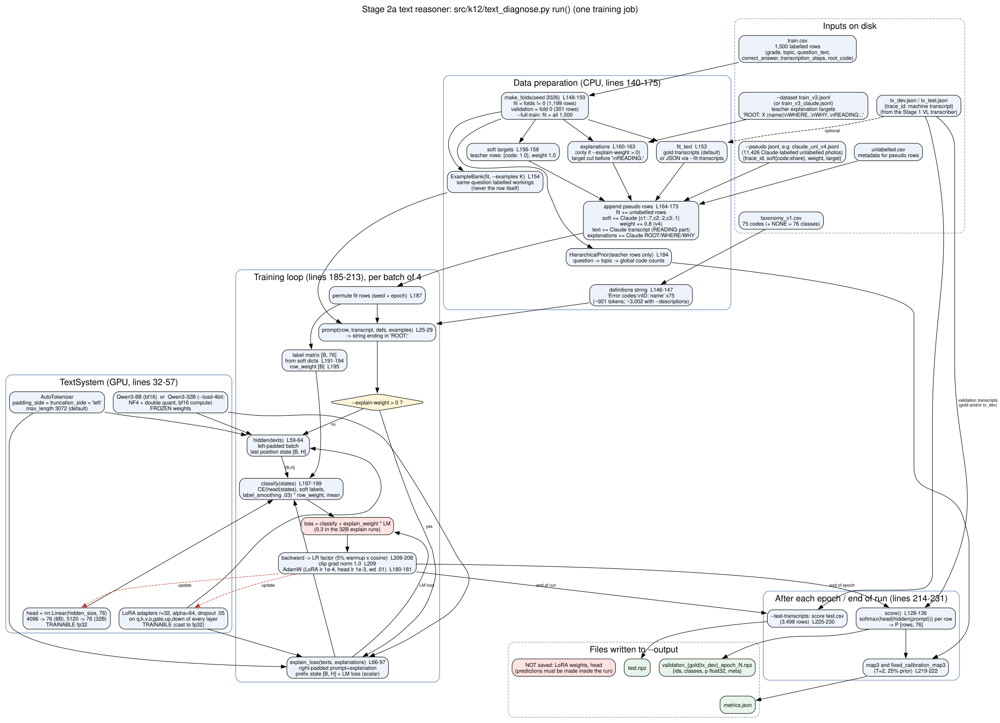
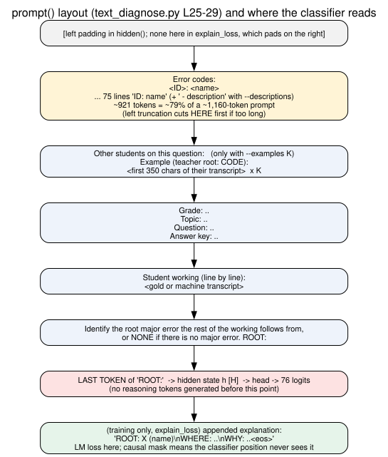
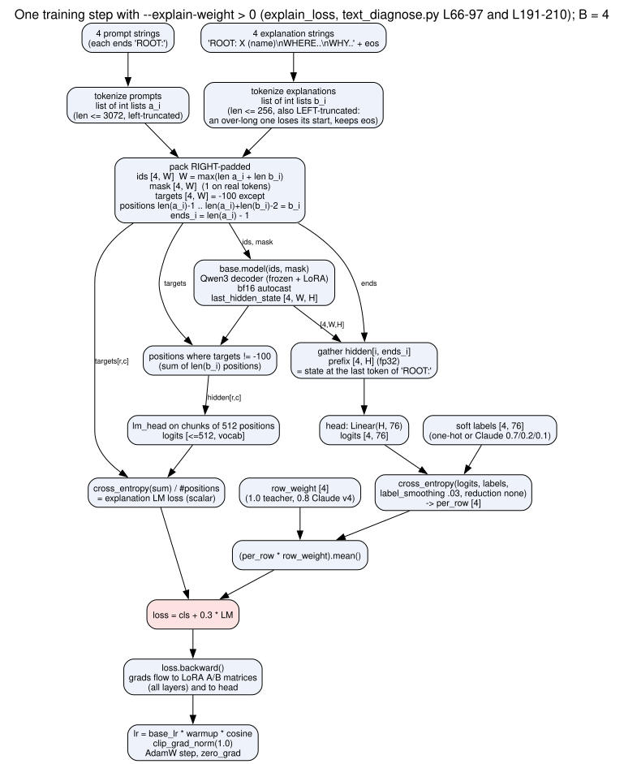

<a id="03-text-reasoner"></a>

# Stage 2a: the text reasoners (Qwen3-8B and Qwen3-32B)

## Stage 2a: the text reasoners (Qwen3-8B and Qwen3-32B)

### In one paragraph

The text reasoner is the second half of our "read, then diagnose" pipeline. Stage 1 turns a photo into a text transcript of the student's working. Stage 2a gives that transcript to a text-only language model (Qwen3-8B or Qwen3-32B), together with the question, the answer key and the list of 75 error codes. It then reads one hidden-state vector at the very last prompt token (the end of `ROOT:`), and a small linear layer turns that vector into 76 scores (75 codes + NONE). We fine-tune the model cheaply with **LoRA** (the 32B is loaded in 4 bits, which is **QLoRA**). The loss mixes hard teacher labels, soft "pseudo" labels distilled from Claude on unlabelled photos, and an optional language-model loss on a written explanation of the error. On the 301-row dev fold with machine transcripts, the 8B scores **0.6667** MAP@3 and the 32B scores **0.6523**. Together with an image model they make up the blend that scores 0.7182 on dev and **0.7085 public**. The main weakness, found in `runs/arch/PLAN.md`, is that the code is chosen **before any reasoning happens**, from a prompt that is 79% code list.



---

### 1. Where this stage sits, and the concepts you need

```
photo --(Stage 1: Qwen3-VL-8B transcriber)--> transcript text
transcript + question + code list --(Stage 2a: THIS SECTION)--> P[76] per row
P(32B) , P(8B) , P(VL image model) --(geometric blend .35/.30/.35)--> top-3 codes --> submission
   (PLAN.md proposes adding Sinkhorn balancing after the blend; the 0.7085 submission does not use it)
```

Concepts used in this section, in plain words:

- **MAP@3 (Mean Average Precision at 3).** For each row we submit 3 ranked codes. A row scores 1 if the true code is first, 1/2 if it is second, 1/3 if it is third and 0 otherwise. The final score is the average over rows. In our code this is `row_scores` / `map3` in `src/k12/core.py:38-51`.
- **Geometric blend.** To combine models, we take a weighted average of their *log*-probabilities, exponentiate, and renormalise each row to sum to 1: `normalize(exp(sum_m w_m * log P_m))`. A code needs support from every model to stay on top.
- **Sinkhorn balancing (mentioned only).** This rescales a probability matrix, alternating over its columns and rows, until the predicted label mix matches a target mix, such as the training label shares. It belongs to the blending stage (PLAN.md), not to this one.
- **Causal LM / decoder.** Qwen3 reads tokens left to right, and the hidden state at position *t* can only "see" tokens 0..*t*. So the state at the last prompt token summarises the whole prompt, and it cannot see anything appended later.
- **LoRA (Low-Rank Adaptation).** We freeze each big weight matrix W (for example 4096x4096) instead of updating it, and learn two thin matrices A (r x in) and B (out x r). The layer then computes `W x + (alpha/r) * B A x`. With r=32 on all seven projection matrices of every block, this trains about 1% of the parameters. Our code does not log the count. By hand arithmetic from the Qwen3 configs, it is roughly 87M for the 8B and roughly 270M for the 32B.
- **QLoRA.** The same LoRA idea, but the frozen base weights are stored in 4-bit **NF4** ("NormalFloat 4", a 4-bit format tuned for weights that are roughly normally distributed). They are dequantised to bf16 for the matmuls. "Double quantization" also compresses the per-block scale factors. This is what lets a 32B model train on one 48-80 GB GPU.
- **Classification head.** A plain `nn.Linear(hidden_size, 76)`. We do **not** make the model generate the code as text. We read a vector and classify it.
- **Distillation / soft labels / pseudo rows.** Claude (the "teacher") labelled unlabelled photos with three ranked codes. We turn those into a probability target such as `{c1: .7, c2: .2, c3: .1}` and train our model (the "student") to match it. These extra rows are called pseudo-labelled rows.
- **Label smoothing.** This mixes a little uniform probability into the target (here 3%), so the model is never pushed to put 100% on one class. It usually improves calibration.
- **Cosine schedule with warmup.** The learning-rate factor is the product of a linear warmup over the first 5% of steps and a half-cosine decay from 1 towards 0 over all steps.
- **Paired, question-grouped bootstrap CI.** This checks whether model A really beats model B on dev. We resample *questions* with replacement, keeping rows of the same question together because they are correlated. Each time we recompute the mean per-row score difference, and after 2,000 draws we take the 2.5% and 97.5% quantiles. If the interval excludes 0, the difference is probably real. See `paired_interval` in `scripts/report_scaling.py:12-16`.

---

### 2. The prompt: `prompt()` (text_diagnose.py:25-29)

```python
def prompt(row, transcript, definitions, examples=''):
    return (f"{definitions}\n\n{examples}Grade: {row.grade}\nTopic: {row.topic_name}\nQuestion: {row.question_text}\n"
            f"Answer key: {row.correct_answer}\nStudent working (line by line):\n{transcript}\n\n"
            "Identify the root major error the rest of the working follows from, or NONE if there is no "
            "major error. ROOT:")
```

The parts, in order:

1. **`definitions`** is built once in `run()` (`text_diagnose.py:146-147`). It is `"Error codes:\n"` followed by one line `ID: name` per taxonomy row, in file order. With `--descriptions`, each line also gets ` - description`.
2. **`examples`** (optional, `--examples K`) shows K labelled workings of *other* students on the same question (see ExampleBank below).
3. The row's **metadata**: grade, topic, question text and answer key.
4. The **transcript**. For the fitting rows this is gold (the teacher's transcription) by default. For validation it is gold text, machine text (`tx_dev.json`), or both.
5. The instruction, ending with **`ROOT:`**. The classifier reads the hidden state at this final token.

Measured prompt sizes (`runs/arch/recipe-audit/a4_tokens.json`, which uses the Qwen2.5 tokenizer as a proxy for Qwen3):

| Item | Tokens |
|---|---|
| Code list, `id: name` only | **921** |
| Code list with descriptions | 3,002 |
| Dev prompt, short definitions, gold text (median / 99th percentile / max) | 1,161 / 1,440 / 1,526 |
| Dev prompt with descriptions (median) | 3,241. All 301 dev rows exceed `--max-length 3072` |
| Gold transcript, train (median / max) | 106 / 550 |
| Machine transcript, dev (median) | 92 |

So in a typical prompt, about 921 of about 1,160 tokens (79%) are the same code list repeated on every row, and the student's working is under 10%. With descriptions turned on, every prompt is longer than 3,072 tokens. The tokenizer truncates from the **left** (`text_diagnose.py:37-38`), so the cut falls on the start of the code list and never on the student's working. Descriptions also make training much slower. In the 32B explanation run, the first 100 rows took 579 s with descriptions and 196 s without (`runs/pod/text32-explain/pod-setup/text32-explain-{desc-aborted,nodesc-stopped}.log`).



---

### 3. The model: `TextSystem` (text_diagnose.py:32-57)

#### 3.1 Tokenizer settings

```python
self.tokenizer = AutoTokenizer.from_pretrained(model_path)
# Left truncation drops the start of the code list, never the student's working at the end.
self.tokenizer.padding_side = self.tokenizer.truncation_side = 'left'
self.max_length = args.max_length
if self.tokenizer.pad_token is None:
    self.tokenizer.pad_token = self.tokenizer.eos_token
```

**Left padding** matters as much as left truncation. When a batch of 4 prompts of different lengths is padded on the left, every prompt's real last token lands in column `-1`. That is why `hidden()` can simply take `out[:, -1]`. Note that `truncation_side='left'` is a tokenizer-wide setting, so it also applies to the explanation targets in section 4.

#### 3.2 Base model, and QLoRA for the 32B

```python
quantization = None
if args.load_4bit:
    # QLoRA: NF4 frozen weights so a 32B reasoner trains on one 48-80 GB card.
    from transformers import BitsAndBytesConfig
    quantization = BitsAndBytesConfig(load_in_4bit=True, bnb_4bit_quant_type='nf4',
                                      bnb_4bit_use_double_quant=True, bnb_4bit_compute_dtype=torch.bfloat16)
base = AutoModelForCausalLM.from_pretrained(model_path, dtype=torch.bfloat16, device_map={'': 0},
                                            attn_implementation='sdpa', quantization_config=quantization)
```

- 8B: without `--load-4bit` the base is loaded in plain bf16. No 8B launch script in the repo records the exact flags.
- 32B: `--load-4bit` turns on NF4 with double quantization and bf16 compute. All three 32B launch scripts in the repo pass it (`runs/pod/text32-explain/pod-setup/run_text32_full.sh`, `run_text32_explain.sh`, `v4/run.sh`).
- `sdpa` means PyTorch's fused scaled-dot-product attention.
- `device_map={'': 0}` puts the whole model on GPU 0. There is no model parallelism.

#### 3.3 LoRA config

```python
self.model = get_peft_model(base, LoraConfig(r=args.rank, lora_alpha=2 * args.rank, lora_dropout=.05,
                                             target_modules=['q_proj', 'k_proj', 'v_proj', 'o_proj',
                                                             'gate_proj', 'up_proj', 'down_proj']))
for p in self.model.parameters():
    if p.requires_grad:
        p.data = p.data.float()
self.head = nn.Linear(base.config.hidden_size, len(classes), device='cuda')
```

- `r=32` by default (`--rank`) and `alpha = 2r = 64`, so the LoRA update is scaled by alpha/r = 2.
- Adapters sit on **all seven linear layers** of every transformer block: the attention projections q/k/v/o and the MLP projections gate/up/down.
- Trainable LoRA parameters are cast to **fp32** so that the AdamW updates on them are numerically stable. The frozen base stays bf16 (or NF4).
- The **head** maps `hidden_size` to 76 (75 codes + NONE, from `label_space` in `core.py:18-19`). It is fp32 and created directly on the GPU.
- Our code does **not log** the trainable parameter count (see the estimate in section 1). You can print it with `self.model.print_trainable_parameters()`.

#### 3.4 Reading the classifier state: `hidden()` (text_diagnose.py:59-64)

```python
def hidden(self, texts):
    batch = self.tokenizer(texts, return_tensors='pt', padding=True, truncation=True,
                           max_length=self.max_length).to('cuda')
    with torch.autocast('cuda', dtype=torch.bfloat16):
        out = self.model.get_base_model().model(**batch, use_cache=False).last_hidden_state
    return out[:, -1].float()
```

Two details worth understanding:

- `self.model.get_base_model().model` is the **inner decoder stack without `lm_head`**. PEFT injects the LoRA layers in place, so they are still active here. We skip the vocabulary projection (about 152k outputs per token) because this path never needs it.
- `out[:, -1]` gives one vector of shape `[B, H]` (H = 4096 for the 8B, 5120 for the 32B). Because padding is on the left, this is the state at the last token of `ROOT:` for every row.

---

### 4. The explanation loss: `explain_loss()` (text_diagnose.py:66-97)

**Idea.** Besides classifying, the model is taught to *write* a short explanation of where the root error is and why. This is an **auxiliary loss**: an extra training signal that is thrown away at test time. The hope is that it shapes the shared hidden states to encode the reasoning.

**Why right padding here.** The prompt and its explanation are joined into one sequence. With left padding, each row's prompt would end at a different column depending on the length of its explanation. So the function packs the batch itself, padded on the **right**, and records where each prompt ends:

```python
for row, (a, b) in enumerate(zip(prompts, answers)):
    ids[row, :len(a) + len(b)] = torch.tensor(a + b)
    mask[row, :len(a) + len(b)] = 1
    targets[row, len(a) - 1:len(a) + len(b) - 1] = torch.tensor(b)
    ends.append(len(a) - 1)
...
prefix = hidden[torch.arange(len(texts)), torch.tensor(ends)].float()
```

- `a` holds the prompt token ids, left-truncated to `max_length`. `b` holds the explanation ids + `eos`, capped at 256 tokens. Because truncation is left-sided, an over-long explanation loses its **start** (the `ROOT: ...` line) and keeps the end and `eos`. `a4_tokens.json` counts 470 Claude explanations (4.1%) and 11 gold explanations over 255 tokens.
- `targets` is `-100` (ignored) everywhere except over the explanation. Note the one-position shift: the hidden state at position `t` predicts token `t+1`, so the target at position `len(a)-1` (the last prompt token) is the explanation's first token.
- `prefix` is the hidden state at `ends[i] = len(a)-1`, the same `ROOT:` position that `hidden()` reads at inference. Attention is causal, so **the classifier position cannot see the explanation** that follows it. Training and inference therefore see the same information at that position.
- The LM loss is computed only at target positions, in chunks of 512 positions, so the `[positions, vocab]` logits tensor never gets huge. The loss is averaged over all explanation tokens in the batch:

```python
positions = (targets != -100).nonzero(as_tuple=True)
for start in range(0, len(positions[0]), 512):
    r, c = positions[0][start:start + 512], positions[1][start:start + 512]
    logits = lm_head(hidden[r, c]).float()
    reading = reading + F.cross_entropy(logits, targets[r, c], reduction='sum')
return prefix, reading / max(1, len(positions[0]))
```

**Where explanations come from** (`run()`, `text_diagnose.py:160-172`). They are only loaded when `--explain-weight > 0`.

- Teacher rows come from the `target` field of the `--dataset` file, cut before `\nREADING:`. In `train_v3.jsonl`, `evidence_target` (`scripts/build_dataset_v3.py:33-45`) builds the target as `ROOT: CODE (name)\nWHERE: step | span\nWHY: ...`, or `ROOT: NONE (no major misconception)\nFINAL ANSWER: matches/does not match the key`. A variant, `train_v3_claude.jsonl` (`scripts/build_claude_train_why.py`), replaces the WHY line on error rows with Claude's explanation of the gold code.
- Pseudo rows use Claude's `ROOT: c1 (name)\nWHERE: <root_line>\nWHY: <reasoning>`, or just `ROOT: NONE (no major misconception)` for NONE. These are built in `scripts/build_claude_distill.py:56-58`.

A quirk you can see by reading the code: the prompt already ends with `ROOT:`, and every explanation target also starts with `ROOT: ` (true for all 1,500 rows of `train_v3.jsonl` and all 11,426 rows of `claude_unl_v4.jsonl`). The sequence the model learns is therefore `... ROOT:ROOT: CODE (...)`, so the first token the LM loss asks for at the classifier position is "ROOT", not the code. Its effect has **not been measured**.



---

### 5. Training data assembly in `run()` (text_diagnose.py:139-184)

| Step | Lines | What happens |
|---|---|---|
| Folds | 148-150 | `make_folds(train, seed=args.split_seed)`, default 2026 (`core.py:64`). Fit = 1,199 rows, dev = fold 0 = 301 rows. `--full-train` fits on all 1,500 rows and skips validation. |
| Smoke test | 151-152, 165 | `--limit N` keeps the first N rows of the fit, validation and pseudo sets |
| Fitting transcripts | 153 | gold by default, or a JSON file via `--fit-transcripts` |
| ExampleBank | 154 | built from **teacher fit rows only**, before pseudo rows are added |
| Soft targets | 156-158 | teacher rows get `{root_code: 1.0}` with weight 1.0 |
| Pseudo rows | 164-173 | rows from `unlabelled.csv` are appended. Their `soft`, `weight`, transcript (the `READING:` part of the target) and explanation come from the pseudo file |
| Prior | 184 | `HierarchicalPrior` fitted on **teacher rows only** (`labelled = fit` is captured at line 158, before pseudo rows are added) |

**Soft labels and pseudo rows in practice.** The v4 distillation (`reports/claude_distill_v4.json`) has 11,426 rows, a 33.3% NONE share, shares `[0.7, 0.2, 0.1]` for Claude's three codes, and a weight of 0.8 per row. Such a row contributes the target `{c1: .7, c2: .2, c3: .1}` with loss weight 0.8. If Claude repeats a code, its shares are added together. A teacher row contributes a one-hot target with weight 1.0. Earlier pseudo files (`claude_unl.jsonl`, 3,427 rows, and `claude_unl_v2.jsonl`, 6,764 rows) were used by the older 32B runs. Under the AGENTS.md rule, Claude is used on training and unlabelled photos only, never on test photos.

```python
labels = torch.zeros(len(idx), len(classes), device='cuda')
for row, i in enumerate(idx):
    for code, share in soft[i].items():
        labels[row, ci[code]] += share
row_weight = torch.tensor([weights[i] for i in idx], device='cuda')

def classify(states):
    per_row = F.cross_entropy(system.head(states), labels, label_smoothing=.03, reduction='none')
    return (per_row * row_weight).mean()
```

`F.cross_entropy` accepts a probability matrix as the target. With `label_smoothing=.03`, the effective target for each class becomes `0.97 * soft + 0.03 / 76`.

### 6. The optimisation loop (text_diagnose.py:176-213)

- **Memory savers** (177-178): gradient checkpointing (activations are recomputed in the backward pass instead of being stored) with `use_reentrant=False`, plus `enable_input_require_grads()` so gradients can flow from the frozen embedding output into the checkpointed blocks.
- **Optimizer** (179-181): AdamW with two parameter groups and weight decay 0.01. The LoRA group uses `lr=1e-4`. The head uses `head_lr=1e-3`, because a new random layer needs bigger steps.
- **Batch**: 4 rows (`--batch-size 4`). There is no gradient accumulation, so each batch is one update, and `updates = epochs * ceil(len(fit)/4)`.
- **Loss** (200-204): `classify(prefix) + explain_weight * LM` when `--explain-weight > 0`, otherwise `classify(hidden(texts))`. The weight is 0.3 in the 32B explanation runs (`run_text32_explain.sh`, `v4/run.sh`). `run_text32_full.sh` (the 32B test model) passes no `--explain-weight`, so it trains with the classification loss only.
- **Schedule** (206-208): a linear warmup over the first 5% of updates, multiplied by a cosine decay:

```python
factor = min(1., (step + 1) / max(1, .05 * updates)) * .5 * (1 + math.cos(math.pi * step / max(1, updates)))
optimizer.param_groups[0]['lr'] = args.lr * factor
optimizer.param_groups[1]['lr'] = args.head_lr * factor
torch.nn.utils.clip_grad_norm_(params + list(system.head.parameters()), 1.)
```

- **Gradient clipping** (209): the total gradient norm is capped at 1.0, which protects against rare huge updates.
- **Logging** (211-213): every 25 steps the code prints a JSON line `{"stage": "train", ..., "loss": ...}` with the loss of **that single batch**, not an average. In `runs/pod/scaling/scale_0.log` the first logged loss is 4.53 at 100 rows. For comparison, ln(76) = 4.33 is the loss of a uniform guess. When the explanation loss is on, it is added to this number.

### 7. Inference: `score()` and the bundles (text_diagnose.py:128-136, 214-231)

```python
@torch.inference_mode()
def score(system, frame, texts, definitions, batch_size, examples=lambda row: ''):
    system.model.eval(); system.head.eval()
    out = []
    for offset in range(0, len(frame), batch_size):
        batch = [prompt(frame.iloc[i], texts[i], definitions, examples(frame.iloc[i]))
                 for i in range(offset, min(offset + batch_size, len(frame)))]
        out.append(system.head(system.hidden(batch)).softmax(-1).cpu().numpy())
    return np.concatenate(out)
```

Each row gets one forward pass and a softmax over 76 classes. There is no generation. After **every epoch**, each validation transcript source is scored and saved:

- `validation_{gold|<json stem>}_epoch_{N}.npz` is written by `save_bundle` (`core.py:97-103`). It holds `ids`, `classes`, `p` (float32, rows renormalised) and `meta` (kind and transcript path).
- `metrics.json` records `map3` and `fixed_calibration_map3` for each epoch and source. The second is `calibrated(p, prior, .25, 2.)` (`holdout_calibration.py:12-14`): soften by temperature 2, then mix in 25% of the hierarchical prior.
- With `--test-transcripts`, the **final** model also scores the 3,498 test rows into `test.npz`.
- `K12_TEXT_RUN_COMPLETE` is printed at the end, and the launch scripts grep for it (for example `v4/run.sh` after its smoke test).

**Important: the LoRA weights and the head are never saved.** Every prediction you will need (dev, test) must be produced inside the same run. That is why the final 32B test model is a separate run, `text32-full`. Its script runs `--full-train --pseudo claude_unl.jsonl --test-transcripts ... --epochs 2`, which is not the same recipe as the dev bundle in `runs/pod/text32/` (epoch 1).

### 8. ExampleBank (text_diagnose.py:107-125)

```python
def __call__(self, row):
    ...
    picked = group[group.trace_id != row.trace_id].head(self.count)
    ...
    lines = [f"Example (teacher root: {r.root_code}):\n{str(r.transcription_steps)[:self.chars]}"
             for r in picked.itertuples(index=False)]
    return 'Other students on this question:\n' + '\n'.join(lines) + '\n\n'
```

For each row, the bank shows up to K other labelled workings of the **same question**, each with its teacher root code. Each question's group is shuffled once with seed 2026, and each transcript is cut to 350 characters. The row itself is never shown. The bank is built from fit rows only, so in a fold run dev rows never leak into it. It is a form of in-context retrieval. Note that it pushes the model even further towards "this question usually has code X", which is the same shortcut PLAN.md identifies as the main weakness (section 10). `docs/handoff.md` records that a run with 3 examples plus descriptions was started, but no result for it is in the repo, so its effect is **not measured** here.

---

### 9. Scores (all on the 301-row dev fold unless stated)

Single models, recomputed from the bundles while writing this guide. They match `runs/arch/ensemble-anatomy/anatomy.json`.

| Model | Bundle | Gold transcripts | Machine transcripts |
|---|---|---|---|
| Qwen3-32B QLoRA, epoch 1 | `runs/pod/text32/validation_*_epoch_1.npz` | 0.6872 | **0.6523** |
| Qwen3-8B, epoch 2 | `runs/pod/tx/text_tx_dev_e2.npz` | not measured | 0.6346 |
| Qwen3-8B, epoch 3 | `runs/pod/tx/text_tx_dev_e3.npz` | not measured | **0.6667** |
| Qwen3-8B, early run, epoch 1 (`docs/handoff.md`) | | 0.570 | 0.542 |

Recall of the true code in the top k (`anatomy.json`): the 32B has recall@3 0.764 and recall@10 0.940. The 8B e3 has recall@3 0.794 and recall@10 0.910.

Notes:

- The 32B is **not** better than the 8B e3 on machine text (0.6523 vs 0.6667), even though it is bigger. The 32B bundle is from epoch 1 and the 8B from epoch 3, and neither run's exact flags are stored in the repo, so this is not a clean size comparison.
- Reading errors cost the 32B 0.0349 here (0.6872 on gold vs 0.6523 on machine text). Inside the blend, PLAN.md measures the paired gain from gold reading at +0.0155, CI [+0.006, +0.026].
- With the fixed calibration (T=2, 25% prior), the 32B machine bundle drops to 0.6401, and the 8B e3 to 0.6501 (both computed here). The prior hurts models that have already learned the question priors.
- A 50/50 geometric blend of only the two text models gives 0.706. This was computed here with an untuned weight. Weight 0.25 on the 32B gives 0.688 and 0.75 gives 0.702.
- The 3-way blend (.35 x 32B, .30 x 8B e3, .35 x VL distilled image model) scores **0.7182** on dev and **0.7085 public** (submission 58240192, `reports/status.json`). Cross-fitted weights give 0.706, which is the honest dev number (PLAN.md).

**The scaling experiment** (`reports/claude_scaling.json`, `scripts/report_scaling.py`). It uses the same 8B recipe for 1 epoch, with the 1,199 teacher rows plus 0%, 25% or 100% of the 11,426 Claude pseudo rows. The logs show `"added": 2856` and `"added": 11426`.

| Claude rows | Machine MAP@3 | Teacher-transcript MAP@3 | Wall-clock s at end of run (training + both dev scorings, `metrics.json`) |
|---|---|---|---|
| 0% (0) | 0.5532 | 0.5781 | 1,404 |
| 25% (2,856) | 0.6661 | 0.6916 | 4,236 |
| 100% (11,426) | **0.6921** | **0.7204** | 12,738 |

Paired, question-grouped bootstrap deltas (machine transcripts):

- 25% vs 0%: **+0.113**, CI [0.073, 0.156]
- 100% vs 0%: **+0.139**, CI [0.095, 0.186]
- 100% vs 25%: +0.026, CI [-0.002, 0.053]. The returns are diminishing: this CI crosses 0.

The 50% run was skipped at the coordinator's request (`runs/pod/scaling/scaling_status.txt`). `scale_100` is the best single model (0.6921), yet it **did not help the ensemble**. Adding it changed the blend by -0.007 to -0.014, and the ensemble stayed at 0.715 vs 0.718 (PLAN.md). The exact CLI flags of the scaling runs, for example whether `--explain-weight` was on, are not saved in the repo.

The 32B explanation runs (`text32-explain`, `text32-v4`) were aborted, stopped or not yet scored, so their dev effect is **not measured**. Only the `--limit 8` smoke test produced a number (0.5 on 8 rows), and an 8-row number means nothing.

---

### 10. The weakness found in PLAN.md

The PLAN's root-cause section (`runs/arch/PLAN.md`, "Root cause in the training recipe") lists these points, all found by reading this file and its data:

1. **The code is chosen before any reasoning.** The classifier reads the state at `ROOT:`. Any explanation comes *after* that position, and causal masking stops it from influencing the decision (see section 4). The explanation loss only shapes features indirectly.
2. **Explanation targets put the code first** (`ROOT: X / WHERE / WHY`). Even the LM part learns to name the code first and justify it afterwards.
3. **Claude wrote the training explanations with the gold label already known** (the `train_v3_claude.jsonl` WHY lines). They mention answer-key numbers in 58% of rows, against 88% for Claude's own zero-shot reasoning.
4. **The 921-token code list is 79% of every prompt**, and codes are shown only as `id: name`. Adding descriptions (3,002 tokens) would truncate 100% of prompts.

Why it matters: about 78% of the 0.10 gap to Claude (Claude scores 0.8189 on dev) comes from 84 error rows on *seen* questions whose true code never appeared for that question in the fit rows. The blend scores 0.431 on them and Claude 0.712. Our models memorise "question -> usual codes". PLAN.md's proposed fix is Stage B, a reason-then-choose 8B student. It writes `ROOT_LINE -> SOLVE/WHERE/WHY` first, then `CODES: c1 c2 c3`. It chooses from 8-12 candidate codes, with descriptions for the candidates only, which takes about 400 tokens instead of the 3,002-token fully described list. It also hides `question_id`.

---

### Key files

- `src/k12/text_diagnose.py`: the whole reasoner (prompt, TextSystem, explain_loss, ExampleBank, score, run, and the CLI at 234-253)
- `src/k12/core.py`: `label_space`, `map3`, `row_scores`, `topk`, `make_folds`, `save_bundle`, `aligned_bundle`
- `src/k12/baseline.py:13-36`: `HierarchicalPrior`
- `src/k12/holdout_calibration.py:12-14`: `calibrated`
- `scripts/build_dataset_v3.py`, `scripts/build_claude_train_why.py`, `scripts/build_claude_distill.py`: explanation and soft-label targets
- `scripts/report_scaling.py` -> `reports/claude_scaling.json`
- `runs/pod/text32-explain/pod-setup/run_text32_full.sh`, `run_text32_explain.sh`, `v4/run.sh`: the real 32B launch commands
- `runs/pod/{text32,tx,scaling,text32-full,text-full}/`: dev and test bundles
- `runs/arch/PLAN.md`, `runs/arch/recipe-audit/a4_tokens.json`, `runs/arch/ensemble-anatomy/anatomy.json`, `docs/handoff.md`, `runs/research/REPORT.md`

---

### Things to try yourself (CPU only)

**1. Load a bundle and compute MAP@3.** The repo's `.venv` has numpy and pandas but not torch, which is fine for this.

```bash
cd ~/Documents/ChatGPT/kaggle-K-12 && PYTHONPATH=src .venv/bin/python -c "
from k12.core import aligned_bundle, label_space, make_folds, read_csv, map3
tr=read_csv('data/raw/train.csv'); cl=label_space(read_csv('data/raw/taxonomy_v1.csv'))
v=tr.loc[make_folds(tr)==0].reset_index(drop=True)
for f in ['runs/pod/text32/validation_gold_epoch_1.npz','runs/pod/text32/validation_tx_dev_epoch_1.npz','runs/pod/tx/text_tx_dev_e3.npz']:
    print(f, round(map3(v.root_code, aligned_bundle(f, v.trace_id.tolist(), cl), cl), 4))"
```

You should get 0.6872, 0.6523 and 0.6667.

**2. Blend the two text models.** Compute `normalize(exp(w*log p32 + (1-w)*log p8))` for w in 0, .25, .5, .75 and 1, and plot MAP@3 against w. You should see 0.6667, 0.688, 0.706, 0.702 and 0.6523. Then ask yourself why choosing w on the same 301 rows is optimistic.

**3. Reproduce a paired bootstrap.** Copy `paired_interval` from `scripts/report_scaling.py`. Compare the 32B on gold vs machine transcripts with `row_scores` per row, and see whether the CI excludes 0.

**4. Build a prompt and look at it.** Importing `prompt` from `k12.text_diagnose` needs torch, so either install CPU torch in a scratch venv or copy the 5-line function. Build the `definitions` string as in lines 146-147 and print `len(definitions) / len(full_prompt)` for a few dev rows. You will see the code list dominate. Keep the output on your machine, because it contains private competition data.

---

### Common confusions

- **"The model generates the code."** It does not. It reads one hidden vector at `ROOT:` and a linear head classifies it. `lm_head` is used only for the auxiliary explanation loss during training.
- **"The explanation helps the decision at test time."** No. At test time no explanation is generated. During training, the explanation sits after the classifier position, where causal attention hides it.
- **Left vs right padding.** `hidden()` uses left padding so that `[:, -1]` is always the last real token. `explain_loss()` packs right-padded sequences by hand and indexes `ends`. Both read the same `ROOT:` position. Qwen3 uses rotary position encoding, in which attention scores depend only on the distance between tokens. So shifting a sequence right by some pad tokens does not change how its real tokens attend to each other (up to bf16 rounding).
- **QLoRA vs LoRA.** Both train the same LoRA adapters. QLoRA only stores the frozen base in 4-bit NF4 to save memory, and the adapters and head are still fp32.
- **"Pseudo rows use Claude on test."** Never. Pseudo rows come from **unlabelled** photos. Test photos never go to Claude, and final predictions are made offline.
- **"`fixed_calibration_map3` is the better number."** It is just a fixed recipe (T=2, 25% prior), and whether it helps depends on the model. It is *lower* than raw `map3` for the 32B, the 8B e2/e3, and scale_25 and scale_100. It is *higher* only for scale_0, the model trained without Claude rows (0.5797 vs 0.5532 on machine text).
- **"Bigger model, better score."** Here the 32B (0.6523) is below the 8B e3 (0.6667) on machine text, and 235B few-shot scores 0.650 (PLAN.md). The gap to Claude comes from memorising question-code pairs, not from model size.
- **"Where are the trained weights?"** They are not saved. Only `.npz` probability bundles and `metrics.json` are written.

