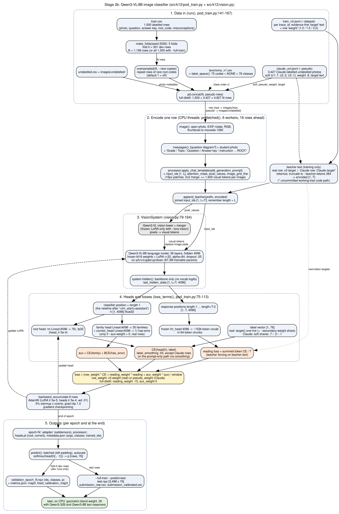
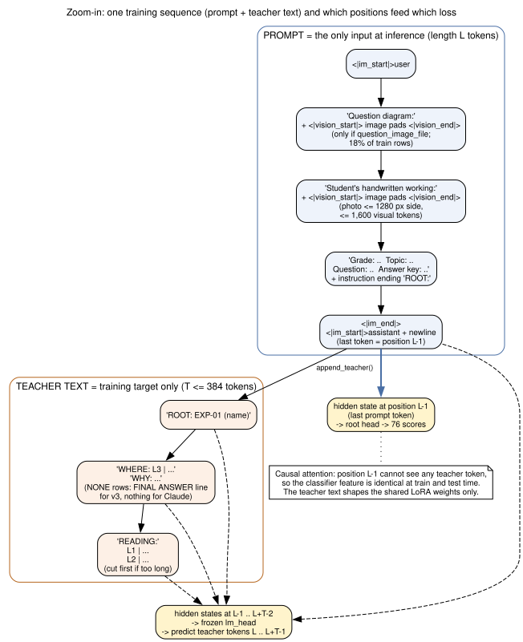
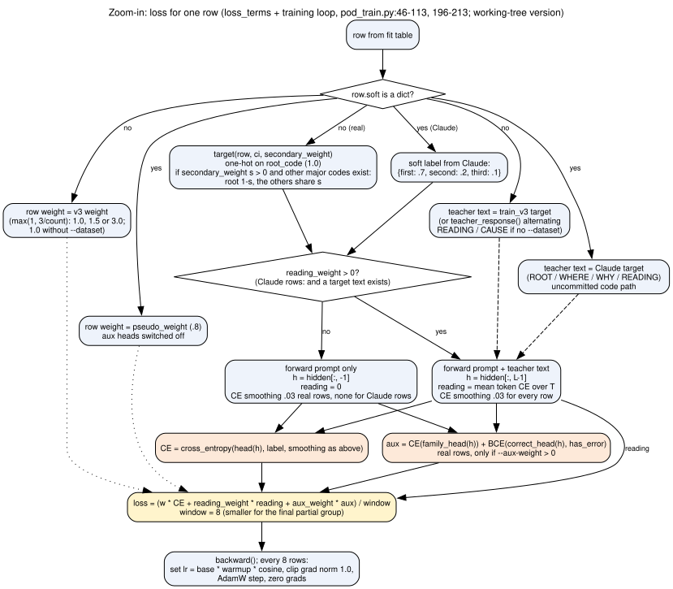

<a id="04-vision-classifier"></a>

# Stage 2b: the image classifier (Qwen3-VL-8B distilled from Claude)

## Stage 2b: the image classifier (Qwen3-VL-8B distilled from Claude)

### In one paragraph

This component looks straight at the student's photo and gives a probability for each of the 76 labels (75 taxonomy codes plus `NONE`). It is a Qwen3-VL-8B vision-language model with small trainable LoRA adapters and one new linear "root head" on top. The head reads the model's hidden state at the last prompt token.

Two things are added during training only:
- **A reading loss.** A language-modelling loss makes the same network also write a teacher explanation and transcription ("reading-weight").
- **Claude rows.** 3,427 unlabelled photos that Claude Opus labelled are added as soft-labelled rows. This is the "distilled from Claude" part.

At inference the model needs only the photo, the optional question diagram, the question, the answer key, the grade and the topic, so it runs offline. On the 301-row dev fold the distilled model (`runs/pod/dev-distill/validation_epoch_2.npz`) scores **MAP@3 0.6528** on its own. It is the `.35`-weight "VL distill" member of the 3-way blend that scored **0.7085 public**.



---

### 1. Words you need first

| Term | Plain meaning | Where it shows up here |
|---|---|---|
| **Vision-language model (VLM)** | A language model that also takes images. A vision tower cuts the photo into patches and turns them into "visual tokens". The language model reads those tokens alongside the text. | Qwen3-VL-8B, `vision.py:94-96` |
| **LoRA** (Low-Rank Adaptation) | The 8B weights stay frozen. Next to chosen weight matrices `W` (4096x4096 for `q_proj`) we add a small product `B·A`, where `A` is 32x4096 and `B` is 4096x32. Only `A` and `B` are trained. Each adapted matrix therefore gets 32·(4096+4096) = 262,144 new numbers instead of 16.8M. | `vision.py:114-125` |
| **QLoRA** | LoRA on a base model stored in 4-bit (NF4) to save memory. Only the frozen weights are quantised; the adapters stay in full precision. | `--load-4bit`, `vision.py:89-93`. Tried for a 32B classifier, which reached 0.403 dev after epoch 1 and was stopped (`docs/handoff.md`). |
| **Classification head** | One `nn.Linear(4096 -> 76)` that turns a 4096-number hidden vector into 76 scores. A softmax turns the scores into probabilities. | `vision.py:127` |
| **Cross-entropy (CE)** | The usual classification loss: −log(probability given to the right answer). With a *soft* target it becomes −Σ target_c · log p_c. | `pod_train.py:87, 94, 103` |
| **Label smoothing** | The target is softened from 1.0 on the right code to 0.97, and the remaining 0.03 is spread over all classes. This stops the model from becoming over-confident. | `label_smoothing=.03` at `pod_train.py:94` and `:103`. It applies to real rows, and also to Claude rows on the reading path (§6.2). |
| **Soft labels** | The target is a probability vector instead of a single code, for example `{OOO-01: .7, OOO-02: .2, INT-02: .1}`. | Claude rows, `pod_train.py:81-83` |
| **Distillation** | A small "student" model is trained to copy the outputs of a strong "teacher" (Claude). Here the student copies Claude's ranked codes. In the current working-tree code it can also copy Claude's written explanation (see the caveat in §6.3). | `--pseudo data/v3/claude_unl.jsonl` |
| **Teacher forcing / LM loss** | The real teacher text is fed in, and at each position the model is scored on predicting the next token. | `pod_train.py:105-113` |
| **Auxiliary (multi-task) heads** | Extra small heads trained on related questions ("which error family?", "is there any error?"), in the hope that they shape better shared features. | `auxiliary()`, `pod_train.py:67-72` |
| **Gradient accumulation** | Run 8 single-row passes, add up their gradients, then take one optimiser step. This acts like a batch of 8 without the memory cost. | `--accumulation 8` |
| **Gradient checkpointing** | Activations are not stored during the forward pass; they are recomputed during backward. This trades compute for memory. | `pod_train.py:178` |
| **MAP@3** | The competition metric. You give 3 ranked codes per row. A row scores 1, 1/2 or 1/3 if the true code is 1st, 2nd or 3rd, otherwise 0. The final number is the average over rows. | `core.py:38-51` |

---

### 2. Two scripts, one model class

- **`src/k12/vision.py`** holds the **shared model wrapper** `VisionSystem`, the prompt builder `messages()` and the image loader `image()`.
  - It also contains the original **Kaggle T4 recipe** `train()`: FP16, Qwen3-VL-4B, rank 16, a `--max-pixels 768*768` budget and `maxside` 1024.
  - That recipe produced the first public scores: 0.58216, then 0.598 after calibration.
- **`src/k12/pod_train.py`** is the **RunPod recipe** for the 8B model.
  - Its defaults are BF16, 1280-pixel images and rank 32.
  - It adds the reading loss, dataset v3, Claude pseudo rows, aux heads, secondary weights, rare copies and CPU prefetching.
  - Every 8B image model in this project came from this file.
- **`src/k12/pod_predict.py`** reloads a saved `epoch-N/` folder and scores any CSV by calling the same `predict()` function.

---

### 3. The input: what the model sees

#### 3.1 Loading a photo (`vision.py:50-57`)

```python
def image(data, split, filename, maxside=1024):
    candidates = [data/'images'/split/str(filename), data/str(filename)]
    path = next((p for p in candidates if p.is_file()), None)
    if path is None: raise FileNotFoundError(f'Missing {split} image: {filename}')
    with Image.open(path) as im:
        out=ImageOps.exif_transpose(im).convert('RGB')
    out.thumbnail((maxside,maxside));return out
```

- `exif_transpose` applies the phone's rotation flag, so sideways photos come out upright.
- `thumbnail` shrinks the image until its longer side is at most `maxside` (1280 on the pod). It keeps the aspect ratio and never enlarges.
- `split` picks the folder:
  - real training rows use `images/train`;
  - Claude rows use `images/unlabelled` (`encode_row`, `pod_train.py:42-43`);
  - test rows use `images/test`;
  - question diagrams use `images/questions`.

#### 3.2 The prompt (`vision.py:60-76`)

`messages()` builds a single user turn:
1. If the row has a `question_image_file` (18.2% of train rows), the text `Question diagram:` followed by that image.
2. `Student's handwritten working:` followed by the student photo.
3. A text block, `Grade / Topic / Question / Answer key`, then the instruction:

> "Read the student's actual reasoning. Identify the root major error that the rest of the work follows from, which need not be the first written error. NONE means no major error … Respect crossed-out corrections and do not invent missing steps.\nROOT:"

The same function also supports `task='transcribe'` (used by the transcriber stage) and `task='rank'`.

**What is *not* in the prompt:** the gold transcription, the annotations, `final_answer_correct` and the `question_id`. That is what "identical inputs at train and inference" means in the file docstrings.

#### 3.3 Tokenising (`vision.py:136-138`)

`processor.apply_chat_template(..., add_generation_prompt=True, return_dict=True, return_tensors='pt')` returns:
- `input_ids` `[1, L]`: text tokens, with placeholder `<|image_pad|>` tokens where the images go. Each image is wrapped in `<|vision_start|> … <|vision_end|>`.
- `attention_mask` `[1, L]`.
- `pixel_values` and `image_grid_thw`: the image patches.

The saved processor config (`runs/pod/full-distill/epoch-2/processor/processor_config.json`) sets:
- `patch_size 16` and `merge_size 2`;
- a total-pixel budget of 1,638,400 (= `--max-pixels 1280*1280`) and a minimum of 16,384 (= 128*128). The JSON stores these under the confusingly named keys `size.longest_edge` and `size.shortest_edge`, but they count pixels, not edge lengths.

One visual token therefore covers 32x32 pixels, so a 1280x1280 page becomes at most 1,600 visual tokens. Because `add_generation_prompt=True`, the sequence ends with `<|im_start|>assistant\n`; the saved chat template adds no system message.



#### 3.4 Keeping the GPU busy: `prefetched()` (`pod_train.py:28-39`)

```python
def prefetched(function, items, workers=6, ahead=16):
    with ThreadPoolExecutor(workers) as pool:
        queue = deque(pool.submit(function, item) for item in items[:ahead])
        for item in items[ahead:]:
            yield queue.popleft().result()
            queue.append(pool.submit(function, item))
        while queue:
            yield queue.popleft().result()
```

Decoding a JPEG, rotating it, resizing it and running the processor all happen on the CPU. Done one at a time, they would leave the GPU waiting between rows. This generator keeps up to 16 future rows "in flight" on 6 background threads. Because it pops from the left of a queue, it still **yields results in the original order**.

It is used in three places:
- training, over the shuffled row order (`pod_train.py:195`);
- `predict()`, over batches with `ahead=4` (`pod_train.py:127`);
- `transcriber.py`, which imports it (`transcriber.py:17`).

---

### 4. The model: `VisionSystem` (`vision.py:79-164`)

1. **Processor.** Loaded with `min_pixels=128*128` and `max_pixels=args.max_pixels`. The tokenizer uses `padding_side='left'` (`:85`). This matters for batched prediction; see §8.
2. **Base model.** `AutoModelForImageTextToText` in `--dtype bfloat16` on one GPU, with SDPA attention. If `--load-4bit` is set, it is quantised to NF4 instead (QLoRA).
3. **LoRA targets** (`:114-125`). Every `nn.Linear` inside `language_model` whose name ends in one of `q_proj, k_proj, v_proj, o_proj, gate_proj, up_proj, down_proj`. With `--lora-vision`, the vision tower's `qkv, proj, linear_fc1, linear_fc2` are added too (`full-distill` records `lora_vision: false`).
   ```python
   self.model=get_peft_model(self.base,LoraConfig(r=args.rank,lora_alpha=args.rank*2,
                lora_dropout=.05,target_modules=targets))
   ```
   - For `full-distill` this gives 36 layers x 7 matrices x (A, B) = 504 tensors and **87,293,952 trainable LoRA numbers**.
   - I counted these from the header of `adapter_model.safetensors` (349 MB, all tensors stored as F32).
   - `lora_alpha = 2·rank` (64 in `adapter_config.json`) means the adapter's output is scaled by alpha/r = 2.
4. **Heads** (`:127-128`). `head = Linear(4096 -> 76)` and `correct_head = Linear(4096 -> 1)`, both in float32. `heads.pt` stores `root.weight [76, 4096]`, `root.bias [76]`, `correct.weight [1, 4096]` and `correct.bias [1]`.
5. **Trainable parameters are cast to float32** (`:132-133`). The frozen base stays in BF16, while the LoRA weights and their optimiser state are fp32, which is more stable.
6. **`hidden()`** (`:140-143`):
   ```python
   def hidden(self,inp):
       inp={k:v.cuda() for k,v in inp.items() if k!='token_type_ids'}
       return self.model.get_base_model().model(**inp,use_cache=False).last_hidden_state
   ```
   - It calls the backbone (`.model`), not the full `ForConditionalGeneration` wrapper.
   - The model therefore returns hidden states `[1, L, 4096]` and **never computes the vocabulary logits (~152k tokens; the tokenizer has 151,669) for every position**.
   - For a 2,000-token prompt those logits would be about 0.6 GB in bf16, or 1.2 GB in fp32. This is an estimate, not measured.

---

### 5. The classification feature: "the last prompt token"

The classifier takes:
- `hidden[:, -1]` when there is no teacher text;
- `hidden[:, length-1]` when teacher text has been appended.

Both are the hidden state of the final newline token in `<|im_start|>assistant\n`. **No text is generated.**

Attention is causal, so this position has "seen" the photo, the question and the instruction. Its 4096 numbers summarise everything the model knows just before it would start answering. The root head maps that summary to 76 scores.

---

### 6. The losses (`loss_terms`, `pod_train.py:75-113`)



#### 6.1 Root-code target with an optional secondary share (`target`, `:46-57`)

```python
vector = torch.zeros(len(ci), device='cuda')
others = []
if secondary_weight > 0:
    findings = json.loads(str(row.misconceptions).replace('NaN', 'null'))
    others = sorted({f['category'] for f in findings if f.get('severity') == 'major' and not f.get('root')
                     and f.get('category') in ci} - {row.root_code})
vector[ci[row.root_code]] = 1 - (secondary_weight if others else 0)
for code in others:
    vector[ci[code]] += secondary_weight / len(others)
```

By default this is a one-hot vector. With `--secondary-weight s`, any *other* major, non-root errors that annotators marked get a total share `s`, and the root keeps `1 − s`. The idea is to teach ranks 2 and 3 about near-misses. `reports/dataset_v3.json` counts 203 rows with a secondary code and 234 with several major errors.

This was tested as run **D**, together with rare oversampling: dev 0.618 at epoch 3, against 0.619 for the plain run A, so **no gain**. The exact `s` and copy count used are not recorded in `docs/handoff.md`.

#### 6.2 Classification CE

- **Real rows:** `F.cross_entropy(head(h), label, label_smoothing=.03)`, at `:94` (prompt only) or `:103` (with teacher text).
- **Claude rows, two paths in the current working-tree code:**
  - If `reading_weight <= 0`, or the row has no target text, the code uses `F.cross_entropy(head(h), soft_label)` with **no smoothing** (`:87`).
  - Otherwise the row goes down the reading path to `:103`, which applies **`label_smoothing=.03` to the soft label as well**.
  - In the committed version, Claude rows always took the no-smoothing path (see the caveat in §6.3).

#### 6.3 The reading-weight LM loss (`:95-113`)

This is the key idea of run **B** ("teacher-transcription supervision"). Lines 97-113, without the comment and aux lines:

```python
encoded = system.processor.tokenizer(text, add_special_tokens=False, truncation=True,
                                     max_length=args.teacher_tokens, return_tensors='pt')['input_ids']
joined, length = append_teacher(prefix, encoded)
hidden = system.hidden(joined)
prefix_hidden = hidden[:, length - 1].float()
ce = F.cross_entropy(system.head(prefix_hidden), label, label_smoothing=.03)
lm_head = system.model.get_base_model().lm_head
response = hidden[:, length - 1:length + encoded.shape[1] - 1]
encoded = encoded.cuda()
reading = ce.new_zeros(())
for offset in range(0, encoded.shape[1], 64):
    logits = lm_head(response[:, offset:offset + 64]).float()
    reading = reading + F.cross_entropy(logits.reshape(-1, logits.shape[-1]),
                                        encoded[:, offset:offset + 64].reshape(-1), reduction='sum')
return ce, reading / encoded.shape[1], aux
```

Step by step:
1. **Append.** The teacher text (up to `--teacher-tokens 384`) is tokenised and **appended after the prompt** by `append_teacher` (`reading_finetune.py:36-44`). That function extends `input_ids` and the attention mask with ones, and any `token_type_ids` / `mm_token_type_ids` with zeros. The image tensors are unchanged.
2. **One forward pass** covers prompt plus teacher text.
3. **Classifier position.** The classifier reads position `length-1`. Attention is causal (each token sees only earlier tokens), so this position **cannot see the teacher text**. Its feature is computed exactly as at test time, when there is no teacher text.
4. **Next-token predictions.** Positions `length-1` to `length+T-2` each predict the *next* teacher token. They go through the model's own `lm_head` (4096 -> vocabulary), which is frozen because LoRA does not target it. The work is done in **64-token chunks**, so the full `[T, ~152k]` logit matrix never sits in memory at once.
5. **Average.** The summed token CE is divided by `T` to give a per-token average.

**Why it helps.** To write "WHERE: L3 | 27 : 3 = …", the shared LoRA weights must learn to actually *read the handwriting* and locate the error, and that improves the feature the classifier uses.

**Measured on dev:** A (CE only) scored 0.619 and B (reading weight 0.15) scored **0.632** at epoch 3. The paired question-bootstrap 95% interval for B against the submitted 4B reference is [−0.014, +0.060] (`reports/pod_8b_read_dev.json`). The gain is suggestive but not statistically certain.

**Which teacher text?**
- **No `--dataset`:** `teacher_response()` (`reading_finetune.py:25-33`) alternates by row index between `ROOT: X\nREADING: <gold transcription>` and `ROOT: X\nCAUSE: <annotator root text>`. The `index` argument (`k + epoch`, `pod_train.py:198`) exists only for this alternation.
- **With `--dataset train_v3.jsonl`:** the v3 "evidence-first" target (`scripts/build_dataset_v3.py:33-45`), described in §7.
- **Claude rows:** Claude's own `ROOT (name) / WHERE / WHY / READING` text (`scripts/build_claude_distill.py:56-58`). `NONE`-first rows get only `ROOT: NONE (no major misconception)` plus `READING`.

**Caveat: was Claude's text actually used?**
- The code path that uses this text for pseudo rows (`pod_train.py:84-88, 164`) is an **uncommitted** change in the working tree. The committed version (97b4e98) gave Claude rows soft CE only, with no smoothing.
- The run metadata records arguments but not the code version.
- File timestamps point one way. The commit is 03:55 UTC on 11 Nov. `pod_train.py` was last modified at 04:23 UTC, `claude_unl.jsonl` was built at 04:27 UTC, and the `dev-distill` results arrived at 07:23 UTC. So both distill runs **probably** used Claude's text as an LM target, but this is **not recorded**.

#### 6.4 Auxiliary heads (`auxiliary`, `:67-72`)

```python
family = torch.tensor([families[row.root_code.split('-', 1)[0].upper()]], device='cuda')
error = torch.tensor([float(row.root_code != 'NONE')], device='cuda')
return (F.cross_entropy(family_head(hidden), family)
        + F.binary_cross_entropy_with_logits(system.correct_head(hidden).view(-1), error))
```

- **Family head:** a new `Linear(4096 -> 35)`. The 35 families are the code prefixes (`EXP`, `FRA`, `ALG`, … plus `NONE`), built at `:184`.
- **Has-error head:** reuses `correct_head`, with BCE on "root_code ≠ NONE". In the old Kaggle `vision.py` recipe, this same head predicted `final_answer_correct` with weight 0.2 (`vision.py:208-210`).
- **When they are on:** only when `--aux-weight > 0`, and only for real rows. Pseudo rows either return early or set `family_head = None` (`:88`).

The heads were motivated by the failure analysis in `docs/handoff.md`: "68% of lost points are 'saw an error but named the wrong error family'". They were measured as run **E** (`runs/pod/dev-aux`): dev 0.613 at epoch 3 against 0.619 for A, so **no gain**. `full-distill` records `aux_weight 0`.

#### 6.5 Total loss and optimiser (`pod_train.py:196-213`)

```python
if isinstance(row.get('soft'), dict):
    weight = row.pseudo_weight
else:
    weight = args.v3[row.trace_id]['weight'] if args.v3 else 1.
((weight * ce + args.reading_weight * reading + args.aux_weight * aux) / window).backward()
...
if (k + 1) % args.accumulation == 0 or k + 1 == len(order):
    factor = min(1., (step + 1) / max(1, .05 * updates)) * .5 * (1 + math.cos(math.pi * step / max(1, updates)))
    optimizer.param_groups[0]['lr'] = args.lr * factor
    optimizer.param_groups[1]['lr'] = args.head_lr * factor
    torch.nn.utils.clip_grad_norm_(params + heads, 1.)
    optimizer.step(); optimizer.zero_grad(set_to_none=True); step += 1
```

- **Row weight.** It multiplies **only the classification CE**, not the reading loss.
- **`window`.** Dividing by `window` (normally 8, smaller for the last partial group) makes the accumulated gradient an average.
- **Learning-rate schedule.** A linear warm-up over the first 5% of updates, multiplied by a cosine decay to 0.
- **Two learning rates.** LoRA uses `5e-5`. The heads use `5e-4`, ten times higher, because they start from random.
- **Optimiser.** AdamW with weight decay 0.01 and a gradient-norm clip of 1.0.
- **Precision.** `torch.autocast(bfloat16)` (`:197`) runs the matrix maths in BF16, while the heads and losses are computed in fp32 (`.float()`).

---

### 7. Training data: dataset v3, rare copies, Claude rows

#### 7.1 Dataset v3 (`scripts/build_dataset_v3.py`, `data/v3/train_v3.jsonl`)

There is one JSON line per training row, with `root_code`, `family`, `has_error`, `secondary_codes`, `weight`, `target` and `flags`. `reports/dataset_v3.json` reports 1,500 rows, 35 families and 29 up-weighted rows.

**Evidence-first target.** The text puts the decision-relevant part first, so that 384-token truncation cuts the tail (the transcript), not the reason:
```
ROOT: EXP-01 (Power = base × exponent)
WHERE: L1 | <span of the root step>
WHY: <annotator explanation>
READING:
L1 | ...
```
`NONE` rows get `ROOT: NONE (no major misconception)\nFINAL ANSWER: matches/does not match the key`, followed by `READING:`.

**How much gets cut.** I measured token lengths for this guide with the saved tokenizer, with truncation turned off:

| Targets | Median | 90th percentile | Maximum | Over 384 tokens |
|---|---|---|---|---|
| v3 | 207.5 | 349 | 699 | **5.9%** |
| Claude (`claude_unl.jsonl`) | 232 | 364 | 869 | **6.7%** |

**Row weights** (`build_dataset_v3.py:78`): `weight = max(1, 3 / count(root_code))`. A code seen once gets 3.0 and a code seen twice gets 1.5. The actual distribution is 1,471 rows at 1.0, 16 at 1.5 and 13 at 3.0.

Run **v3** (B with these targets) scored dev 0.627 at epoch 2 and 0.6285 at epoch 3. That is level with B (0.632), not better.

#### 7.2 Rare copies (`oversampled`, `pod_train.py:60-64`)

```python
counts = fit.root_code.map(fit.root_code.value_counts())
copies = np.clip(np.ceil(max_copies / counts), 1, max_copies).astype(int)
return fit.loc[fit.index.repeat(copies)].reset_index(drop=True)
```

- **Rule.** With `--rare-copies 3`, a code seen once is repeated 3 times and a code seen twice is repeated twice (ceil(3/2) = 2). Codes with 3 or more examples are left alone.
- **Effect on all 1,500 train rows** (computed for this guide): the table grows to 1,542 rows with 3 copies, 1,513 with 2 and 1,591 with 5.
- **Order.** It runs **before** Claude rows are added, so Claude rows are never duplicated.
- **Verdict.** It is a cruder relative of the v3 row weights, and it was part of the no-gain run D.

#### 7.3 Claude pseudo rows (`pod_train.py:158-167`, `scripts/build_claude_distill.py`)

1. **Labelling.** Claude Opus (`claude-opus-5-5`, `scripts/claude_label.py:23`) looked at **unlabelled** photos, never test photos. For each photo it returned `transcription`, `root_line`, `reasoning` and `first/second/third_code`.
2. **Conversion.** `build_claude_distill.py` turns each answer into a training row:
   - a soft label `{first: .7, second: .2, third: .1}` (shares add up if codes repeat);
   - `weight = .8` by default. The later v3 and v4w builds also use `.5` for error answers longer than 700 output tokens and `1.0` for rare first codes;
   - a target text.

   It then caps rows whose first code is `NONE` at one third of the output, because (per the script's help text) the unlabelled pool contains far more correct work than test does.
3. **The file used here.** The distill runs used `data/v3/claude_unl.jsonl`. `full-distill`'s metadata names `/workspace/data/claude_unl.jsonl` on the pod, and its row count matches. Counted for this guide, the file has **3,427 rows**: all weight 0.8, all with three distinct codes and a target, 1,142 of them `NONE`-first.
4. **Later builds.** They have 6,764 rows (`reports/claude_distill_v3.json`) and 11,426 rows (`reports/claude_distill_v4*.json`). I found no image-model run in `runs/pod` that used them; they fed the text-model experiments.
5. **Joining.** In `run()`, these rows are joined to `unlabelled.csv`, which supplies the grade, topic, question, answer key and image file. The pseudo-label table is stored in new columns `soft`, `pseudo_weight` and `target`, and `root_code` is set to the arg-max code. The rows are then concatenated to the fit table. For `full-distill`, `metadata.json` records `fit_rows: 4927` = 1,500 + 3,427.

There is also an older self-training file, `data/v3/pseudo_v3.jsonl`.
- It has 1,565 rows kept from 9,602 scored unlabelled photos, using confidence ≥ 0.5 on the project's own 8B predictions, with weight 0.5 (`reports/pseudo_v3.json`).
- It has no target text, so its rows always take the soft-CE, prompt-only path through the same `--pseudo` option.
- I found no dev score for an image run trained on it in the reports.

---

### 8. Prediction, saving, validation (`pod_train.py:116-138, 222-238`)

**predict()**
- It groups rows into batches (`--batch-size`, 4 in `full-distill`).
- Each batch is built with the chat template using `padding=True` and **left padding**: short prompts are padded at the *start*, so position `-1` is the real last token for every row.
- It runs under autocast and takes `softmax(head(hidden[:, -1]))`.
- The result goes to `save_bundle()` (`core.py:97-103`), which writes `.npz` files holding `ids`, `classes`, `p` (rows x 76, with rows renormalised) and `meta`.

**After each epoch** the loop does three things:
- It saves `epoch-N/`, containing:
  - `adapter/` (LoRA safetensors and config) and `processor/`;
  - `heads.pt`;
  - `metadata.json`: args, GPU, library versions, SHA-256 hashes of the model config and `train.csv`, class order, `fit_rows`, `trained_ids`.
- Unless `--full-train` is set, it predicts the 301 dev rows into `validation_epoch_N.npz`.
- It writes `metrics.json` with raw `map3` and `fixed_calibration_map3`.

**Fixed calibration** (`holdout_calibration.calibrated`, `:12-14`) works in two steps:
1. It softens the probabilities with temperature 2 (`p^(1/2)`, renormalised).
2. It mixes in 25% of a `HierarchicalPrior`, which is a smoothed per-question and per-topic code frequency (`baseline.py:13-36`).

**`--full-train --predict-test`** trains on all 1,500 rows plus the pseudo rows, with no dev scoring. It then writes `test.npz` (3,498 x 76), `submission_raw.csv` and `submission_calibrated.csv`. `full-distill` was run this way on an RTX A6000 (`runs/pod/full-distill/epoch-2/metadata.json`), with:
- `epochs 2`, `rank 32`;
- `reading_weight 0.15`, `aux_weight 0`;
- `dataset train_v3.jsonl` and `pseudo claude_unl.jsonl`.

**Two different models.**
- The dev number comes from `dev-distill`, which by design was trained on the 1,199 fit rows plus the Claude rows. Its own `metadata.json` was not copied back to this Mac, so its exact arguments are not recorded locally.
- The test predictions come from a separate model, `full-distill`, trained on all 1,500 rows plus the Claude rows.

This keeps the dev score honest, but the test model itself was never scored.

---

### 9. Results (dev = fold 0, 301 rows)

| Run | What changed | Dev MAP@3 | Source |
|---|---|---|---|
| 4B original (`vision.py` Kaggle recipe) | — | 0.5952 raw, 0.607 calibrated | `runs/arch/ensemble-anatomy/anatomy.json`, `reports/pod_8b_cls_dev.json` |
| A `dev-cls` | 8B, CE only | 0.550 / 0.604 / **0.619** (epochs 1/2/3) | handoff, `pod_8b_cls_dev.json` |
| B `dev-read` | + reading LM loss 0.15 | 0.557 / 0.615 / **0.632** | handoff, `pod_8b_read_dev.json` |
| D | A + secondary soft labels + rare copies | 0.529 / 0.611 / 0.618 | handoff |
| E `dev-aux` | A + family and has-error heads | 0.524 / 0.617 / 0.613 | handoff |
| v3 `dev-v3` | B + dataset v3 targets and weights | 0.539 / 0.627 / 0.6285 | handoff, anatomy.json |
| 32B QLoRA classifier | bigger base, 4-bit | 0.403 at epoch 1 (stopped) | handoff |
| **`dev-distill`** | v3 recipe + Claude rows (assumed same arguments as `full-distill`; not recorded locally) | **0.6528** (epoch 2) | anatomy.json, `balance_generality.json` |
| Claude Opus zero-shot (oracle, not deployable) | — | 0.8189 | `reports/claude_dev_opus.json` |

**Extra numbers for `dev-distill`:**
- **Calibration.** Top-1 accuracy is 0.558. With the fixed T=2 / 25%-prior calibration it scores **0.6262**, so calibration *hurts* this model, and the raw probabilities go into the blend. Both numbers were computed for this guide with `core.map3`.
- **By row group** (`runs/arch/ensemble-anatomy/anatomy3.json`):
  - 0.7875 when the true code had already appeared for that question in the fit rows (149 rows);
  - 0.4985 when the question was known but the code was new for it (113 rows, including NONE rows where NONE was new);
  - 0.5855 on questions not seen at all (39 rows).

  This is the "memorising" pattern. `runs/arch/PLAN.md` identifies codes that are new for a known question as the main gap to Claude.
- **Sinkhorn label balancing** (explained in the combiner section), applied to this model alone, gives 0.6645 at λ=0.5 and 0.6744 at λ=1.0 (`runs/arch/label-structure/balance_generality.json`).

**Public scores that include this model** (`reports/status.json`):

| Submission | Blend | Public | Dev |
|---|---|---|---|
| 58234705 | Qwen3-8B text reasoner x VL distill, 50/50 geometric | **0.68283** | 0.6932 |
| 58240192 | 3-way geometric: .35 (32B text) / .30 (8B text) / .35 (VL distill) | **0.7085** | 0.7182 |

The 3-way weights were picked on dev; cross-fitted weights give 0.706 (`PLAN.md`).

A **geometric blend** multiplies the models' probabilities, each raised to its weight (`p = Π p_i^{w_i}`, then renormalised). A label ranks high only if *every* model gives it reasonable probability.

Training time and cost for the distill runs are **not recorded** in the files I read; `reports/runpod_budget.json` has no distill entry.

---

### Key files

- `src/k12/pod_train.py`: RunPod trainer and predictor. `prefetched` :28, `target` :46, `oversampled` :60, `auxiliary` :67, `loss_terms` :75, `predict` :116, `run` :141, CLI `parser` :242.
- `src/k12/vision.py`: `image` :50, `messages` :60, `VisionSystem` :79 (LoRA :114, heads :127, `encode` :136, `hidden` :140, `save` :159), old Kaggle `train` :167.
- `src/k12/reading_finetune.py`: `teacher_response` :25, `append_teacher` :36.
- `src/k12/pod_predict.py`: rescoring a saved checkpoint.
- `src/k12/core.py`: `label_space` :18, `topk` :31, `map3` :50, `make_folds` :64, `save_bundle` :97.
- `src/k12/holdout_calibration.py` (`calibrated` :12) and `src/k12/baseline.py` (`HierarchicalPrior` :13).
- `scripts/build_dataset_v3.py` -> `data/v3/train_v3.jsonl`, `reports/dataset_v3.json`.
- `scripts/build_claude_distill.py` -> `data/v3/claude_unl*.jsonl`, `reports/claude_distill*.json`.
- `runs/pod/dev-distill/validation_epoch_2.npz` (dev probabilities), `runs/pod/full-distill/epoch-2/` (checkpoint), `runs/pod/full-distill/test.npz`.
- `reports/pod_8b_cls_dev.json`, `reports/pod_8b_read_dev.json`, `runs/arch/ensemble-anatomy/anatomy*.json`, `docs/handoff.md`, `runs/arch/PLAN.md`.

---

### Things to try yourself (CPU only)

**1. Score the dev bundle.** This should print `301 0.6528…` and then `0.6262…`:
```python
# run from the repo root with: PYTHONPATH=src python3
from k12.core import read_csv, label_space, make_folds, map3, aligned_bundle
from k12.baseline import HierarchicalPrior
from k12.holdout_calibration import calibrated
tr = read_csv('data/raw/train.csv'); cl = label_space(read_csv('data/raw/taxonomy_v1.csv'))
f = make_folds(tr); fit, val = tr[f != 0], tr[f == 0].reset_index(drop=True)
p = aligned_bundle('runs/pod/dev-distill/validation_epoch_2.npz', val.trace_id.tolist(), cl)
print(len(val), map3(val.root_code, p, cl))
prior = HierarchicalPrior(cl).fit(fit).predict_proba(val)
print(map3(val.root_code, calibrated(p, prior, .25, 2.), cl))
```
Extension: loop over `w in [0, .1, .25]` and `T in [1, 2]` to see which calibration settings help. Then split the score by `val.root_code == 'NONE'`.

**2. Look inside the checkpoint.**
- Run `torch.load('runs/pod/full-distill/epoch-2/heads.pt', map_location='cpu', weights_only=True)` and print the shapes. You should see `root.weight [76, 4096]` and `correct.weight [1, 4096]`, plus their biases.
- Read the JSON header of `adapter/adapter_model.safetensors`. The first 8 bytes give the header length (little-endian), and the header lists every tensor's shape.
- Count the parameters (87,293,952), and check that `q_proj` has `lora_A [32, 4096]` and `lora_B [4096, 32]`.

**3. Rebuild the targets by hand.**
- `from k12.pod_train import oversampled` runs on CPU. Call `oversampled(tr, 3)` and confirm it returns 1,542 rows. Which codes were copied, and how many times?
- `target()` creates its tensor on `cuda`. Copy it into your notebook with `device='cpu'`, then print the label vector for a row that has secondary codes in `train_v3.jsonl`, using `s=.2`.

**4. Check how much teacher text is cut off.**
- Load `runs/pod/full-distill/epoch-2/processor/tokenizer.json` with `tokenizers.Tokenizer.from_file`. **Call `.no_truncation()` first**, because the saved file has a 384-token truncation setting baked in.
- Measure the token lengths of the `target` fields in `train_v3.jsonl` and `claude_unl.jsonl`. You should find about 6–7% over 384.
- Read one long target and see which part is lost.

---

### Common confusions

- **"Does the model generate the answer?"** No. It reads one hidden vector at the last prompt token and applies a linear head. The text after `ROOT:` is only a training target. Prediction is a single forward pass, and nothing is decoded.
- **"Does the teacher transcription leak into predictions?"** No. It is appended *after* the classifier position, and causal attention stops that position from looking ahead. At inference no teacher text exists, and the feature is computed the same way.
- **Four different weights.**
  - `weight` / `pseudo_weight` scale the per-row classification CE.
  - `--reading-weight` scales the LM loss.
  - `--aux-weight` scales the family and has-error losses.
  - `--secondary-weight` changes the *target vector*, not the loss scale.
- **`correct_head` in `heads.pt`.** In `full-distill`, `aux_weight=0`, so `correct_head` is never in the optimiser. What is saved is its random (seeded) initial value, and it should be ignored. `pod_train.predict()` does not use it either; only the old `VisionSystem.predict()` reports it.
- **"Distilled" does not mean Claude runs at test time.** Claude labelled training and unlabelled photos only. The final predictions come from the offline Qwen3-VL-8B checkpoint.
- **Dev model vs test model.** `validation_epoch_2.npz` comes from `dev-distill` (fit rows plus Claude rows). `test.npz` comes from `full-distill` (all 1,500 rows plus Claude rows). The 0.6528 is an estimate for a sibling model, not a score of the shipped one.
- **Label smoothing on Claude rows depends on the path.** In the current working-tree code, smoothing is skipped only when a Claude row goes through the prompt-only branch (`:87`). That happens with no target text or `reading_weight <= 0`. With reading on and a target present, as in `full-distill`, line 103 applies 0.03 smoothing to the soft label too. The committed version always skipped it.
- **Rare copies and v3 weights both target rare codes, in different ways.**
  - Copies repeat rows: more gradient steps, and the image is seen several times.
  - Weights scale the loss of a single pass.
  - Neither showed a measurable dev gain alone.
  - Claude rows add genuinely new examples of rare codes, but only a few in the file used here. For example, `MEA-05` has 2 train rows and 3 Claude first-code rows in the 3,427-row `claude_unl.jsonl`. The later 6,764-row build has 16 (`reports/claude_distill_v3.json`).
- **Why batch prediction pads on the left.** Taking `[:, -1]` must hit each row's real last token. With right padding, short prompts would end in pad tokens.

