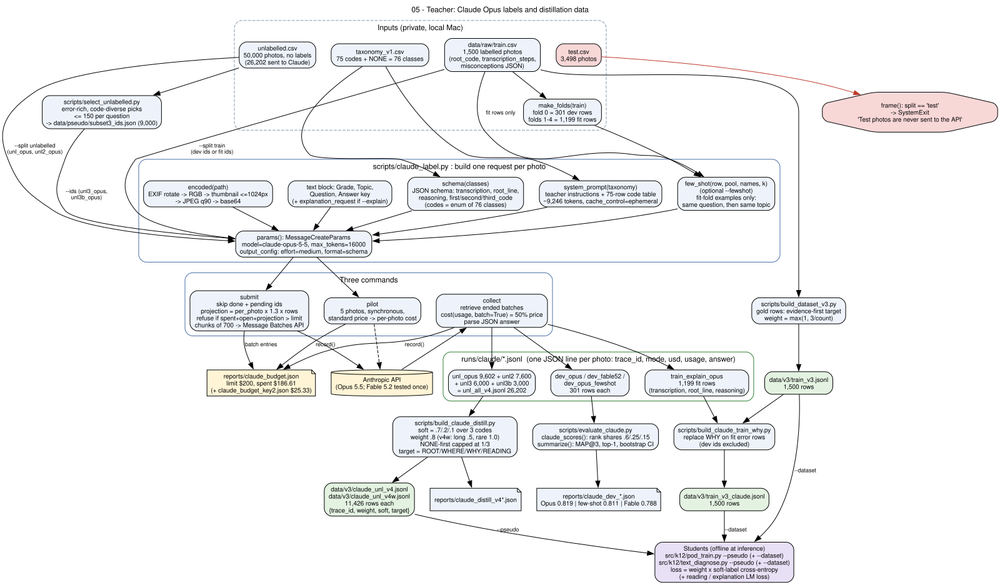
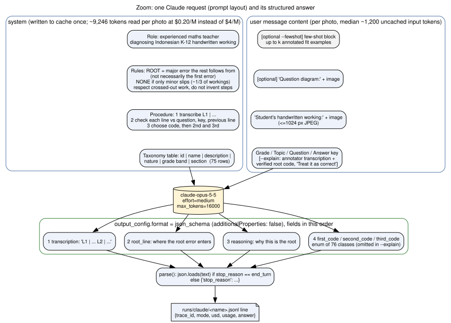
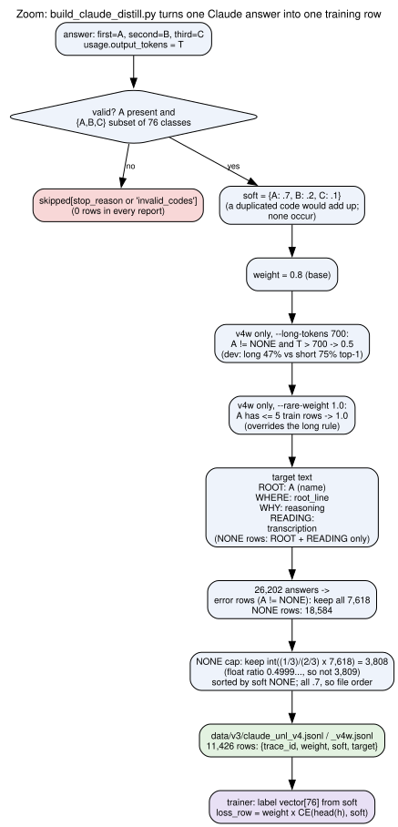

<a id="05-teacher"></a>

# The teacher: Claude Opus labels and distillation data

## The teacher: Claude Opus labels and distillation data

### In one paragraph

Our offline models learn from more than the 1,500 human-labelled photos. They also learn from a **teacher**: Claude Opus 5.5, called through the paid Anthropic API on **training and unlabelled photos only, never test photos**. For each photo, `scripts/claude_label.py` asks Claude for four things in a fixed JSON format: a line-by-line transcription, the line where the root error enters, a short explanation, and its three most likely misconception codes. On the 301-photo dev fold, that zero-shot answer scores **MAP@3 0.819**. Our best offline blend scores 0.718 (about 0.706 once its weights are cross-fitted). `scripts/build_claude_distill.py` turns Claude's answers on 26,202 unlabelled photos into 11,426 soft-labelled training rows. The soft shares are .7/.2/.1, each row has a weight, and NONE is capped at 1/3 of the rows. `scripts/build_dataset_v3.py` builds the matching gold rows from the 1,500 labelled photos. The students learn from both, and only those offline students make the final predictions. Two students are documented as trained on these rows: the Qwen3-VL-8B image classifier and the Qwen3-8B text models. The API cost $186.61 on the main key and $25.33 on a second key.



---

### 1. Concepts you need first

| Term | Plain meaning | Where it shows up here |
|---|---|---|
| **Teacher / student (distillation)** | A strong, expensive model (the teacher) labels data. A smaller, cheaper model (the student) is trained to copy those labels. At inference, only the student runs. | Claude is the teacher. Two students are documented as trained on Claude rows: the Qwen3-VL-8B image classifier (`runs/pod/dev-distill`) and the Qwen3-8B text models (scaling study). No file checked records whether the 32B text model used Claude rows. |
| **Pseudo-label** | A label produced by a model rather than a human. It is noisy, but it is cheap and there are many of them. | Claude's codes on 26,202 of the 50,000 unlabelled photos. |
| **Soft label** | Instead of "the answer is A" (one-hot), the target is a distribution such as A 0.7, B 0.2, C 0.1. The student is rewarded for putting some probability on near-misses too. | `soft = {A: .7, B: .2, C: .1}` in every distillation row. |
| **Row weight** | A multiplier on one row's loss. A weight of 0.5 means "learn half as much from this row". | Claude rows: 0.8 normally, 0.5 for low-confidence ones in v4w. Gold rows: up to 3.0 for very rare codes, but only in the image trainer with `--dataset`; the text trainer gives every gold row 1.0. |
| **MAP@3** | The competition metric. You submit 3 ranked codes per photo. You get 1 point if the true code is 1st, 1/2 if 2nd, 1/3 if 3rd and 0 otherwise, averaged over photos. | `row_scores` / `map3` in `src/k12/core.py:38-51`. |
| **Batch API** | You send many requests at once and collect the results later (asynchronously). It costs **half price**. | `submit` / `collect` commands. |
| **Prompt caching** | If many requests start with the same long prefix, the API stores it once. Later requests read it at 1/20 of the normal input price ($0.20/M instead of $4/M for Opus). | The ~9,246-token system prompt (instructions + taxonomy table). |
| **Structured output (JSON schema)** | The API forces the reply to match a JSON schema, so it always parses. Enum fields can only take allowed values. | The `transcription / root_line / reasoning / first_code / second_code / third_code` schema. |
| **Paired question bootstrap CI** | Resample *questions* (not rows) 2,000 times with replacement, recompute the per-row score difference between two systems each time, and take the 2.5% and 97.5% quantiles. If the interval excludes 0, the difference is probably real. Grouping by question matters because photos of the same question are correlated. | `summarize()` in `scripts/evaluate_working_verifier.py:154-171` (seed 2026). |
| **Dev fold / fit folds** | `make_folds(train)` (`src/k12/core.py:64`) splits the 1,500 labelled photos into 5 folds. Fold 0 (301 rows) is the development set. The other 1,199 rows are "fit" rows used for training. | Every dev number in this section is on fold 0. |

---

### 2. Why this is allowed (and where the line is)

- **Competition rule.** The organiser forbids external APIs in the *final solution* and requires offline reproducibility. A follow-up reply allows commercial-API pseudo-labels on **train/unlabelled data** (cited in `docs/competition_research.md:24`). The same line also says "we use no paid APIs". That sentence predates 11 Nov and is now out of date.
- **User authorisation.** AGENTS.md, 11 Nov 2026: the paid Claude API may be used *"for training and unlabelled photos only, never test photos. Final predictions must come from offline models."* The working limit is $200, tracked in `reports/claude_budget.json`.
- **The code enforces it.** `frame()` refuses the test split before any image is read:

```python
# scripts/claude_label.py:165-173
def frame(args):
    if args.split == 'test':
        raise SystemExit('Test photos are never sent to the API')
    data = Path(args.data)
    rows = read_csv(data / ('train.csv' if args.split == 'train' else 'unlabelled.csv'))
    if args.ids:
        keep = json.loads(Path(args.ids).read_text())
        rows = rows.set_index('trace_id').loc[keep].reset_index()
    return rows
```

- **Dev labels are measurement only.** Claude's answers on the 301 dev photos are used only to *score* Claude. `runs/arch/PLAN.md` tags anything that uses them **O = oracle**. They are never training data. Few-shot examples come only from fit folds (`claude_label.py:215-216`: `pool = train[make_folds(train) != 0]`). `build_claude_train_why.py:18-23` drops dev IDs, and none of the 1,199 explain rows is a dev ID (checked).
- **No test hand-labelling.** No human or API looks at test photos. The test CSV is produced by offline students only, and every submission still needs the user's explicit OK.

---

### 3. `scripts/claude_label.py`: asking the teacher



#### 3.1 Model, prices, budget files

```python
# scripts/claude_label.py:23-31
MODEL = 'claude-opus-5-5'
# USD per million tokens (Anthropic pricing page, 11 Nov 2026); batch requests cost half.
PRICES = {'claude-opus-5-5': {'input_tokens': 4.0, 'output_tokens': 20.0, 'cache_read_input_tokens': .2,
                              'cache_creation_input_tokens': 5.0},
          'claude-fable-5-2': {'input_tokens': 8.0, 'output_tokens': 40.0, 'cache_read_input_tokens': .2,
                               'cache_creation_input_tokens': 10.0}}
RATES = PRICES[MODEL]
BUDGET = Path('reports/claude_budget.json')
KEY = Path.home() / '.config/k12/anthropic_key'
```

`cost(usage, batch)` (lines 40-42) multiplies each usage field by its rate and halves the total for batch requests. `record()` (lines 49-54) appends a timestamped log entry to the budget file and adds the amount to `spent_usd`. `configure()` (lines 176-179) lets one run switch model, key file and budget file. That is how the Fable test and the `unl3b_opus` run were charged to the second key and logged in `reports/claude_budget_key2.json`. The key file is read (line 36) but never printed.

#### 3.2 The system prompt (cached)

`system_prompt(taxonomy)` (lines 57-71) builds one long string in three parts:
1. **Role and rules.** "You are an experienced mathematics teacher…". The ROOT is *the major error the rest of the working follows from, not necessarily the first error*. Claude should answer NONE when there are only minor slips. "About a third of workings are NONE, and false alarms on correct work are as harmful as missed errors." It must respect crossed-out work and must not invent steps.
2. **Procedure.** Transcribe as `L1 | ...`, check each line against the question, the key and the previous line, choose a code, then give a 2nd and a 3rd.
3. **The taxonomy table.** One line per code: `id | name | description | nature | grade band | section`. There are 75 codes; adding NONE gives a label space of 76 classes (`label_space()` in `src/k12/core.py:18-19`).

Every request sends this same text, so it is marked `cache_control: ephemeral` (line 155). In the `unl_opus` run, 1 request wrote the cache and **9,601 of 9,602 read it**. Each read covered a median of **9,246 tokens** at $0.20/M instead of $4/M (measured from `usage` in `runs/claude/unl_opus.jsonl`). Rough arithmetic (an estimate, not measured): without caching, each batch photo would cost about 9,246 × ($4 − $0.20)/M × 0.5 ≈ **$0.018 more**. That is about 3.4× the observed $0.0073.

#### 3.3 The per-photo user message

`params()` (lines 144-157) assembles the content blocks in this order:

```python
# scripts/claude_label.py:145-157
content = [{'type': 'text', 'text': shots}] if shots else []
if str(row.question_image_file).strip():
    content += [{'type': 'text', 'text': 'Question diagram:'},
                encoded(images / 'questions' / row.question_image_file)]
content += [{'type': 'text', 'text': "Student's handwritten working:"}, encoded(images / split / row.image_file),
            {'type': 'text', 'text': f'Grade: {row.grade}\nTopic: {row.topic_name}\nQuestion: {row.question_text}\n'
                                     f'Answer key: {row.correct_answer}'
                                     + (explanation_request(row, names) if names else '')}]
return MessageCreateParamsNonStreaming(
    model=MODEL, max_tokens=16000,
    system=[{'type': 'text', 'text': system, 'cache_control': {'type': 'ephemeral'}}],
    output_config={'effort': effort, 'format': schema(classes, explain=bool(names))},
    messages=[{'role': 'user', 'content': content}])
```

- `encoded()` (lines 90-97) fixes phone rotation (`exif_transpose`), converts the photo to RGB and shrinks it so its long side is at most 1024 px. It then saves it as JPEG quality 90 and base64-encodes it. The median uncached input per photo is about 1,160-1,200 tokens (image + text).
- `effort='medium'` (CLI default, line 190) controls how much the model thinks before answering.
- `max_tokens=16000` is generous. The median output was 515 tokens on dev and about 366 on unlabelled photos. No run had a truncated or refused answer: across all eight runs, 0 rows had a non-`end_turn` stop reason (checked in the JSONL files).

#### 3.4 The structured output schema

```python
# scripts/claude_label.py:81-87
code = {'type': 'string', 'enum': classes}
return {'type': 'json_schema', 'schema': {
    'type': 'object', 'additionalProperties': False,
    'required': ['transcription', 'root_line', 'reasoning', 'first_code', 'second_code', 'third_code'],
    'properties': {'transcription': {'type': 'string'}, 'root_line': {'type': 'string'},
                   'reasoning': {'type': 'string'}, 'first_code': code, 'second_code': code,
                   'third_code': code}}}
```

The order of the fields matters. The model writes the **transcription first, then the root line, then the reasoning, and only then the codes**. That is "reason, then decide". The code fields are an `enum` of the 76 classes, so Claude cannot invent a code. That is why every distillation report shows `"skipped": {}`. `parse()` (lines 160-162) loads the JSON. If generation did not finish normally, it stores `{'stop_reason': ...}` instead.

#### 3.5 Two optional modes

- **`--fewshot k`** (`few_shot()`, lines 116-141) puts up to *k* annotated **fit-fold** examples in front of the photo, same-question examples first and then same-topic ones. A CRC32 hash of the two trace IDs gives a deterministic "random" order. Each example shows the question, key, transcription, root code and the annotator's explanation. It raised the median uncached input from 1,201 to 2,796 tokens. The value of *k* used for `dev_opus_fewshot` is not recorded in the reports.
- **`--explain`** (`explanation_request()`, lines 100-113) works on the train split only (checked at lines 204-205; line 202-203 also forbids combining it with `--fewshot`). It gives Claude the annotators' transcription *and* the verified root code ("Treat it as correct") and asks only *why*. The schema then drops the code fields (lines 75-80). This produced `runs/claude/train_explain_opus.jsonl` (1,199 fit rows). There is a caveat in `runs/arch/PLAN.md` §1: these label-conditioned explanations mention answer-key numbers in 58% of rows, against 88% for Claude's own zero-shot reasoning.

#### 3.6 The three commands and the budget guard

| Command | What it does | Price |
|---|---|---|
| `pilot` (lines 223-241) | Sends 5 photos one by one (synchronously) and checks the budget before each one. Prints the measured per-photo cost and the batch estimate (half). | standard |
| `submit` (lines 243-268) | Skips photos that are already done or in an open batch. Projects cost as `per_photo × 1.3 × rows` (a 30% safety margin), using `--per-photo` if given, or else the run's observed batch cost. **Refuses** if spent + open-batch projections + this projection > limit. Sends chunks of 700 photos (sized for the 256 MB batch limit, line 191). | batch (50%) |
| `collect` (lines 270-279, `collect_one` 282-301) | For every ended batch, writes one JSONL line per succeeded result, marks the batch collected and records the real cost. | batch (50%) |

```python
# scripts/claude_label.py:255-258
per_photo = args.per_photo or sum(observed) / len(observed)
projected = per_photo * 1.3 * len(rows)
if state['spent_usd'] + sum(b['projected_usd'] for b in state['batches'] if not b['collected']) + projected > state['limit_usd']:
    raise SystemExit(f'Projected ${projected:.2f} for {len(rows)} photos exceeds the remaining budget')
```

Each output line in `runs/claude/<name>.jsonl` has the form `{trace_id, mode: pilot|batch, usd, usage, answer}`.

#### 3.7 Which photos were labelled

- `dev_*` runs: the 301 dev photos (5 pilot + 296 batch).
- `unl_opus` (9,602) and `unl2_opus` (7,600): unlabelled photos. `unl_all.jsonl` combines these two: 17,202 rows (ID sets verified identical).
- `unl3_opus` (6,000) and `unl3b_opus` (3,000): positions 0-5,999 and 6,000-8,999 of one 9,000-photo list, `data/pseudo/subset3_ids.json`, written by `scripts/select_unlabelled.py`. That script estimates each remaining photo's likely codes from its question's code mix. It then greedily picks photos whose expected codes are still scarce, with at most 150 per question. Because the list is in pick order, the earliest picks are the most error-rich. Claude's NONE-first share was 76.2% for `unl_opus` and fell to 61.2% for `unl3_opus`. For `unl3b_opus` (the later picks) it was back up to 74.0%. All three shares are measured.
- `unl_all_v4.jsonl` combines all four unlabelled runs: **26,202 rows** (verified). `unl_opus` comes first in the file.
- `train_explain_opus`: 1,199 fit photos in `--explain` mode.

---

### 4. How good is the teacher? `scripts/evaluate_claude.py`

Claude gives three ranked codes but no probabilities. `claude_scores()` turns the ranks into a pseudo-probability matrix, so Claude can be scored and blended like any model:

```python
# scripts/evaluate_claude.py:20-30
p = np.full((len(ids), len(classes)), 1e-4)
missing = 0
for row, trace in enumerate(ids):
    answer = answers.get(trace, {})
    codes = [answer.get(k) for k in ('first_code', 'second_code', 'third_code')]
    if not any(codes):
        missing += 1
    for share, code in zip(shares, codes):
        if code in index and p[row, index[code]] < share:
            p[row, index[code]] = share
return normalize(p), missing
```

Every class starts at a tiny floor of 1e-4, so no probability is exactly 0. That keeps geometric blends (products of powers) from collapsing to zero. The 1st, 2nd and 3rd codes get the **rank shares .6/.25/.15**, and the row is renormalised. `main()` then does three things:
- It scores with `summarize()`: MAP@3, top-1, recall@3, MAP@3 on error rows and on NONE rows, and a paired question bootstrap CI against a reference. The reference is the calibrated image model (lines 45-47), or another Claude run when `--baseline` is given (lines 48-49).
- It counts four failure types (lines 53-61). These are a false alarm on a NONE row, a missed error (Claude said NONE), a wrong family (the code prefix before `-` differs) and a right family with the wrong code.
- Optionally, it tries geometric blends `claude^w × other^(1-w)` with w = .5 and .7 (lines 62-67).

**Measured dev results (301 rows, fold 0):**

| Run | MAP@3 | Top-1 | Recall@3 | Error-row MAP@3 | NONE MAP@3 | Delta vs reference, 95% CI | Cost | $/photo (batch) |
|---|---|---|---|---|---|---|---|---|
| `dev_opus` (zero-shot) | **0.819** | 0.738 | 0.920 | 0.761 | 0.934 | +0.212 vs image model [+0.161, +0.261] | $2.75 | $0.0088 |
| `dev_opus_fewshot` | 0.811 | 0.754 | 0.877 | 0.743 | 0.944 | −0.008 vs Opus [−0.034, +0.017] | $3.48 | $0.0112 |
| `dev_fable52` (key 2) | 0.788 | 0.714 | 0.884 | 0.730 | 0.903 | −0.031 vs Opus [−0.055, −0.006] | $3.88 | $0.0123 |

Sources: `reports/claude_dev_opus.json`, `reports/claude_dev_opus_fewshot.json` and `reports/claude_dev_fable52.json`. Costs come from the budget logs, and $/photo from the `usd` field of the batch rows.

How to read this:
- Few-shot raised top-1 slightly but lowered recall@3. The net change is not significant (the CI spans 0), and it costs more, so zero-shot Opus became the teacher.
- Fable was significantly worse and about 40% more expensive per photo. Key 2 therefore spent nothing more on Fable (approval note in `claude_budget_key2.json`).
- Opus's dev errors were 7 false alarms on NONE rows, 7 errors called NONE, **51 wrong family** and 14 right family but wrong code. Most of its mistakes are choosing the wrong *kind* of error, not missing that there is one.
- For context, `runs/arch/PLAN.md` §1 reports our best offline blend at **0.7182**. That figure includes about 0.012 of optimism from tuning on dev; cross-fitted, it is 0.706. The gap to Claude is 0.1008, CI [0.063, 0.138]. About 78% of that gap comes from 84 error rows of *seen* questions whose true code never appeared for that question in the fit rows.

---

### 5. Gold rows: `scripts/build_dataset_v3.py` → `data/v3/train_v3.jsonl`

This script uses **human labels only** (no API). For each of the 1,500 training rows it writes:

| Field | Meaning |
|---|---|
| `root_code`, `family` (e.g. `ALG`), `has_error` | the label, its prefix, and whether it is NONE |
| `secondary_codes` | other *major* annotated errors that are not the root (lines 63-65). 203 rows have at least one. |
| `weight` | `max(1, 3 / count(root_code))` (line 78). Codes seen once get 3.0 (13 rows), codes seen twice get 1.5 (16 rows), and all others get 1.0. In total 29 rows are upweighted (`reports/dataset_v3.json`). |
| `target` | an "evidence-first" text: `ROOT / WHERE / WHY` (NONE rows: `ROOT / FINAL ANSWER`), then `READING:` + transcription |
| `flags` | unclear (75), crossed_out (314), multiple_major (234), answer_correct_but_error (30), answer_wrong_but_none (19), root_step_missing (0) |

```python
# scripts/build_dataset_v3.py:36-45
if row.root_code == 'NONE':
    answer = 'matches' if str(row.final_answer_correct).lower() == 'true' else 'does not match'
    head = f'ROOT: NONE (no major misconception)\nFINAL ANSWER: {answer} the key'
else:
    root = next((f for f in findings if f.get('root')), {})
    step = root.get('step') or '?'
    span = normalize(root.get('span') or lines(row.transcription_steps).get(step, ''))
    head = (f"ROOT: {row.root_code} ({names.get(row.root_code, '')})\n"
            f"WHERE: {step} | {span}\nWHY: {normalize(root.get('text', ''))}")
return f'{head}\nREADING:\n{transcript}'
```

The decision comes first so that truncation keeps it (the docstring says "so truncation keeps the decision-relevant part"). The median target is 464.5 characters, and the median evidence head is 293.5. In the students, gold rows are one-hot labels. In the image trainer, `--secondary-weight > 0` changes that. `pod_train.target()` (`src/k12/pod_train.py:46-57`) then moves that much probability from the root to the other major codes, so ranks 2-3 learn near-misses. The image trainer also uses each gold row's `weight` from this file when `--dataset` is given (line 205). The text trainer uses weight 1.0 for every gold row (`text_diagnose.py:157`).

**Variant `train_v3_claude.jsonl`.** `scripts/build_claude_train_why.py` replaces the short annotator `WHY:` on fit error rows with Claude's `--explain` reasoning. ROOT, WHERE, READING, NONE rows and dev rows are left unchanged (lines 22, 29-32).

---

### 6. Teacher rows: `scripts/build_claude_distill.py` → `data/v3/claude_unl_v4*.jsonl`



#### 6.1 Soft label from ranks

```python
# scripts/build_claude_distill.py:43-49
codes = [answer.get(k) for k in ('first_code', 'second_code', 'third_code')]
if not codes[0] or not set(codes) <= classes:
    skipped[answer.get('stop_reason', 'invalid_codes')] += 1
    continue
soft = {}
for share, code in zip(args.shares, codes):
    soft[code] = soft.get(code, 0) + share
```

The default shares are **.7/.2/.1**. A duplicated code would *add* its shares here (`claude_scores` takes the max instead), but no duplicates occur in the 26,202 answers (measured).

#### 6.2 Row weights (confidence)

```python
# scripts/build_claude_distill.py:51-55
weight, kind = args.weight, 'base'
if args.long_tokens and first != 'NONE' and record['usage']['output_tokens'] > args.long_tokens:
    weight, kind = args.long_weight, 'long'
if args.rare_weight and first in rare:
    weight, kind = args.rare_weight, 'rare' if kind == 'base' else 'rare_long'
```

- **Base 0.8.** A teacher row counts a bit less than a human row (1.0).
- **Long answers → 0.5** (only when `--long-tokens` is set, as in v3 and v4w). On dev, Opus error answers longer than 700 output tokens had the right first code only **47%** of the time (79 rows), against **75%** for shorter ones (121 rows). This is measured, and it matches the docstring. Long reasoning signals that Claude was unsure.
- **Rare first code → 1.0** (only when `--rare-weight` is set). If the first code has 5 or fewer training rows, the teacher is the main source of examples for it, so its rows count fully. This rule overrides the long rule.

#### 6.3 Target text

The target reads `ROOT: <code> (<name>)` / `WHERE: <root_line>` / `WHY: <reasoning>` / `READING:` / `<transcription>`. NONE rows keep only ROOT and READING (lines 56-58). The format matches the gold rows, so one trainer can read both.

#### 6.4 The NONE cap

```python
# scripts/build_claude_distill.py:62-66
errors = [r for r in rows if not r['target'].startswith('ROOT: NONE')]
nones = [r for r in rows if r['target'].startswith('ROOT: NONE')]
keep_none = int(args.none_share / (1 - args.none_share) * len(errors))
nones = sorted(nones, key=lambda r: -r['soft'].get('NONE', 0))[:keep_none]
rows = errors + nones
```

Claude puts NONE first on **70.9%** of the 26,202 unlabelled photos (18,584 rows, measured). Train is 33.7% NONE: 506 of 1,500, measured from `train.csv` (`runs/research/REPORT.md` quotes 29%). Keeping all of them would teach the student to say NONE far too often. With `none_share = 1/3` the ratio is (1/3)/(2/3). In exact arithmetic that is 0.5, which would give 3,809. In floating point it is 0.49999999999999994, so `int(0.4999… × 7,618)` gives **3,808**. The script therefore keeps 3,808 NONE rows next to all 7,618 error rows, for 11,426 rows in total and a NONE share of 33.3% (`reports/claude_distill_v4.json`).

#### 6.5 The output files

| File | Built from | Rows | Settings | Report |
|---|---|---|---|---|
| `data/v3/claude_unl.jsonl` | `unl_opus` | 3,427 | defaults (all 0.8) | `reports/claude_distill.json`. That file now shows a later rerun (6,764 rows) and has no settings block. |
| `data/v3/claude_unl_v2.jsonl` / `_v3.jsonl` | `unl_all` (17,202) | 6,764 | v2: all 0.8. v3: long 700→0.5, rare 1.0 (5,398 × 0.8, 1,194 × 0.5, 172 × 1.0) | `reports/claude_distill_v3.json` |
| `data/v3/claude_unl_v4.jsonl` | `unl_all_v4` (26,202) | 11,426 | all weights 0.8 | `reports/claude_distill_v4.json` |
| `data/v3/claude_unl_v4w.jsonl` | `unl_all_v4` | 11,426 | weights: 9,169 × 0.8, 1,992 × 0.5, 265 × 1.0 | `reports/claude_distill_v4w.json` |
| `data/v3/scale_25.jsonl`, `scale_50.jsonl` | subsets of v4 | 2,856 / 5,713 | data-scaling study | `reports/claude_scaling.json` (no 50% run is reported) |
| `data/v3/pseudo_v3.jsonl` | **our own model**, not Claude (`scripts/build_pseudo_labels.py`) | 1,565 | top-5 soft, confidence ≥ 0.5, weight 0.5 | `reports/pseudo_v3.json` |

Each Claude row is `{trace_id, weight, soft, target}`. The reports also list rare-code coverage. For example, FRA-03 has 3 training rows and gains 25 Claude first-code rows in v4. Eight rare codes get no Claude rows at all (ANG-02, CHK-01, LIN-01, PRO-01/02/03, SET-01, STA-03), and PRO-03 has no rows anywhere.

#### 6.6 How a student consumes it

**Text student** (`src/k12/text_diagnose.py`). The pseudo rows are appended at lines 164-173, and the loss is built here:

```python
# src/k12/text_diagnose.py:191-199
labels = torch.zeros(len(idx), len(classes), device='cuda')
for row, i in enumerate(idx):
    for code, share in soft[i].items():
        labels[row, ci[code]] += share
row_weight = torch.tensor([weights[i] for i in idx], device='cuda')

def classify(states):
    per_row = F.cross_entropy(system.head(states), labels, label_smoothing=.03, reduction='none')
    return (per_row * row_weight).mean()
```

`F.cross_entropy` with a probability vector as the target is soft-label cross-entropy: the student's 76-way softmax is pulled toward {A: .7, B: .2, C: .1}. Each Claude row feeds the text student in two other ways:
- Claude's **transcription becomes the input text** the text student reads (`fit_text`, line 169), in place of a gold transcript.
- The part of the target before `READING:` becomes the optional explanation language-model loss target (line 172, used when `--explain-weight > 0`, lines 200-202).

**Image student** (`src/k12/pod_train.py`). The rows are loaded at lines 158-167. The soft label vector is built at lines 81-83. Without a reading target, a pseudo row gets plain CE with no label smoothing (line 87). With `--reading-weight > 0`, the whole target text (ROOT … READING + transcription) is appended after the image prompt and becomes a language-model "reading" target (lines 95-113, CE with smoothing .03 at line 103). The row weight is read at lines 202-203 (`row.pseudo_weight`) and multiplied into the loss at line 206.

---

### 7. Costs (all from `reports/claude_budget*.json`)

| Run | Photos | USD | Key |
|---|---|---|---|
| dev_opus | 301 | 2.75 | 1 |
| dev_opus_fewshot | 301 | 3.48 | 1 |
| unl_opus | 9,602 | 70.06 | 1 |
| unl2_opus | 7,600 | 55.53 | 1 |
| unl3_opus | 6,000 | 44.55 | 1 |
| train_explain_opus | 1,199 | 10.23 | 1 |
| **Key 1 total** | | **186.61 of $200 limit** | |
| dev_fable52 | 301 | 3.88 | 2 |
| unl3b_opus | 3,000 | 21.46 | 2 |
| **Key 2 total** | | **25.33** (of a $100 approved limit; the API then refused for low credit, and the key is unusable until its owner adds credit) | |

The observed Opus batch cost is about **$0.0072-0.0074 per unlabelled photo** and $0.0085 per explain photo. `runs/arch/PLAN.md` §3 records **$13.39 left** on key 1 and spends nothing by default.

**Was it worth it?** The scaling study measured a single Qwen3-8B text student on dev, scored on machine transcripts (`reports/claude_scaling.json`):

| Claude rows used | 0% | 25% | 100% |
|---|---|---|---|
| Single 8B | 0.553 | 0.666 | 0.692 |

Going from 0% to 25% gives +0.113 [CI 0.073, 0.156], and going from 25% to 100% gives only +0.026 [CI −0.002, +0.053]. The returns diminish fast. Per `runs/arch/PLAN.md` §1, the *ensemble* barely moves: 0.715 vs 0.718. `REPORT.md` estimates that all 11,426 rows add about +0.025 over a well-trained 8B that uses real rows alone, and it advises against random labelling of more photos.

---

### 8. Label skew: NOT-01 is about 57× over-represented

- **Source.** `runs/research/q5-datasets/label_shift_correction_probe.json` gives a training-mix-to-gold ratio of **57.36 for NOT-01** ("imprecise/incomplete notation without affecting correctness", a *careless* code) and 19.48 for NOT-02.
- **Mechanism** (measured on `unl_all_v4.jsonl`). Claude gives NOT-01 as **second_code in 17,021 of 26,202 answers**, and 16,557 of those are NONE-first rows. It is effectively saying "no major error, but the notation is sloppy". NOT-01 is first only 22 times (and third 2,537 times). After distillation, **5,010 of the 11,426 kept rows** still carry NOT-01 in their soft label. `train.csv` has exactly **1** NOT-01 row.
- **Why it matters.** A student trained on this mix learns a class prior that dev and test do not have. A post-hoc correction (divide by the training-mix prior, multiply by the gold prior^τ) helped one pseudo-trained 8B by about +0.027. On the submitted ensemble it gave about 0 (cross-fit −0.010 to +0.001; `REPORT.md` Q5). Sinkhorn balancing depends on the same question. It rescales the probability matrix so that each class's total matches a target mix. Toward the train label mix it gives +0.019 on dev (`PLAN.md` Step 0). Toward Claude's label mix it gives −0.066, and toward a uniform mix −0.019 (`PLAN.md` §6).
- **Proposed fix (not run).** If the 8B is retrained, remove NOT-01, NOT-02 and REL-01 from the soft secondary slots and reweight teacher rows toward the train code mix (`REPORT.md` Q5 table). The estimated gain is 0 to +0.01; it is unmeasured.

---

### Key files

- `scripts/claude_label.py`: API labeller (prompt, schema, caching, batch, budget, test refusal)
- `scripts/evaluate_claude.py`: rank shares → pseudo-probabilities, dev scoring, failure types, blends
- `scripts/evaluate_working_verifier.py:154-171`: `summarize()` with the paired question bootstrap
- `scripts/build_claude_distill.py`: teacher answers → soft-labelled rows (shares, weights, NONE cap)
- `scripts/build_dataset_v3.py`: gold rows with evidence-first targets and rare weights
- `scripts/build_claude_train_why.py`: swaps in Claude's label-conditioned WHY on fit rows
- `scripts/select_unlabelled.py`: picks error-rich, code-diverse unlabelled photos for `unl3*`
- `scripts/collect_claude_dataset.py`: gathers all Claude-labelled photos into `data/claude_dataset/` (private)
- `src/k12/core.py`: `label_space`, `make_folds`, `topk`, `row_scores`, `map3`
- `src/k12/text_diagnose.py:155-205` and `src/k12/pod_train.py:46-113, 158-167, 200-206`: where the soft rows are consumed
- Data: `runs/claude/*.jsonl`, `data/pseudo/subset3_ids.json`, `data/v3/train_v3.jsonl`, `data/v3/train_v3_claude.jsonl`, `data/v3/claude_unl_v4.jsonl`, `data/v3/claude_unl_v4w.jsonl`, `data/v3/dev_ids.json`
- Reports: `reports/claude_dev_opus.json`, `reports/claude_dev_opus_fewshot.json`, `reports/claude_dev_fable52.json`, `reports/claude_distill_v4*.json`, `reports/claude_scaling.json`, `reports/dataset_v3.json`, `reports/claude_budget.json`, `reports/claude_budget_key2.json`

---

### Things to try yourself (CPU only, no API calls)

Run from the repo root with `PYTHONPATH=src:scripts .venv/bin/python`. The system Python fails to import SciPy because of a NumPy binary mismatch.

1. **Reproduce the teacher's dev scores.**
   ```python
   from k12.core import read_csv, label_space, make_folds, map3
   from evaluate_claude import claude_scores
   train = read_csv('data/raw/train.csv'); classes = label_space(read_csv('data/raw/taxonomy_v1.csv'))
   dev = train.loc[make_folds(train) == 0].reset_index(drop=True)
   for run in ['dev_opus', 'dev_opus_fewshot', 'dev_fable52']:
       p, _ = claude_scores(f'runs/claude/{run}.jsonl', dev.trace_id.tolist(), classes)
       print(run, round(map3(dev.root_code, p, classes), 4))
   ```
   You should see 0.8189 / 0.8106 / 0.7879. Then pass `shares=(.7, .2, .1)`. The score does not change, because MAP@3 depends only on the order of the codes.

2. **See when shares *do* matter.** Load a student bundle with `aligned_bundle('runs/pod/dev-distill/validation_epoch_2.npz', ids, classes)`. Blend it as `normalize(c**w * s**(1-w))` for w in (.5, .7), with shares (.6,.25,.15) and with (.9,.05,.05). Rechecked for this guide: the student alone scores 0.6528, and the blends range from 0.797 (shares .6/.25/.15, w=.5) to 0.817 (shares .9/.05/.05, w=.7). Treat this as an **oracle** exercise only: Claude cannot be used on test, so these blends can never be submitted.

3. **Recompute the NONE cap and the skew.** Count `first_code == 'NONE'` in `runs/claude/unl_all_v4.jsonl` (expect 18,584 of 26,202). Apply `int((1/3)/(1 - 1/3) * errors)`, compare it with `reports/claude_distill_v4.json`, and print `(1/3)/(1 - 1/3)` to see why the result is 3,808 rather than 3,809. Then count which slot NOT-01 sits in (first / second / third).

4. **Check the confidence weighting.** For the error answers in `runs/claude/dev_opus.jsonl`, split on `usage.output_tokens > 700` and compute top-1 accuracy against `train.csv`. Expect about 0.47 (79 rows) vs 0.75 (121 rows). Then try thresholds of 500 and 900. Rechecked: at 500 it is 0.61 vs 0.70, and at 900 it is 0.28 vs 0.69. The direction holds, but the split gets sharper as the threshold rises.

---

### Common confusions

- **"Claude is part of the model."** No. Claude only produces *training targets*. The submitted CSV comes from offline students. Claude never sees a test photo, and `frame()` refuses the test split.
- **"0.819 is our score."** It is the *teacher's* score on 301 dev rows, an oracle reference. Our offline blend is 0.718 on dev (0.706 cross-fitted). The best public score so far is 0.7085 (`reports/status.json`). No Claude prediction was ever submitted. Submitted blends do include students *trained on* Claude's labels, such as the distilled Qwen3-VL-8B image classifier.
- **Two different rank shares.** `.6/.25/.15` (evaluate) turns ranks into probabilities for scoring and blending. `.7/.2/.1` (distill) is the soft *training target*. Neither changes Claude's own MAP@3.
- **`weight` vs `soft`.** `soft` says *which* codes the student should believe, and how much. `weight` says *how loudly* the whole row speaks in the loss.
- **"The NONE cap keeps the most confident NONE rows."** In practice every NONE-first row has soft NONE = 0.7. Python's stable sort therefore keeps them in file order, and `unl_opus` rows come first.
- **v4 vs v4w.** The rows, order, soft labels and targets are identical (checked). Only the weights differ: v4 is all 0.8, while v4w adds long-answer 0.5 and rare 1.0.
- **"teacher_map3" in `reports/claude_scaling.json`** means the student was scored on *gold (annotator) transcripts*, not on Claude's. "machine" means our own transcriber's output.
- **`pseudo_v3.jsonl` is not Claude data.** It holds 1,565 rows labelled by our own image model.
- **Explain-mode rationales are not independent evidence.** Claude was told the answer first, so these WHY lines rationalise a given label. They also lean less on the answer key (58% mention it, vs 88% for zero-shot).
- **Budget numbers.** Costs are recorded at *collect* time from real `usage`. The `projected_usd` in each batch entry is only the 1.3× safety projection used to block over-spending.

