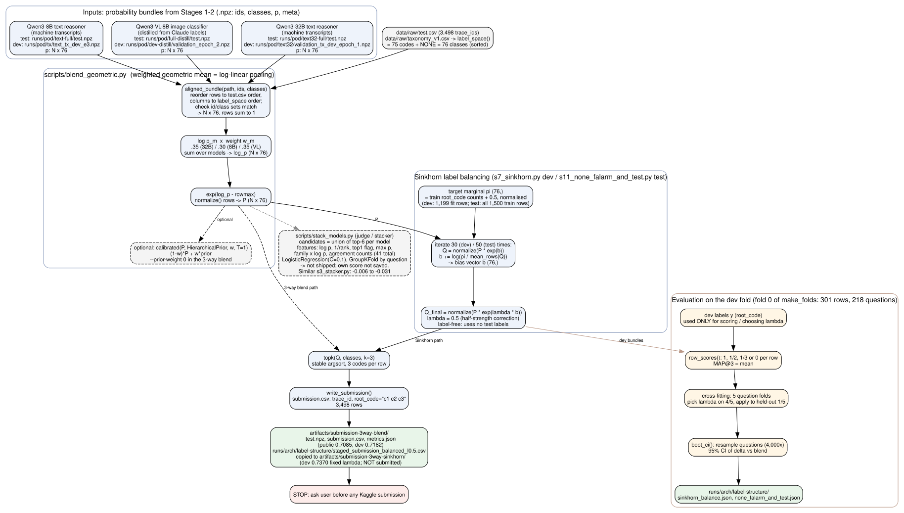
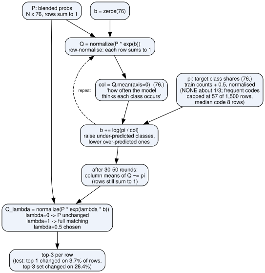
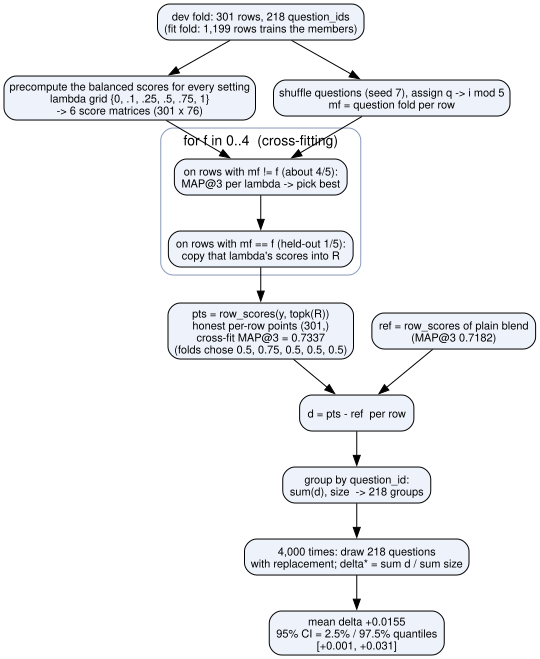

<a id="06-ensemble"></a>

# Stage 3: combining the models (blend, balancing, evaluation)

## Stage 3: combining the models (blend, balancing, evaluation)

### In one paragraph

Stages 1 and 2 each produce a **probability bundle**. A bundle is an `.npz` file with one row per photo and one column per class: 75 taxonomy codes plus `NONE`, so 76 columns.

Stage 3 combines three of these bundles (Qwen3-32B text, Qwen3-8B text, Qwen3-VL-8B image) with a **weighted geometric mean**, weights .35 / .30 / .35. That blend is the submission that scored **0.7085 public** (dev 0.7182).

On top of the blend we can apply **Sinkhorn label balancing**, a CPU-only post-processing step. It nudges the predicted class frequencies toward the label mix seen in train. On dev it raised MAP@3 to **0.7370** (+0.019, question-grouped 95% CI [+0.006, +0.033]). That CSV is staged and **has not been submitted**.

Every number in this section is judged with two tools:
- **Cross-fitting** keeps the tuning honest.
- A **question-grouped bootstrap** gives the error bars.

Those tools also showed that every fancier combiner we tried either lost to the plain blend or tied with it. That includes stackers, routers, priors and the `stack_models.py` judge.



---

### 1. What goes in: probability bundles

Every model in the project writes its predictions with `save_bundle` (`src/k12/core.py:97`) and reads them back with `aligned_bundle` (`src/k12/core.py:106`). A bundle holds:

- `ids`: the photo ids (`trace_id`).
- `classes`: the 76 class names.
- `p`: an N x 76 float32 matrix whose rows sum to 1.
- `meta`: a small JSON note.

`aligned_bundle` matters more than it looks. Different models may store rows and columns in different orders, so it re-indexes both to the order you ask for. It also refuses to continue if the id set or the class set differs:

```python
# src/k12/core.py:106-114
def aligned_bundle(path, ids, classes):
    with np.load(path, allow_pickle=False) as b:
        old_ids, old_classes = b['ids'].tolist(), b['classes'].tolist()
        if len(set(old_ids)) != len(old_ids) or set(old_ids) != set(ids):
            raise ValueError('Prediction ID sets differ')
        ...
        ii, cc = {x: i for i, x in enumerate(old_ids)}, {x: i for i, x in enumerate(old_classes)}
        return normalize(b['p'][[ii[x] for x in ids]][:, [cc[x] for x in classes]])
```

The class order comes from `label_space` (`core.py:18-19`). It is the sorted set of taxonomy ids plus `NONE`.

The three members, from `runs/arch/PLAN.md` section 1 and `artifacts/submission-3way-blend/metrics.json`:

| Weight | Model | Dev bundle (trained on fit rows) | Test bundle (trained on all 1,500 train rows) | Dev MAP@3 alone |
|---|---|---|---|---|
| .35 | Qwen3-32B text reasoner on machine transcripts | `runs/pod/text32/validation_tx_dev_epoch_1.npz` | `runs/pod/text32-full/test.npz` | 0.6523 |
| .30 | Qwen3-8B text reasoner on machine transcripts | `runs/pod/tx/text_tx_dev_e3.npz` | `runs/pod/text-full/test.npz` | 0.6667 |
| .35 | Qwen3-VL-8B image classifier distilled from Claude labels | `runs/pod/dev-distill/validation_epoch_2.npz` | `runs/pod/full-distill/test.npz` | 0.6528 |

The single-model numbers are the λ=0 entries (`component_32b`, `component_8b`, `component_vl`) in `runs/arch/label-structure/sinkhorn_balance.json`.

No single member reaches 0.67, yet the blend reaches 0.7182. The members make partly different mistakes, and the blend cancels some of them.

**The dev fold.** `make_folds` (`src/k12/core.py:64`) assigns fold 0 as the development set: 301 rows from 218 questions. The other 1,199 rows are the "fit" rows that train the dev versions of the models. The split balances label counts across folds (round-robin stratification), which matters later for Sinkhorn.

---

### 2. The metric: MAP@3 in plain words

Each photo has exactly one true root code. We submit three ranked guesses. A row scores:

- 1 if the truth is our 1st guess;
- 1/2 if it is our 2nd;
- 1/3 if it is our 3rd;
- 0 otherwise.

MAP@3 is the average over rows. With one true label per row, "mean average precision at 3" reduces to exactly this.

```python
# src/k12/core.py:38-51
def row_scores(y, predictions):
    ...
    for target, codes in zip(y, predictions):
        if isinstance(codes, str):
            codes = codes.split()
        hits = [1.0 / (i + 1) for i, c in enumerate(list(codes)[:3]) if c == target]
        scores.append(hits[0] if hits else 0.0)
    return np.asarray(scores)

def map3(y, p, classes):
    return float(row_scores(y, topk(p, classes)).mean())
```

`topk` (`core.py:31-35`) uses a **stable** argsort, so ties are broken the same way every time. Only the **ranking** inside each row matters to MAP@3. The actual probability values do not.

---

### 3. The weighted geometric blend (`scripts/blend_geometric.py`)

**Concept.** There are two natural ways to average probability vectors:

- **Arithmetic mean**: `sum_m w_m * p_m`. One confident model can drag a class up even when the others think it is impossible.
- **Geometric mean**, also called *log-linear pooling* or "product of experts": compute `prod_m p_m ^ w_m`, then renormalise. In log space this is a weighted sum of log-probabilities. If any model gives a class almost zero probability, the product stays small, so each model can veto a class. A class wins only when all models find it at least plausible.

On our dev fold the geometric version wins clearly (both numbers reproduced on CPU):

- geometric .35/.30/.35: **0.7182**;
- arithmetic with the same weights: **0.7071**. This is `A_arith_.35/.30/.35(fixed)` in `runs/arch/combiner-headroom/s2_grids.json`, delta −0.011.

**How our code does it** (`scripts/blend_geometric.py:24-31`):

```python
for spec in args.inputs:                       # "name=path.npz:weight"
    name, rest = spec.split('=', 1)
    path, weight = rest.rsplit(':', 1)
    log_p = log_p + float(weight) * np.log(aligned_bundle(path, ids, classes))
    recipe[name] = {'path': path, 'weight': float(weight)}
scores = normalize(np.exp(log_p - log_p.max(axis=1, keepdims=True)))
if args.prior_weight:
    scores = calibrated(scores, HierarchicalPrior(classes).fit(train).predict_proba(test), args.prior_weight, 1.)
```

Line by line:

1. Each input is parsed as `name=path:weight`. `rsplit(':', 1)` splits on the last colon, so paths that contain colons still work.
2. The log of each aligned bundle is multiplied by its weight and added up. The result is an N x 76 matrix of log-scores.
3. **Numerical stability trick.** Subtract the row maximum before `exp`. Otherwise very negative logs underflow to 0. Subtracting a constant from a row does not change that row after normalising.
4. `normalize` divides each row by its sum, so rows become probabilities again.
5. `--prior-weight` is optional. If set, `calibrated()` (`src/k12/holdout_calibration.py:12-14`) mixes in a per-question "usual codes" prior. It computes `(1-w)*softened + w*prior`, where `softened = normalize(max(scores, 1e-12) ** (1/T))`. The blend script passes T=1, so the softening changes nothing and the mix is simply `(1-w)*scores + w*prior`. The 3-way submission used **`prior_weight: 0.0`**, so the prior was off. When cross-fitted, question priors measured −0.004 to −0.005 (PLAN section 4).

The script then writes three files to `--output` (`blend_geometric.py:32-41`):

- `test.npz`: the blended bundle;
- `submission.csv`: `trace_id,root_code`, with three space-separated codes per row;
- `metrics.json`: the recipe, the share of rows with `NONE` ranked first, the dev score you passed in, and a SHA-256 fingerprint of the CSV.

**Real output** (`artifacts/submission-3way-blend/metrics.json`):

| Field | Value |
|---|---|
| rows | 3,498 |
| recipe | text32 (text32-full) .35, text8 (text-full) .30, distill8b (full-distill) .35 |
| prior_weight | 0.0 |
| none_first_share | 0.354 |
| development_map3 | 0.7182 |
| public MAP@3 (from `reports/status.json`, refs 58240192 / 58240232; the second is an accidental duplicate of the same file) | **0.7085** |

**A detail worth knowing.** The script does **not** compute `development_map3`. You pass it in with `--development-map3`, after running the same recipe on the dev bundles yourself. The script cannot check it, so treat it as a note, not a measurement.

**Where did .35/.30/.35 come from?** The weights were picked by looking at dev. `runs/arch/combiner-headroom/s2_grids.json` measured how much that flatters the dev score:

- the best in-sample weights, (.30, .30, .40), score 0.7187;
- **cross-fitted** weights (explained in section 6) score **0.7063**: delta −0.012, CI [−0.021, −0.004].

So about 0.012 of the 0.7182 is optimism from choosing weights on the same rows we score. The cross-fitted 0.706 is close to the public 0.7085. This is why PLAN.md calls 0.706, not 0.718, the "honest baseline".

---

### 4. Sinkhorn label balancing



#### 4.1 The problem it fixes: label shift

The train labels look **capped**:

- The most frequent codes stop at exactly 57 rows. Five codes (OTH-00, ANS-01, FRM-01, WOP-01, CAL-01) have exactly 57.
- The median code has only 8 rows, and 74 of the 76 classes appear at all.
- NONE is 506 of 1,500 rows (0.337). Measured on the fit rows with +0.5 smoothing, the NONE share is `NONE_share_train` 0.328 in `runs/arch/label-structure/prior_shift.json`.

Our members were trained on a mix in which Claude pseudo-labels on unlabelled photos dominate, and that mix is very different. For example, `runs/research/ARCHITECTURE_FROM_PAPERS.md` (around line 91) notes that NOT-01 is 57× over-represented relative to gold.

A model absorbs the label frequencies it was trained on. As a result, the blend over-predicts some codes and under-predicts others. A label-free diagnostic in `prior_shift.json` compares how often each code is top-1 on test with how often train frequencies say it should be:

| Code | Top-1 count on test | Expected from train shares |
|---|---|---|
| NONE | 1,239 | 1,146.7 |
| WOP-01 | 168 | 131.5 |
| FRM-01 | 75 | 131.5 |
| FRA-04 | 1 | 18.4 |

12 codes are never top-1 on test at all (`test_codes_never_top1` in `prior_shift.json`, also in `none_falarm_and_test.json`).

#### 4.2 The concept

**Sinkhorn–Knopp matrix scaling** is an old algorithm with a simple loop: alternately rescale a matrix's rows and columns until the row sums and column sums hit chosen targets. In our case:

- **rows** must sum to 1, because each photo's probabilities must sum to 1;
- **column means** should equal a target class distribution `pi`, the train label shares.

The fix is a single **bias vector `b`**, one number per class, added in log space. Classes the model under-predicts get a positive bias, and over-predicted classes get a negative one. This is the same idea as classical *prior correction* (Saerens et al. 2002, cited in `ARCHITECTURE_FROM_PAPERS.md`), done jointly over the whole set.

It is **transductive**: it looks at all the test rows together. It is also **label-free**: it never uses test labels, only the model's own predictions plus the train label counts. One consequence is that a row's final ranking can depend slightly on the other rows in the batch.

**λ (lambda)** sets how strong the correction is. The final scores are `P * exp(λ·b)`, renormalised:

- λ=0 means no change;
- λ=1 means full matching;
- λ=0.5 means "go halfway". Halfway hedges against the target `pi` being only approximately right for test.

#### 4.3 How our code does it: dev experiment (`runs/arch/label-structure/s7_sinkhorn.py`)

```python
# s7_sinkhorn.py:8-13
pi_fit = np.bincount(fit.root_code.map(ci), minlength=len(classes)) + .5; pi_fit /= pi_fit.sum()
def sinkhorn(P, target, lam, iters=30):
    b = np.zeros(P.shape[1]); Q = P
    for _ in range(iters):
        Q = normalize(P * np.exp(b)); b += np.log(target / Q.mean(0))
    return normalize(P * np.exp(lam * b))
```

- **Line 8.** Count each class among the 1,199 **fit** rows (never the dev labels) and add 0.5 to every count. Two classes never appear in train. This "add-half" smoothing keeps a class with zero examples from getting a target of 0, which would make `log(0)` blow up. Then normalise the counts to shares.
- **Inside the loop.** `normalize` fixes the rows. `Q.mean(0)` is "how often the model currently thinks each class occurs". Adding `log(target / Q.mean(0))` pushes each class's bias toward its target.
- **After the loop.** Only `λ·b` is applied to the original `P`.

`P` here is the dev blend from `common.py:13-18`. It uses the same three models and weights as the test blend, but with their dev bundles.

Then the script (`s7_sinkhorn.py:14-29`):

- tries λ over the grid `{0, .1, .25, .5, .75, 1}`;
- **cross-fits** λ over 5 question folds;
- puts a question-grouped CI on the gain over the plain blend.

It also tests balancing each member on its own (`s7_sinkhorn.py:30-33`).

**Measured results** (`runs/arch/label-structure/sinkhorn_balance.json`; the λ=0, 0.5 and 1 rows were reproduced on CPU):

| λ | Dev MAP@3 (in-sample) |
|---|---|
| 0 (plain blend) | 0.7182 |
| 0.1 | 0.7243 |
| 0.25 | 0.7281 |
| **0.5** | **0.7370** |
| 0.75 | 0.7348 |
| 1.0 | 0.7287 |

| Summary | Value |
|---|---|
| Fixed λ=0.5, delta vs blend | +0.0188, CI [+0.0056, +0.0333] |
| Cross-fitted λ (folds chose 0.5, 0.75, 0.5, 0.5, 0.5) | 0.7337, delta +0.0155, CI [+0.0011, +0.0306] |
| Error rows: blend → λ=0.5 | 0.618 → 0.642 |
| NONE rows: blend → λ=0.5 | 0.916 → 0.926 |

`runs/arch/test-combine/cpu_test.json` contains a separate stage-0 cross-fit (`cpu_test.py:66`) over λ ∈ {0, .25, .5, .75}, with the fusion weight w fixed at 0. All 5 folds chose λ=0.5, so its cross-fitted score equals the fixed-λ 0.7370.

**Does balancing help each model on its own?** Mostly yes, but not always:

- In `sinkhorn_balance.json`, the 32B goes from 0.652 to 0.710 at λ=1. The 8B goes from 0.667 to 0.675, and the VL from 0.653 to 0.674.
- `balance_generality.json` shows that the gain is not universal. The 0%-Claude 8B (`scale_0`) drops from 0.5532 to 0.546 at λ=0.5. The 235B few-shot drops from 0.6495 to 0.6318 at λ=1.

**Balance each member, or only the final blend?** `runs/arch/label-structure/s8_component_balance.py` balanced each member before blending, with an optional extra balance of the blend at strength 0 or 0.5. Its cross-fitted results (`component_balance.json`) were 0.7298 to 0.7331 across 3 seeds, with CIs whose lower ends sit just below 0. That is no better than balancing the blend once.

#### 4.4 How our code does it: test (`s11_none_falarm_and_test.py`)

```python
# s11_none_falarm_and_test.py:16-23
pi = np.bincount(tr.root_code.map(ci), minlength=len(classes)) + .5; pi /= pi.sum()
lp = (.35*np.log(aligned_bundle(ROOT/'runs/pod/text32-full/test.npz', tids, classes)) + .30*np.log(...text-full...)
      + .35*np.log(...full-distill...))
PT = normalize(np.exp(lp - lp.max(1, keepdims=True)))
b = np.zeros(len(classes))
for _ in range(50):
    b += np.log(pi / normalize(PT * np.exp(b)).mean(0))
QT = normalize(PT * np.exp(.5 * b))
```

The differences from the dev version are deliberate:

- the target `pi` now uses **all 1,500 train rows**, because the test models were trained on all of train;
- it runs 50 iterations instead of 30;
- λ is fixed at 0.5.

The script rebuilds the same blend that `blend_geometric.py` produced. Its own `note` asks you to check that the components match. They do: `artifacts/submission-3way-blend/metrics.json` lists the same three test bundles and weights. The script writes `test_blend_balanced_l0.5.npz` and `staged_submission_balanced_l0.5.csv` into `runs/arch/label-structure/` (`s11_none_falarm_and_test.py:30-31`).

**Test-side effects**, measured without labels (`none_falarm_and_test.json`; the first two rows were reproduced from the two CSVs):

| Measure | Value |
|---|---|
| Rows whose top-1 changed | 3.7% |
| Rows whose top-3 set changed | 26.4% |
| NONE top-1 share | 0.354 → 0.359 |
| Codes never top-1 | 12 → 12 |

The staged result was copied to `artifacts/submission-3way-sinkhorn/`. Its CSV hash `1c17a4f2…` matches `runs/arch/label-structure/staged_submission_balanced_l0.5.csv`. Its `metrics.json` says `"submitted": false`.

#### 4.5 Risks (from the adversarial test `runs/arch/test-pragmatist/t2_sinkhorn.json`)

- **The dev fold flatters Sinkhorn.** `make_folds` stratifies labels, so dev's label mix is unusually close to fit's: L1 distance 0.109, against 0.322 expected for a random split. The test then perturbed the target the way a random train/test split would:
  - effective sample size 1,050: mean gain +0.011, positive in 98.3% of draws;
  - effective sample size 301: mean gain +0.005, positive in 81.7% of draws.
- **A wrong target hurts badly.** Using Claude's unlabelled-photo label mix as the target gives **−0.066**. A uniform target gives −0.019.
- **Transfer to the test models is unverified.** On the 34 classes with at least 10 rows, the dev bias vector and the test bias vector correlate only 0.47 (Pearson; Spearman 0.37). The test models are trained on full train; the dev models only on fit rows.

PLAN.md therefore expects about **+0.01 on public (estimate)**, not +0.019. Only a public submission can show whether test labels follow the train mix, and that needs the user's explicit permission.

---

### 5. The judge / stacker (`scripts/stack_models.py`)

**Concept.** *Stacking* trains a second-level model that learns how much to trust each base model, possibly differently in different situations. This one works per candidate code:

1. Gather each model's top-6 codes for a photo (`--top`, default 6).
2. For each candidate, describe how the models feel about it (features).
3. Train a logistic regression to predict "is this candidate the true code?" (`--c`, default 0.1).

```python
# stack_models.py:37-45
for i in range(rows):
    pool = dict.fromkeys(j for n in names for j in orders[n][i, :top])   # ordered union of top-k
    for j in pool:
        row = []
        for n in names:
            logp, recip = np.log(max(models[n][i, j], 1e-9)), 1 / ranks[n][i, j]
            row += [logp, recip, ranks[n][i, j] == 1, models[n][i].max()]
            row += [logp * (fam[j] == f) for f in FAMILIES]   # family-specific trust
        row += [sum(ranks[n][i, j] == 1 for n in names), sum(ranks[n][i, j] <= 3 for n in names)]
```

**Features.** With 3 models there are 13 features per model plus 2 agreement counts, 41 in total. Per model there are:

- 4 general features: log-probability, reciprocal rank, an is-top-1 flag, and the model's maximum probability (a confidence measure);
- 9 family-gated copies of the log-probability, one per family in `FAMILIES` (`stack_models.py:22`). Codes from other families get zeros here.

The 2 agreement counts are how many models rank the candidate 1st, and how many rank it in their top 3.

**Cross-fitting the judge** (`stack_models.py:80-82`). `GroupKFold(n_splits=5)` splits the candidate rows **by question_id**. All candidates of a photo, and all photos of a question, land in the same fold. Each candidate's confidence therefore comes from a judge that never saw that question.

`scores_from` (`stack_models.py:51-54`) turns the confidences into a full 76-column matrix:

- each candidate gets `confidence + 1e-3`;
- every other class gets `1e-6 × fallback`, where the fallback is an **equal-weight** geometric blend.

Candidates therefore always outrank non-candidates.

For test, the judge is refit on all dev candidates (`stack_models.py:99-102`).

**Results.**

- **Its own output is not in the repo.** There is no `artifacts/stacked/` folder, so its score is **not measured** in any saved file.
- **The closest measured equivalent** is `runs/arch/combiner-headroom/s3_stacker.py`. It uses similar candidate-level features plus prior features, with question-grouped cross-fitting. Results are in `s3_stacker_base3.json`:

| Stacker | Dev MAP@3 | Delta vs blend |
|---|---|---|
| LR, C=0.01 | 0.7122 | −0.006 |
| LR, C=0.1 | 0.7050 | −0.013 |
| LR, C=1 | 0.7013 | −0.017 |
| Gradient boosting (3 settings) | 0.687–0.696 | −0.022 to −0.031 |

**A trap in `stack_models.py`.** Its `ci_vs_ref` compares against an **old reference**: the vision epoch-3 bundle mixed with a 25% question prior at temperature 2 (`calibrated(..., .25, 2.)`, `stack_models.py:84-85`). It does not compare against the 0.7182 blend, so a positive CI there does not mean it beats the current blend. Compare its `stacked_crossfit.map3` with 0.7182 (or the honest 0.706) yourself.

---

### 6. Honest evaluation: cross-fitting and question-grouped bootstrap



#### 6.1 Cross-fitting

**Concept.** Suppose you try 6 values of λ on the dev rows and report the best score. That score is optimistic, because you partly picked the λ that got lucky on these rows.

*Cross-fitting* fixes this:

1. Split the dev rows into 5 parts.
2. For each part, choose λ using only the other 4 parts, then apply it to the held-out part.
3. Stitch the 5 held-out pieces together and score once.

That final score evaluates the whole **procedure** ("pick λ on data, then apply it"), which is what will happen on test.

It differs from ordinary cross-validation in one way: the expensive models are **not** retrained. Only the cheap knob (λ, blend weights, stacker) is re-chosen per fold.

**Our code splits by question, not by row** (`s7_sinkhorn.py:14-23`):

```python
qs = dev.question_id.unique().copy(); np.random.default_rng(7).shuffle(qs)
g = {q: i % 5 for i, q in enumerate(qs)}; mf = np.array([g[q] for q in dev.question_id])
...
for f in range(5):
    m = mf != f                                    # the 4 folds used for choosing
    sc = [row_scores(y[m], topk(cache[l][m], classes)).mean() for l in grid]
    l = grid[int(np.argmax(sc))]; ch.append(l); R[~m] = cache[l][~m]
```

Two photos of the same question are similar. If one sat in the choosing part and the other in the held-out part, information would leak into the held-out score. Splitting by question prevents that.

The cost of honesty in our numbers:

| Setting | In-sample | Cross-fitted |
|---|---|---|
| λ | 0.7370 | 0.7337 |
| Blend weights | 0.7187 | 0.7063 |

#### 6.2 Question-grouped bootstrap CI

**Concept.** A *bootstrap* estimates uncertainty by resampling your data with replacement many times and recomputing the statistic each time. The spread of the recomputed values shows how much the result could move on similar data.

We bootstrap the **paired difference** between the new method and the reference on the same rows. Pairing cancels most of the per-row difficulty.

The 301 dev rows come from only 218 questions. Rows of the same question tend to succeed or fail together, so treating them as independent can make the CI too narrow. We therefore resample **questions**, not rows.

```python
# runs/arch/label-structure/common.py:20-28
def boot_ci(new_pts, ref_pts, groups=None, B=4000, seed=2026):
    d = np.asarray(new_pts) - np.asarray(ref_pts)
    rng = np.random.default_rng(seed)
    if groups is None:
        s = rng.integers(0, len(d), (B, len(d))); b = d[s].mean(1)
    else:
        g = pd.DataFrame({'g': groups, 'd': d}).groupby('g').d.agg(['sum', 'size']).to_numpy()
        s = rng.integers(0, len(g), (B, len(g))); b = g[s, 0].sum(1)/g[s, 1].sum(1)
    return float(d.mean()), [float(x) for x in np.quantile(b, [.025, .975])]
```

1. `d` is the per-row difference in points. Each value lies between −1 and +1, and most are 0.
2. Group `d` by question into (sum, size) pairs.
3. Draw 218 question indices with replacement, 4,000 times.
4. For each draw, compute `sum of d / number of rows`. This is the MAP@3 delta of that pseudo-dataset. Dividing by rows rather than questions keeps the row-level meaning.
5. The 2.5% and 97.5% quantiles form the 95% interval. If the lower end is above 0, the gain is unlikely to be luck from which questions happened to land in dev.

`summarize` in `scripts/evaluate_working_verifier.py:154-171`, which `stack_models.py` uses, does the same thing with 2,000 draws.

**What the CI does not cover:**

- seed-to-seed variation of the trained models (no model has a second seed; PLAN section 6, question 3);
- the gap between the dev bundles and the full-train test bundles.

---

### 7. Why almost every combiner failed (PLAN.md section 4)

PLAN.md reports that every cross-fitted combiner, prior or stacking variant landed between **−0.031 and +0.006** relative to the 0.7182 blend. Examples (`runs/arch/combiner-headroom/*.json`):

| Combiner | Dev MAP@3 | Delta |
|---|---|---|
| Cross-fitted blend weights | 0.7063 | −0.012 |
| Gold question prior (log-linear) | 0.7139 | −0.004 |
| LR stacker | 0.701–0.712 | −0.006 to −0.017 |
| Gradient-boosting stacker | 0.687–0.696 | −0.022 to −0.031 |
| Route to the most confident model | 0.6949 | −0.023 |
| Confidence-weighted geometric | 0.7145 | −0.004 |
| Reciprocal-rank blend | 0.7171 | −0.001 |
| Adding scale_100 (best single 8B) as a 4th member | 0.7111 | −0.007 |

One measured exception sits outside that range. `s4_pool.json` shows that adding the 235B few-shot model as a 4th member, with a cross-fitted weight, gives 0.7342 (+0.016). Its CI [−0.006, +0.038] crosses 0. PLAN.md files this under "bigger models", not combiners: after Sinkhorn it is worth only +0.008 (CI crossing 0), and running it on test would cost about $15.

Why, in plain words:

1. **The errors are shared.** About 78% of the 0.10 gap to Claude sits on 84 error rows whose true code never appeared for that question in the fit rows (PLAN section 1). All three members learned the same shortcut: "question → its usual codes." When all three are wrong in the same direction, re-weighting them cannot produce the right answer. A combiner can only rearrange evidence the members already contain. It needs **new** evidence, which is why PLAN.md proposes a reason-then-choose student instead.
2. **Small data, many knobs.** On 301 rows, CIs are about ±0.03. A stacker with 41 features or a boosted tree fits noise. The more flexible the combiner, the worse it did: LR was −0.006 at C=0.01 and −0.017 at C=1, and boosting was worse still.
3. **The blend already does the easy part.** The truth is in the blend's top 3, 5 and 10 on 0.831, 0.894 and 0.940 of rows. Telling NONE apart from errors already has an AUC of 0.947. What is left is hard re-ranking that the members' probabilities cannot inform.
4. **Sinkhorn is the exception because it fixes a different kind of error.** It corrects a **global bias**: the label shift between the training mix and the test mix. That is a single 76-number vector, estimated label-free from every row in the batch (301 on dev, 3,498 on test). Only one knob, λ, is tuned on dev labels. It is not row-level re-weighting, so it does not need much labelled data.

---

### Key files

- `/Users/gaddamshivateja/Documents/ChatGPT/kaggle-K-12/scripts/blend_geometric.py`: weighted geometric blend; writes `submission.csv`, `test.npz` and `metrics.json`.
- `/Users/gaddamshivateja/Documents/ChatGPT/kaggle-K-12/artifacts/submission-3way-blend/metrics.json`: the recipe behind public 0.7085.
- `/Users/gaddamshivateja/Documents/ChatGPT/kaggle-K-12/runs/arch/label-structure/common.py`: dev blend (`blend`, lines 13-18) and `boot_ci` (lines 20-28).
- `/Users/gaddamshivateja/Documents/ChatGPT/kaggle-K-12/runs/arch/label-structure/s7_sinkhorn.py`: Sinkhorn on dev, with the λ grid, cross-fit and CI.
- `/Users/gaddamshivateja/Documents/ChatGPT/kaggle-K-12/runs/arch/label-structure/s11_none_falarm_and_test.py`: Sinkhorn on test; writes the staged CSV.
- `/Users/gaddamshivateja/Documents/ChatGPT/kaggle-K-12/runs/arch/label-structure/{sinkhorn_balance,none_falarm_and_test,component_balance,balance_generality,prior_shift}.json`: results.
- `/Users/gaddamshivateja/Documents/ChatGPT/kaggle-K-12/artifacts/submission-3way-sinkhorn/metrics.json`: the balanced CSV, staged and not submitted.
- `/Users/gaddamshivateja/Documents/ChatGPT/kaggle-K-12/runs/arch/test-pragmatist/t2_sinkhorn.json`: Sinkhorn stress test (target noise, wrong target).
- `/Users/gaddamshivateja/Documents/ChatGPT/kaggle-K-12/runs/arch/test-combine/cpu_test.json`: independent stage-0 λ cross-fit.
- `/Users/gaddamshivateja/Documents/ChatGPT/kaggle-K-12/scripts/stack_models.py`: candidate-level LR judge.
- `/Users/gaddamshivateja/Documents/ChatGPT/kaggle-K-12/runs/arch/combiner-headroom/`: all failed-combiner measurements (`s2_grids.json`, `s3_stacker_base3.json`, `s4_pool.json`, `s6_router.json`).
- `/Users/gaddamshivateja/Documents/ChatGPT/kaggle-K-12/src/k12/core.py`: `label_space`, `normalize`, `topk`, `row_scores`, `map3`, `write_submission`, `make_folds`, `save_bundle`, `aligned_bundle`.
- `/Users/gaddamshivateja/Documents/ChatGPT/kaggle-K-12/runs/arch/PLAN.md`: sections 1, 3 (step 0), 4, 5 and 6.

---

### Things to try yourself (CPU only, a few seconds each)

Run these from the repo root with `PYTHONPATH=src .venv/bin/python your_script.py`. Keep your scripts outside `runs/arch/label-structure/`, because the `s*.py` scripts there overwrite their JSON outputs when run. All numbers below were reproduced on CPU while this guide was checked.

**Exercise 1: rebuild the blend and compare geometric with arithmetic.** You should get 0.7182 and 0.7071.

```python
import numpy as np
from k12.core import read_csv, label_space, make_folds, aligned_bundle, normalize, map3
tr = read_csv('data/raw/train.csv'); classes = label_space(read_csv('data/raw/taxonomy_v1.csv'))
dev = tr.loc[make_folds(tr) == 0].reset_index(drop=True); ids, y = dev.trace_id.tolist(), dev.root_code.to_numpy()
M = {'runs/pod/text32/validation_tx_dev_epoch_1.npz': .35, 'runs/pod/tx/text_tx_dev_e3.npz': .30,
     'runs/pod/dev-distill/validation_epoch_2.npz': .35}
P = {p: aligned_bundle(p, ids, classes) for p in M}
lp = sum(w * np.log(P[p]) for p, w in M.items()); G = normalize(np.exp(lp - lp.max(1, keepdims=True)))
A = sum(w * P[p] for p, w in M.items())
print('geometric', map3(y, G, classes), 'arithmetic', map3(y, A, classes))
```

Then try doubling every weight (use `2*lp` and subtract its own row max). The score stays 0.7182. Explain why (see Common confusions).

**Exercise 2: run Sinkhorn by hand and watch it converge.** Continue from exercise 1:

1. Build `pi` from the fit rows (`tr.loc[make_folds(tr) != 0]`, counts + 0.5).
2. Run the 30-step loop from `s7_sinkhorn.py:9-13`.
3. After each step, print `np.abs(normalize(G*np.exp(b)).mean(0) - pi).sum()`. It should shrink from about 0.063 after step 1, to about 0.007 after step 6, to about 4e-5 after step 30.
4. Score λ in {0, 0.5, 1}. You should get 0.7182 / 0.7370 / 0.7287.

Bonus: print the 5 classes with the largest positive `b` and the 5 with the largest negative `b`.

**Exercise 3: see what grouping does to the CI.** Import `boot_ci` from `runs/arch/label-structure/common.py`. Let `new` and `ref` be the `row_scores` of the λ=0.5 and λ=0 rankings. Compute both `boot_ci(new, ref)` and `boot_ci(new, ref, dev.question_id.to_numpy())`, then compare the interval widths. On this data the grouped interval is only slightly wider: [+0.0056, +0.0333] against [+0.0061, +0.0327] for rows. Most questions have only one or two dev rows, so grouping changes little here. It matters more when many rows share a question.

**Exercise 4: inspect the staged test change, without submitting.**

1. Load `artifacts/submission-3way-blend/submission.csv` and `artifacts/submission-3way-sinkhorn/submission.csv` with pandas.
2. Count the rows where the first code differs (expect 3.7%) and the rows where the set of three codes differs (26.4%).
3. Tabulate which codes gained top-1 positions and which lost them.
4. Load `artifacts/submission-3way-blend/test.npz` and confirm `p.shape == (3498, 76)`.

---

### Common confusions

- **"Doubling all blend weights changes the blend."** It does not change the ranking. Multiplying every weight by c raises the blended distribution to the power c, which makes it sharper (c > 1) or flatter (c < 1). The order inside each row stays the same, so MAP@3 is unchanged. Only the **ratios** of the weights matter for ranking. Sharpness does matter for any later step that reads probability values, such as the arithmetic prior mix or Sinkhorn, because `Q.mean(0)` depends on it.
- **"Geometric mean means averaging the three top-3 lists."** No. It multiplies full 76-class probability vectors. A class that one model scores near zero is vetoed even if the other two like it.
- **"Sinkhorn here is optimal transport with a cost matrix."** It is plain Sinkhorn–Knopp scaling: find one per-class bias so that column means match a target while rows still sum to 1. There is no cost matrix and no training.
- **"Sinkhorn uses test labels."** It does not. It uses the model's test predictions and the **train** label counts. It is transductive, though: the prediction for one photo depends slightly on the rest of the test set.
- **"+0.019 dev means +0.019 public."** The dev fold is label-stratified, which flatters Sinkhorn. PLAN.md expects about +0.01 on public. The gain could turn negative if test labels do not follow the train mix: it is −0.066 with a Claude-mix target.
- **"0.7370 vs 0.7337: which is the real dev number?"** 0.7370 uses the fixed λ=0.5. 0.7337 is the cross-fitted procedure, in which one fold picked 0.75. Both are reported in `artifacts/submission-3way-sinkhorn/metrics.json`. The cross-fitted one is the safer estimate.
- **"0.7182 is our honest dev score."** It includes about 0.012 of weight-selection optimism. Cross-fitted weights give 0.706, close to public 0.7085.
- **"Train has about 57 rows per code."** No. 57 is the **cap** on the most frequent codes. The median code has 8 rows, and NONE has 506 of 1,500.
- **"Dev bundles and test bundles come from the same models."** They do not. Dev bundles come from models trained on the 1,199 fit rows. Test bundles come from models retrained on all 1,500 rows. No fit-only test bundles exist, so nobody has directly measured whether λ and the weights transfer (PLAN section 6, question 2).
- **"`stack_models.py` printed a positive CI, so it beats the blend."** Its CI reference is the old vision+prior model (`stack_models.py:84-85`), not the 3-way blend. Compare its MAP@3 with 0.7182 / 0.706.
- **"A bootstrap CI covers all uncertainty."** It only covers which questions happened to land in dev. It says nothing about training-seed noise (unmeasured) or about the differences between the dev and test models.
- **"`development_map3` in metrics.json is computed by the blend script."** It is typed in by hand with `--development-map3`.

