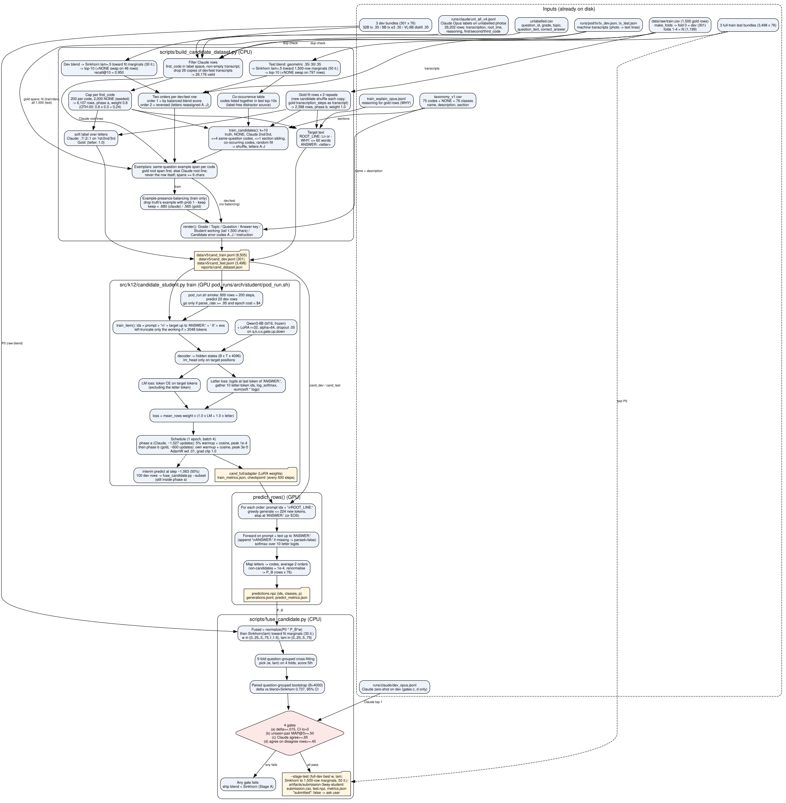
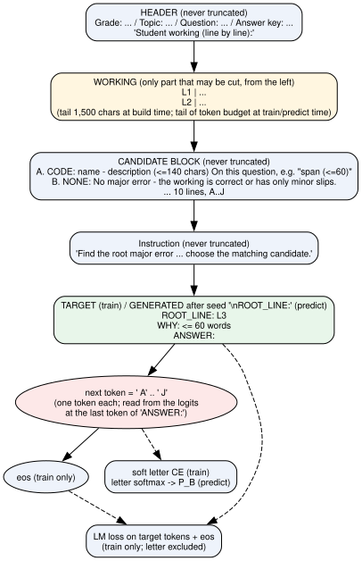
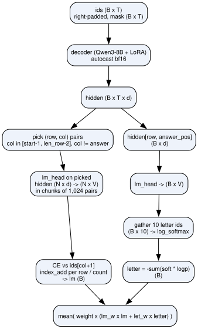
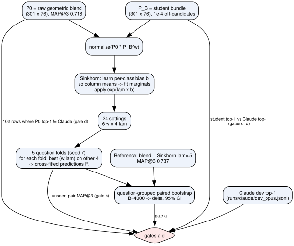

<a id="07-candidate-student"></a>

# Stage 4 (new): the candidate-aware student

## Stage 4 (new): the candidate-aware student

### In one paragraph

Our existing models do well on codes they have already seen for a question. They do badly when a student makes a kind of mistake that is **new for that question**. On those 84 dev rows the blend scores 0.431 MAP@3 and Claude scores 0.712. The candidate-aware student is built to close that gap. It is Qwen3-8B with a LoRA adapter.

It does not choose from all 76 codes. Its prompt holds:
- the question;
- the answer key;
- the transcript;
- **10 candidate codes**, each with its description and, when one exists, a short example of that code on the same question.

The student first writes a short diagnosis (`ROOT_LINE`, `WHY`), then a single letter. At that point we read the probabilities of the letters A to J and map them back to codes. We then fuse the result with the existing blend (`P0 · P_B^w`, then Sinkhorn balancing). The fused model ships only if it passes four gates that were declared in advance.

> **Results: pending.** When this was written, the full Qwen3-8B run had not produced any dev predictions. Every number below is either a dataset statistic or a baseline measured before this stage existed. The only predictions so far come from CPU smoke tests on a tiny random model. They show that the code runs; they are not results.



---

### 1. Why this stage exists: the gap analysis

`runs/arch/PLAN.md` §1 splits the dev fold (301 rows, fold 0) into four kinds of row and compares the reference blend with Claude Opus zero-shot:

| Row kind | Rows | Blend | Claude | Share of the 0.10 gap |
|---|---|---|---|---|
| Error rows on a **seen question**, with a **code never seen for that question** in the fit rows | 84 | **0.431** | **0.712** | about 78% |
| Error rows on **unseen questions** | 22 | 0.432 | 0.727 | about 21% |
| Error rows whose code **was** seen for the question | 94 | 0.830 | 0.812 | −5.5% (the blend wins) |
| NONE rows | 101 | 0.916 | 0.934 | about 6% |

The reference blend scores MAP@3 0.7182. It is a geometric blend of three models: the 32B text model (weight .35), the 8B text model (.30) and the VL-8B image model distilled from Claude (.35). Claude scores 0.8189.

**What the table means.** The fine-tuned classifiers have memorised which codes go with each question. When a student makes a different kind of mistake, they fall back on the usual codes. On the error rows whose code is new for the question, the blend's top-1 is one of that question's training codes 36% of the time. Claude's top-1 is one of them only 11% of the time (PLAN §1).

Two facts make a *candidate re-ranker* the natural fix:
- **Recall is not the problem.** The truth is in the raw blend's top 10 on 0.940 of dev rows.
- **The candidate list does not hold us back.** Claude restricted to the blend's top 10 still scores 0.802–0.807. This is an oracle diagnostic, so it cannot be deployed.

So the job is to **re-rank 10 candidates by actually reading the working**, not by remembering the question.

The design also borrows two changes from the literature survey (`runs/research/ARCHITECTURE_FROM_PAPERS.md`):
- **Change #2: train on Claude pseudo-labels first, then on gold.** A *pseudo-label* is a label that a model produced rather than a human.
- **Change #3: show candidates with same-question exemplars, and score with letter logits.** An *exemplar* is a real example of the code. One cited paper (2310.02439) found that picking from 4 candidates instead of about 100 raised GPT-4 from 39.8% to 91.9%.

---

### 2. Concepts you need first

- **LoRA (Low-Rank Adaptation).** The 8 billion weights of the base model stay frozen. Beside chosen weight matrices W, we add a small trainable update `B·A`. Here those matrices are the attention projections q, k, v and o and the MLP projections gate, up and down.
  - For a W of shape d_out × d_in, A is r × d_in and B is d_out × r, with rank r = 32.
  - Only A and B train. For Qwen3-8B with r = 32 on all seven projections this comes to about 87 million parameters, roughly 1% of the base. That figure is computed from the published layer shapes; no real run has logged it.
  - `lora_alpha` scales the update. It is 64 here, which is 2r.
- **QLoRA.** The same idea, but the frozen base is stored in 4-bit NF4 to save memory. It is available as `--load-4bit` (`candidate_student.py:58-63`). `pod_run.sh` does **not** use it and loads the model in bf16.
- **Distillation and soft labels.** Distillation means training the smaller model to imitate a stronger teacher, here Claude. A Claude row does not give one "correct" label. It says something like "70% the 1st code, 20% the 2nd, 10% the 3rd". That is a *soft label*. Cross-entropy against a soft label is `−Σ soft_i · log p_i`.
- **Letter-logit scoring.** At every position, a language model outputs a score (logit) for every token in its vocabulary, and those scores predict the *next* token. Each candidate is labelled with a letter, and each of `" A"` … `" J"` is a single token. So the 10 logits for those tokens, read at the last token of `ANSWER:`, form a 10-way classifier. No new head is needed.
- **MAP@3.** For each row we submit 3 ranked codes. A hit in position 1, 2 or 3 scores 1, 1/2 or 1/3; a miss scores 0. The metric is the mean over rows (`src/k12/core.py:38-51`).
- **Geometric blending.** Combine models with a weighted average of log-probabilities, then renormalise: `p ∝ Π p_m^{w_m}`. A code needs support from every model; a high score from one model is not enough.
- **Sinkhorn balancing.** Our models over-predict some codes. Sinkhorn learns one additive log-bias b per class. The bias is chosen so that the **average** predicted distribution over rows matches a target label mix, here the training label frequencies with +0.5 smoothing. λ ∈ [0, 1] applies only part of that bias.
- **Cross-fitting.** This is how we pick hyperparameters (here w and λ) without fooling ourselves. We split the dev questions into 5 groups. For each group, we choose the setting on the other 4 groups and score it on the held-out group. No row's score ever saw that row during selection.
- **Question-grouped paired bootstrap CI.** We resample *questions*, not rows, with replacement, 4,000 times. Each time we recompute the mean difference "new − reference". The 2.5% and 97.5% quantiles give a 95% confidence interval. Grouping by question matters because rows on the same question are correlated.

---

### 3. The dataset builder: `scripts/build_candidate_dataset.py`

This script runs on CPU. It renders **complete prompts and targets** into JSONL files, so the trainer can stay generic (`SPEC.md:17`).

**Outputs** (`reports/cand_dataset.json`):

| File | Rows |
|---|---|
| `data/v5/cand_train.jsonl` | 8,505: 6,107 Claude rows in phase a + 2,398 gold rows in phase b |
| `data/v5/cand_dev.jsonl` | 301 |
| `data/v5/cand_test.jsonl` | 3,498 |

#### 3.1 Training rows: two sources, two phases

**Claude rows (phase a)**, `build_candidate_dataset.py:209-226` and `:309-333`:
- **Source.** `runs/claude/unl_all_v4.jsonl`, which has 26,202 lines. These are Claude Opus labels on *unlabelled* photos, which the API rule in AGENTS.md allows. Each row carries Claude's transcription, root line, reasoning and three ranked codes.
- **Filters.** The first code must be in the label space and the transcription must be non-empty. A row is also dropped if its normalised transcript equals a dev or test transcript on the same question. That rule dropped 26 rows, leaving 26,176 valid rows.
- **Caps.** At most 200 rows per first code and 2,000 NONE rows, chosen with a seeded RNG. That leaves 6,107 rows.
- **Weights.** 0.8, or 0.8 × 0.3 = 0.24 when the first code is OTH-00. PLAN notes that Claude's precision on OTH-00 is only 0.21.
- **Transcript.** Claude's own transcription.

**Gold rows (phase b)**, `:334-347`:
- **Source.** The 1,199 *fit* gold rows (folds 1–4), with weight 1.0.
- **Transcript.** The human `transcription_steps`.
- **Repeats.** Each row appears twice, each copy with a different candidate shuffle, giving 2,398 rows.
- **Hard rule.** No dev (fold 0) trace_id appears as a training row or as an exemplar source for training rows. This is asserted at `:461`.

The three splits read different transcripts:

| Rows | Transcript |
|---|---|
| Claude training rows | Claude's transcription |
| Gold training rows | Human transcription |
| Dev and test rows | Our machine transcriber's output (§3.6) |

#### 3.2 Choosing the 10 candidates for a training row

Training rows have no model predictions, so `train_candidates` (`:285-307`) builds a plausible list:

```python
for c in [truth, 'NONE', *extra]:          # extra = Claude's 2nd/3rd codes
    add(c)
cnt = Counter(qcount.get(q, Counter())); cnt[own_code] -= 1
for c, n in sorted(cnt.items(), key=lambda x: (-x[1], x[0])):
    if n > 0 and taken < 4 and c not in cands and len(cands) < args.k:
        add(c); taken += 1                  # up to 4 codes seen on this question
sib = [c for c in section.get(taxonomy.get(truth, {}).get('section'), []) if c != truth]
for c in (rng.permutation(sib)[:args.max_siblings] if sib else []):
    add(str(c))                             # at most 1 same-section sibling
nb = cooc.get(truth)                        # codes that co-occur with truth in TEST top-10s
...
return [cands[i] for i in rng.permutation(len(cands))]   # shuffle -> letters A..J
```

The list is filled in this order:
1. The truth.
2. NONE.
3. Claude's 2nd and 3rd codes.
4. Up to 4 codes seen on this question, most frequent first, counting fit gold rows and Claude rows. These are **hard negatives**: plausible wrong answers that directly attack the "question → usual code" shortcut.
5. One sibling from the same taxonomy section.
6. Codes that co-occur with the truth in the label-free test-blend top-10 lists (`:265-283`). They are taken in a random order weighted by co-occurrence count.
7. Random codes, until there are 10.

Then the list is shuffled. The report confirms two things: the truth is among the candidates on 100% of training rows, and every training row has 10 candidates including NONE.

#### 3.3 Shortcut fixes (deviations from SPEC, listed in the docstring at `:7-14`)

A model learns whatever cue predicts the label most cheaply. The first draft had two cheap cues.

**1. Section plurality.** SPEC filled the candidates with *all* same-section siblings of the truth. The truth's section would then hold the most candidates, so "pick from the biggest section" becomes a shortcut that dev lists do not support. The fix caps siblings at `--max-siblings 1` and fills the rest from test co-occurrence. Here is the measured share of rows where the truth's section is the plurality section:

| Split | Share |
|---|---|
| train_claude | 0.479 |
| train_gold | 0.587 |
| dev error rows | 0.481 |
| dev unseen-pair rows | 0.593 |

Average number of same-section distractors:

| Split | Distractors |
|---|---|
| train_claude | 2.44 |
| train_gold | 2.43 |
| dev error rows | 2.14 |
| dev unseen-pair rows | 2.56 |

**2. Example presence.** A candidate shows an example only if one exists for that (question, code) pair. On Claude rows the truth had an example 0.917 of the time, against 0.624 for distractors, so "the line with an example is the answer" was a free shortcut. Lines `:349-363` drop the truth's example with a probability chosen so that the two rates match:

| Source | Truth before | Distractor | Keep prob. | Truth after |
|---|---|---|---|---|
| Claude | 0.9172 | 0.6241 | 0.6804 | 0.6236 |
| Gold | 0.6285 | 0.3553 | 0.5654 | 0.3665 |

**Other fixes:**
- WHY is capped at 60 words (`why()`, `:67-80`). The concluding sentence, the one that names the error, is kept when it is 30 words or fewer.
- Example spans shorter than 6 characters are skipped.
- Claude NONE rows get `ROOT_LINE: -`.
- Literal "nan" header fields are filled from other rows of the same question. This filled 192 `topic_name` values.

#### 3.4 Exemplars: "On this question, e.g. …"

`Exemplars` (`:122-138`) builds a pool keyed by (question_id, code):
- **Gold rows come first.** Their example is the `span` of the root misconception.
- **Then Claude rows.** Their example is the text of the `root_line` line of Claude's transcription. These come from all 26,176 valid Claude rows, not only the 6,107 picked ones.
- **Order** is deterministic, by a seeded hash. The row's own trace_id is never used.

Training and dev use the fit-only bank (`ex_fit`); test uses the bank built from all 1,500 gold rows (`ex_all`). Both banks also contain the Claude spans.

Share of non-NONE candidate lines that carry an example:

| Split | Share |
|---|---|
| Claude training rows | 0.581 |
| Gold training rows | 0.324 |
| Dev | 0.326 |
| Test | 0.359 |

#### 3.5 The prompt and the target

`render()` (`:141-154`) writes this layout (`SPEC.md:32-50`):



```
Grade: {grade}
Topic: {topic_name}
Question: {question_text}
Answer key: {correct_answer}
Student working (line by line):
{transcript, last 1,500 chars}

Candidate error codes:
A. {code}: {name} - {description <=140 chars} On this question, e.g. "{span <=60 chars}"
B. NONE: No major error - the working is correct or has only minor slips.
...
Find the root major error the rest of the working follows from (or NONE ...) and choose the matching candidate.
```

The target (training only) puts the **reasoning first and the letter last**:

```
ROOT_LINE: L3          (or "-" for NONE)
WHY: <=60 words of diagnosis
ANSWER: C
```

Where the parts come from:

| Row source | WHY text | Soft label |
|---|---|---|
| Claude | Claude's own reasoning | `.7/.2/.1` over the letters of Claude's codes 1, 2 and 3, renormalised if one is missing |
| Gold | Reasoning from `train_explain_opus.jsonl`; if that is missing, the root misconception's `text` | `{letter: 1.0}` |

Token lengths, measured with the Qwen2.5-vocabulary tokenizer of the tiny test model:

| Measure | Value |
|---|---|
| Training prompt + target, p50 | 852 |
| Training prompt + target, p99 | 1,135 |
| Training prompt + target, max | 1,440 |
| Training rows over 2,048 | 0 |
| Training target, p50 / p99 | 100 / 148 |

Each of `" A"` … `" J"` is a single token (`candidate_letters_single_token: true`).

#### 3.6 Dev and test rows: candidates from the blend, in two orders

Dev rows (`:381-387`):
- **Blend.** The three dev bundles are combined geometrically (.35/.30/.35). The result is Sinkhorn-balanced with λ = 0.5 toward the fit-row label mix, for 30 iterations.
- **Candidates.** The top 10 codes. If NONE is not among them, it replaces the 10th. This happened on 46 dev rows and 797 test rows.
- **Orders.** Order 1 sorts by balanced blend score. Order 2 is the reverse, with the letters reassigned (`:371-379`).

Measured on dev:

| Measure | Value |
|---|---|
| Recall@10 of the truth, all rows | **0.950** (raw blend without NONE swap: 0.940) |
| Recall@10, error rows only | 0.925 |
| Balanced blend's top-1 accuracy | 0.648 |

Test rows use the full-train test bundles, balanced toward all 1,500 training labels for 50 iterations (`:275-277`). Machine transcripts come from `runs/pod/tx/tx_dev.json` and `tx_test.json`.

**Leakage checks** (`reports/cand_dataset.json` → `leakage`):

| Check | Value |
|---|---|
| Dev ids as training rows | 0 |
| Dev ids as training exemplar sources | 0 |
| Dev ids as dev exemplar sources | 0 |
| Gold training prompts containing a dev gold transcript verbatim | 2 |

Those 2 rows are probably near-duplicate short workings. `runs/arch/student/checks/check_data.json` finds only 1 such match at 40 characters or more.

---

### 4. The trainer: `src/k12/candidate_student.py train`

#### 4.1 Model

`Student.__init__` (`:43-78`):
- Loads the base model given by `--model`. On CUDA it uses bf16 with SDPA attention; `pod_run.sh` passes Qwen3-8B. On CPU it falls back to the cached tiny random Qwen2 in float32, for smoke tests.
- Wraps it with `LoraConfig(r=32, lora_alpha=2r=64, lora_dropout=.05, target_modules=[q,k,v,o,gate,up,down])`.
- Casts the trainable LoRA weights to float32, which keeps the optimizer updates precise.

`letter()` (`:80-85`) asserts that each `" X"` encodes to exactly one token.

#### 4.2 Building one training sequence

`train_item` (`:106-118`):

```python
k = target.rindex(ANSWER) + len(ANSWER)
answer = target[k:].strip()                       # e.g. "C"
head = self.encode('\n' + target[:k])             # "\nROOT_LINE: ...\nWHY: ...\nANSWER:"
tail = [self.letter(answer), self.tokenizer.eos_token_id]
prompt, cut = self.prompt_ids(row['prompt'], self.max_length - len(head) - len(tail))
...
return {'ids': prompt + head + tail, 'start': len(prompt),
        'answer': len(prompt) + len(head) - 1, ...}
```

`'answer'` is the index of the last token of `ANSWER:`. The output logits at that position predict the *next* token, which is the letter.

`prompt_ids` (`:90-101`) splits the prompt into three parts: header, working, and candidate block plus instruction. It left-truncates **only the working**, so the candidates and the target always survive. It raises an error if the header and candidate block alone exceed the budget (default `--max-length 2048`).

#### 4.3 The loss (two parts)



`Student.loss` (`:124-149`), simplified:

```python
c = [c for c in range(x['start'] - 1, len(x['ids']) - 1) if c != x['answer']]
...
ce = F.cross_entropy(self.lm_head(hidden[r, c]).float(), ids[r, c + 1], reduction='none')
token_ce = token_ce.index_add(0, r, ce)
lm = token_ce / torch.bincount(rows, minlength=len(items)).clamp(min=1)
answer = self.lm_head(hidden[torch.arange(len(items)), answer_positions]).float()
letter = torch.stack([-(soft_r * answer[r, x['letters']].log_softmax(-1)).sum() for r, x in ...])
return (weight * (lm_weight * lm + letter_weight * letter)).mean(), lm.mean(), letter.mean()
```

**LM loss.** Ordinary next-token cross-entropy over the target tokens (the diagnosis plus EOS), averaged per row. The letter token is **excluded**, so it is not trained twice.

**Letter loss.** At the answer position, take the logits of only the 10 candidate-letter tokens. Apply log-softmax over those 10 and dot the result with the soft label. This is a 10-way soft classifier inside the language model.

**Total.** Each row's loss is multiplied by its row weight (0.8, 0.24 or 1.0) and then averaged. Defaults: `lm_weight = letter_weight = 1.0`.

**Efficiency trick.** The code runs the decoder once to get the hidden states. It then applies `lm_head` only at the positions it needs, in chunks of 1,024 (row, position) pairs. `lm_head` is vocabulary size × hidden size, the most expensive projection. The code never builds full B × T × V logits.

#### 4.4 Phase a, then phase b, each with its own cosine

`plan()` (`:196-203`) orders every epoch in two blocks: all phase-a (Claude) batches, shuffled, then all phase-b (gold) batches, shuffled. Gradient-accumulation windows never mix phases.

`lr_at()` (`:208-210`):

```python
n, peak = max(1, total[name]), args.lr * (args.phase_b_lr_mult if name == 'b' else 1.)
return peak * min(1., (k + 1) / max(1, .05 * n)) * .5 * (1 + math.cos(math.pi * k / n))
```

Each phase has its own 5% warmup and its own cosine decay:

| Phase | Rows | Updates | Peak lr |
|---|---|---|---|
| a (Claude) | 6,107 | about 1,527 | 1e-4 |
| b (gold) | 2,398 | about 600 | 3e-5 (0.3 × 1e-4) |

These updates assume batch 4 and grad-accum 1, as `pod_run.sh` sets them: 6,107/4 and 2,398/4, rounded up.

**Why a cosine per phase?** The module docstring (`:8-9`) explains that one cosine over the whole epoch left the gold rows at about 2% of the peak learning rate, so they would barely move the model. This is the "pretrain on teacher labels, then refine on human labels" recipe from change #2.

Other settings:
- AdamW with weight decay 0.01, and gradient clipping at 1.0.
- Gradient checkpointing (`use_reentrant=False`).
- A JSON log line every `--log-every` steps (default 25), with loss, lm_loss, letter_loss and rows/s.
- An optional checkpoint every N steps, and an optional interim dev prediction at 50% of updates.

#### 4.5 Pod orchestration: `runs/arch/student/pod_run.sh`

1. **Install and download** (`:6-10`). Pinned torch, transformers and peft; Qwen3-8B into `/workspace/models`.
2. **Smoke test** (`:14-19`). 600 phase-a rows + 200 phase-b rows = 200 steps at batch 4, then a prediction on 20 dev rows. Timeout 45 minutes.
3. **Automatic go/no-go** (`:20-32`):

   ```python
   cost = 8505 / rps / 3600 * rate
   ok = m['parse_rate'] >= .95 and cost < 4.
   ```

   The script continues only if both conditions hold:
   - at least 95% of generations contain `ANSWER:`;
   - the projected cost of a full training epoch is under $4.

   `rps` is the training rows/s from the last smoke log line, so the projection leaves out prediction time.
4. **Full run** (`:34-37`). The full epoch, with a 6-hour timeout. It saves a checkpoint every 500 steps, runs an interim prediction on 100 dev rows at 50% of updates, then saves the adapter and runs the full dev prediction. Test prediction is launched separately, only after the dev gates pass.

The interim abort rule (PLAN step 4): stop if, on those 100 rows, the student's recall@3 on unseen-pair rows is no better than the blend's. It is checked with `fuse_candidate.py --subset` (`:66-85`), which requires the student to beat the better of the raw blend and blend + Sinkhorn (`:81`).

Note the timing. 50% of 2,127 updates is about step 1,063, which is still inside phase a. So the interim check sees a model that has **not yet trained on any gold rows**.

---

### 5. Inference: `predict_rows` (`candidate_student.py:253-320`)

For each dev or test row, and for each of its 2 candidate orders:

1. **Prefill.** Append the seed `"\nROOT_LINE:"` to the prompt tokens, so the model starts in the right format. The working is left-truncated to fit `max_length − max_new_tokens − seed − 8` tokens.
2. **Generate.** Greedy decoding, up to `--max-new-tokens` (code default 224; SPEC said 160), stopping at the string `ANSWER:` or at EOS (`generate`, `:164-177`). Batches use left padding.
3. **Read the letter.** If `ANSWER:` was produced, cut the text right after it. If not, append `"\nANSWER:"` and flag the row as **unparsed**. Then run one forward pass on prompt + text and take the softmax over the 10 letter logits at the last position (`letter_probs`, `:151-162`).
4. **Map back to codes.** Letters become codes through that order's `codes_per_prompt`. The two orders' probabilities are averaged per code. Every non-candidate code gets 1e-4, and the row is renormalised to a 76-way distribution.
5. **Save** three files:
   - `predictions.npz`, in the same bundle format as every other model (ids, classes, p);
   - `generations.jsonl`, with the text, parsed flag, truncation flag and letter probabilities;
   - `predict_metrics.json`, with the parse rate and rows/s, and on dev also MAP@3, per-order MAP@3 and candidate recall.

**Why two orders?** Language models have a **position bias**: they favour early letters or early list positions. Averaging the forward and reversed lists cancels much of that bias. This is the Eedi 2nd-place reversed-order trick, cited under change #3 in ARCHITECTURE_FROM_PAPERS.

---

### 6. Fusion and gates: `scripts/fuse_candidate.py` (CPU)



#### 6.1 Fusion formula

```python
def sinkhorn(P, target, lam, iters):
    b = np.zeros(P.shape[1])
    for _ in range(iters):
        b += np.log(target / normalize(P * np.exp(b)).mean(0))
    return normalize(P * np.exp(lam * b))

def fuse(P0, PB, w, lam, target, iters):
    F = normalize(P0 * np.clip(PB, 1e-12, None) ** w) if w else P0
    return sinkhorn(F, target, lam, iters) if lam else F
```

(`fuse_candidate.py:35-44`)

- **P0** is the *raw* geometric blend (MAP@3 0.718). **P_B** is the student bundle.
- **w** sets how much we trust the student. w = 0 ignores it; w = 1 is a plain product of the two.
- **Sinkhorn** then repeatedly nudges a per-class bias b until the mean prediction matches the fit-row label frequencies (+0.5 smoothing; `marginals`, `:29-32`). The final output applies `λ·b`.

#### 6.2 Cross-fitted selection (`:136-151`)

- **Grid.** w ∈ {0, .25, .5, .75, 1, 1.5} × λ ∈ {0, .25, .5, .75}, which is 24 settings, all precomputed.
- **Folds.** Dev questions are shuffled (seed 7) and dealt round-robin into 5 groups. For each group, the best setting on the other 4 groups is applied to that group. This gives the cross-fitted prediction matrix `R` and its per-row scores `cf`.
- **Reference.** Blend + Sinkhorn at a fixed λ = 0.5, with dev MAP@3 **0.737**. The script also reports a "λ-only cross-fitted" reference (`R0`, w = 0).
- **Bootstrap.** `boot_ci` (`:47-52`) resamples questions 4,000 times and returns the mean Δ and its 95% CI.

#### 6.3 The four gates (all must pass; `:159-162`, PLAN step 5)

| Gate | Test | Threshold | Baseline today |
|---|---|---|---|
| (a) | Cross-fitted fused MAP@3 − blend+Sinkhorn | Δ ≥ +0.015 **and** CI lower bound > 0 | reference 0.737 |
| (b) | Cross-fitted fused MAP@3 on the 106 "unseen-pair" rows (84 new-code + 22 unseen-question) | ≥ 0.50 | raw blend 0.431; blend+Sinkhorn 0.451; scale_100 8B 0.44 |
| (c) | Student-alone top-1 agrees with Claude's top-1 on those 106 rows | ≥ 0.65 | scale_100: 0.49 |
| (d) | Student-alone top-1 agrees with Claude on the 102 rows where the raw blend's top-1 and Claude's top-1 differ | ≥ 0.45 | best existing student: 0.245 |

The blend+Sinkhorn figure in gate (b) was measured on CPU while this guide was being checked.

Why four gates?
- (a) asks whether the student helps overall.
- (b) asks whether it helps where we are weak.
- (c) and (d) ask whether it learned *Claude-like reasoning* rather than a different kind of memorisation.

PLAN notes that the proposals' original gates "could pass with zero real gain", so these corrected gates were agreed in advance.

**Staging.** With `--stage-test`, the script refuses to stage if any gate fails, unless `--allow-failed-gates` is set (that flag is for pipeline checks only). If every gate passes, the script:
- applies the full-dev best (w, λ) to the test bundles, with Sinkhorn toward all 1,500 training labels (50 iterations);
- writes `artifacts/submission-3way-student/submission.csv`, `test.npz` and `metrics.json`; `metrics.json` includes the CSV's sha256 and `"submitted": false`.

The script never submits; the user must approve each submission. If any gate fails, the plan falls back to shipping blend + Sinkhorn.

#### 6.4 Results

> **Results: pending.** None of the following has been measured yet:
> - student-alone MAP@3, parse rate and per-order scores;
> - cross-fitted fused MAP@3, Δ and CI;
> - gates (a)–(d);
> - test staging.
>
> PLAN gives an *estimate*, not a measurement, for "Stage B passes the corrected gate": 0.75–0.76 on dev and about 0.73–0.75 on public, with a 25–35% probability.

---

### Key files

| File | What it holds |
|---|---|
| `runs/arch/student/SPEC.md` | Build spec: row format (`:15-30`), prompt (`:32-50`), target (`:52-64`), candidates (`:66-93`), exemplars (`:95-107`), data selection (`:109-127`), trainer (`:129-161`), fusion and gates (`:163-177`) |
| `scripts/build_candidate_dataset.py` | `why` `:67`, `Exemplars` `:122`, `render` `:141`, Claude filter `:209`, co-occurrence `:265`, `train_candidates` `:285`, phase a `:309`, phase b `:334`, example balancing `:349`, dev/test rows `:371-387`, report and leakage asserts `:396-461` |
| `src/k12/candidate_student.py` | `Student` `:43`, `prompt_ids` `:90`, `train_item` `:106`, `loss` `:124`, `letter_probs` `:151`, `generate` `:164`, `train` / `plan` / `lr_at` `:180-250`, `predict_rows` `:253` |
| `scripts/fuse_candidate.py` | `geo` `:24`, `sinkhorn` `:35`, `fuse` `:42`, `boot_ci` `:47`, `unseen_pairs` `:59`, `interim` `:66`, cross-fit `:136-151`, gates `:159`, staging `:181` |
| `runs/arch/student/pod_run.sh` | Pod install, 200-step smoke, automatic go/no-go, full epoch, dev predict |
| `reports/cand_dataset.json` | Row counts, per-code counts, recall@10, shortcut checks, example balance, token lengths, leakage |
| `runs/arch/student/checks/` | Leakage and alignment audits (`check_data.json`), cost estimate (`cost.py`) |
| `runs/arch/PLAN.md` | Gap analysis (§1), Stage B design (§2), steps 2–6 and gates (§3) |
| `src/k12/core.py` | `row_scores` / `map3` `:38-51`, `make_folds` `:64`, `save_bundle` / `aligned_bundle` `:97-114` |

---

### Things to try yourself (CPU only)

All of these run on CPU from the repo root with `PYTHONPATH=src:scripts .venv/bin/python`. None of them touch pods, APIs or Kaggle.

**1. Reproduce the baselines the gates compare against.**

```python
from fuse_candidate import DEV, geo, sinkhorn, marginals, unseen_pairs
from k12.core import read_csv, label_space, make_folds, map3, row_scores, topk
tr = read_csv('data/raw/train.csv'); classes = label_space(read_csv('data/raw/taxonomy_v1.csv'))
f = make_folds(tr); dev, fit = tr[f == 0].reset_index(drop=True), tr[f != 0].reset_index(drop=True)
P0 = geo(DEV, dev.trace_id.tolist(), classes)
print(map3(dev.root_code, P0, classes))                      # raw blend
for lam in (0, .25, .5, .75, 1):
    print(lam, map3(dev.root_code, sinkhorn(P0, marginals(fit.root_code, classes), lam, 30), classes))
newc, unq = unseen_pairs(fit, dev.root_code.to_numpy(), dev.question_id.to_numpy())
s = row_scores(dev.root_code.to_numpy(), topk(P0, classes)); print(newc.sum(), s[newc].mean())
```

When this guide was checked, the script printed:

| Setting | Dev MAP@3 |
|---|---|
| Raw blend | 0.7182 |
| Sinkhorn λ = 0.25 | 0.7281 |
| Sinkhorn λ = 0.5 | **0.737** |
| Sinkhorn λ = 0.75 | 0.7348 |
| Sinkhorn λ = 1 | 0.7287 |
| Raw blend on the 84 new-code rows | **0.431** |

Notice that full balancing (λ = 1) is *worse* than half balancing. As an extension, also print `unq.sum()` and `s[unq].mean()`. The check gave 22 rows at 0.432, and the λ = 0.5 blend scored 0.451 on all 106 unseen-pair rows.

**2. Check the single-token letter assumption and look at a training row.** Use any Python that has `tokenizers`; the builder uses `/usr/bin/python3`.

```python
import glob, os, json
from tokenizers import Tokenizer
t = Tokenizer.from_file(sorted(glob.glob(os.path.expanduser(
    '~/.cache/huggingface/hub/models--trl-internal-testing--tiny-Qwen2ForCausalLM-2.5/snapshots/*/tokenizer.json')))[0])
print(t.encode('ANSWER: B', add_special_tokens=False).tokens)   # ['ANS','WER',':','ĠB']
row = json.loads(open('data/v5/cand_train.jsonl').readline())
print(row['source'], row['weight'], row['soft'], row['codes'])
```

`ĠB` means "space + B" as a single token. That is why the letter loss can read one logit per candidate. Then try `' AA'` or `'A'` without the space and see what changes.

**3. Measure recall and position effects on the dev candidate file.** Load `data/v5/cand_dev.jsonl` and compute three shares:
- rows whose `truth` is in `codes_per_prompt[0]` (expect 0.950);
- rows where it is in the first 3, which is the balanced blend's own top-3 recall after the NONE swap;
- rows where NONE sits in the last slot, which shows where the NONE swap put it.

Then check that `codes_per_prompt[1]` is exactly the reverse of order 1.

**4. Toy fusion.** Make a 3-row × 4-class `P0` and a `PB` that puts 0.9 on one candidate and 1e-4 elsewhere. Compute `normalize(P0 * PB**w)` for w ∈ {0, .5, 1, 1.5} and watch how quickly the student overrides the blend. Then run `sinkhorn` toward a uniform target with λ = 0.5 and compare the column means before and after.

---

### Common confusions

- **"The student chooses among 76 codes."** No. It only ever sees 10 lettered candidates. The 76-way bundle is built afterwards: the candidate probabilities, plus 1e-4 for every other code. On its own the student can only re-rank the balanced blend's top 10, so its ceiling is the 0.950 recall@10. In the fusion with w ≥ 1, the non-candidates are pushed down by a factor of roughly 1,000, so they almost disappear.
- **"The diagnosis text is the prediction."** No. The WHY text is never parsed into a code. It exists so that the letter is chosen *after* reasoning, and it trains through the LM loss. The prediction is purely the softmax over the 10 letter logits at the `ANSWER:` position.
- **"Parse rate < 1 means missing predictions."** No. If `ANSWER:` is never generated, the code appends `"\nANSWER:"` and still reads the letters. The row gets a prediction but is flagged `parsed: false`. The smoke gate requires a parse rate of at least 0.95.
- **"Letters mean the same code across orders."** They do not. In order 2 the list is reversed and the letters are reassigned, so `A` in order 1 is `J` in order 2. Averaging happens per **code**, not per letter.
- **"Phase b is a second epoch on gold."** No. It is the second half of the *same* epoch, with its own warmup and cosine at 0.3× the peak lr. The interim check at 50% of updates runs before any gold row has been seen.
- **"Example presence was made uninformative everywhere."** Only in training. On dev error rows the truth still has an example more often than distractors (0.660 vs 0.321), because the blend's candidates come from the question's history. The student is deliberately not taught to exploit that cue; the fusion with P0 already carries that prior.
- **"Unseen-pair truth can't have an example."** It can: 0.341 on those dev rows. Examples also come from Claude labels on *unlabelled* photos of the same question, not only from fit gold rows.
- **"Fusion uses the balanced blend."** It does not. Candidates come from the Sinkhorn-*balanced* blend, but the fusion starts from the *raw* blend P0 and applies Sinkhorn once at the end. Applying it twice would double-count the correction.
- **"The smoke-test MAP@3 is a result."** It is not. `runs/arch/student/smoke_v5/` used a tiny random model on CPU, with a parse rate of 0.0. It only shows that the pipeline runs end to end.
- **"Gates (c) and (d) use the fused model."** They do not. They use the **student alone** (`st = PB.argmax`) against Claude's top-1. Gate (d)'s row set is where the **raw** blend's top-1 differs from Claude's. Gate (b) uses the cross-fitted **fused** scores.
- **"Train and dev see the same kind of transcript."** They do not. Claude rows use Claude's transcription, gold rows use the human transcription, and dev and test use our machine transcriber's output.

