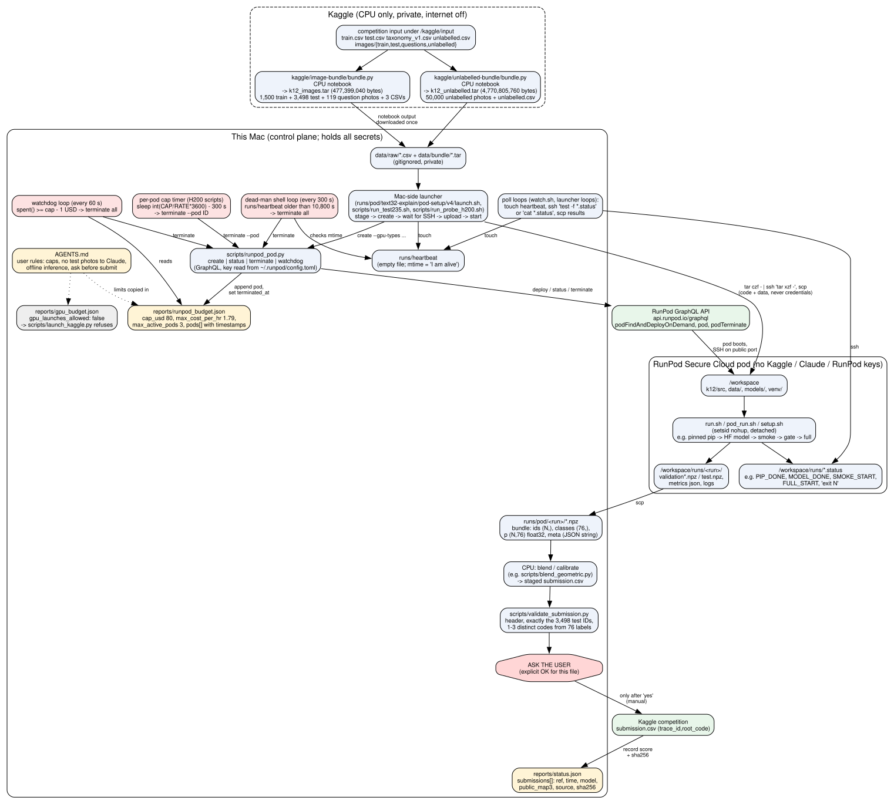
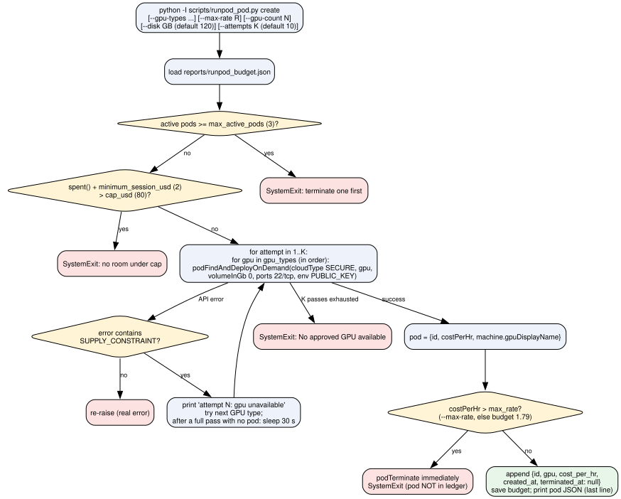
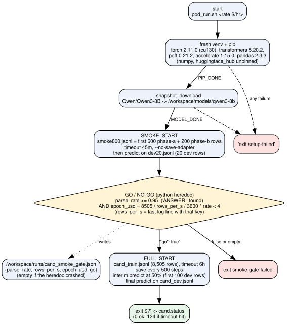

<a id="08-infrastructure"></a>

# Infrastructure: pods, budgets, safety and submissions

## Infrastructure: pods, budgets, safety and submissions

### In one paragraph

Your Mac is the control room. It holds the competition data, every secret (RunPod key, Kaggle token, Claude key) and every budget file. GPU work runs on rented RunPod pods that only ever get code and data, never credentials. `scripts/runpod_pod.py` creates pods (trying several approved GPU types in turn), records each one in `reports/runpod_budget.json`, works out spend from timestamps, and terminates pods. Three separate "kill switches" protect the money: a spend **watchdog**, a **dead-man switch** on `runs/heartbeat`, and a per-pod **cap timer**. Pods run a detached `run.sh` that reports progress through a one-line status file and stops itself at a **predeclared gate**. Kaggle is used only for CPU notebooks that bundle the photos, and for submissions. Each submission needs your explicit OK and is logged with its SHA-256 in `reports/status.json`.



---

### 1. The rulebook: `AGENTS.md`

Everything in this section enforces the rules in `AGENTS.md`. It is a dated list, and **later entries narrow or override earlier ones for their own scope**:

| Rule (AGENTS.md line) | What it means in practice |
|---|---|
| L3: "Keep Gemma running; continue K-12 on CPU" (8 Nov) | No K-12 Kaggle GPU jobs at all. `reports/gpu_budget.json` has `"gpu_launches_allowed": false`. |
| L4–L9: Kaggle free GPUs only, 10 h hard cap, keep a 4 h reserve, use `scripts/launch_kaggle.py` | Still in force for Kaggle jobs. The launcher refuses anyway (see section 7). |
| L10: CPU-only dependency preparation is allowed | This is why the CPU bundling notebooks are fine (section 6). |
| L11: RunPod Secure Cloud, 48 GB or more, at most **$1.79/hr**, **$80 total cap** | Encoded in `reports/runpod_budget.json` (`cap_usd: 80.0`, `max_cost_per_hr: 1.79`). |
| L11: "never copy Kaggle credentials to a pod" | Data goes Mac → pod over SSH. The pod never downloads from Kaggle. |
| L12: Claude API on training and unlabelled photos only, never test; $200 working limit | Tracked in `reports/claude_budget.json`: `spent_usd` 186.6112 of `limit_usd` 200 (PLAN.md: "$186.61 of $200 spent, $13.39 left"). |
| L13: never submit without explicit permission for that specific submission | Build, validate and stage CSVs, then ask. |
| L14: do not claim a score from smoke tests, in-sample predictions or unlaunched jobs | Only completed public scores go into `status.json`. |
| L15: final inference offline; keep data private; no hand-labelling test | See section 10. |

> Plain words: a **hard cap** is a limit the code checks before acting. A soft goal is just a target. Most of the scripts below exist to turn the AGENTS.md sentences into hard caps.

---

### 2. `scripts/runpod_pod.py`: the pod manager (133 lines)

It is one CLI with four subcommands (`runpod_pod.py:120-133`): `create`, `status`, `terminate`, `watchdog`. It talks to RunPod's **GraphQL API**. GraphQL is a single HTTPS endpoint where you POST a query (a read) or a "mutation" (a write action).

```python
def gql(query, variables=None):
    key = tomllib.loads((Path.home() / '.runpod/config.toml').read_text())['apikey']
    request = urllib.request.Request(
        'https://api.runpod.io/graphql', data=json.dumps({'query': query, 'variables': variables or {}}).encode(),
        headers={'Content-Type': 'application/json', 'Authorization': f'Bearer {key}', 'User-Agent': 'k12-cli'})
```
(`runpod_pod.py:18-26`). The key is read from `~/.runpod/config.toml` at call time and is never printed or written anywhere else. The launchers call this script with `python -I` ("isolated mode": `PYTHONPATH` is ignored, and neither the script's folder nor user site-packages goes on `sys.path`), so a stray `json.py` lying around cannot hijack it.

#### 2.1 The budget file is the source of truth

`reports/runpod_budget.json` holds the policy (`cap_usd 80`, `max_cost_per_hr 1.79`, `watchdog_margin_usd 1`, `minimum_session_usd 2`, `max_active_pods 3`, the approved `gpu_types` list, the dev `gate` text, the `approval` history) and a `pods[]` ledger. Each ledger entry has `id, gpu, cost_per_hr, created_at, terminated_at`.

Spend is **computed, not fetched**:

```python
def spent(budget):
    total = 0.
    for pod in budget['pods']:
        end = datetime.fromisoformat(pod['terminated_at']) if pod.get('terminated_at') else now()
        total += (end - datetime.fromisoformat(pod['created_at'])).total_seconds() / 3600 * pod['cost_per_hr']
    return total
```
(`runpod_pod.py:41-46`). A pod that is still running is charged up to "now", so the number grows every second. This is an estimate from local timestamps. It is not RunPod's invoice, which can also include container disk and the few seconds before `created_at` is written.

The ledger lists 10 pods: RTX A6000 ($0.59), L40S ($1.09), RTX 6000 Ada ($0.99), A100 SXM ($1.79) and one H200 SXM ($5.29). `PLAN.md` puts spend at "about $54 by 00:01 UTC 12 Nov". Recomputing `spent()` locally gave **about $56.3 at 01:11 UTC** and **$56.48 at 01:15 UTC**, with two pods still active (`a7cevylabnswz1` A100 at $1.79/hr and `6c9dmwpwmjusor` RTX 6000 Ada at $0.99/hr, so it was rising at $2.78/hr).

#### 2.2 `create`: guards, then GPU fallbacks

See the zoom-in diagram below. In order:

1. **Pre-checks** (`runpod_pod.py:50-54`): refuse if 3 pods are already active, or if `spent + $2 minimum session > $80 cap`.
2. **Fallback loop** (`runpod_pod.py:56-77`): `gpu_types` is `--gpu-types` if given, otherwise the approved list. `max_rate` is `--max-rate` if given, otherwise the budget's 1.79 (`:57`). For up to `--attempts` passes (default 10), the loop tries each GPU type in order. The call is `podFindAndDeployOnDemand` with `cloudType: 'SECURE'`, the SSH public key in the `PUBLIC_KEY` env var, `startSsh`, port `22/tcp`, a 120 GB container disk by default and no network volume (`volumeInGb: 0`). Only a `SUPPLY_CONSTRAINT` error (that GPU is sold out) moves on to the next GPU. Any other error is raised. After a full pass with no pod it sleeps 30 s, including after the last pass, before giving up.
3. **Rate check after deploy** (`runpod_pod.py:78-80`): if the returned `costPerHr` is above `max_rate`, the pod is terminated at once.
4. **Ledger write** (`runpod_pod.py:81-84`): append the pod with `terminated_at: null` and print the pod JSON as the last line. The launchers parse that line with `tail -1`.

```python
            except RuntimeError as exc:
                if 'SUPPLY_CONSTRAINT' not in str(exc):
                    raise
                print(f'attempt {attempt + 1}: {gpu} unavailable', flush=True)
        if pod:
            break
        time.sleep(30)
```
(`runpod_pod.py:69-75`)



Subtleties worth knowing:
- The rate is checked **after** the pod exists. A too-expensive pod lives for a few seconds and is never written to the ledger, so `spent()` slightly undercounts in that case.
- `--max-rate` and `--gpu-types` are levers that need your approval. The budget file's `scale_probe` block records the approval for the 235B probe ($15 probe budget). The code never reads that block. The H200 scripts pass `--max-rate 5.29` explicitly (`scripts/run_test235.sh:15-16`, `scripts/run_probe_h200.sh:12-13`), while `scale_probe.max_rate` says 3.6. The code doesn't enforce the approval text; it relies on the approval having been given.

#### 2.3 `status` and `terminate`

- `status` (`runpod_pod.py:87-94`) queries each non-terminated pod for `desiredStatus`, uptime and port mappings, then prints `{"spent_usd", "cap_usd"}`. The launchers scrape the public IP and public port mapped to private port 22 from this output to build the `ssh -p PORT root@HOST` command (e.g. `run_test235.sh:32-36`).
- `terminate` (`runpod_pod.py:97-105`) calls `podTerminate` on every active pod, or only on `--pod ID`, and stamps `terminated_at`. Terminate deletes the pod and its disk. Anything not copied back to the Mac is gone.

#### 2.4 `watchdog`: the spend kill switch

```python
def watchdog(args):
    """Terminate once spend reaches the cap minus a margin; poll every minute."""
    while True:
        budget = load_budget()
        if all(pod.get('terminated_at') for pod in budget['pods']):
            print('no active pod'); return
        if spent(budget) >= budget['cap_usd'] - budget['watchdog_margin_usd']:
            print(f'cap reached at {spent(budget):.2f} USD', flush=True)
            terminate(args); return
```
(`runpod_pod.py:108-117`; line 117 is `time.sleep(60)`). It fires at $79 ($80 − $1 margin) and exits on its own when no pod is active. `launch.sh` starts it only if one isn't already running: `pgrep -f "runpod_pod.py watchdog" || nohup ... watchdog &` (`runs/pod/text32-explain/pod-setup/v4/launch.sh:26`). The H200 scripts do not start it; they rely on their own cap timer (section 4). Its limitation (`docs/handoff.md:50`): it **only runs while the Mac is awake**. If the laptop sleeps, nothing local can stop a pod. That is why pod-side `timeout` commands exist.

---

### 3. The dead-man switch on `runs/heartbeat`

> Plain words: a **dead-man switch** acts when a regular "I'm still here" signal *stops*. A watchdog acts when a bad value appears. Here the heartbeat is just the file's modification time.

The checker is **not a checked-in script**. It is a long-running shell loop started from an agent session (visible in the process list). Condensed:

```sh
touch runs/heartbeat && while true; do
  age=$(( $(date +%s) - $(stat -f %m runs/heartbeat) ))
  if [ $age -gt 10800 ]; then
    echo "no heartbeat for ${age}s ..."; .venv/bin/python -I scripts/runpod_pod.py terminate; break
  fi
  sleep 300
done
```

Every 5 minutes it checks the heartbeat's age. If nobody has touched the file for **3 hours** (10,800 s), it terminates **all** K-12 pods. The heartbeat is touched by:
- launchers at key steps (`launch.sh:23,40`, `run_test235.sh:14,31,51`, `run_probe_h200.sh:11,45`);
- polling loops while a pod job runs (`runs/pod/text32-explain/pod-setup/v4/watch.sh:8`, every 180 s, for at most 11 h = 39,600 s).

So if the agent or the poller crashes, or the session dies while a pod is idle or stuck, the pods stop within about 3 h 5 min instead of billing all night. This is a different failure from the watchdog's: there, money is running out; here, nobody is watching. The flip side: a legitimate long job is also killed if no poller touches the heartbeat for 3 h. Always keep a poller running.

---

### 4. The third switch: per-pod cap timers

For the expensive H200 runs, the launcher starts a background timer right after `create`:

```sh
LIMIT=$($PY -c "print(int($CAP / $RATE * 3600) - 300)")
( sleep "$LIMIT"; $PY -I scripts/runpod_pod.py terminate --pod "$POD" > /dev/null 2>&1; echo "cap timer fired" ) &
TIMER=$!
DEADLINE=$($PY -c "import time; print(int(time.time() + $LIMIT - 720))")
```
(`scripts/run_test235.sh:23-26`). With CAP=16 and RATE=5.29 the timer is int(10,888.5) − 300 = **10,588 s** (about 2.94 h). `DEADLINE` is copied to the pod (`run_test235.sh:46`) as `/workspace/runs/probe_deadline`, 12 minutes before the kill. `src/k12/scale_probe.py:84-86,135` reads it and does not start a chunk whose projected end (with 20% slack) would pass it. Rows it never reached keep a constant score (`np.full(..., 1e-4)`, `scale_probe.py:149`), which becomes uniform after normalisation, so the other ensemble members decide those rows. The polling loop checks `kill -0 "$TIMER"` to tell whether the timer already fired (`run_test235.sh:52`).

| Switch | Trigger | Scope | Where |
|---|---|---|---|
| watchdog | estimated spend ≥ $79 | all pods | `runpod_pod.py:108-117` |
| dead-man | heartbeat older than 3 h | all pods | ad-hoc shell loop (not in repo) |
| cap timer | wall-clock budget for one pod | one pod | `run_test235.sh:23-24`, `run_probe_h200.sh:21-22` |
| pod-side `timeout` | 45 min smoke, 6 h full (pod_run.sh); 10,800 s / 7,200 s for the 235B probes | one process | `pod_run.sh:17,34`, `probe_test_setup.sh:30`, `probe_setup.sh:20` |
| predeclared gate | dev metric or cost misses its threshold | the run | `pod_run.sh:20-32` |

---

### 5. Data transfer: Mac → pod → Mac over SSH

There is no shared drive and no Kaggle token on the pod. Everything goes through SSH using `~/.runpod/ssh/runpodctl-ssh-key`. The public half is injected at create time.

The **staging pattern** (`runs/pod/text32-explain/pod-setup/v4/launch.sh`):
1. **Leak check before spending** (`launch.sh:11-16`): assert that the extra training subset (a jsonl of explanation rows) shares no `trace_id` with the dev fold or with `train.csv`. This keeps dev numbers honest.
2. **Stage a clean tree** in `mktemp -d` (`launch.sh:18-22`): CSVs, the jsonl dataset, dev/test transcripts and `src/k12`, with `__pycache__` removed.
3. **Create the pod, start the watchdog, wait for SSH** (`launch.sh:24-38`): up to 40 tries, 15 s apart, each one running `ssh ... true`.
4. **Stream it in one pipe** and launch detached (`launch.sh:41-42`):

```sh
(cd $STAGE && COPYFILE_DISABLE=1 tar czf - data k12 get32.py run.sh runs) | ssh ... \
  "mkdir -p /workspace && cd /workspace && tar xzf - 2>/dev/null && chmod +x run.sh && \
   (setsid nohup /workspace/run.sh $NAME $LIMIT ... > /workspace/runs/run.log 2>&1 < /dev/null &) && echo launched"
```

- `tar czf - | ssh 'tar xzf -'` compresses on the Mac and unpacks on the pod in one stream, without a temporary archive.
- `COPYFILE_DISABLE=1` stops macOS from adding `._*` AppleDouble junk files to the tar.
- `setsid nohup ... < /dev/null &` puts the job in its own session with all streams redirected. The SSH command returns at once, and the job survives the SSH disconnect.

**Getting results back:** polling loops either run `ssh 'test -f /workspace/runs/<x>.status'` (`run_test235.sh:50`, `run_probe_h200.sh:44`) or `cat` the status file (`watch.sh:9`), then `scp` the outputs into `runs/pod/<run>/`. `run_test235.sh:53-54` also copies **partial** results every 2 minutes, "in case the pod disappears". `launch.sh` is text-only and sends no photos. Jobs that need photos get them from the Kaggle bundles (section 6), which are sent from the Mac over SSH as AGENTS.md L11 requires. `docs/handoff.md:52` documents the pod layout: `/workspace/k12*` code, `/workspace/data/competition_data`, `/workspace/models/{qwen3-vl-8b,qwen3-8b}`.

---

### 6. Kaggle CPU notebooks that bundle the photos

Downloading competition photos one file at a time from Kaggle is rate-limited (`docs/handoff.md:56`). The fix is two tiny **private, CPU-only, internet-off** Kaggle scripts. Each reads the competition input inside Kaggle and writes one `.tar` to `/kaggle/working`, and you then download the notebook output once. CPU notebooks use no GPU quota (AGENTS.md L10).

```python
hits = [p.parent for p in Path('/kaggle/input').rglob('train.csv') if (p.parent / 'taxonomy_v1.csv').exists()]
assert len(hits) == 1, hits
root = hits[0]
with tarfile.open('/kaggle/working/k12_images.tar', 'w') as tar:
    for name in ['train.csv', 'test.csv', 'taxonomy_v1.csv']:
        tar.add(root / name, arcname=f'competition_data/{name}')
    for split in ['train', 'test', 'questions']:
        tar.add(root / 'images' / split, arcname=f'competition_data/images/{split}')
```
(`kaggle/image-bundle/bundle.py:5-15`, condensed). Both `kernel-metadata.json` files set `"is_private": true, "enable_gpu": false, "enable_internet": false`.

| Notebook | Output | Contents (counted from the local tar listings) |
|---|---|---|
| `kaggle/image-bundle` | `data/bundle/k12_images.tar`, 477,399,040 bytes | train 1,500, test 3,498, questions 119 photos + 3 CSVs |
| `kaggle/unlabelled-bundle` | `data/bundle/unl/k12_unlabelled.tar`, 4,770,805,760 bytes | 50,000 unlabelled photos + `unlabelled.csv` |

The unlabelled script looks for `unlabelled.csv` only in a folder named `competition_data` (`unlabelled-bundle/bundle.py:5-6`), because a legacy duplicate sits at the dataset root. It also skips the train/test/questions folders, which the first bundle already has (`:14`). Both archives sit under `data/`, which is gitignored, so they never reach git.

---

### 7. Kaggle GPU guard: `scripts/launch_kaggle.py` (currently always refuses)

K-12 runs no Kaggle GPU jobs right now. The launcher still shows the "reserve the worst case" idea that the RunPod scripts copy.

- `launch()` refuses unless the timeout is between 0 and 6 h and the notebook is private, offline and on the free T4 (`launch_kaggle.py:118-122`). It also refuses a duplicate of an already-running version (`:123-125`).
- `budget_check()` stops first if `gpu_launches_allowed` is false (`:76-77`). That is where every K-12 attempt stops today, before any arithmetic. Otherwise it stops if the weekly quota window changed, because a reset does not renew the 10 h allowance (`:80-81`), and if any active Kaggle session is not registered (`:84-91`).
- The worst case reserves every active job's *remaining timeout* plus overhead and margin:

```python
def projected_hours(used,reservations,timeout,overhead=.1,margin=.25):
    remaining=sum(max(0,r['timeout_seconds']-r.get('observed_seconds',0))/3600+overhead for r in reservations)
    return used+remaining+timeout/3600+overhead+margin
```
(`launch_kaggle.py:44-46`). Admission needs `total <= 10` h **and** at least 4 h of quota left afterwards (`:98-111`). The last snapshot in `gpu_budget.json` has `quota_snapshot_used_hours` = 21.12 against the 10 h hard cap, so even a 1 h job would project to 22.47 h and be refused. The whole run holds a file lock (`fcntl.flock`, `:152-154`) so two launchers cannot both pass the check at once.

---

### 8. The pod run script pattern: `runs/arch/student/pod_run.sh`

This is the newest pod-side script, for the reason-then-choose student. It is a good template: everything the Mac needs to know is in **one status file** (`/workspace/runs/cand.status`), and the run decides go/no-go by itself.



1. **Setup with pinned versions** (`pod_run.sh:6-10`): a fresh venv, then `torch==2.11.0` (cu130 wheels), `transformers==5.20.2`, `peft==0.21.2`, `accelerate==1.15.0`, `pandas==2.3.3`, then `Qwen/Qwen3-8B` from Hugging Face. Status goes `PIP_DONE` → `MODEL_DONE`. Any failure in that `&&` chain writes `exit setup-failed`. Pinning makes a rerun install the same versions of the main libraries. It is not complete: `numpy`, `huggingface_hub` and `hf_xet` are unpinned, and the model download has no fixed revision.
2. **Smoke subset** (`:14-15`): the first 600 phase-a and first 200 phase-b rows of `cand_train.jsonl` (800 rows, which is 200 steps at batch size 4), and the first 20 dev rows.
3. **Smoke run** under `timeout 45m` (`:16-19`) with `--no-save-adapter`, so no time is spent writing the adapter.
4. **Automatic go/no-go gate** (`:20-32`): the gate PLAN.md Step 3 declared before the run:

```python
rate = float(sys.argv[1])
m = json.load(open('/workspace/runs/cand_smoke/predict_dev20/predict_metrics.json'))
logs = [json.loads(l) for l in open('/workspace/runs/cand_smoke.log') if l.startswith('{') and 'rows_per_s' in l]
rps = logs[-1]['rows_per_s']
cost = 8505 / rps / 3600 * rate
ok = m['parse_rate'] >= .95 and cost < 4.
```
   The run continues only if two things hold. First, at least 95% of generated prompts (each dev row is generated once per candidate order) contain the `ANSWER:` marker (`candidate_student.py:28,276`; PLAN.md calls this "`CODES:` present"). Second, the measured speed puts one pass over the 8,505 training rows under $4. Note what that speed is. `logs[-1]` is the **last** log line with `rows_per_s`, which is the `predict_done` record of the 20-row dev predict (`candidate_student.py:306,319`), not a training record. So the cost estimate uses generation throughput. Whether that over- or under-estimates the real epoch cost is **not measured**. If the smoke run crashes, the metrics file is missing and the heredoc fails. `GATE` then comes back empty (an empty `cand_smoke_gate.json` is still written), and the `case` falls through to `exit smoke-gate-failed`. That is the safe direction.
5. **Full run** under `timeout 6h` (`:33-37`). It checkpoints every 500 steps, runs an **interim predict** on the first 100 dev rows at 50% of the updates (PLAN.md Step 4's abort point), then predicts on all dev rows. The last line writes `exit $?` (`:38`). That is 0 on success, or 124 if `timeout` killed it.

> Plain words: a **predeclared gate** is a pass/fail rule written down *before* you see the result. If you choose the threshold afterwards, you can talk yourself into continuing a run that should stop. AGENTS.md L11 requires stopping pods when such a gate fails.

PLAN.md's later gates for this student (Step 5) are evaluated on the Mac, on CPU. Among other conditions, the student must beat blend+Sinkhorn (0.737) by at least +0.015, with the bootstrap CI's lower bound above 0. The pod script only automates the cheap smoke gate. No result of this pod run exists locally yet (there are no `runs/pod/*cand*` outputs), so whether it passed any gate is **not measured** at the time of writing.

Older launchers follow the same shape, with different status files (`/workspace/runs/text32-v4.status`, `fewshot235_test.status`, `probe235.status`).

---

### 9. Submissions: staging, permission and the log

#### 9.1 Build → validate → ask → submit → record

1. **Blend on CPU** from `.npz` bundles. A bundle holds `ids (N,)`, `classes (76,)`, `p (N,76) float32` and a JSON `meta` string. It is written by `save_bundle` (`src/k12/core.py:97-103`) and read back by `aligned_bundle` (`core.py:106-114`). `aligned_bundle` reorders rows and columns by name and refuses if the ID or class sets differ, which prevents silent misalignment.
2. **Write top-3** with `write_submission` (`core.py:54-61`).
3. **Validate** (`scripts/validate_submission.py:8-17`): the header must be exactly `trace_id,root_code`, the file must hold exactly the 3,498 test IDs with no duplicates, and each row needs 1–3 distinct codes, all from the 76-label space (75 taxonomy codes + `NONE`). Use `read_csv` (`core.py:13-15`), which sets `keep_default_na=False`; otherwise pandas turns the literal label `NONE` into a missing value.
4. **Stage and ask.** The CSV sits in `artifacts/...` or `runs/arch/...` until you approve that specific file. For example, `runs/arch/label-structure/staged_submission_balanced_l0.5.csv` is staged and **not submitted**; PLAN.md says "submit only with your explicit OK".
5. **Record** the result in `reports/status.json`.

#### 9.2 `reports/status.json` submissions log (real entries)

| Kaggle ref | Model (short) | Dev MAP@3 | Public MAP@3 |
|---|---|---|---|
| 58126216 | Qwen3-VL-4B LoRA epoch 3 | not recorded | 0.58216 |
| 58133839 | 4B, T=2 + 25% hierarchical prior | not recorded | 0.598 |
| 58221584 | 8B transcription-trained classifier 0.7 / 4B 0.3, 10% prior | 0.6467 | 0.62383 |
| 58228022 | transcriber → Qwen3-8B reasoner 0.6 / 8B classifier 0.4 | 0.6838 | 0.66183 |
| 58234705 | 8B reasoner × VL-8B distilled from Claude labels, 50/50 | 0.6932 | 0.68283 |
| 58240192 | 3-way: 32B QLoRA .35 / 8B .30 / VL distill .35 | 0.7182 | **0.7085** |
| 58240232 | same file, same SHA-256 | 0.7182 | 0.7085 |

Each entry stores `source` (the CSV path) and `sha256`. The hash proves which exact file was scored: `shasum -a 256 artifacts/submission-3way-blend/submission.csv` gives `886f61a0…`, matching both of the last two entries. The last entry is marked "Accidental duplicate of 58240192 (same file and hash) from a second waiter; used a daily slot, no score effect". A "waiter" was an ad-hoc background command waiting to submit. Two were running. With 5 submissions a day (`docs/handoff.md:8`) and a deadline of 17 Nov 00:00 UTC, a wasted slot matters. This is one reason for the per-file permission rule from 11 Nov.

`best_public_map3` is 0.7085. The milestone is 0.82, and the public top 3 in the 8 Nov snapshot were 0.8445 / 0.842 / 0.83916.

#### 9.3 The permission rule

AGENTS.md L13, plus the auto-memory note "Kaggle submit needs permission": **never submit without your explicit OK for that specific file.** Approving one CSV does not approve the next one. No checked-in file calls `kaggle competitions submit` (a grep of `scripts/`, `src/`, `runs/`, `kaggle/` and `docs/` finds none). Submitting is a manual, approved step.

---

### 10. Reproducibility and the offline requirement

- **Offline final inference.** Test predictions must come from models whose weights we hold. Claude-generated labels are training targets only. The Claude API never sees a test photo (AGENTS.md L12), and test transcripts (`runs/pod/tx/tx_test.json`) come from our own Qwen3-VL-8B transcriber. Kaggle jobs must have `enable_internet: false` (`launch_kaggle.py:120`).
- **Open-source obligation.** Winners must publish full training and inference code under an open licence (`docs/handoff.md:11`). That is why pod scripts pin the main library versions and the data-prep steps (bundles, folds, datasets) are scripts, not manual clicks.
- **Deterministic splits.** `make_folds(seed=2026)` (`core.py:64-94`) groups rows with the same question ID and the same normalised transcription, so the 301-row dev fold (fold 0) cannot leak exact copies of fit rows.
- **Privacy.** `.gitignore` excludes `data/`, `runs/`, `artifacts/`, `.kaggle/`, `kaggle.json`, `*.csv`, `*.npz`, `*.jsonl`, `.env` and `.env.*`. Results and photos stay local.
- **What git does *not* hold yet.** Because `runs/` is ignored, `runs/arch/student/pod_run.sh`, `runs/pod/text32-explain/pod-setup/v4/launch.sh`, `watch.sh` and the dead-man loop are not in git. `scripts/run_test235.sh`, `scripts/run_probe_h200.sh`, `src/k12/candidate_student.py`, `src/k12/scale_probe.py` and `reports/claude_budget.json` are untracked (`??` in `git status`), and `scripts/runpod_pod.py` has uncommitted edits. Copy the pod scripts into a tracked folder and commit them before the code-sharing deadline.
- **Provenance.** Budget files record who approved what and when (`runpod_budget.json["approval"]`, `claude_budget.json["approval"]`), and the submission log records hashes.

---

### Key files

- `/Users/gaddamshivateja/Documents/ChatGPT/kaggle-K-12/AGENTS.md`: the dated user rules
- `/Users/gaddamshivateja/Documents/ChatGPT/kaggle-K-12/scripts/runpod_pod.py`: create / status / terminate / watchdog
- `/Users/gaddamshivateja/Documents/ChatGPT/kaggle-K-12/reports/runpod_budget.json`: RunPod policy and pod ledger
- `/Users/gaddamshivateja/Documents/ChatGPT/kaggle-K-12/runs/heartbeat`: dead-man heartbeat (empty file; only its mtime matters)
- `/Users/gaddamshivateja/Documents/ChatGPT/kaggle-K-12/runs/arch/student/pod_run.sh`: pod-side run with status file and automatic gate
- `/Users/gaddamshivateja/Documents/ChatGPT/kaggle-K-12/runs/pod/text32-explain/pod-setup/v4/launch.sh` and `watch.sh`: Mac-side stage/upload/launch and heartbeat poller
- `/Users/gaddamshivateja/Documents/ChatGPT/kaggle-K-12/scripts/run_test235.sh`, `scripts/run_probe_h200.sh`: H200 runs with cap timers and partial-result rescue
- `/Users/gaddamshivateja/Documents/ChatGPT/kaggle-K-12/src/k12/scale_probe.py`: reads `probe_deadline` and stops starting chunks
- `/Users/gaddamshivateja/Documents/ChatGPT/kaggle-K-12/src/k12/candidate_student.py`: writes the `parse_rate` and `rows_per_s` the smoke gate reads
- `/Users/gaddamshivateja/Documents/ChatGPT/kaggle-K-12/kaggle/image-bundle/bundle.py`, `kaggle/unlabelled-bundle/bundle.py`: CPU bundling notebooks
- `/Users/gaddamshivateja/Documents/ChatGPT/kaggle-K-12/scripts/launch_kaggle.py`, `reports/gpu_budget.json`: Kaggle GPU admission control (disabled for K-12)
- `/Users/gaddamshivateja/Documents/ChatGPT/kaggle-K-12/scripts/validate_submission.py`, `src/k12/core.py`: submission checks, bundles, MAP@3
- `/Users/gaddamshivateja/Documents/ChatGPT/kaggle-K-12/reports/status.json`: submissions log
- `/Users/gaddamshivateja/Documents/ChatGPT/kaggle-K-12/reports/claude_budget.json`: Claude API spend log
- `/Users/gaddamshivateja/Documents/ChatGPT/kaggle-K-12/docs/handoff.md`: pod layout and operations notes (partly stale, see below)
- `/Users/gaddamshivateja/Documents/ChatGPT/kaggle-K-12/runs/arch/PLAN.md`: current plan, budgets and gates

---

### Things to try yourself (all CPU, no pods, no APIs)

Run these from the repo root with `.venv/bin/python -I`.

**1. Load the three dev bundles and recompute MAP@3 and the 3-way geometric blend.**

> **MAP@3**: for each row you rank 3 codes. You score 1, 1/2 or 1/3 if the true code is 1st, 2nd or 3rd, otherwise 0, and then average over rows. **Geometric blending**: average the *log*-probabilities with weights, then exponentiate. A code must be fairly likely under every model to stay on top.

```python
import json, numpy as np, sys; sys.path.insert(0, 'src')
from k12.core import read_csv, aligned_bundle, map3
tr = read_csv('data/raw/train.csv').set_index('trace_id')
ids = json.load(open('data/v3/dev_ids.json')); y = tr.loc[ids, 'root_code'].tolist()
cls = sorted(np.load('runs/pod/dev-distill/validation_epoch_2.npz')['classes'].tolist())
fs = {'32b': 'runs/pod/text32/validation_tx_dev_epoch_1.npz', '8b': 'runs/pod/tx/text_tx_dev_e3.npz',
      'vl': 'runs/pod/dev-distill/validation_epoch_2.npz'}
P = {k: aligned_bundle(f, ids, cls) for k, f in fs.items()}
for k in P: print(k, round(map3(y, P[k], cls), 4))
logp = .35*np.log(P['32b']) + .30*np.log(P['8b']) + .35*np.log(P['vl'])
print('blend', round(map3(y, np.exp(logp - logp.max(1, keepdims=True)), cls), 4))
```
When this guide was checked, it printed 32b 0.6523, 8b 0.6667, vl 0.6528 and blend **0.7182** on the 301 dev rows. That matches PLAN.md and the `development_map3` of submission 58240192. Equal weights (1/3 each) gave 0.7126. Try other weights and see how far the score moves.

**2. Compute RunPod spend without touching the API.**
```python
import sys; sys.path.insert(0, 'scripts')
from runpod_pod import load_budget, spent   # importing does not call the API; gql() runs only inside create/status/terminate
print(round(spent(load_budget()), 2))
```
Run it twice a minute apart while a pod is active and watch it grow. Then work out by hand when the watchdog would fire ($79). Do **not** run `runpod_pod.py status`: it calls the API.

**3. Validate a staged CSV and check its hash against the log.**
```sh
.venv/bin/python -I scripts/validate_submission.py runs/arch/label-structure/staged_submission_balanced_l0.5.csv
shasum -a 256 artifacts/submission-3way-blend/submission.csv   # compare with status.json sha256
```
The first command prints `VALID: 3498 rows, ...`. Then copy a CSV to your scratch folder, delete one row or add a 4th code, and watch the validator reject it.

**4. Replay the Kaggle admission arithmetic.**
```python
import sys; sys.path.insert(0, 'scripts'); from launch_kaggle import projected_hours
print(projected_hours(21.12, [], 3600))   # 22.47 > hard cap 10, so refused
print(projected_hours(2.0, [{'timeout_seconds': 7200, 'observed_seconds': 1800}], 3600))   # 4.95
```
The second call shows how an active job's *remaining* timeout (5,400 s = 1.5 h, plus 0.1 h overhead) is reserved, not its elapsed time.

---

### Common confusions

- **"AGENTS.md says no paid compute, yet we rent pods and use the Claude API."** Line 4 is from 8 Nov. Lines 11–12 (10–11 Nov) are later, dated, scoped authorisations: RunPod up to $80, and Claude up to $200 on non-test photos. The Kaggle-GPU rules still apply to Kaggle jobs.
- **"The handoff says a $50 cap."** `docs/handoff.md` was last updated 11 Nov ~04:00 UTC. The cap was later raised to $70, then $80 (see `runpod_budget.json["approval"]`). `reports/runpod_budget.json` and AGENTS.md are current. Several top-level fields in `status.json` (`budget`, `monitoring`, `next_required`) also date from the Kaggle-only era. Treat `submissions[]` as the reliable part.
- **"`spent()` is what RunPod will bill."** No. It is elapsed time × listed rate from the local ledger. Disk charges, boot seconds and an over-rate pod that was killed at once are not included. Keep the $1 margin.
- **Watchdog vs dead-man vs cap timer.** Watchdog: "money is running out" (all pods). Dead-man: "nobody has checked in for 3 h" (all pods). Cap timer: "this one pod's time is up". All three run on the Mac and stop if it sleeps. Only the pod-side `timeout` and gate keep working without the Mac. They end the *job*, not the *billing*: an idle pod still costs money until it is terminated.
- **"The dead-man switch is in the repo."** It isn't. It is a shell loop in a background session. If you start fresh, recreate it (or a script version) before leaving pods unattended.
- **"`terminate` = stop."** Terminate destroys the pod and its disk. Copy results back first. This is why the launchers `scp` partial outputs while the job runs.
- **"Smoke-test score = a result."** AGENTS.md L14 forbids claiming it. A 20-row smoke run tests that the pipeline works (parsing, speed, cost), not accuracy.
- **"The smoke gate measured training speed."** It reads the last `rows_per_s` in the log. In `pod_run.sh` that comes from the dev-predict summary, so it measures generation speed.
- **"Validated = OK to submit."** Validation checks format only. Submitting still needs your explicit yes for that file, and a duplicate submit still burns a daily slot (ref 58240232).
- **"Kaggle bundles use GPU quota."** They are CPU-only notebooks (`enable_gpu: false`), so they use none.

