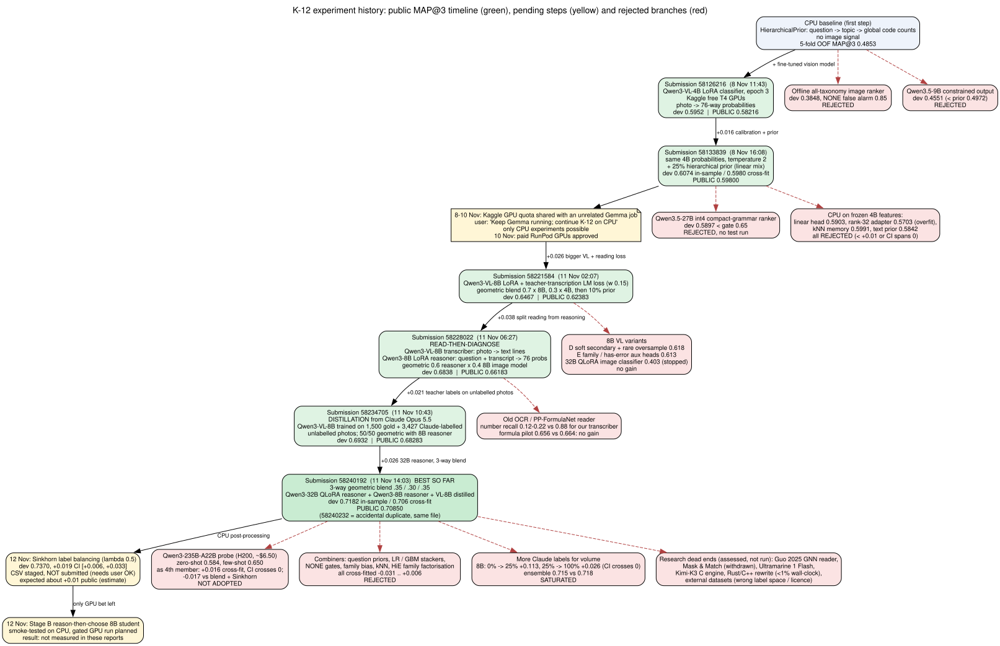
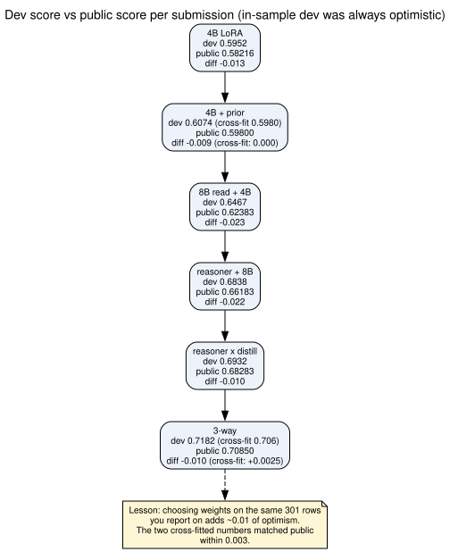
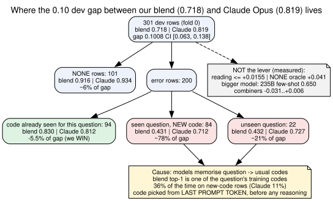

<a id="09-history-lessons"></a>

# Experiment history and lessons learned

## In one paragraph

The public MAP@3 went from **0.58216 to 0.70850** in six distinct submissions over four days (8 to 11 November 2026). Each step changed one big thing:
1. a fine-tuned 4B vision model;
2. calibration with a prior;
3. a bigger 8B vision model with a "reading" loss;
4. splitting the job into *read the photo* and *diagnose the text*;
5. training on Claude-labelled unlabelled photos (distillation);
6. a 3-way blend that adds a 32B text reasoner.

Many more ideas failed than succeeded. Bigger models without fine-tuning (Qwen3.5-27B, Qwen3-235B), smarter combiners and stackers, and better readers were all measured and gave no gain that held up. External datasets and speed rewrites in Rust or C++ were assessed and ruled out on evidence, without being run. The gap analysis in `runs/arch/PLAN.md` explains why. Claude Opus scores 0.819 on dev, about 0.10 above us. About 78% of that gap sits on one kind of row: a question we have seen before, where the student made a type of error that never appeared for that question in training. Our models have learned "question → its usual codes", and nothing tried so far breaks that shortcut. The honest outlook is about 0.72–0.74 public by 17 November, and nothing measured supports 0.80 or more.



---

## 1. Concepts you need for this chapter

These ideas come up again and again below. Each gets one plain-words explanation here.

- **MAP@3 (mean average precision at 3).** For each photo you submit up to 3 ranked codes. A correct code scores 1 at rank 1, 1/2 at rank 2 and 1/3 at rank 3; anything else scores 0. The score is the average over all photos. Our implementation is in `src/k12/core.py:38-51`:
  ```python
  def row_scores(y, predictions):
      ...
      for target, codes in zip(y, predictions):
          ...
          hits = [1.0 / (i + 1) for i, c in enumerate(list(codes)[:3]) if c == target]
          scores.append(hits[0] if hits else 0.0)
      return np.asarray(scores)

  def map3(y, p, classes):
      return float(row_scores(y, topk(p, classes)).mean())
  ```
  There are 76 classes: 75 taxonomy codes plus `NONE` (`label_space`, `core.py:18-19`).
- **Dev fold.** `make_folds` (`core.py:64`) splits the 1,500 training rows into 5 folds.
  - Fold 0 (**301 rows**) is the *development* (dev) set. Every number in this chapter is measured on it.
  - The other **1,199 rows** are the *fit* rows the dev models were trained on.
  - Test has 3,498 rows. Its labels are hidden, and only Kaggle's public leaderboard scores it.
- **LoRA / QLoRA.** LoRA leaves a big model's weights frozen and trains small low-rank "adapter" matrices added to some layers, which makes training cheap. Our text reasoner puts LoRA on all attention and MLP projections (`src/k12/text_diagnose.py:50-52`). QLoRA does the same on top of a base model stored in 4-bit NF4, so a 32B model fits on one GPU (`text_diagnose.py:44-47`).
- **Distillation / soft labels.** A strong "teacher" (Claude Opus) labels unlabelled photos, and a smaller "student" (our Qwen model) is trained to copy it. With soft labels the target is a spread of probability over several codes, not a single code. We put 0.7/0.2/0.1 on Claude's ranked top 3. That is the default `--shares` in `scripts/build_claude_distill.py:24`, and it is recorded in the settings of `reports/claude_distill_v3.json`, `_v4.json` and `_v4w.json`.
- **Geometric blending.** To combine models, raise each model's probabilities to a weight, multiply them, then renormalise. This equals a weighted sum of log-probabilities. A code needs support from every model to rank high. See `scripts/blend_geometric.py:24-29`:
  ```python
  for spec in args.inputs:
      name, rest = spec.split('=', 1)
      path, weight = rest.rsplit(':', 1)
      log_p = log_p + float(weight) * np.log(aligned_bundle(path, ids, classes))
      recipe[name] = {'path': path, 'weight': float(weight)}
  scores = normalize(np.exp(log_p - log_p.max(axis=1, keepdims=True)))
  ```
- **Hierarchical prior.** A model with no image signal at all. It asks how often each code was the answer for this question, backs off to the topic when the question has few rows, and backs off to all rows after that. See `src/k12/baseline.py:13-36` (`question_strength=2.0`, `topic_strength=8.0`). It was the very first baseline, and it was mixed in at 10–25% in early submissions.
- **Cross-fitting.** If you pick a setting (a blend weight, a λ) on the same 301 rows you then score, the score is optimistic. Cross-fitting avoids this:
  1. Split the dev rows into 5 groups *by question* (for example `s7_sinkhorn.py:14-15`).
  2. For each group, pick the setting on the other 4 groups.
  3. Score that setting on the held-out group.

  This is how the plan computes an honest number.
- **Paired question-grouped bootstrap CI.** This tests whether "new − old" is a real difference.
  - Resample *questions* 4,000 times. Questions, not rows, because rows from one question are correlated.
  - Take the 2.5% and 97.5% quantiles of the mean difference. See `runs/arch/label-structure/common.py:20-28`.
  - If the interval contains 0, the gain is not established.
  - On 301 rows the paired standard error is about 0.013, so one run cannot confirm a gain smaller than about +0.02 (`runs/research/REPORT.md:5`).
- **Sinkhorn balancing.** Each class gets one scaling factor, applied to every row, so that the *average* predicted class mix on the evaluated set matches a target mix (here, the training label counts). It needs no labels on the evaluated set. λ controls how far toward full balancing to go. Covered in §5.

---

## 2. The score timeline: what changed each time

All submissions are recorded in `reports/status.json` under the `submissions` key.

| # | Ref | Time (UTC) | What changed | Dev MAP@3 | Public MAP@3 | Public Δ |
|---|---|---|---|---|---|---|
| 0 | n/a | first step | CPU hierarchical prior, no image (`reports/baseline_metrics.json`) | 0.4853 (5-fold OOF) | n/a | n/a |
| 1 | 58126216 | 8 Nov 11:43 | Qwen3-VL-4B LoRA classifier, epoch 3, Kaggle free T4 | 0.5952 | **0.58216** | n/a |
| 2 | 58133839 | 8 Nov 16:08 | Same probabilities, temperature 2 + 25% hierarchical prior | 0.6074 (in-sample) / 0.5980 (cross-fit) | **0.59800** | +0.0158 |
| 3 | 58221584 | 11 Nov 02:07 | Qwen3-VL-8B LoRA with teacher-transcription loss; geometric 0.7 × 8B · 0.3 × 4B; 10% prior | 0.6467 | **0.62383** | +0.0258 |
| 4 | 58228022 | 11 Nov 06:27 | Read-then-diagnose: VL-8B transcriber → Qwen3-8B LoRA reasoner; geometric 0.6 reasoner · 0.4 VL-8B | 0.6838 | **0.66183** | +0.0380 |
| 5 | 58234705 | 11 Nov 10:43 | VL-8B distilled from Claude Opus 5.5 labels (1,500 real + 3,427 Claude rows); 50/50 with 8B reasoner | 0.6932 | **0.68283** | +0.0210 |
| 6 | 58240192 | 11 Nov 14:03 | 3-way: Qwen3-32B QLoRA reasoner .35 + Qwen3-8B reasoner .30 + VL-8B distilled .35 | 0.7182 (in-sample) / 0.706 (cross-fit) | **0.70850** | +0.0257 |
| (6b) | 58240232 | 11 Nov 14:05 | Accidental duplicate of 58240192 (same SHA-256), sent by a second waiter process. It used up a daily slot and had no score effect. | | 0.70850 | 0 |

### Step 1: a fine-tuned vision model (0.58216)

- **What:** Qwen3-VL-4B with a LoRA adapter and a 76-way classification head, trained for 3 epochs on Kaggle's free T4 GPUs. Photo in, 76 probabilities out.
- **Evidence:**
  - Dev MAP@3 by epoch was 0.434 → 0.586 → 0.595 (`status.json` → `experiments[k12-vision-development].epoch_metrics_from_live_log`).
  - The prior alone scores 0.497 on the same rows, so the photo added about +0.10, CI [+0.057, +0.140].
- **Weakness:** it called 17.8% of NONE rows an error, and labelled 11.5% of error rows NONE.

### Step 2: calibration plus a prior (0.59800)

- **What:** no new model. The 4B probabilities were softened with temperature 2 (raised to the power 1/2), then mixed linearly with the hierarchical prior at weight 0.25. Code: `src/k12/holdout_calibration.py:12-14`:
  ```python
  def calibrated(image,prior,weight,temperature):
      softened=normalize(np.maximum(image,1e-12)**(1/temperature))
      return (1-weight)*softened+weight*prior
  ```
- **Lesson:** the in-sample dev score was 0.6074 and the cross-fit score was 0.5980. Public came in at exactly 0.59800. This was the first sign that **cross-fitted dev numbers predict public; in-sample ones do not**.

### The pause (8–10 Nov): CPU only

- An unrelated Gemma job on the same Kaggle account was consuming the shared GPU quota. The user chose "Keep Gemma running; continue K-12 on CPU" (`AGENTS.md`). The queued K-12 GPU run was cancelled.
- Every CPU idea on frozen 4B features failed (§3.2).
- On 10 Nov the user approved paid RunPod GPUs, which made steps 3–6 possible.

### Step 3: bigger vision model plus a reading loss (0.62383)

- **What:** Qwen3-VL-8B with two losses.
  - The usual classification loss.
  - An extra language-model loss for writing the annotator's transcription of the photo (`--reading-weight 0.15`).
- **The idea:** forcing the model to *read* the working should help it *diagnose*. The combined loss is at `src/k12/pod_train.py:206`:
  ```python
  ((weight * ce + args.reading_weight * reading + args.aux_weight * aux) / window).backward()
  ```
- **Evidence** (`docs/handoff.md:22-31`, dev at epoch 3):

  | Run | Dev MAP@3 |
  |---|---|
  | Run A, plain 8B | 0.619 |
  | Run B, + reading loss (weight 0.15) | **0.632** |
  | B^0.7 · 4B^0.3, then 10% prior | **0.647** |

- **Caveat:** against the submitted 4B recipe (0.6074), Run B's paired CI was still [−0.014, +0.060] (`reports/pod_8b_read_dev.json`, `paired_question_bootstrap_delta_95`). So the reading loss was a plausible gain, not a proven one.

### Step 4: read, then diagnose (0.66183, the largest single jump)

- **What:** split the problem into two models.
  1. **Transcriber.** A Qwen3-VL-8B LoRA writes the student's working as text lines (photo → text lines).
  2. **Reasoner.** A Qwen3-8B text model with LoRA and a linear classifier head (`text_diagnose.py:56`).
     - Input: the taxonomy code list, then grade, topic, question, answer key and transcript.
     - Output: 76 probabilities.
     - The prompt is built in `src/k12/text_diagnose.py:25-29`.
- **Why it worked:**
  - **The transcriber reads well.** On dev photos it reached number recall 0.88 and precision 0.91; older OCR got 0.12–0.22 recall (`docs/handoff.md:35`).
  - **Text is easier to reason over.** Given good text, a text-only LLM reasons about the maths much better than a vision model reasoning about pixels.
  - **Machine reading costs little.** At epoch 1 the reasoner scored 0.570 on teacher transcripts and 0.542 on machine transcripts, a cost of about 0.03 (`docs/handoff.md:36`).

### Step 5: distillation from Claude (0.68283)

- **What:**
  - Claude Opus 5.5 (paid API, on **training and unlabelled photos only, never test**) labelled thousands of the 50,000 unlabelled competition photos with a ranked top 3.
  - The VL-8B was then trained on 1,500 real rows plus 3,427 Claude rows with soft targets.
  - Inference stays fully offline: only the Qwen weights are used at test time.
  - The API budget later covered 17,503 photos in total (`reports/claude_budget.json`).
- **Teacher quality:** Claude scored **0.8189** on the 301 dev photos (`reports/claude_dev_opus.json`). That is far above any of our models, so it is a good teacher.
- **Data scaling** (`reports/claude_scaling.json`, 8B text reasoner on machine transcripts):

  | Claude labels added | Dev MAP@3 | Δ (95% CI) |
  |---|---|---|
  | 0% | 0.5532 | n/a |
  | 25% | 0.6661 | +0.113 vs 0% [0.073, 0.156] |
  | 100% | 0.6921 | +0.026 vs 25% [−0.002, +0.053] |

  The first quarter of the labels did almost all of the work.

### Step 6: the 3-way blend with a 32B reasoner (0.70850, current best)

- **What:** a geometric blend at .35/.30/.35 of three models (`runs/arch/PLAN.md:20-24`):

  | Member | Epoch | Dev MAP@3 alone |
  |---|---|---|
  | Qwen3-32B QLoRA text reasoner | 1 | 0.652 |
  | Qwen3-8B text reasoner | 3 | 0.667 |
  | Distilled VL-8B | 2 | 0.653 |

- **Why it worked:** no single member beats 0.667, but the blend reaches 0.718. The members make *different* mistakes, so multiplying their probabilities cancels some errors.



**Lesson from the dev-vs-public pairs:**
- In-sample dev was always higher than public, by 0.009 to 0.023.
- A cross-fitted number exists only for submissions 2 and 6. In both it lands within 0.003 of public (0.5980 vs 0.59800; 0.706 vs 0.7085).
- **Picking the 3-way weights on dev adds about 0.012 of optimism.** The blend scores 0.718 in-sample against 0.706 cross-fitted, CI [−0.021, −0.004] (`PLAN.md:61`, `PLAN.md:210`).

---

## 3. Experiments that failed, and why



### 3.1 Big models without fine-tuning

| Experiment | Dev MAP@3 | Why it failed | Source |
|---|---|---|---|
| Offline all-taxonomy image ranker | 0.3848 | It over-diagnosed, calling 85% of NONE rows an error. Version 1 also ran out of memory on one T4 with the long taxonomy prompt. | `status.json` experiments |
| Qwen3.5-9B, code-only constrained output | 0.4551 | Worse than the no-image prior (0.4972). It missed 53.5% of errors as NONE. | same |
| Qwen3.5-27B int4 compact-grammar ranker | 0.5897 | Failed its predeclared 0.65 gate, so no test run. It took 2,171 s for 301 rows. | `status.json`, `reports/qwen35_27b_result.json` |
| **Qwen3-235B-A22B probe** (one H200, about $6.50) | zero-shot 0.584; few-shot (4 examples) **0.650** | Still below our 0.718 ensemble. | `runs/pod/probe235/REPORT.md` |

**More on the 235B probe:**
- **Scale does help at equal information.** With both models few-shot, 235B beat 32B by +0.054, CI [+0.014, +0.094].
- **Fine-tuning helps about as much as scale.**
  - The 32B went from 0.596 few-shot to 0.652 fine-tuned (+0.056).
  - A fine-tuned 235B might reach about 0.70–0.71. That is an extrapolation, not a measurement.
  - A 235B fine-tune was estimated at $150–300, far above the remaining cap.
- **As a 4th ensemble member it adds little.**
  - Probe report: +0.012 over the *equal-weight* 3-way blend (0.713), CI [−0.014, +0.037].
  - With the weight cross-fitted on the real blend: +0.016 with a CI crossing 0, and −0.017 against blend + Sinkhorn (`PLAN.md:213`).
  - Its gain sits on rows we already get right. Unseen-pair rows go 0.431 → 0.429.
- **Setup lessons** (`runs/pod/probe235/REPORT.md:30-33`):
  - vLLM 0.33 needs the venv's CUDA 13 NVRTC on `LD_LIBRARY_PATH` and the venv `bin` on `PATH`. `scripts/probe_setup.sh:15-17` does both.
  - FlashInfer cannot be built with the image's nvcc 12.4. Point `CUDA_HOME` at the venv's CUDA 13, or set `VLLM_USE_FLASHINFER_SAMPLER=0`.
  - Start the model download in parallel with `pip install`. The setup script itself still downloads after pip.

**Lesson:** a bigger general model is not a better *diagnoser* of these specific student errors. The literature review found the same: in MAP 2025, going from Qwen3-8B to 32B gained the winner only +0.003 (`runs/research/ARCHITECTURE_FROM_PAPERS.md:14`).

### 3.2 CPU tricks on frozen features (the 8–10 Nov pause)

All of these are on the reused dev fold (`status.json` and `reports/experiment_results_2026-11-08.md:9-21`). They use two different references:
- The adapters and kNN are compared against the same 4B model on cached batched features, at **0.5980**.
- The two prior ideas are compared against the fixed in-sample blend, at **0.6074**.

| Idea | Dev MAP@3 | Reference | Verdict |
|---|---|---|---|
| Linear head refit | 0.5903 | 0.5980 | worse |
| Rank-32 residual adapter | 0.5703 | 0.5980 | **overfit**: fit-rows MAP 0.960, dev fell |
| Regularised rank-8 adapter | 0.5991 | 0.5980 | +0.001, CI spans 0, below the +0.01 screen |
| kNN feature memory (k=8), confidence-gated | 0.5991 | 0.5980 | insufficient gain |
| Conditional-prior odds correction | 0.6074 | 0.6074 | Δ 0.000, CI [−0.021, +0.018] |
| Question-text logistic prior | 0.5842 | 0.6074 | worse, Δ −0.023, CI [−0.043, −0.005] |

**Lesson:** you cannot squeeze new information out of features that do not contain it. More output capacity just memorised the 1,199 fit rows.

### 3.3 Training-recipe variants that did not help

From `docs/handoff.md:22-30`. The VL-8B variants are at epoch 3:

| Variant | Dev MAP@3 |
|---|---|
| Run A (plain 8B, reference) | 0.619 |
| D: soft secondary labels + rare-code oversampling | 0.618 |
| E: error-family and has-error auxiliary heads | 0.613 |
| 32B QLoRA image classifier | 0.403 at epoch 1, stopped |

### 3.4 Combiners, priors and stackers

`PLAN.md:58` and `ARCHITECTURE_FROM_PAPERS.md` §2 and §4 list everything tried on top of the 3-way blend, all cross-fitted:
- question priors (−0.004);
- logistic-regression and gradient-boosting stackers;
- NONE gates, family bias and routing;
- within-question kNN over about 27k transcriptions: 1,199 gold + 26,161 Claude-labelled (−0.006 to 0.000);
- HiE family factorisation (−0.004 raw, −0.008 on the Sinkhorn base).

Every variant lands between **−0.031 and +0.006**.

**Lesson:** once three strong members are blended, re-weighting their outputs is exhausted. A real gain needs *new evidence*, not a new way to mix old evidence.

### 3.5 Reading upgrades

- **Perfect reading is worth little** (`runs/arch/reading-impact/results.json`).
  - Single models: swapping the machine transcript for the gold one improves them by +0.025 to +0.035.
  - Ensemble: only about +0.0155 (32B reading gold, CI [+0.006, +0.026]).
- **Most lost points are not reading errors.** 17.0 of the 30.3 gap points are on rows our transcriber read exactly right (`PLAN.md:55`).
- **Claude does not read better than our transcriber.** Median page character error rate is 0.124 for Claude and 0.095 for ours (`PLAN.md:55`).
- **The PP-FormulaNet formula-reader pilot gave no diagnosis gain**: 0.656 vs 0.664 (`runs/research/REPORT.md:139`).
- **The worry that "VLMs over-correct student errors" does not apply here.** Our transcriber turned a wrong final answer right on only 8 of 173 rows (`ARCHITECTURE_FROM_PAPERS.md:81`).

### 3.6 More data

- **More Claude labels are saturated.**
  - Going from 0% to 100% Claude labels lifted a single 8B from 0.553 to 0.692.
  - The *ensemble* only reached 0.715, against 0.718 without them (`PLAN.md:57`).
  - Labelling the whole 50k pool would cost about $174 for roughly nothing (`REPORT.md:177`).
  - The API budget stands at $186.61 spent of $200 (`reports/claude_budget.json`).
- **External datasets don't fit** (`runs/research/REPORT.md` Q5, lines 156-183):
  - **MathWriting, CROHME, HME100K.** Single-expression handwriting sets. MathWriting is non-commercial, and the other two licences are unverified.
  - **ProcessBench, PRM800K.** They label LLM solution steps as right or wrong, not student misconceptions.
  - **Eedi 2024, MAP 2025, ScratchMath, FERMAT, ErrorRadar and others.** Each one fails on at least one count: a different label space, typed or deliberately perturbed text, a small or Chinese-only set, or an unverified licence.
  - No external set uses our 75 codes.
- **Self-training on our own ensemble's labels was ruled out.** The teacher would be weaker (0.718 vs 0.819) and would reinforce its own mistakes.

### 3.7 Research dead ends (assessed, not run)

From `runs/research/REPORT.md`:

| Idea | Why not |
|---|---|
| Guo 2025 EfficientNet + GNN formula reader (Q1) | It reads single formulas, it is weaker than CoMER on CROHME, and its tables are inconsistent. |
| Mask & Match, arXiv 2508.06107 (Q4) | Withdrawn by the authors, and no code was released. |
| Ultramarine 1 Flash (Q2) | 331 GB in FP8, so it cannot run offline on Kaggle. Its RL post-training was text-only. |
| Kimi-K3-in-C CPU engine (Q3) | 5.6–26.5 s per token, so the 3,498 test rows (about 4.1M prompt tokens) would take weeks. |
| Rust/C++ rewrite (Q3) | Tokenising takes 0.3 ms per prompt and image preprocessing 6.4 ms per photo, both already in native code. Against 1–2 s of GPU time per row, a rewrite saves under 1% of wall-clock. |

**The one transferable efficiency lesson from Q3:** the 921-token taxonomy list is most of every prompt. It is about 72% of a training row and 78% of an inference prompt (`REPORT.md:92`); `PLAN.md:67` says 79%. **The prompt is the real speed lever.**

---

## 4. The gap analysis: where the remaining 0.10 lives

This table (`runs/arch/PLAN.md:28-33`) is the most important result in the project. It splits the 301 dev rows by *whether we have seen this situation before*:

| Where | Rows | Blend | Claude | Share of gap |
|---|---|---|---|---|
| Error rows, seen question, **code never seen for that question** in fit rows | 84 | 0.431 | 0.712 | **about 78%** (+0.282, CI [0.204, 0.366]) |
| Error rows from **unseen questions** | 22 | 0.432 | 0.727 | about 21% |
| Error rows whose code **was** seen for that question | 94 | **0.830** | 0.812 | −5.5% (we win) |
| NONE rows | 101 | 0.916 | 0.934 | about 6% |

Total gap: 0.1008, CI [0.063, 0.138] (`PLAN.md:26`).

**How to read it:**
- **Familiar situations:** our fine-tuned blend already *beats* Claude.
- **A mistake that is new for the question:** we fall back on the question's usual codes. On those rows our top-1 is one of the question's training codes 36% of the time, against 11% for Claude (`PLAN.md:38`).
- **Ranking, not recall, is the problem.** The truth is in our top 10 on 94% of rows, so a perfect reranker of the top 10 would score 0.940. That is an oracle number (`PLAN.md:46-47`).

**The root cause in code** (`PLAN.md:63-67`). The text reasoner picks its code from the **last prompt token**, before any reasoning has happened. The prompt ends with `ROOT:` (`text_diagnose.py:25-29`), and the head reads `out[:, -1]` (`text_diagnose.py:59-64`):

```python
def prompt(row, transcript, definitions, examples=''):
    return (f"{definitions}\n\n{examples}Grade: {row.grade}\nTopic: {row.topic_name}\nQuestion: {row.question_text}\n"
            f"Answer key: {row.correct_answer}\nStudent working (line by line):\n{transcript}\n\n"
            "Identify the root major error the rest of the working follows from, or NONE if there is no "
            "major error. ROOT:")
...
        return out[:, -1].float()
```

The explanation targets also put the code first (`ROOT: X / WHERE / WHY`). So the model never has to work the problem out before committing. The easiest shortcut is "this question → its usual codes".

---

## 5. The one thing that survived: Sinkhorn balancing

- **What it does.** The blend's average predicted class mix on dev differs from the training label mix. Sinkhorn repeatedly adjusts a per-class log-bias `b` until the average prediction for each class matches the target. It then applies a fraction λ of that bias. Code: `runs/arch/label-structure/s7_sinkhorn.py:8-13`:
  ```python
  pi_fit = np.bincount(fit.root_code.map(ci), minlength=len(classes)) + .5; pi_fit /= pi_fit.sum()
  def sinkhorn(P, target, lam, iters=30):
      b = np.zeros(P.shape[1]); Q = P
      for _ in range(iters):
          Q = normalize(P * np.exp(b)); b += np.log(target / Q.mean(0))
      return normalize(P * np.exp(lam * b))
  ```
- **Result** (`runs/arch/label-structure/sinkhorn_balance.json`):

  | Setting | Dev MAP@3 | Notes |
  |---|---|---|
  | No balancing | 0.7182 | the 3-way blend |
  | λ = 0.5, fixed | **0.7370** | Δ +0.019, CI [+0.006, +0.033] |
  | λ cross-fitted | 0.7337 | Δ +0.016, CI [+0.001, +0.031]. λ = 0.5 was chosen in 4 of 5 folds (0.75 in one). `PLAN.md:132` says "all 5 folds", but the JSON `choices` field is [0.5, 0.75, 0.5, 0.5, 0.5]. |

  It helps error rows (0.618 → 0.642) and NONE rows (0.916 → 0.926).
- **Risk.**
  - It only helps if the *test* labels follow the training label mix. With Claude's label mix as the target, the change is −0.066 (`PLAN.md:137`, `PLAN.md:238`).
  - The CSV is staged at `runs/arch/label-structure/staged_submission_balanced_l0.5.csv`. Under the user's rule it is **not submitted** without their explicit OK.
  - Expected public gain is about +0.01 (an estimate).

---

## 6. Lessons learned

1. **Splitting a hard problem into easier sub-problems beat scaling.**
   - Read-then-diagnose (+0.038 public) was the biggest single jump.
   - Neither the 235B zero-shot (0.584) nor its few-shot run (0.650) caught up with the fine-tuned 8B reasoner (0.667).
2. **A strong teacher's labels are worth a lot, then saturate quickly.** The first 25% of Claude labels gave +0.113. The next 75% gave +0.026, with a CI crossing 0.
3. **Ensembles help when their members differ.**
   - The 3-way blend beats its best member by about +0.05.
   - A fourth, *similar* member (scale_100, the best single 8B) gave −0.007 to −0.014 (`PLAN.md:142`).
4. **Tune on one set, report on another.**
   - In both cases where it was measured, in-sample tuning on the dev rows added about 0.01 of optimism.
   - The cross-fitted numbers matched public within 0.003.
5. **Predeclare gates.**
   - The 27B ranker (gate 0.65) and the frozen-feature adapters (+0.01 screen) were each stopped after one dev run.
   - The bar was written down before the run, so no time or quota went to test inference or promotion.
6. **Diagnose before you build.**
   - The gap table showed that reading, NONE handling, model size and combiners are *not* the lever.
   - That saved money that would otherwise have gone to a better transcriber or a 235B fine-tune.
7. **The real bug can be a design choice.** "Pick the code from the last prompt token, before reasoning" looks harmless, but it invites the question-to-code shortcut.
8. **Speed work only matters where the time actually goes.** Profile first. The prompt length (the 921-token code list) is the lever, not the Python glue.
9. **Process hygiene matters.**
   - A second waiter process re-submitted the same file (58240232) and wasted a daily slot.
   - Pods need watchdogs and explicit termination.

---

## 7. Honest outlook

From `runs/arch/PLAN.md:222-233`:

| Scenario | Dev (cross-fitted) | Public (estimate) | Probability (estimate) |
|---|---|---|---|
| Blend + Sinkhorn only (ships no matter what) | 0.734–0.737 (measured) | about 0.715–0.72; could be lower if the test label mix differs | n/a |
| + 32B-all retrain as 4th member | +0 to +0.01 | +0 to +0.01 | about 40% that it helps at all |
| Stage B reason-then-choose student passes its gate | 0.75–0.76 | about 0.73–0.75 | about 25–35% |
| Stage B reaches Claude-like accuracy on unseen pairs | about 0.79–0.80 | about 0.78 | at most 10–15% |

- **Stage B** is the one remaining GPU bet, specified in `runs/arch/student/SPEC.md`.
  - **Model:** a Qwen3-8B LoRA.
  - **Input:** about 10 candidate codes taken from the top 10 of the Sinkhorn-balanced blend, each shown with its meaning and a same-question example.
  - **Output:** it writes `ROOT_LINE:` and `WHY:` first, then `ANSWER: <letter>` (`SPEC.md:54-58`). The letter probabilities become a 76-way bundle.
  - **Status:** the PLAN sketch (`PLAN.md:90`) ended with `CODES: c1 c2 c3`; SPEC.md replaced that with the letter answer. At the time of writing Stage B had been smoke-tested on CPU (`runs/arch/student/smoke_v5/`). Its full-run dev result is **not measured** in these reports.
- **Budget at plan time** (`PLAN.md:125-126`):
  - RunPod: about $54 of the $80 cap spent by 12 Nov 00:01 UTC.
  - Claude API: $13.39 left.
- **Leaderboard context.** The public top 3 were 0.8445 / 0.842 / 0.83916 on 8 Nov (`status.json` → `public_leaderboard_snapshot`). The immediate milestone of 0.82 has not been reached, and **nothing measured supports 0.80+ by 17 Nov**.

---

## Key files

- `reports/status.json`: every submission (ref, time, model, public score, SHA-256) and the early Kaggle experiments with their decisions.
- `docs/handoff.md`: state on 11 Nov, the dev table for the 8B variants, and transcriber quality.
- `runs/arch/PLAN.md`: gap analysis, recommended pipeline, what not to do, honest expected range.
- `runs/research/REPORT.md`: Q1–Q5 research (papers, Ultramarine, Kimi-K3/Rust, Mask & Match, datasets).
- `runs/research/ARCHITECTURE_FROM_PAPERS.md`: literature-backed ranked changes and the CPU probes (kNN, family, over-correction).
- `runs/pod/probe235/REPORT.md`: the 235B scale probe.
- Budget and result reports: `reports/claude_scaling.json`, `reports/claude_dev_opus.json`, `reports/claude_budget.json`, `reports/runpod_budget.json`, `reports/pod_8b_read_dev.json`.
- `reports/experiment_results_2026-11-08.md`: the CPU-only phase.
- Sinkhorn work in `runs/arch/label-structure/`: `s7_sinkhorn.py`, `common.py`, `sinkhorn_balance.json`, `staged_submission_balanced_l0.5.csv`.
- Core code:
  - `src/k12/core.py` (MAP@3, folds);
  - `scripts/blend_geometric.py`;
  - `src/k12/holdout_calibration.py`;
  - `src/k12/baseline.py`;
  - `src/k12/text_diagnose.py`;
  - `src/k12/pod_train.py`;
  - `scripts/build_claude_distill.py`.
- `runs/arch/student/SPEC.md`: the Stage B design.

---

## Things to try yourself

All of these run on CPU in seconds from the repo root with `PYTHONPATH=src .venv/bin/python`. They only read local dev bundles. Run them from a scratch script: `s7_sinkhorn.py` itself rewrites `sinkhorn_balance.json`.

1. **Reproduce the 0.7182 blend and its members.** In a scratch script:
   ```python
   import sys; sys.path.insert(0, 'runs/arch/label-structure')
   from common import *
   tr, tax, classes, folds, dev, fit = load()
   ids, y = dev.trace_id.tolist(), dev.root_code.to_numpy()
   P = blend(ids, classes)
   print(map3(y, P, classes))   # expect 0.7182
   ```
   Then load each member with `aligned_bundle(ROOT/'runs/pod/tx/text_tx_dev_e3.npz', ids, classes)` and score it alone. Do the same for `runs/pod/text32/validation_tx_dev_epoch_1.npz` and `runs/pod/dev-distill/validation_epoch_2.npz`. You should see 32B 0.652, 8B 0.667 and VL 0.653, all below the blend.
2. **Apply Sinkhorn and get a CI.**
   1. Copy the `sinkhorn` function from `s7_sinkhorn.py:9-13`.
   2. Compute `pi_fit` from `fit.root_code`, as on line 8.
   3. Compare `row_scores(y, topk(sinkhorn(P, pi_fit, .5), classes))` against the unbalanced scores with `boot_ci(new, ref, dev.question_id.to_numpy())`. Expect about (+0.0188, [0.0056, 0.0333]).
   4. Try λ = 1.0 (in-sample 0.7287). Then try a *uniform* target instead of `pi_fit`: the plan measured −0.019 for it (`PLAN.md:238`).
3. **Measure your own optimism.**
   1. Grid the three blend weights, for example each in {.2, .3, .4, .5}, renormalised.
   2. Pick the best weights on all 301 rows.
   3. Repeat with 5-fold question-grouped cross-fitting, as in `s7_sinkhorn.py:14-23`.

   The in-sample best should beat the cross-fitted score by roughly 0.01.
4. **Rebuild the gap table.**
   1. Using `fit`, build the set of `(question_id, root_code)` pairs.
   2. Split the dev error rows into three buckets: "question unseen", "pair seen" and "pair new".
   3. Compute the blend's MAP@3 in each bucket and compare with the 0.432 / 0.830 / 0.431 in §4.

---

## Common confusions

- **"Dev 0.718 means public 0.718."** No. 0.718 is in-sample: the weights were chosen on those same rows. The honest cross-fitted figure is 0.706, and public was 0.7085.
- **"The duplicate submission was a second model."** No. 58240232 is the same file (same SHA-256) as 58240192, sent by accident.
- **"Claude makes the predictions."** No. Claude only labelled *training and unlabelled* photos. Every test prediction comes from offline Qwen models, as the rules require.
- **"A bigger model will fix it."** The 235B few-shot scored 0.650 alone. Its ensemble gain had a CI crossing 0, and it sat on rows we already get right.
- **"Better OCR will fix it."** Perfect reading is worth about +0.0155 to the ensemble when measured, and +0.022 by estimate. Most lost points are on rows that were read correctly.
- **"MAP@3 rank shares are the metric."** No. The 0.6/0.25/0.15 shares in the 235B probe only turn *generated* code lists into probabilities. The metric itself gives 1, 1/2 or 1/3 for a hit at rank 1, 2 or 3.
- **"Sinkhorn is a free +0.019 on public."** It is measured on dev, where the fold was built to match the fit label mix, and that flatters it (`PLAN.md:133`). On public, expect about +0.01. It could be negative if the test labels follow a different mix.
- **"A CI that excludes 0 proves the method works on test."** The interval covers only sampling noise among dev questions. It does not cover the noise from selecting models and settings on this same fold, or a shift between dev and test.

